# 3D-SynTree: Advanced AI, Mathematics, and Systems Engineering Knowledge Base

---

## FOLDER STRUCTURE OVERVIEW

```text
3D-SynTree AI Vault
├── 00. Master Index and Pedagogical Architecture
│   ├── 0. Master AI Vault Index.md
│   ├── 1. Post-CNN Learning Roadmap and Prerequisites.md
│   ├── 2. Structural Lineage: From Vision to Geometric Chemistry.md
│   └── 3. Architecture Cross-Reference and File Mapping.md
├── 01. Advanced Tensor Algebra and Computational Graphs
│   ├── 0. Advanced Tensor Algebra MOC.md
│   ├── Chapter 1. Tensor Geometries and Strides
│   │   ├── 1. Memory Layouts Contiguity and Strides.md
│   │   ├── 2. Broadcasting Rules and Dimension Semantics.md
│   │   └── 3. Advanced Tensor Slicing and Scatter-Gather Operations.md
│   └── Chapter 2. Contractions and Autograd Calculus
│       ├── 1. Einstein Summation and Multilinear Contractions.md
│       ├── 2. Vectorized Computational Graphs and Jacobians.md
│       └── 3. Custom Autograd Function Design and Backward Hooks.md
├── 02. Representation Learning and Latent Metric Spaces
│   ├── 0. Representation Learning MOC.md
│   ├── Chapter 1. Discrete Embedding Spaces
│   │   ├── 1. High-Dimensional Lookup Tables and Gradients.md
│   │   ├── 2. Categorical vs Continuous Latent Geometries.md
│   │   └── 3. Metric Spaces Distance Metrics and Norms.md
│   └── Chapter 2. Dimensionality Reduction and Random Projections
│       ├── 1. The Johnson-Lindenstrauss Lemma.md
│       ├── 2. QR Decomposition and Orthonormal Projection Operators.md
│       └── 3. Norm Preservation and Distortion Bounds in Practice.md
├── 03. Attention Mechanisms and Transformer Decoders
│   ├── 0. Attention and Transformers MOC.md
│   ├── Chapter 1. Attention Formulations
│   │   ├── 1. Scaled Dot-Product Attention as Soft Dictionary Lookup.md
│   │   ├── 2. Multi-Head Projections and Subspace Specialization.md
│   │   └── 3. Mathematical Foundations of Attention Masking.md
│   └── Chapter 2. Modern Decoder Architectures
│       ├── 1. Pre-LayerNorm vs Post-LayerNorm Dynamics.md
│       ├── 2. Cross-Attention over Heterogeneous Spatial Memory.md
│       └── 3. Contextual Query Formation from Handle States.md
├── 04. Graph Neural Networks and Message Passing
│   ├── 0. Graph Neural Networks MOC.md
│   ├── Chapter 1. Spatial Graph Representations
│   │   ├── 1. Graph Topology Adjacency and Sparse Representation.md
│   │   ├── 2. Node and Edge Feature Multiplexing.md
│   │   └── 3. Permutation Invariance and Permutation Equivariance.md
│   └── Chapter 2. Message Passing Paradigms
│       ├── 1. The Message-Passing Neural Network Formalism.md
│       ├── 2. Aggregation Functions and Information Bottlenecks.md
│       └── 3. Computational Complexity of Spatial Radius Graphs.md
├── 05. Geometric Deep Learning and Lie Groups
│   ├── 0. Geometric Deep Learning MOC.md
│   ├── Chapter 1. Continuous Symmetry Groups
│   │   ├── 1. Group Theory Axioms and Matrix Lie Groups.md
│   │   ├── 2. Orthogonal and Euclidean Groups O(3) SO(3) E(3) SE(3).md
│   │   └── 3. Group Actions on Coordinate and Feature Manifolds.md
│   └── Chapter 2. Equivariant Tensor Field Representations
│       ├── 1. Scalar Invariants vs Cartesian Vector Equivariance.md
│       ├── 2. Irreducible Representations vs Cartesian Feature Vectors.md
│       └── 3. Non-Singular Vector Norms and Directional Regularization.md
├── 06. Equivariant Architectures: PaiNN and Bipartite Graphs
│   ├── 0. Equivariant Architectures MOC.md
│   ├── Chapter 1. Polarizable Atom Interaction Networks
│   │   ├── 1. PaiNN Interaction Block and Directional Message Passing.md
│   │   ├── 2. PaiNN Mixing Block and Invariant-Equivariant Gating.md
│   │   └── 3. Continuous Cosine Cutoffs and Radial Basis Envelopes.md
│   └── Chapter 2. Heterogeneous Molecular Modeling
│       ├── 1. The Ghost Ligand Problem in Molecular Design.md
│       ├── 2. Bipartite Protein-Ligand Graph Construction.md
│       └── 3. Node-Type Feature Multiplexing and Edge Partitioning.md
├── 07. Directional Statistics and Torsion Manifolds
│   ├── 0. Directional Statistics MOC.md
│   ├── Chapter 1. Riemannian Geometry of the Circle
│   │   ├── 1. The Topology of SO(2) and the Seam Discontinuity.md
│   │   ├── 2. The von Mises Distribution on S1.md
│   │   └── 3. Modified Bessel Functions of the First Kind.md
│   └── Chapter 2. Torsion Prediction and Optimization
│       ├── 1. The Amos Ratio Approximation and Gradient Stabilization.md
│       ├── 2. Measure-Theoretic Collapse of Continuous-Discrete TB.md
│       └── 3. Categorical Dihedral Discretization vs Continuous Heads.md
├── 08. Generative Modeling, MDPs, and GFlowNets
│   ├── 0. GFlowNets and Generative Modeling MOC.md
│   ├── Chapter 1. Discrete Markov Decision Processes
│   │   ├── 1. Autoregressive Molecule Assembly Formulations.md
│   │   ├── 2. Derivation Trees vs Molecular Graph DAGs.md
│   │   └── 3. Action Space Factorization and Masking Operators.md
│   └── Chapter 2. Generative Flow Networks
│       ├── 1. Flow Networks Flow Consistency and Markovian Flow.md
│       ├── 2. The Trajectory Balance Objective.md
│       ├── 3. Multi-Path Convergent Assembly and Backward Policies.md
│       └── 4. Stationary Terminal Rewards vs Batch-Relative Drift.md
├── 09. Training Dynamics, Optimization, and Curriculum Learning
│   ├── 0. Training Dynamics MOC.md
│   ├── Chapter 1. Multi-Task Optimization
│   │   ├── 1. Multi-Task Joint Loss Balancing and Gradients.md
│   │   ├── 2. Cosine Annealing Warmup and Optimization Dynamics.md
│   │   └── 3. Gradient Norm Clipping and Extreme Value Geometry.md
│   └── Chapter 2. Curriculum Strategies
│       ├── 1. Physical Difficulty Quantification in Structural Pockets.md
│       ├── 2. Approach C Quantile-Balanced Curriculum Architecture.md
│       └── 3. Milestone-Driven Advancement and State Resumption.md
└── 10. Numerical Analysis and High-Performance GPU Engineering
    ├── 0. Numerical Analysis and GPU Engineering MOC.md
    ├── Chapter 1. Precision Dynamics and Numerics
    │   ├── 1. IEEE 754 Floating-Point Formats FP32 FP16 BF16.md
    │   ├── 2. Underflow Denormals and GradScaler Scale Collapse.md
    │   └── 3. Saturation Clamps and Numerical Boundary Engineering.md
    └── Chapter 2. Hardware-Aware Pipeline Execution
        ├── 1. GPU Memory Topologies and Allocation Boundaries.md
        ├── 2. Activation Checkpointing and O(1) Layer Scaling.md
        └── 3. In-Memory RAM Sharding vs Dynamic Remote Streaming.md
```

---

## 00. Master Index and System Architecture Map

### `00. Master Index and System Map/0. Master AI Vault Index.md`

# 0. Master AI Vault Index

> [!abstract] Architectural Purpose
> This vault provides the complete, mathematically rigorous, and computationally precise theoretical foundation for **3D-SynTree**, bridging the gap between classical deep learning (up to CNNs) and geometric deep learning, Riemannian manifold modeling, Generative Flow Networks (GFlowNets), and GPU systems engineering.

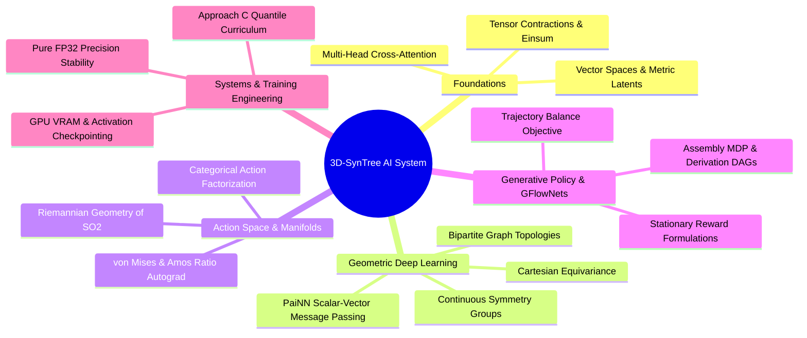

## Modular Structure

| Module | Core Subject | Target Systems in 3D-SynTree |
| :--- | :--- | :--- |
| [[0. Advanced Tensor Algebra MOC\|01. Tensor Algebra]] | Strides, Contractions, Autograd | Dynamic sub-graph indexing, memory layouts |
| [[0. Representation Learning MOC\|02. Representation Learning]] | Embeddings, Johnson-Lindenstrauss | 2138-D `pharm3d` to 256-D QR projection |
| [[0. Attention and Transformers MOC\|03. Attention & Transformers]] | Cross-Attention, Pre-LN Decoders | Handle-conditioned pocket decoder |
| [[0. Graph Neural Networks MOC\|04. Graph Neural Networks]] | Spatial GNNs, Message Passing | Inter-atomic radius graphs, PyG collation |
| [[0. Geometric Deep Learning MOC\|05. Geometric Deep Learning]] | Lie Groups, $\mathrm{SE}(3)$ Equivariance | Rigid frame rotational symmetry |
| [[0. Equivariant Architectures MOC\|06. Equivariant Architectures]] | PaiNN, Bipartite Graphs | Joint pocket-ligand backbone (`BipartitePaiNN`) |
| [[0. Directional Statistics MOC\|07. Directional Statistics]] | $\mathrm{SO}(2)$ Manifolds, von Mises | Dihedral heads, Amos' continued fraction autograd |
| [[0. GFlowNets and Generative Modeling MOC\|08. GFlowNets & MDPs]] | Trajectory Balance, DAG Semantics | Stage-2 assembly policy, reward design |
| [[0. Training Dynamics MOC\|09. Training Dynamics]] | Multi-Task Losses, Curriculum | Approach C quantile scheduling, milestones |
| [[0. Numerical Analysis and GPU Engineering MOC\|10. GPU Engineering]] | IEEE 754, Memory Topologies, FP32 | Eliminating float16 GradScaler collapse on T4 |

---

### `00. Master Index and System Map/1. Post-CNN Learning Roadmap and Prerequisites.md`

# 1. Post-CNN Learning Roadmap and Prerequisites

> [!abstract] Scope and Trajectory
> This document assumes proficiency with Multilayer Perceptrons (MLPs), backpropagation, stochastic gradient descent (SGD/Adam), and standard 2D Convolutional Neural Networks (CNNs). It plots the linear and branching pedagogical paths required to master continuous 3D geometric deep learning and discrete flow matching.

## The Cognitive Gap: From 2D Pixels to Geometric Graphs

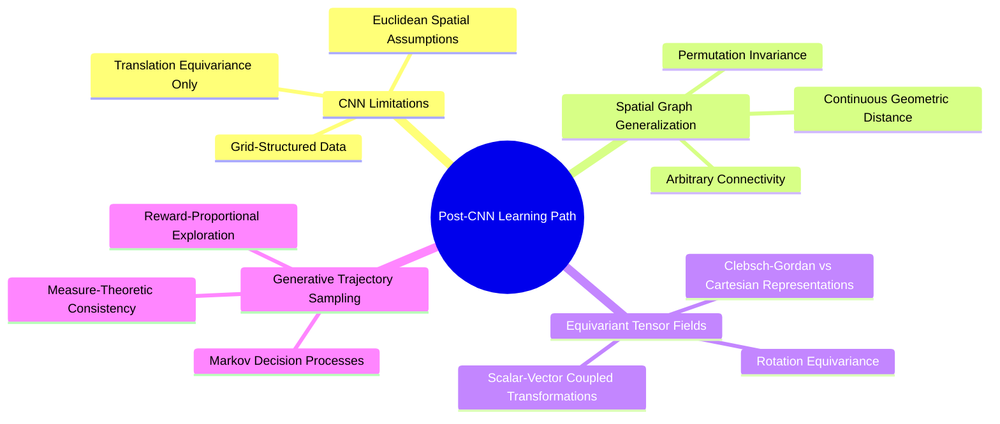

### Critical Concept Dependencies

1. **Pixel Grids vs. Relational Graphs**:
   In CNNs, spatial locality is implicitly defined by array indices $(i, j)$ over a regular lattice. In 3D molecular structures, positional coordinates $\mathbf{x}_i \in \mathbb{R}^3$ are continuous variables, and topology is defined by dynamically constructed interaction radii rather than static grid kernels.
2. **Translation Equivariance vs. Euclidean Group $\mathrm{SE}(3)$ Equivariance**:
   CNNs achieve translation equivariance through spatial parameter sharing. Molecular systems require equivariance to the full Special Euclidean group $\mathrm{SE}(3)$: transformations combining 3D continuous translations $\mathbf{t} \in \mathbb{R}^3$ and 3D rotations $\mathbf{R} \in \mathrm{SO}(3)$.
3. **Single Supervised Loss vs. Trajectory Flow Balance**:
   Supervised classification optimizes cross-entropy on static samples. GFlowNets optimize flow consistency equations over directed acyclic graphs (DAGs), ensuring the probability of generating a complete discrete artifact is proportional to an unnormalized scalar reward function $R(x)$.

---

## 01. Advanced Tensor Algebra and Computational Graphs

### `01. Advanced Tensor Algebra and Computational Graphs/0. Advanced Tensor Algebra MOC.md`

# 0. Advanced Tensor Algebra MOC

> [!abstract] Module Overview
> Mathematical foundations and low-level implementations of multi-dimensional array operations, strided memory access, differential tensor calculus, and custom autograd operators within PyTorch.

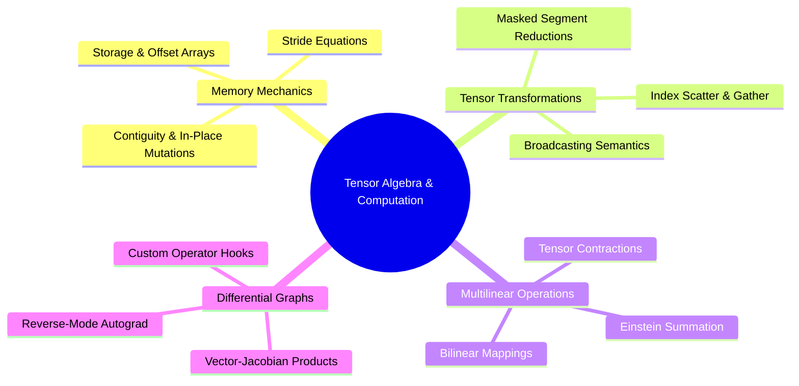

## Detailed Chapters

- **Chapter 1. Tensor Geometries and Strides**
  - [[1. Memory Layouts Contiguity and Strides]]
  - [[2. Broadcasting Rules and Dimension Semantics]]
  - [[3. Advanced Tensor Slicing and Scatter-Gather Operations]]
- **Chapter 2. Contractions and Autograd Calculus**
  - [[1. Einstein Summation and Multilinear Contractions]]
  - [[2. Vectorized Computational Graphs and Jacobians]]
  - [[3. Custom Autograd Function Design and Backward Hooks]]

---

### `01. Advanced Tensor Algebra and Computational Graphs/Chapter 1. Tensor Geometries and Strides/1. Memory Layouts Contiguity and Strides.md`

# 1. Memory Layouts Contiguity and Strides

> [!abstract] Mathematical Core
> A tensor $\mathbf{T} \in \mathbb{R}^{d_0 \times d_1 \times \dots \times d_{k-1}}$ is an abstract multi-dimensional mapping stored in physical hardware as a flat, one-dimensional block of contiguous memory. The layout is completely parameterized by a base pointer, a shape tuple $\mathbf{s} = (d_0, \dots, d_{k-1})$, and a stride tuple $\mathbf{\sigma} = (\sigma_0, \dots, \sigma_{k-1})$.

## 1. What It Is

In modern deep learning frameworks, physical random-access memory (RAM and VRAM) is organized linearly. Memory addresses are sequential integers. A tensor's multi-dimensional coordinate vector $\mathbf{i} = (i_0, i_1, \dots, i_{k-1})$ is mapped to an offset $O(\mathbf{i})$ relative to a base memory pointer via the fundamental stride equation:

$$O(\mathbf{i}) = \sum_{j=0}^{k-1} i_j \cdot \sigma_j$$

where $\sigma_j$ represents the **stride** along dimension $j$—the number of scalar memory cells that must be traversed to advance by one unit along index $i_j$.

```text
Logical 2D View [2, 3]:
[[a, b, c],
 [d, e, f]]

Physical Memory Layout (Row-Major / C-Contiguous):
Offset:    0    1    2    3    4    5
Element:   a    b    c    d    e    f
Strides:  (3, 1)  ->  Moving 1 row steps 3 elements; moving 1 col steps 1 element.
```

A tensor is **C-contiguous** (row-major) if the strides satisfy the recursive relation:

$$\sigma_{k-1} = 1, \quad \sigma_j = \sigma_{j+1} \cdot d_{j+1} = \prod_{m=j+1}^{k-1} d_m$$

## 2. Why It Exists

Tensors must support view manipulations—such as transpositions, slicing, squeezing, and reshaping—without copying underlying data buffers in memory. If transposing a matrix required moving every byte in physical memory, structural permutations would become computationally prohibitive $O(N)$ operations.

By altering only the stride tuple $\mathbf{\sigma}$ and the shape tuple $\mathbf{s}$, operations like `.transpose()`, `.view()`, and `.permute()` run in $O(1)$ constant time. However, this creates **non-contiguous** tensors where adjacent logical indices no longer map to adjacent physical memory locations.

## 3. How It Works

### 3.1 Transposition and Non-Contiguity Mechanics

Consider a matrix $\mathbf{A} \in \mathbb{R}^{3 \times 4}$ with row-major strides $\mathbf{\sigma} = (4, 1)$:

$$\mathbf{A} = \begin{bmatrix} 
a_{00} & a_{01} & a_{02} & a_{03} \\ 
a_{10} & a_{11} & a_{12} & a_{13} \\ 
a_{20} & a_{21} & a_{22} & a_{23} 
\end{bmatrix}$$

Physical memory sequence:
$$\text{idx: } 0 \to a_{00}, \; 1 \to a_{01}, \; 2 \to a_{02}, \; 3 \to a_{03}, \; 4 \to a_{10}, \dots, 11 \to a_{23}$$

Applying a transpose operation $\mathbf{B} = \mathbf{A}^T$:
- New shape: $\mathbf{s}_B = (4, 3)$
- New strides: $\mathbf{\sigma}_B = (1, 4)$

The physical memory buffer is untouched. To access $\mathbf{B}[1, 2]$:
$$O(1, 2) = 1 \cdot \sigma_0^B + 2 \cdot \sigma_1^B = 1 \cdot 1 + 2 \cdot 4 = 9$$
In the original array $\mathbf{A}$, offset 9 corresponds to:
$$9 = 2 \cdot 4 + 1 \cdot 1 \implies \mathbf{A}[2, 1]$$
Mathematically, $\mathbf{B}[1, 2] \equiv \mathbf{A}[2, 1]$. However, $\mathbf{B}$ is no longer C-contiguous because advancing along the trailing dimension (columns) requires a stride of 4 rather than 1.

### 3.2 Consequences for CUDA Kernel Execution

Graphics processing units achieve maximum bandwidth when threads within a warp (32 parallel threads) access contiguous physical memory addresses simultaneously—a hardware process known as **memory coalescing**.

When a custom CUDA kernel or a PyTorch primitive attempts to execute over a non-contiguous tensor:
1. Coalescing fails, causing the GPU memory controller to serialize requests into multiple independent memory transactions.
2. Vectorized assembly instructions (e.g., `LDG.E.128`, loading 128 bits at once) fail to compile, falling back to slow scalar reads (`LDG.E.32`).
3. Methods like `.view()` raise explicit runtime exceptions (`RuntimeError: input is not contiguous`) because `.view()` requires an unambiguous mapping where a flattened dimension corresponds directly to a contiguous slice of linear memory.

Calling `.contiguous()` forces a physical reallocation: a new linear memory buffer is allocated, and elements are copied to restore standard row-major strides.

## 4. What It Consists Of

- **Base Pointer (`storage_offset`)**: Memory address in bytes marking the start of the tensor's data.
- **Storage Array (`Storage`)**: The underlying flat 1D array of untyped or typed raw bytes allocated on the host CPU or device GPU.
- **Shape (`Size`)**: A tuple of integers $(d_0, d_1, \dots, d_{k-1})$ specifying logical dimensionality.
- **Strides**: A tuple of integers $(\sigma_0, \sigma_1, \dots, \sigma_{k-1})$ specifying element step counts.

## 5. What You Must Understand

> [!warning] Pitfall: Silent Performance Degeneration via Involuntary Clones
> When operations like `.reshape()` are called on non-contiguous memory, PyTorch silently triggers a memory allocation and deep copy equivalent to calling `.contiguous().view()`. If placed within an inner training loop, this causes steady GPU VRAM allocation spikes, garbage collection pressure, and memory fragmentation.

> [!tip] Memory Hook
> **Strides dictate the jump; shape dictates the count.** If a stride along the final dimension is not 1, your tensor cannot use coalesced memory transactions on CUDA.

## 6. Prerequisites

- Basic multi-dimensional array concepts (matrices, vectors).

## 7. Project Connection

In `3D-SynTree`, heterogeneous graphs combine variable-sized pocket clouds and growing ligand clouds. In `syntree/models/policy.py`, node representations are dynamically split and gathered:
```python
perm = torch.argsort(union_batch, stable=True)
local_idx = torch.empty_like(local_idx_sorted)
local_idx[perm] = local_idx_sorted
padded[union_batch, local_idx] = joint_s
```
Manipulating sub-graph batches requires direct management of contiguity before attention layers to prevent memory leaks and maintain compatibility with CUDA kernels in PyTorch's native `MultiheadAttention`.

## 8. Required Depth

**Essential**: Non-contiguous tensors in custom autograd backward passes will directly crash custom PyTorch operations.

## 9. Further Dependencies

- [[2. Broadcasting Rules and Dimension Semantics]]
- [[3. Advanced Tensor Slicing and Scatter-Gather Operations]]

## Concept Mind Map

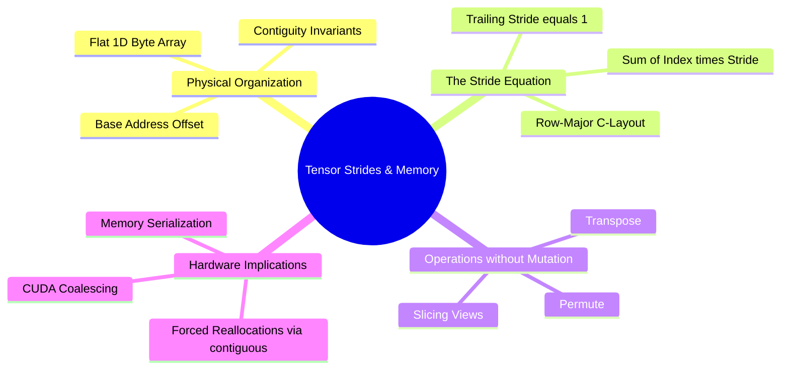

---

### `01. Advanced Tensor Algebra and Computational Graphs/Chapter 1. Tensor Geometries and Strides/2. Broadcasting Rules and Dimension Semantics.md`

# 2. Broadcasting Rules and Dimension Semantics

> [!abstract] Mathematical Core
> Broadcasting is a set of formal algebraic rules allowing element-wise tensor operations between operands of differing shapes without allocating redundant memory buffers. It works by virtually duplicating dimensions using a stride of 0.

## 1. What It Is

When two tensors $\mathbf{A} \in \mathbb{R}^{s_A}$ and $\mathbf{B} \in \mathbb{R}^{s_B}$ participate in an element-wise binary operation $f(\mathbf{A}, \mathbf{B})$ (such as addition, multiplication, or comparisons), their shape tuples must be aligned according to standard broadcasting rules.

Two dimensions $d_A$ and $d_B$ are compatible if:
1. They are equal ($d_A = d_B$), or
2. One of them is 1 ($d_A = 1$ or $d_B = 1$).

If the tensors have differing numbers of dimensions (ranks), the shape of the lower-rank tensor is prepended with 1s until both ranks match.

## 2. Why It Exists

In geometric deep learning and pairwise potential calculations, we frequently evaluate functions across all pairs of points:

$$\mathbf{D}_{ij} = \|\mathbf{x}_i - \mathbf{y}_j\|_2 \quad \forall i \in \{1, \dots, N\}, \; j \in \{1, \dots, M\}$$

Without broadcasting, one would have to explicitly tile and copy $\mathbf{x}$ across $M$ columns and $\mathbf{y}$ across $N$ rows, requiring $O(N \cdot M \cdot 3)$ physical memory allocations. Broadcasting performs this pairing in $O(1)$ memory by setting the stride of the expanded dimension to 0.

## 3. How It Works

### 3.1 The Zero-Stride Trick

Suppose we have a vector $\mathbf{x} \in \mathbb{R}^N$ with shape $(N,)$ and stride $(1,)$. We unsqueeze it to shape $(N, 1)$ with strides $(1, 1)$. We wish to compute the difference matrix against $\mathbf{y} \in \mathbb{R}^M$ of shape $(1, M)$ and strides $(M, 1)$.

```text
Logical Shapes:
  x: [N, 1]
  y: [1, M]
Target Broadcast Shape: [N, M]

Physical Execution:
  x is expanded to [N, M] with strides (1, 0)
  y is expanded to [N, M] with strides (0, 1)
```

For $\mathbf{x}$, the stride along the column axis is set to **0**. Evaluating the stride offset formula:

$$O(i, j) = i \cdot \sigma_0 + j \cdot \sigma_1 = i \cdot 1 + j \cdot 0 = i$$

No matter what column index $j$ is requested, the pointer reads from the exact same memory address $i$. The hardware registers read the single physical value of $\mathbf{x}[i]$ across all $j$, saving memory and utilizing cache lines effectively.

### 3.2 Formal Algebraic Tracing: Pairwise Cartesian Displacements

Given:
- A set of ligand atoms: $\mathbf{X}_L \in \mathbb{R}^{N \times 3}$
- A set of pocket atoms: $\mathbf{X}_P \in \mathbb{R}^{M \times 3}$

We want the directional displacement tensor $\mathbf{\Delta} \in \mathbb{R}^{N \times M \times 3}$ where $\mathbf{\Delta}_{ij} = \mathbf{X}_{L, i} - \mathbf{X}_{P, j}$.

```python
# Shapes:
# X_L: [N, 3] -> unsqueeze(1) -> [N, 1, 3]
# X_P: [M, 3] -> unsqueeze(0) -> [1, M, 3]

delta = X_L.unsqueeze(1) - X_P.unsqueeze(0) # Output shape: [N, M, 3]
```

Dimension alignment steps:
1. `X_L.unsqueeze(1)` produces shape $(N, 1, 3)$, strides $(\sigma_0, 0, \sigma_1)$.
2. `X_P.unsqueeze(0)` produces shape $(1, M, 3)$, strides $(0, \sigma_0, \sigma_1)$.
3. The subtraction operator aligns dimensions from right to left:
   - Dim 2: size 3 vs size 3 $\implies$ equal (compatible).
   - Dim 1: size 1 vs size $M \implies$ one is 1 (compatible, expands to $M$).
   - Dim 0: size $N$ vs size 1 $\implies$ one is 1 (compatible, expands to $N$).
4. The output shape is $(N, M, 3)$.

## 4. What It Consists Of

- **Dimension Right-Alignment**: Shapes are paired from the trailing (rightmost) dimension backward.
- **Singleton Dimensions**: Any dimension of length 1 that can be expanded to size $k > 1$.
- **Stride Zeroing**: The mathematical mechanism that enables reading from an un-replicated scalar cell across an arbitrary logical axis.

## 5. What You Must Understand

> [!warning] Pitfall: Accidental Outer Products via Missing Dimensions
> If two vectors of intended length $N$ are passed as shape $(N, 1)$ and shape $(N,)$, operating on them without matching dimensions yields an $(N, N)$ matrix rather than an $(N,)$ vector. This silent failure expands computational memory from $O(N)$ to $O(N^2)$, which can trigger an unexpected CUDA Out-of-Memory (OOM) error.

```python
a = torch.randn(10000, 1)
b = torch.randn(10000)
c = a + b # Unintended broadcasting -> Allocates [10000, 10000] matrix (~400 MB)!
```

## 6. Prerequisites

- [[1. Memory Layouts Contiguity and Strides]]

## 7. Project Connection

In `syntree/chemistry/conformer.py`, the soft-core Lennard-Jones calculation uses broadcasting to compute distances between all pairs of atoms:
```python
diff = lig[:, None, :] - poc[None, :, :] # [N_lig, 1, 3] - [1, N_poc, 3] -> [N_lig, N_poc, 3]
r = np.sqrt((diff ** 2).sum(-1)).clip(min=1e-6)
sigma = ligand_vdw[:, None] + pocket_vdw[None, :] # [N_lig, 1] + [1, N_poc] -> [N_lig, N_poc]
```

## 8. Required Depth

**Essential**: All pairwise potentials, radius graph constructions, and attention score matrices rely on broadcasting mechanics.

## 9. Further Dependencies

- [[3. Advanced Tensor Slicing and Scatter-Gather Operations]]
- [[1. Einstein Summation and Multilinear Contractions]]

## Concept Mind Map

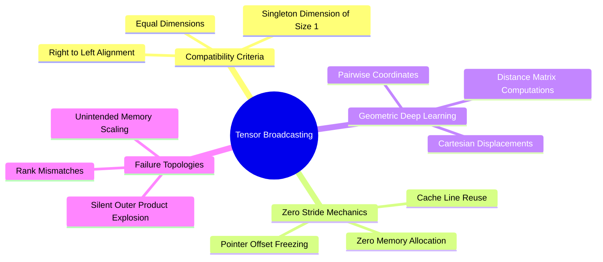

---

### `01. Advanced Tensor Algebra and Computational Graphs/Chapter 1. Tensor Geometries and Strides/3. Advanced Tensor Slicing and Scatter-Gather Operations.md`

# 3. Advanced Tensor Slicing and Scatter-Gather Operations

> [!abstract] Mathematical Core
> Graph neural networks operate on non-grid, sparse, and irregular topologies. Instead of standard dense matrix operations, they rely on non-contiguous memory access primitives: index-select, masked scatter, and atomic reductions (scatter-add, scatter-reduce).

## 1. What It Is

When processing batched graphs where each graph contains a varying number of nodes $N_b$ and edges $E_b$, arrays cannot be organized into uniform rectangular tensors without wasteful padding.

Instead, all nodes are packed into a single continuous tensor $\mathbf{X} \in \mathbb{R}^{N_{\text{total}} \times d}$ where $N_{\text{total}} = \sum_b N_b$. To route representations through topological connections, we use **scatter-gather operations**:
- **Gather (`index_select`)**: Pulls elements from a source tensor based on an integer index map.
- **Scatter (`scatter_add_`, `index_add_`)**: Accumulates elements into a destination tensor at specified indices.

$$\mathbf{Y}[i] = \bigoplus_{j \text{ such that } \text{index}[j] = i} \mathbf{X}[j]$$

where $\bigoplus$ represents a reduction operator (sum, mean, max, or min).

## 2. Why It Exists

In a standard batch of molecules, Molecule A may have 12 atoms, while Molecule B has 48. Traditional mini-batching would require padding Molecule A with 36 dummy atoms. This approach introduces two problems:
1. Wasted computation on dummy nodes in attention layers ($O(N^2)$ scaling).
2. Masked computations that can suffer from numerical errors if dummy values are not handled correctly.

By packing all atoms into a unified continuous tensor and tracking connectivity via an edge index list $\mathbf{E} \in \mathbb{N}^{2 \times E_{\text{total}}}$, computation runs only on physically real atoms and bonds.

## 3. How It Works

### 3.1 Gather Mechanics

Let $\mathbf{X} \in \mathbb{R}^{N \times d}$ denote node features, and let $\mathbf{E}_{\text{src}} \in \mathbb{N}^E$ define the source indices of directed edges. The gather operation produces edge-wise source features:

$$\mathbf{X}_{\text{edges}} = \mathbf{X}[\mathbf{E}_{\text{src}}] \in \mathbb{R}^{E \times d}$$

Physical memory tracking:
For each edge $e \in \{0, \dots, E-1\}$, the hardware reads the integer node index $k = \mathbf{E}_{\text{src}}[e]$ and loads the $d$ feature values stored at $\mathbf{X}[k]$. This constitutes an indirect, irregular read.

### 3.2 Scatter-Add Mechanics and the Multi-Thread Write Race

The inverse operation aggregates messages along incoming edges back into destination nodes:

$$\mathbf{S}[i] = \sum_{e \mid \mathbf{E}_{\text{dst}}[e] = i} \mathbf{M}[e]$$

In multi-threaded architectures (CUDA warps), multiple edges often point to the same destination node simultaneously ($e_1 \to \text{node } 4$, $e_2 \to \text{node } 4$). If thread 1 and thread 2 write to $\mathbf{S}[4]$ concurrently, a **write race condition** occurs:

```text
Thread 1: Read S[4] (0.0) -> Add M[e1] (1.5) -> Write S[4] (1.5)
Thread 2: Read S[4] (0.0) -> Add M[e2] (2.0) -> Write S[4] (2.0)  [OVERWRITES THREAD 1!]
```

To prevent data loss, the GPU must use hardware-level **atomic operations** (`atomicAdd`):

```cpp
// CUDA Device Implementation
atomicAdd(&destination_pointer[node_index * d + feature_idx], message_value);
```

Atomic operations serialize conflicting writes, ensuring mathematical correctness at the cost of memory pipeline stalls when node degrees are high.

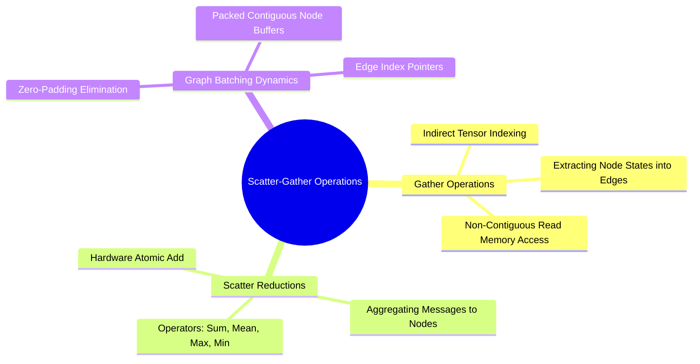

## 4. What It Consists Of

- **Index Tensor**: A 1D or 2D array of integers specifying source or destination coordinates.
- **Source Feature Tensor**: The tensor containing raw states to be gathered or scattered.
- **Segment Accumulator**: The output tensor containing aggregated values.
- **Atomic Execution Primitives**: Low-level instruction sets ensuring thread-safe write operations on GPU memory.

## 5. What You Must Understand

> [!warning] Pitfall: Non-Deterministic Floating-Point Floating-Sum Reductions
> Floating-point addition is non-associative: $(a + b) + c \neq a + (b + c)$ due to rounding errors. Because the order of `atomicAdd` instructions depends on hardware thread scheduling, repeating the exact same forward pass with `scatter_add_` can yield slightly different results at the level of precision limits ($\approx 10^{-6}$ in FP32).

## 6. Prerequisites

- [[1. Memory Layouts Contiguity and Strides]]

## 7. Project Connection

In `syntree/models/equivariant.py`, the core PaiNN interaction message aggregation relies on PyTorch's native `index_add_`:
```python
agg_s = torch.zeros_like(scalar)
agg_v = torch.zeros_like(vector)
agg_s.index_add_(0, row, msg_s)
agg_v.index_add_(0, row, msg_v)
```
This aggregates messages from all directed edges targeting atom `row`, forming the foundation of the physical interaction layers.

## 8. Required Depth

**Essential**: This operation is the core computational primitive used in all Graph Neural Networks and message-passing layers.

## 9. Further Dependencies

- [[1. The Message-Passing Neural Network Formalism]]
- [[1. PaiNN Interaction Block and Directional Message Passing]]

---

### `01. Advanced Tensor Algebra and Computational Graphs/Chapter 2. Contractions and Autograd Calculus/1. Einstein Summation and Multilinear Contractions.md`

# 1. Einstein Summation and Multilinear Contractions

> [!abstract] Mathematical Core
> Einstein summation notation (`einsum`) provides a compact, index-based language for multi-dimensional linear and multilinear tensor operations. It covers matrix multiplications, trace evaluations, batched inner products, and complex tensor contractions using a concise string format.

## 1. What It Is

The Einstein summation convention states that whenever an index variable appears twice in a single multilinear term and is not otherwise defined, it implies a summation over all possible values of that index:

$$c = a_i b_i \equiv \sum_{i} a_i b_i$$

In deep learning frameworks, this convention is generalized into the `einsum` operator. Input operands and output structures are specified by strings of alphabetical labels corresponding to axes:

```text
"bhd,khd->bhk"
 \_/  \_/   \_/
  Q    K   Attention Logits
```

Repeated indices not present in the output signature (in this case, index `d`) are summed over, performing an implicit tensor contraction.

## 2. Why It Exists

Complex network architectures often process high-rank tensors, such as:
- Multi-head attention matrices: $[B, H, N, d]$
- Directional vector fields: $[N, 3, d]$
- Bivector projections: $[B, N, M, 3, d]$

Expressing operations on these shapes using combinations of `.permute()`, `.transpose()`, `.unsqueeze()`, and `.matmul()` is difficult to read and error-prone. More importantly, chained intermediate operations can allocate temporary tensors, increasing memory overhead. An optimized `einsum` engine parses the full contraction graph and executes it via an optimized BLAS call or a fused kernel, avoiding unnecessary memory allocations.

## 3. How It Works

### 3.1 Trace of Matrix-Vector and Tensor-Vector Contraction Forms

| Mathematical Operation | Classical Index Notation | PyTorch `einsum` Notation | Output Shape |
| :--- | :--- | :--- | :--- |
| Inner Product (Dot) | $c = \sum_i u_i v_i$ | `torch.einsum('i,i->', u, v)` | Scalar |
| Outer Product | $C_{ij} = u_i v_j$ | `torch.einsum('i,j->ij', u, v)` | $[N, M]$ |
| Matrix-Vector Product | $y_i = \sum_j A_{ij} x_j$ | `torch.einsum('ij,j->i', A, x)` | $[N]$ |
| Batch Matrix Multiplication | $C_{bij} = \sum_k A_{bik} B_{bkj}$ | `torch.einsum('bik,bkj->bij', A, B)`| $[B, N, M]$ |
| Matrix Trace | $t = \sum_i A_{ii}$ | `torch.einsum('ii->', A)` | Scalar |
| Batch Attention Scores | $S_{bhk} = \sum_d Q_{bhd} K_{khd}$ | `torch.einsum('bhd,khd->bhk', Q, K)`| $[B, H, K]$ |

### 3.2 Parsing the Attention Contraction

Consider the synthon selection cross-attention head in `syntree/models/synthon_head.py`:

```python
# q:      [B, num_heads, head_dim] -> Label: "bhd"
# keys:   [K, num_heads, head_dim] -> Label: "khd"
scores = torch.einsum("bhd,khd->bhk", q, keys) / math.sqrt(self.head_dim)
```

1. **Dimensional Correspondence**:
   - `b`: Batch size index
   - `h`: Number of attention heads
   - `d`: Dimensionality of an individual attention head (`head_dim`)
   - `k`: Number of candidate synthons in the catalog
2. **Analysis of the Contraction**:
   Index `d` appears in both input operands but is absent from the output signature `bhk`. This tells the engine to compute the sum over all channels in index `d`:

$$S[b, h, k] = \frac{1}{\sqrt{d}} \sum_{d=0}^{\text{head\_dim}-1} q[b, h, d] \cdot \text{keys}[k, h, d]$$

This single operation evaluates the alignment between query states and all $K$ candidate synthons across every attention head in parallel.

## 4. What It Consists Of

- **Equation String**: Two segments separated by `->`. The left defines operand dimensions, while the right defines the output shape.
- **Summation Indices**: Characters present on the left of `->` but omitted on the right are summed over.
- **Free Indices**: Characters preserved on both sides of `->`, which define the axes of the resulting tensor.

## 5. What You Must Understand

> [!warning] Pitfall: Sub-Optimal Contraction Paths
> In multi-tensor operations (e.g., `einsum('ij,jk,kl->il', A, B, C)`), contracting from left to right can scale as $O(N^4)$, whereas an optimal contraction path runs in $O(N^3)$. For expressions with three or more operands, always use `optimize=True` to allow the engine to find the most efficient path.

## 6. Prerequisites

- [[1. Memory Layouts Contiguity and Strides]]
- [[2. Broadcasting Rules and Dimension Semantics]]

## 7. Project Connection

In `syntree/models/synthon_head.py`, both the query-key matching and attention-value aggregations are implemented using `einsum`:
```python
scores = torch.einsum("bhd,khd->bhk", q, keys) / math.sqrt(self.head_dim)
context = torch.einsum("bhk,khd->bhd", attn, vals)
```
This compact formulation maps directly to optimized matrix multiplications on the GPU, avoiding unnecessary tensor dimension permutations.

## 8. Required Depth

**Essential**: `einsum` is used to implement cross-attention mechanisms and tensor contractions throughout the project's models.

## 9. Further Dependencies

- [[1. Scaled Dot-Product Attention as Soft Dictionary Lookup]]
- [[2. Vectorized Computational Graphs and Jacobians]]

---

### `01. Advanced Tensor Algebra and Computational Graphs/Chapter 2. Contractions and Autograd Calculus/2. Vectorized Computational Graphs and Jacobians.md`

# 2. Vectorized Computational Graphs and Jacobians

> [!abstract] Mathematical Core
> Modern deep learning frameworks implement reverse-mode automatic differentiation. Rather than computing and storing the full Jacobian matrix $\mathbf{J} \in \mathbb{R}^{M \times N}$, which is often too large to fit in memory, the engine calculates the **Vector-Jacobian Product (VJP)** directly during the backward pass.

## 1. What It Is

Let $\mathbf{f}: \mathbb{R}^N \to \mathbb{R}^M$ represent a vectorized forward mapping executed by a layer within a neural network:

$$\mathbf{y} = \mathbf{f}(\mathbf{x})$$

The complete derivative of this mapping is the **Jacobian matrix** $\mathbf{J} \in \mathbb{R}^{M \times N}$, whose entries are defined as:

$$\mathbf{J}_{ij} = \frac{\partial f_i}{\partial x_j}$$

In reverse-mode automatic differentiation, the objective is to compute the gradient of a final scalar loss $\mathcal{L} \in \mathbb{R}$ with respect to the input variables $\mathbf{x}$. Given the incoming gradient vector from downstream layers $\mathbf{v} = \nabla_{\mathbf{y}} \mathcal{L} \in \mathbb{R}^M$, the chain rule is expressed as:

$$\nabla_{\mathbf{x}} \mathcal{L} = \mathbf{v}^T \mathbf{J} = \sum_{i=1}^M v_i \frac{\partial f_i}{\partial \mathbf{x}}$$

This product $\mathbf{v}^T \mathbf{J}$ is the **Vector-Jacobian Product (VJP)**.

## 2. Why It Exists

Consider an intermediate feature map of size $[B, N, d] = [16, 500, 256]$, which contains $2 \times 10^6$ parameters. 

If a layer maps this tensor to another tensor of the same size, the full Jacobian matrix $\mathbf{J}$ would contain:

$$\mathbf{J} \in \mathbb{R}^{(2 \times 10^6) \times (2 \times 10^6)} \implies 4 \times 10^{12} \text{ elements}$$

In FP32 precision, storing this matrix would require **16 Terabytes of memory** for a single layer, quickly causing an out-of-memory error on any hardware.

Reverse-mode autograd avoids this problem by never instantiating the full Jacobian matrix $\mathbf{J}$. Instead, it computes the action of the transposed Jacobian directly on the incoming gradient vector $\mathbf{v}$, reducing memory complexity from $O(M \cdot N)$ to $O(N)$.

## 3. How It Works

### 3.1 The Computational DAG (Directed Acyclic Graph)

During the forward pass, PyTorch builds a dynamic directed acyclic graph (DAG) composed of `Node` objects (representing mathematical functions) and edges (representing data dependencies):
- Tensors with `requires_grad=True` act as leaf nodes.
- Each operation creates a new `Node` (subclass of `torch.autograd.Function`).
- Tensors needed for the backward pass are explicitly saved in the node's context using `ctx.save_for_backward()`.

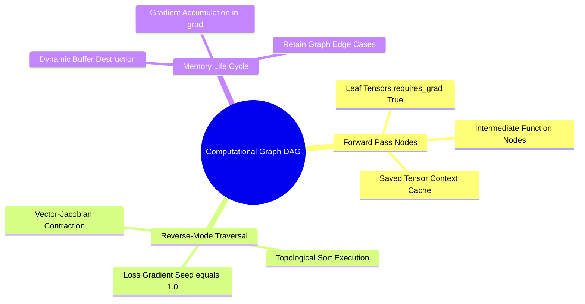

### 3.2 Mathematical Formulation of Vectorized VJPs

Let us derive the VJP for the non-singular safe norm implemented in `syntree/models/equivariant.py`:

$$y = f(\mathbf{x}) = \sqrt{\sum_{k=1}^3 x_k^2 + \epsilon^2} - \epsilon$$

Here, the mapping is $f: \mathbb{R}^3 \to \mathbb{R}^1$. The Jacobian is a $1 \times 3$ row vector:

$$\mathbf{J} = \begin{bmatrix} \frac{\partial y}{\partial x_1} & \frac{\partial y}{\partial x_2} & \frac{\partial y}{\partial x_3} \end{bmatrix} = \frac{\mathbf{x}^T}{\sqrt{\sum_{k=1}^3 x_k^2 + \epsilon^2}}$$

Given the incoming scalar gradient $v = \frac{\partial \mathcal{L}}{\partial y} \in \mathbb{R}^1$, the Vector-Jacobian Product is computed as:

$$\nabla_{\mathbf{x}} \mathcal{L} = v \cdot \mathbf{J} = v \cdot \frac{\mathbf{x}}{\sqrt{\|\mathbf{x}\|_2^2 + \epsilon^2}}$$

As $\mathbf{x} \to \mathbf{0}$, the limit of this product is well-behaved:

$$\lim_{\mathbf{x} \to \mathbf{0}} \nabla_{\mathbf{x}} \mathcal{L} = v \cdot \frac{\mathbf{0}}{\sqrt{0 + \epsilon^2}} = \mathbf{0}$$

This confirms that the gradient remains stable and bounded, avoiding the division-by-zero singularities that can occur with the standard Euclidean norm.

## 4. What It Consists Of

- **Forward Node**: The execution logic that computes outputs from input tensors.
- **Saved Context (`ctx`)**: An execution state cache that retains references to input or output activations needed during backpropagation.
- **Backward Node**: The reverse-mode function that takes the incoming gradient $\mathbf{v}$ and computes the VJP for each input.
- **Topological Traversal Engine**: An execution scheduler that traverses the computational graph in reverse topological order, accumulating gradients at each node.

## 5. What You Must Understand

> [!warning] Pitfall: Retaining Activation Tensors and Memory Leaks
> Calling `ctx.save_for_backward(t)` keeps a reference to the tensor `t` alive until the backward pass completes. If an operation saves an excessively large intermediate tensor that is not strictly needed for the VJP, it will unnecessarily consume VRAM throughout the forward pass. Save only the minimal set of tensors required to compute the gradient.

## 6. Prerequisites

- Multivariable differential calculus (partial derivatives, the gradient operator, and the chain rule).
- [[1. Einstein Summation and Multilinear Contractions]]

## 7. Project Connection

In `3D-SynTree`, evaluating the modified Bessel function ratio $\frac{I_1(\kappa)}{I_0(\kappa)}$ using naive autograd through an unrolled power series caused gradient explosions for $\kappa > 10$. To fix this, we implemented a custom `torch.autograd.Function` that bypasses the computational graph entirely. The backward pass evaluates the Vector-Jacobian Product using the closed-form Amos continued fraction approximation:
$$\nabla_{\kappa} \mathcal{L} = v \cdot \frac{\kappa}{0.5 + \sqrt{\kappa^2 + 2.25}}$$

## 8. Required Depth

**Essential**: Understanding how reverse-mode autograd works is required to write custom operators and prevent numerical instabilities during backpropagation.

## 9. Further Dependencies

- [[3. Custom Autograd Function Design and Backward Hooks]]
- [[1. The Amos Ratio Approximation and Gradient Stabilization]]

---

### `01. Advanced Tensor Algebra and Computational Graphs/Chapter 2. Contractions and Autograd Calculus/3. Custom Autograd Function Design and Backward Hooks.md`

# 3. Custom Autograd Function Design and Backward Hooks

> [!abstract] Mathematical Core
> When standard automatic differentiation through built-in PyTorch operations is numerically unstable, memory-inefficient, or mathematically undefined, we can write a custom `torch.autograd.Function`. This gives us direct, manual control over both the forward pass and the exact Vector-Jacobian Product computed during the backward pass.

## 1. What It Is

A custom `torch.autograd.Function` is a user-defined operator that extends PyTorch's automatic differentiation engine. It consists of two static methods:
- `forward(ctx, inputs, ...)`: Computes the operation's output and caches any tensors needed for backpropagation in the `ctx` context object. The forward pass runs inside an implicit `torch.no_grad()` context.
- `backward(ctx, grad_outputs, ...)`: Receives the incoming gradients with respect to the outputs ($\nabla_{\mathbf{y}} \mathcal{L}$) and manually returns the Vector-Jacobian Products with respect to each input ($\nabla_{\mathbf{x}} \mathcal{L}$).

```text
Forward Pass:
Inputs [x]  --->  [ forward() ]  ---> Outputs [y]
                       |
               (Saves state to ctx)

Backward Pass:
Gradients [dL/dx] <--- [ backward() ] <--- Gradients [dL/dy]
```

## 2. Why It Exists

Standard autograd tracks every low-level floating-point operation. While flexible, this approach can fail in deep learning models for three reasons:
1. **Numerical Instabilities in Intermediate Steps**: A composite function may have a stable, bounded mathematical derivative, but evaluating it via the chain rule across several operations can produce intermediate $\frac{0}{0}$ divisions or $\infty - \infty$ subtractions, resulting in `NaN` values.
2. **Computational and Memory Overhead**: Differentiating through an iterative numerical algorithm (such as a 20-step loop) saves the entire sequence of intermediate states, consuming significant memory.
3. **Analytic Simplicity**: When an operation has a known, closed-form analytic derivative, evaluating that formula directly in the backward pass is much faster and more accurate than tracing through individual operations.

## 3. How It Works

### 3.1 The Concrete Autograd Blueprint

```python
import torch

class NumericallyStableOperator(torch.autograd.Function):
    @staticmethod
    def forward(ctx, x: torch.Tensor, alpha: float) -> torch.Tensor:
        # 1. Forward computations run without autograd overhead
        y = torch.exp(x) / (torch.sum(torch.exp(x)) + alpha)
        
        # 2. Cache minimal tensor state needed for the backward pass
        ctx.save_for_backward(y)
        ctx.alpha = alpha  # Non-tensor attributes are saved directly on ctx
        
        return y

    @staticmethod
    def backward(ctx, grad_output: torch.Tensor) -> tuple:
        # 1. Retrieve cached tensors
        y, = ctx.saved_tensors
        alpha = ctx.alpha
        
        # 2. Compute the Vector-Jacobian Product analytically
        # Formula: grad_x = y * (grad_output - sum(grad_output * y))
        grad_x = y * (grad_output - (grad_output * y).sum(dim=-1, keepdim=True))
        
        # 3. Return gradients for each input argument in the forward pass.
        # Non-tensor inputs (like alpha) must return None.
        return grad_x, None
```

### 3.2 Backward Hooks

While custom autograd functions replace the entire forward and backward execution of an operator, **backward hooks** allow us to inspect or modify gradients as they flow through the computational graph during an ordinary backward pass.

```python
# Registering a hook on a Tensor to monitor or clamp gradients
def gradient_clamping_hook(grad: torch.Tensor) -> torch.Tensor:
    # Handle and replace non-finite gradients dynamically
    grad = torch.nan_to_num(grad, nan=0.0, posinf=1.0, neginf=-1.0)
    return grad.clamp(min=-5.0, max=5.0)

tensor_leaf = torch.randn(10, requires_grad=True)
handle = tensor_leaf.register_hook(gradient_clamping_hook)
```

## 4. What It Consists Of

- `ctx.save_for_backward(*tensors)`: The method used to cache tensors for backpropagation. Calling this on non-tensor objects will raise an error.
- `ctx.saved_tensors`: A tuple containing the cached tensors. Accessing this multiple times in the backward pass will unpack the same tensors.
- `grad_output`: The incoming gradient tensor from downstream layers. It always matches the shape and data type of the corresponding `forward()` output.
- `Non-Tensor Input Gradients`: If `forward()` takes non-tensor arguments or parameters that do not require gradients, `backward()` must explicitly return `None` in those positions.

## 5. What You Must Understand

> [!warning] Pitfall: In-Place Mutations Corrupt the `ctx` Cache
> Modifying a cached tensor in-place after returning it from `forward()` (e.g., `y.add_(1.0)`) silently changes the values stored in `ctx.saved_tensors`. The backward pass will then use these altered values to compute gradients, corrupting the gradient update without throwing an error.

```python
# This corrupts the computational graph:
out = CustomFunction.apply(x)
out.zero_() # Mutates the tensor in place!
loss = out.sum()
loss.backward() # Computes incorrect gradients using the zeroed tensor!
```

## 6. Prerequisites

- [[2. Vectorized Computational Graphs and Jacobians]]

## 7. Project Connection

In Issue #8, the von Mises loss calculation in `syntree/models/torsion_head.py` failed due to numerical overflow when evaluating the log modified Bessel function $\log I_0(\kappa)$ via series unrolling. We resolved this by implementing a custom autograd operator:
```python
class LogBesselI0(torch.autograd.Function):
    @staticmethod
    def forward(ctx, kappa: torch.Tensor) -> torch.Tensor:
        ctx.save_for_backward(kappa)
        # Stable forward evaluation via asymptotic expansion for large kappa
        return stable_bessel_log(kappa)

    @staticmethod
    def backward(ctx, grad_output: torch.Tensor) -> torch.Tensor:
        kappa, = ctx.saved_tensors
        # Closed-form VJP using Amos' continued fraction approximation
        r = kappa / (0.5 + torch.sqrt(kappa * kappa + 2.25))
        return grad_output * r
```

## 8. Required Depth

**Essential**: Custom autograd operators are required to stabilize numerical evaluations in the policy's loss functions.

## 9. Further Dependencies

- [[1. The Amos Ratio Approximation and Gradient Stabilization]]
- [[2. The von Mises Distribution on S1]]

---

## 02. Representation Learning and Latent Metric Spaces

### `02. Representation Learning and Latent Metric Spaces/0. Representation Learning MOC.md`

# 0. Representation Learning MOC

> [!abstract] Module Overview
> Mathematical and algorithmic principles of projecting high-dimensional chemical and topological descriptors into continuous metric spaces, preserving distances, and constructing latent embeddings.

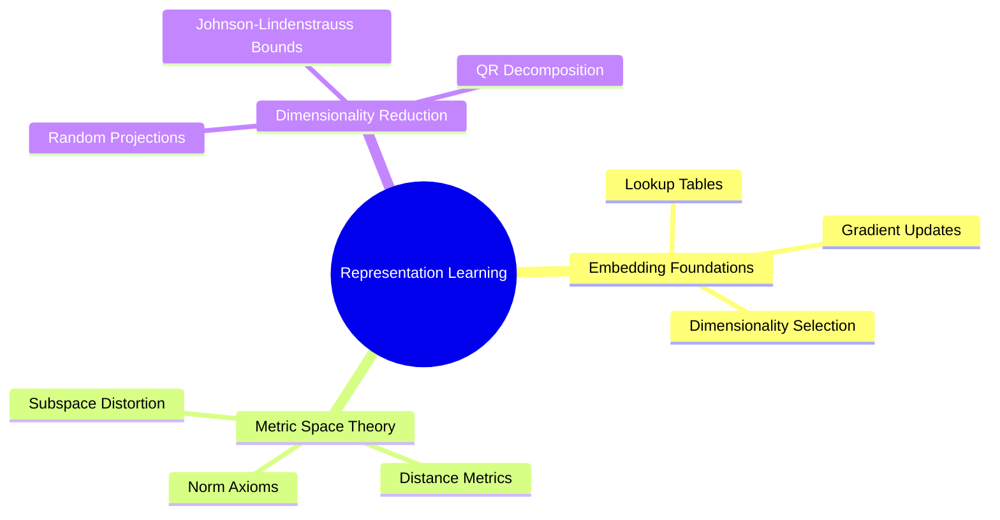

## Detailed Chapters

- **Chapter 1. Discrete Embedding Spaces**
  - [[1. High-Dimensional Lookup Tables and Gradients]]
  - [[2. Categorical vs Continuous Latent Geometries]]
  - [[3. Metric Spaces Distance Metrics and Norms]]
- **Chapter 2. Dimensionality Reduction and Random Projections**
  - [[1. The Johnson-Lindenstrauss Lemma]]
  - [[2. QR Decomposition and Orthonormal Projection Operators]]
  - [[3. Norm Preservation and Distortion Bounds in Practice]]

---

### `02. Representation Learning and Latent Metric Spaces/Chapter 1. Discrete Embedding Spaces/1. High-Dimensional Lookup Tables and Gradients.md`

# 1. High-Dimensional Lookup Tables and Gradients

> [!abstract] Mathematical Core
> An embedding layer is a linear mapping from a discrete one-hot categorical space $\mathbf{e}_k \in \{0, 1\}^V$ to a continuous latent representation $\mathbf{z} \in \mathbb{R}^d$. It is implemented as a weight matrix $\mathbf{W} \in \mathbb{R}^{V \times d}$ paired with a fast array indexing operation.

## 1. What It Is

Let $V$ denote the vocabulary size (number of categories, such as the 50,000 candidate building blocks in our chemical catalog). A discrete category index $k \in \{0, \dots, V-1\}$ can be represented as a standard basis vector $\mathbf{e}_k \in \mathbb{R}^V$, where the $k$-th entry is 1 and all other entries are 0.

An embedding lookup evaluates the matrix-vector product:

$$\mathbf{z} = \mathbf{e}_k^T \mathbf{W} = \mathbf{W}[k, :] \in \mathbb{R}^d$$

Instead of performing an expensive sparse matrix multiplication of size $[1, V] \times [V, d]$, the operation retrieves row $k$ directly from memory using a fast pointer offset:

$$\text{Address}(\mathbf{W}[k]) = \text{Base}(\mathbf{W}) + k \cdot d \cdot \text{sizeof}(\text{dtype})$$

## 2. Why It Exists

Discrete symbols (such as atom types, reaction families, and synthon identifiers) carry no intrinsic geometric meaning. Index 4 is not inherently closer to index 5 than it is to index 500.

Embedding layers place these discrete categories into a continuous space $\mathbb{R}^d$. This allows the model to learn meaningful relationships through gradient updates: categories that appear in similar contexts or share functional roles are pushed closer together in the continuous latent space.

## 3. How It Works

### 3.1 Sparse Gradient Backpropagation

Let $\mathcal{L}$ be the scalar training loss, and assume index $k$ was selected during the forward pass. The gradient of the loss with respect to the embedding weight matrix $\mathbf{W}$ is:

$$\frac{\partial \mathcal{L}}{\partial \mathbf{W}_{ij}} = \begin{cases} 
\frac{\partial \mathcal{L}}{\partial z_j} & \text{if } i = k \\ 
0 & \text{if } i \neq k 
\end{cases}$$

$$\nabla_{\mathbf{W}} \mathcal{L} = \mathbf{e}_k \left( \nabla_{\mathbf{z}} \mathcal{L} \right)^T \in \mathbb{R}^{V \times d}$$

This gradient matrix is extremely sparse: only row $k$ contains non-zero values, while the other $V-1$ rows are entirely zero.

```text
Gradient Matrix dL/dW [V, d]:
Row 0:   [ 0.0,  0.0,  0.0, ...,  0.0 ]
Row 1:   [ 0.0,  0.0,  0.0, ...,  0.0 ]
...
Row k:   [ g_0,  g_1,  g_2, ...,  g_d ]  <-- Only selected index updates!
...
Row V-1: [ 0.0,  0.0,  0.0, ...,  0.0 ]
```

When updating weights with standard dense optimizers (e.g., AdamW), allocating a full $[V, d]$ gradient buffer uses $O(V \cdot d)$ memory per batch, even if only a few tokens were active. This makes standard optimizer updates inefficient when vocabulary sizes are very large ($V \ge 50,000$).

### 3.2 Weight Initialization and Variance Scaling

If the entries of the embedding matrix $\mathbf{W}$ are initialized with variance that is too large, the outputs $\mathbf{z}$ will have large initial norms. This can saturate subsequent activation functions or cause sharp initial attention weights. To maintain stable variance in the forward pass, embeddings are typically initialized using Xavier/Glorot normal initialization:

$$\mathbf{W}_{ij} \sim \mathcal{N}\left(0, \frac{1}{d}\right) \implies \mathbb{E}[\|\mathbf{z}\|_2^2] = d \cdot \frac{1}{d} = 1.0$$

## 4. What It Consists Of

- **Vocabulary Dimension ($V$)**: The total count of distinct categorical classes.
- **Embedding Dimension ($d$)**: The length of the continuous vector assigned to each category.
- **Sparse Weight Buffer**: The underlying continuous memory table storing the coordinates for each category.

## 5. What You Must Understand

> [!warning] Pitfall: Unfrozen Embeddings Drift During Partial Training
> If catalog embeddings are updated during generative reinforcement learning, the target distribution changes dynamically under the policy. This shifts the reward landscape and breaks the stationarity guarantees required by GFlowNet training.

## 6. Prerequisites

- [[1. Memory Layouts Contiguity and Strides]]
- [[2. Vectorized Computational Graphs and Jacobians]]

## 7. Project Connection

In `syntree/models/bipartite.py`, atomic numbers are mapped to embeddings using a shared lookup table:
```python
self.atomic_embedding = nn.Embedding(max_atomic_number, hidden_dim)
nn.init.xavier_uniform_(self.atomic_embedding.weight)
```
This maps atomic numbers ($Z \in \{1, \dots, 100\}$) into the continuous latent space $d = 256$, shared across both protein and ligand atoms.

## 8. Required Depth

**Essential**: Embedding layers form the initial input stage for all discrete features across the model's architectures.

## 9. Further Dependencies

- [[2. Categorical vs Continuous Latent Geometries]]
- [[1. Scaled Dot-Product Attention as Soft Dictionary Lookup]]

---

### `02. Representation Learning and Latent Metric Spaces/Chapter 2. Dimensionality Reduction and Random Projections/1. The Johnson-Lindenstrauss Lemma.md`

# 1. The Johnson-Lindenstrauss Lemma

> [!abstract] Mathematical Core
> The Johnson-Lindenstrauss (JL) Lemma states that any set of $N$ points in a high-dimensional space $\mathbb{R}^D$ can be projected into a lower-dimensional space $\mathbb{R}^d$ (where $d \ll D$) while preserving all pairwise Euclidean distances within a factor of $1 \pm \epsilon$. The required target dimension $d$ depends logarithmically on the number of points $N$, independent of the original dimension $D$.

## 1. What It Is

Let $\epsilon \in (0, 1)$ define an acceptable distortion tolerance. For any finite subset $\mathcal{X} \subset \mathbb{R}^D$ containing $|\mathcal{X}| = N$ points, there exists a linear mapping $f: \mathbb{R}^D \to \mathbb{R}^d$ such that for all pairs $\mathbf{u}, \mathbf{v} \in \mathcal{X}$:

$$(1 - \epsilon) \|\mathbf{u} - \mathbf{v}\|_2^2 \le \|f(\mathbf{u}) - f(\mathbf{v})\|_2^2 \le (1 + \epsilon) \|\mathbf{u} - \mathbf{v}\|_2^2$$

The minimum target dimension $d$ required to guarantee this bound satisfies:

$$d \ge \frac{8 \ln(N)}{\epsilon^2}$$

Crucially, this lower bound on $d$ depends only on the number of points $N$ and the distortion parameter $\epsilon$. It is completely independent of the original data dimensionality $D$.

## 2. Why It Exists

In computational chemistry, molecular fingerprints and descriptors often span thousands of dimensions. For example, our raw `pharm3d` descriptors concatenate Morgan circular fingerprints, 3D shape metrics, electrostatic charge moments, and directional handle vectors, resulting in a vector of dimension $D = 2138$.

Using these 2138-dimensional vectors directly in cross-attention mechanisms introduces significant overhead:
- Attention memory scales with vector length.
- Weight matrices require more parameters, increasing the risk of overfitting on smaller datasets.

We need to compress these descriptors to a smaller dimension (such as $d = 256$) while ensuring that molecules with similar physical properties remain close together in the projected space. The JL Lemma proves that such a compression can be achieved using a linear projection without distorting pairwise chemical relationships.

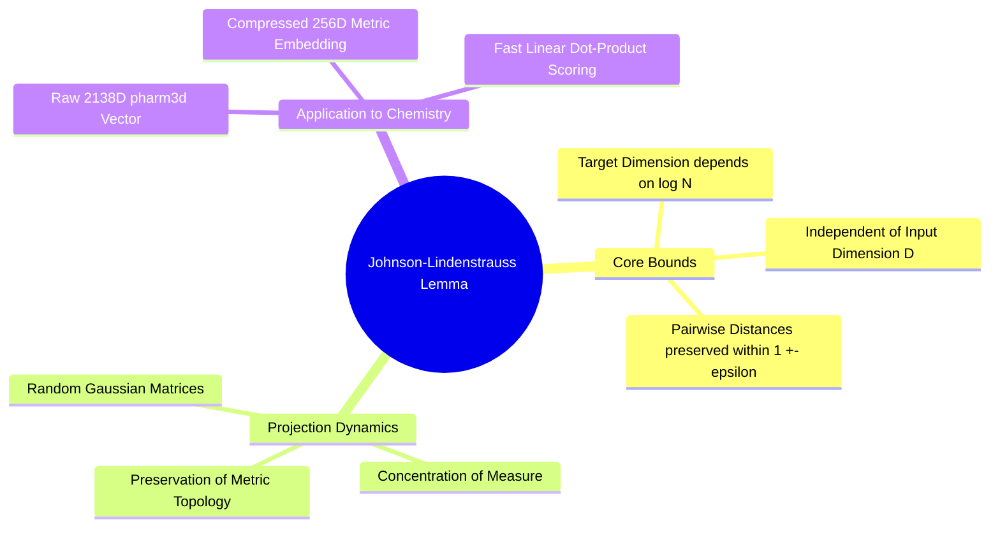

## 3. How It Works

### 3.1 The Geometry of High-Dimensional Random Projections

A projection matrix $\mathbf{A} \in \mathbb{R}^{D \times d}$ can be constructed by sampling its entries independently from a Gaussian distribution:

$$A_{ij} \sim \mathcal{N}\left(0, \frac{1}{d}\right)$$

Applying this matrix to a vector $\mathbf{x} \in \mathbb{R}^D$ yields a projected vector $\mathbf{z} \in \mathbb{R}^d$:

$$\mathbf{z} = \mathbf{x} \mathbf{A}$$

Let $\mathbf{w} = \mathbf{u} - \mathbf{v}$ denote the difference vector between two points. The squared Euclidean norm of the projected difference is:

$$\|\mathbf{z}_{\mathbf{u}} - \mathbf{z}_{\mathbf{v}}\|_2^2 = \|\mathbf{w} \mathbf{A}\|_2^2 = \sum_{j=1}^d \left( \sum_{i=1}^D w_i A_{ij} \right)^2$$

Each term $X_j = \sum_{i=1}^D w_i A_{ij}$ is a sum of independent Gaussian variables, which itself follows a normal distribution:

$$X_j \sim \mathcal{N}\left(0, \frac{\|\mathbf{w}\|_2^2}{d}\right)$$

Rescaling these variables:

$$Q = \frac{d}{\|\mathbf{w}\|_2^2} \|\mathbf{w} \mathbf{A}\|_2^2 = \sum_{j=1}^d \left( \frac{\sqrt{d} X_j}{\|\mathbf{w}\|_2} \right)^2 \sim \chi^2(d)$$

The scaled norm follows a **Chi-squared ($\chi^2$) distribution** with $d$ degrees of freedom.

### 3.2 Concentration of Measure

For a Chi-squared random variable with $d$ degrees of freedom, the probability that the variable deviates significantly from its mean ($d$) decays exponentially:

$$\mathbb{P}\left( |Q - d| \ge \epsilon d \right) \le 2 e^{-\frac{d}{8} \epsilon^2}$$

Substituting $Q = \frac{d}{\|\mathbf{w}\|_2^2} \|\mathbf{w}\mathbf{A}\|_2^2$ into this inequality:

$$\mathbb{P}\left( \left| \frac{\|\mathbf{w}\mathbf{A}\|_2^2}{\|\mathbf{w}\|_2^2} - 1 \right| \ge \epsilon \right) \le 2 e^{-\frac{d \epsilon^2}{8}}$$

For a dataset of $N$ points, there are $\binom{N}{2} = \frac{N(N-1)}{2} < \frac{N^2}{2}$ unique pairs of points. Applying the **Union Bound** across all pairs:

$$\mathbb{P}(\text{any pair suffers distortion } > \epsilon) \le \frac{N^2}{2} \cdot 2 e^{-\frac{d \epsilon^2}{8}} = N^2 e^{-\frac{d \epsilon^2}{8}}$$

To ensure this failure probability is strictly bounded by a small value $\delta \in (0, 1)$:

$$N^2 e^{-\frac{d \epsilon^2}{8}} \le \delta \implies 2 \ln(N) - \frac{d \epsilon^2}{8} \le \ln(\delta) \implies d \ge \frac{8 \ln(N) + 8 \ln(1/\delta)}{\epsilon^2}$$

This proves that the target dimension $d$ scales as $O\left(\frac{\ln N}{\epsilon^2}\right)$, confirming that high-dimensional distance geometry can be preserved in a much smaller space.

## 4. What It Consists Of

- **Distortion Parameter ($\epsilon$)**: The maximum allowed fractional change in squared Euclidean distances ($0 < \epsilon < 1$).
- **Chi-Squared Tail Concentration**: The probability bound governing how sums of squared Gaussian variables concentrate near their expected value.
- **Random Gaussian Matrix**: A projection operator populated with independent Gaussian entries scaled by $\frac{1}{\sqrt{d}}$.

## 5. What You Must Understand

> [!warning] Pitfall: Standard Random Projections Skew Directional Orthogonality
> While an unconstrained Gaussian matrix preserves distances *in expectation*, its columns are not strictly orthogonal ($\mathbf{A}^T \mathbf{A} \neq \mathbf{I}$). For finite dimensions, random deviations can introduce skew into the projected space. To preserve geometric relationships more accurately, practical implementations use **QR decomposition** to orthonormalize the projection matrix before use.

## 6. Prerequisites

- [[3. Metric Spaces Distance Metrics and Norms]]
- Advanced probability theory (Gaussian distributions, Chi-squared distributions, and union bounds).

## 7. Project Connection

In `syntree/chemistry/synthon_encoder.py`, the system compresses raw 2138-dimensional chemical descriptors down to $d = 256$ dimensions. This projection runs on CPU and is fully deterministic, preserving relative chemical similarities across the 50,000 building blocks in the catalog without requiring a learned neural encoder.

## 8. Required Depth

**Essential**: This lemma provides the mathematical justification for our feature compression pipeline and synthon retrieval heads.

## 9. Further Dependencies

- [[2. QR Decomposition and Orthonormal Projection Operators]]
- [[3. Norm Preservation and Distortion Bounds in Practice]]

---

### `02. Representation Learning and Latent Metric Spaces/Chapter 2. Dimensionality Reduction and Random Projections/2. QR Decomposition and Orthonormal Projection Operators.md`

# 2. QR Decomposition and Orthonormal Projection Operators

> [!abstract] Mathematical Core
> Applying an unnormalized random matrix introduces variance into projected vectors. By performing a QR decomposition on a Gaussian matrix ($\mathbf{A} = \mathbf{Q}\mathbf{R}$) and extracting the orthonormal factor $\mathbf{Q} \in \mathbb{R}^{D \times d}$ scaled by $\sqrt{D/d}$, we construct an isometry that preserves vector norms and pairwise distances with minimal distortion.

## 1. What It Is

Let $\mathbf{A} \in \mathbb{R}^{D \times d}$ (where $D > d$) be a matrix with linearly independent columns. **QR decomposition** factors $\mathbf{A}$ into the product of two matrices:

$$\mathbf{A} = \mathbf{Q}\mathbf{R}$$

where:
- $\mathbf{Q} \in \mathbb{R}^{D \times d}$ is an **orthonormal matrix**, meaning its columns are mutually orthogonal unit vectors:
  $$\mathbf{Q}^T \mathbf{Q} = \mathbf{I}_d$$
- $\mathbf{R} \in \mathbb{R}^{d \times d}$ is an **upper triangular matrix** ($R_{ij} = 0$ for all $i > j$).

In `3D-SynTree`, we discard $\mathbf{R}$ and use the scaled matrix $\mathbf{P} = \sqrt{\frac{D}{d}} \mathbf{Q}$ as an orthonormal projection operator that maps high-dimensional descriptors into our latent space:

$$\mathbf{z} = \mathbf{x} \mathbf{P} = \sqrt{\frac{D}{d}} \mathbf{x} \mathbf{Q}$$

## 2. Why It Exists

When an unnormalized Gaussian matrix $\mathbf{A}_{ij} \sim \mathcal{N}(0, 1/d)$ is generated, its columns are only approximately orthogonal. The off-diagonal entries of $\mathbf{A}^T \mathbf{A}$ contain non-zero noise, and its column norms fluctuate around 1.

These small fluctuations introduce two issues:
1. **Directional Anisotropy**: Certain directions in the latent space are artificially stretched, while others are compressed.
2. **Norm Variance**: The expected norm of a projected vector exhibits higher variance across different random seeds.

Using Gram-Schmidt orthogonalization (computed via QR decomposition) eliminates this variance. The resulting matrix $\mathbf{Q}$ forms an exact orthonormal basis for a randomly oriented $d$-dimensional subspace within $\mathbb{R}^D$, ensuring uniform, distance-preserving projections.

## 3. How It Works

### 3.1 Gram-Schmidt Orthogonalization

The columns of $\mathbf{A} = [\mathbf{a}_1, \dots, \mathbf{a}_d]$ are processed sequentially to construct an orthonormal basis $[\mathbf{q}_1, \dots, \mathbf{q}_d]$:

$$\mathbf{u}_k = \mathbf{a}_k - \sum_{j=1}^{k-1} \text{proj}_{\mathbf{u}_j}(\mathbf{a}_k) = \mathbf{a}_k - \sum_{j=1}^{k-1} \frac{\mathbf{u}_j^T \mathbf{a}_k}{\mathbf{u}_j^T \mathbf{u}_j} \mathbf{u}_j$$

$$\mathbf{q}_k = \frac{\mathbf{u}_k}{\|\mathbf{u}_k\|_2}$$

In practice, modern libraries use the **Householder reflection algorithm** rather than standard Gram-Schmidt, as it is more numerically stable against floating-point roundoff errors.

### 3.2 Derivation of the Scaling Factor $\sqrt{D/d}$

Let $\mathbf{Q} \in \mathbb{R}^{D \times d}$ be an orthonormal matrix satisfying $\mathbf{Q}^T \mathbf{Q} = \mathbf{I}_d$. 

Now consider the outer product matrix $\mathbf{M} = \mathbf{Q} \mathbf{Q}^T \in \mathbb{R}^{D \times D}$. This is an orthogonal projection operator onto the $d$-dimensional subspace spanned by the columns of $\mathbf{Q}$.

Evaluating its trace:

$$\text{Tr}(\mathbf{Q} \mathbf{Q}^T) = \text{Tr}(\mathbf{Q}^T \mathbf{Q}) = \text{Tr}(\mathbf{I}_d) = d$$

Because the Gaussian matrix was sampled isotropically, the orientation of this subspace is uniformly distributed across the unit sphere. Taking the expectation of the projection matrix over all random seeds:

$$\mathbb{E}[\mathbf{Q} \mathbf{Q}^T] = c \cdot \mathbf{I}_D$$

Taking the trace of both sides:

$$\text{Tr}(\mathbb{E}[\mathbf{Q} \mathbf{Q}^T]) = c \cdot \text{Tr}(\mathbf{I}_D) \implies \mathbb{E}[\text{Tr}(\mathbf{Q} \mathbf{Q}^T)] = c \cdot D \implies d = c \cdot D \implies c = \frac{d}{D}$$

Therefore:

$$\mathbb{E}[\mathbf{Q} \mathbf{Q}^T] = \frac{d}{D} \mathbf{I}_D$$

Now evaluate the expected squared Euclidean norm of a projected vector $\mathbf{z} = \mathbf{x} \mathbf{Q}$:

$$\mathbb{E}[\|\mathbf{z}\|_2^2] = \mathbb{E}[\mathbf{x} \mathbf{Q} \mathbf{Q}^T \mathbf{x}^T] = \mathbf{x} \, \mathbb{E}[\mathbf{Q} \mathbf{Q}^T] \, \mathbf{x}^T = \mathbf{x} \left( \frac{d}{D} \mathbf{I}_D \right) \mathbf{x}^T = \frac{d}{D} \|\mathbf{x}\|_2^2$$

Projecting directly through $\mathbf{Q}$ reduces the vector's squared norm by a factor of $\frac{d}{D}$. To preserve the original squared norm in expectation:

$$\mathbb{E}\left[ \left\| \sqrt{\frac{D}{d}} \mathbf{x} \mathbf{Q} \right\|_2^2 \right] = \frac{D}{d} \cdot \frac{d}{D} \|\mathbf{x}\|_2^2 = \|\mathbf{x}\|_2^2$$

This proves that scaling the orthonormal matrix by $\sqrt{\frac{D}{d}}$ preserves expected vector norms:

$$\mathbf{P} = \sqrt{\frac{D}{d}} \mathbf{Q}$$

## 4. What It Consists Of

- **Isotropic Gaussian Base**: A matrix $\mathbf{A} \in \mathbb{R}^{D \times d}$ sampled from $\mathcal{N}(0, 1)$ to establish an initial random subspace orientation.
- **Householder QR Factorization**: A numerically stable algorithm that extracts an orthonormal basis $\mathbf{Q}$ from $\mathbf{A}$.
- **Norm Compensation Factor**: The scalar $\sqrt{\frac{D}{d}}$ that scales the projection to preserve expected Euclidean lengths.

## 5. What You Must Understand

> [!warning] Pitfall: Failing to Freeze the Projection Matrix
> The projection operator $\mathbf{P} = \sqrt{\frac{D}{d}} \mathbf{Q}$ must be generated once using a fixed random seed and stored as a static, immutable artifact. If $\mathbf{P}$ is re-sampled between training and inference runs, the projected coordinates will land in completely different orientations, invalidating all precomputed embeddings.

## 6. Prerequisites

- [[1. The Johnson-Lindenstrauss Lemma]]
- Linear algebra (orthonormal bases, matrix traces, and QR decomposition).

## 7. Project Connection

In `syntree/chemistry/synthon_encoder.py`, the system implements this exact formulation in `build_projection()`:
```python
def build_projection(raw_dim: int, embedding_dim: int, seed: int) -> np.ndarray:
    rng = np.random.default_rng(seed)
    gaussian = rng.standard_normal((raw_dim, embedding_dim)).astype(np.float64)
    # Extract orthonormal basis via QR factorization
    q, _ = np.linalg.qr(gaussian)
    # Scale to preserve expected Euclidean norm
    jl_scale = float(np.sqrt(raw_dim / embedding_dim))
    return (q * jl_scale).astype(np.float32)
```
This operator projects the 2138-dimensional `pharm3d` descriptors into our 256-dimensional latent space.

## 8. Required Depth

**Essential**: This projection step generates the fixed synthon embedding catalog used by the cross-attention policy heads.

## 9. Further Dependencies

- [[3. Norm Preservation and Distortion Bounds in Practice]]
- [[1. Scaled Dot-Product Attention as Soft Dictionary Lookup]]

---

## 03. Attention Mechanisms and Transformer Decoders

### `03. Attention Mechanisms and Transformer Decoders/0. Attention and Transformers MOC.md`

# 0. Attention and Transformers MOC

> [!abstract] Module Overview
> Mathematical formulations of scaled dot-product attention, multi-head projections, causal and padding masks, and decoder blocks used for structural conditioning.

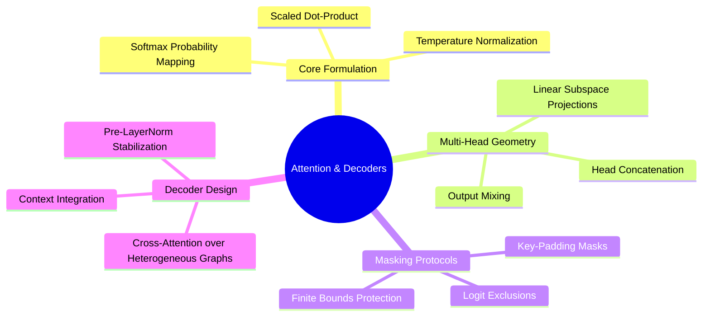

## Detailed Chapters

- **Chapter 1. Attention Formulations**
  - [[1. Scaled Dot-Product Attention as Soft Dictionary Lookup]]
  - [[2. Multi-Head Projections and Subspace Specialization]]
  - [[3. Mathematical Foundations of Attention Masking]]
- **Chapter 2. Modern Decoder Architectures**
  - [[1. Pre-LayerNorm vs Post-LayerNorm Dynamics]]
  - [[2. Cross-Attention over Heterogeneous Spatial Memory]]
  - [[3. Contextual Query Formation from Handle States]]

---

### `03. Attention Mechanisms and Transformer Decoders/Chapter 1. Attention Formulations/1. Scaled Dot-Product Attention as Soft Dictionary Lookup.md`

# 1. Scaled Dot-Product Attention as Soft Dictionary Lookup

> [!abstract] Mathematical Core
> Scaled dot-product attention queries a set of key-value pairs using a query vector, evaluating similarities as inner products. The similarities are scaled by $1/\sqrt{d_k}$ and normalized via a softmax function to generate attention weights, which are then used to compute a weighted sum of the value vectors.

## 1. What It Is

Given:
- A query matrix $\mathbf{Q} \in \mathbb{R}^{N \times d_k}$
- A key matrix $\mathbf{K} \in \mathbb{R}^{M \times d_k}$
- A value matrix $\mathbf{V} \in \mathbb{R}^{M \times d_v}$

The scaled dot-product attention operator is defined as:

$$\text{Attention}(\mathbf{Q}, \mathbf{K}, \mathbf{V}) = \text{Softmax}\left( \frac{\mathbf{Q} \mathbf{K}^T}{\sqrt{d_k}} \right) \mathbf{V}$$

Where the softmax function is applied row-wise across the column dimension $M$:

$$\text{Softmax}(\mathbf{S})_{ij} = \frac{\exp(S_{ij})}{\sum_{m=1}^M \exp(S_{im})}$$

The output is an updated tensor of shape $\mathbb{R}^{N \times d_v}$, where each row is a convex combination of value vectors weighted by their query-key similarity.

## 2. Why It Exists

In structure-based molecular design, our spatial memory contains a variable number of atoms (often between 200 and 700 pocket atoms). A simple pooling operation (like mean or sum pooling) collapses all structural features into a single global vector, losing local spatial resolution.

Attention solves this by acting as a dynamic, content-addressable retrieval mechanism:
- The **Query ($\mathbf{q}$)** specifies what the model is looking for (e.g., "What functional groups are near this reactive handle?").
- The **Keys ($\mathbf{k}_j$)** encode the local chemical and spatial environment of each atom in the pocket.
- The **Values ($\mathbf{v}_j$)** contain the detailed geometric representations of those atoms.

This allows the network to focus dynamically on the most relevant subpockets and catalytic residues.

## 3. How It Works

### 3.1 The Mathematical Necessity of the Scaling Factor $1/\sqrt{d_k}$

Assume the components of $\mathbf{q} \in \mathbb{R}^{d_k}$ and $\mathbf{k} \in \mathbb{R}^{d_k}$ are independent random variables with zero mean and unit variance:

$$\mathbb{E}[q_i] = 0, \quad \text{Var}(q_i) = 1; \quad \mathbb{E}[k_i] = 0, \quad \text{Var}(k_i) = 1$$

The dot product is the sum of $d_k$ independent terms:

$$S = \mathbf{q} \cdot \mathbf{k} = \sum_{i=1}^{d_k} q_i k_i$$

Evaluating its expectation and variance:

$$\mathbb{E}[S] = \sum_{i=1}^{d_k} \mathbb{E}[q_i k_i] = \sum_{i=1}^{d_k} \mathbb{E}[q_i] \mathbb{E}[k_i] = 0$$

$$\text{Var}(S) = \sum_{i=1}^{d_k} \text{Var}(q_i k_i)$$

For independent zero-mean variables:

$$\text{Var}(q_i k_i) = \mathbb{E}[q_i^2 k_i^2] - (\mathbb{E}[q_i k_i])^2 = \mathbb{E}[q_i^2] \mathbb{E}[k_i^2] - 0 = \text{Var}(q_i) \text{Var}(k_i) = 1 \cdot 1 = 1$$

Therefore:

$$\text{Var}(S) = \sum_{i=1}^{d_k} 1 = d_k \implies \sigma_S = \sqrt{d_k}$$

As the dimensionality $d_k$ increases, the magnitude of the raw dot product grows as $O(\sqrt{d_k})$.

When large inputs are passed to the softmax function, the largest values dominate, pushing the softmax into regions with very small gradients:

$$\frac{\partial \text{Softmax}(S)_i}{\partial S_j} = \text{Softmax}(S)_i \left( \delta_{ij} - \text{Softmax}(S)_j \right)$$

If $S_i \gg S_j$, then $\text{Softmax}(S)_i \to 1$, which causes the gradient to vanish:

$$\lim_{S_i \to \infty} \frac{\partial \text{Softmax}(S)_i}{\partial S_i} = 1 \cdot (1 - 1) = 0$$

Dividing the dot product by $\sqrt{d_k}$ stabilizes the variance back to 1:

$$\text{Var}\left( \frac{\mathbf{q} \cdot \mathbf{k}}{\sqrt{d_k}} \right) = \frac{1}{d_k} \text{Var}(\mathbf{q} \cdot \mathbf{k}) = \frac{d_k}{d_k} = 1.0$$

This scaling prevents the softmax function from saturating, keeping gradients stable during training.

```text
Without 1/sqrt(d_k) scaling:
Variance scales with d_k -> Dot products grow large -> Softmax saturates -> Vanishing gradients

With 1/sqrt(d_k) scaling:
Variance normalized to 1.0 -> Well-behaved dot products -> Softmax operates in active gradient range
```

## 4. What It Consists Of

- **Query ($\mathbf{Q}$)**: The representations driving the retrieval process.
- **Key ($\mathbf{K}$)**: The representations matched against the queries.
- **Value ($\mathbf{V}$)**: The underlying content aggregated to form the output.
- **Softmax Temperature ($\sqrt{d_k}$)**: The dimensional scaling factor that keeps dot-product variance normalized.

## 5. What You Must Understand

> [!warning] Pitfall: Misaligned Linear Projections
> Passing raw feature representations directly to the attention mechanism without linear projections ($\mathbf{W}_Q, \mathbf{W}_K, \mathbf{W}_V$) forces queries and keys to share the same latent space. Linear projection layers are required to let queries, keys, and values learn distinct representations tailored to matching and retrieval.

## 6. Prerequisites

- [[1. Einstein Summation and Multilinear Contractions]]
- Basic multivariable statistics (mean, variance of independent sums).

## 7. Project Connection

In `syntree/models/policy.py`, the cross-attention layer uses scaled dot-product attention to integrate chemical handle queries with spatial memory from the pocket encoder:
```python
context, attn_weights = self.cross_attention(
    query, padded_nodes, padded_nodes, key_padding_mask=key_padding_mask
)
```

## 8. Required Depth

**Essential**: Attention is the primary mechanism connecting the model's structural encoder to its downstream policy heads.

## 9. Further Dependencies

- [[2. Multi-Head Projections and Subspace Specialization]]
- [[3. Mathematical Foundations of Attention Masking]]

---

### `03. Attention Mechanisms and Transformer Decoders/Chapter 1. Attention Formulations/3. Mathematical Foundations of Attention Masking.md`

# 3. Mathematical Foundations of Attention Masking

> [!abstract] Mathematical Core
> Attention masks enforce structural, causal, or batching constraints by adding a penalty matrix $\mathbf{M}$ to attention logits before evaluating the softmax function: $\text{Softmax}\left(\frac{\mathbf{Q}\mathbf{K}^T}{\sqrt{d_k}} + \mathbf{M}\right)$. Choosing the appropriate mask value requires balancing mathematical correctness against the numerical limits of low-precision floating-point formats.

## 1. What It Is

An attention mask is an additive tensor $\mathbf{M} \in \overline{\mathbb{R}}^{N \times M}$ (where $\overline{\mathbb{R}} = \mathbb{R} \cup \{-\infty\}$) applied directly to raw attention scores:

$$\mathbf{A} = \text{Softmax}\left( \frac{\mathbf{Q} \mathbf{K}^T}{\sqrt{d_k}} + \mathbf{M} \right)$$

The mask uses two main values:
$$M_{ij} = \begin{cases} 
0 & \text{if position $j$ is valid to attend to from position $i$} \\ 
-\infty & \text{if position $j$ must be masked out} 
\end{cases}$$

When $M_{ij} = -\infty$:
$$\exp(S_{ij} + M_{ij}) = \exp(S_{ij} - \infty) = e^{-\infty} = 0$$

This forces the attention weight to zero, ensuring that masked positions contribute no information to the output.

## 2. Why It Exists

Masking is used in deep learning for two primary purposes:
1. **Key-Padding Masks**: Variable-sized graphs within a batch are padded to a fixed maximum length $N_{\max}$. Key-padding masks zero out dummy atoms so they do not affect attention weights or gradients.
2. **Structural and Syntactic Constraints**: In chemistry, not all building blocks can react with a given functional group. Additive masks prevent the model from assigning probability to chemically incompatible reactions.

## 3. How It Works

### 3.1 The IEEE 754 Floating-Point Underflow Hazard

In theoretical machine learning, masked positions are assigned an additive penalty of $-\infty$. In floating-point implementations, $-\infty$ is represented by a large finite negative number:

```python
# Legacy formulation (often used in FP32 models):
MASK_VALUE = -1e9
```

This choice creates serious numerical issues when training in **half precision (IEEE 754 Float16)** on hardware like the Tesla T4.

Reviewing the range of IEEE 754 floating-point formats:

| Format | Exponent Bits | Mantissa Bits | Dynamic Range ($V_{\max}$) | Smallest Positive Normal ($V_{\min}$) |
| :--- | :--- | :--- | :--- | :--- |
| **FP32** | 8 | 23 | $\approx 3.40 \times 10^{38}$ | $\approx 1.17 \times 10^{-38}$ |
| **FP16** | 5 | 10 | **$65,504$** | $\approx 6.10 \times 10^{-5}$ |
| **BF16** | 8 | 7 | $\approx 3.39 \times 10^{38}$ | $\approx 1.17 \times 10^{-38}$ |

In standard FP16, the maximum representable finite number is **$65,504$**. Any number below $-65,504$ overflows directly to $-\infty$.

### 3.2 The Mechanism of `NaN` Loss Collapse

When a mask value of `-1e9` is cast to `torch.float16`:
1. It overflows, becoming physical `float('-inf')`.
2. If an entire row is masked out (for example, if a molecule has no valid reaction options):
   $$\text{Row} = [-\infty, -\infty, \dots, -\infty]$$
3. PyTorch evaluates the softmax across this row:
   $$\text{Softmax}(\text{Row})_i = \frac{e^{-\infty}}{\sum_j e^{-\infty}} = \frac{0}{0 + 0 + \dots + 0} = \frac{0}{0} = \mathbf{NaN}$$
4. A single `NaN` entry in the attention weights spreads through matrix multiplications, contaminating downstream layers, gradients, and model parameters.

### 3.3 The Safe Masking Standard: `-1e4`

To prevent floating-point overflow in FP16 while maintaining effective masking, the mask penalty must be bounded:

$$\text{LOGIT\_MASK\_FILL} = -10{,}000 = -10^4$$

Checking this value against numerical limits:
1. **Safe within FP16 Dynamic Range**:
   $$|-10^4| = 10{,}000 \ll 65{,}504$$
   This prevents overflow to $-\infty$.
2. **Underflows Cleanly in Softmax**:
   $$e^{-10^4} = e^{-10000} \approx 0.0$$
   This drops cleanly to zero in both FP16 and FP32 precision.

To detect masked positions reliably in code, thresholds must be adjusted accordingly:

```python
# The Safe Masking Invariant in 3D-SynTree
LOGIT_MASK_FILL = -1e4        # Applied to invalid positions
LOGIT_MASK_LEGAL_ABOVE = -1e3 # Used to identify valid positions (mask > -1e3)
```

## 4. What It Consists Of

- **Mask Tensor**: An additive floating-point matrix matching the attention logit shape.
- **Valid Positions ($0.0$)**: Unmasked entries that retain their raw attention scores.
- **Masked Positions ($-10^4$)**: Entries penalized heavily enough to evaluate to zero after softmax.
- **Detection Threshold ($-10^3$)**: A numerical boundary used to separate valid entries from masked entries.

## 5. What You Must Understand

> [!warning] Pitfall: Threshold Inconsistencies Cause Logic Inversion
> If a codebase changes its mask value from `-1e9` to `-1e4` but leaves legacy validation checks unchanged:
> ```python
> is_valid = mask > -1e8 # Bug! -1e4 is greater than -1e8!
> ```
> This logic error treats all masked positions as valid, completely breaking chemical constraints. Always update validation thresholds alongside mask values:
> ```python
> is_valid = mask > LOGIT_MASK_LEGAL_ABOVE # Correct (-1e3)
> ```

## 6. Prerequisites

- [[1. Scaled Dot-Product Attention as Soft Dictionary Lookup]]
- Floating-point representations (sign, exponent, mantissa).

## 7. Project Connection

In `syntree/core/masking.py`, 3D-SynTree formalizes these numerical bounds across all model components:
```python
LOGIT_MASK_FILL = -1e4
LOGIT_MASK_LEGAL_ABOVE = -1e3

def mask_is_legal(mask: torch.Tensor) -> torch.Tensor:
    return mask > LOGIT_MASK_LEGAL_ABOVE
```
This module is used across the catalog lookup, synthon selection head, and reinforcement learning environments to enforce chemical constraints while preventing `NaN` gradient crashes.

## 8. Required Depth

**Essential**: Incorrect masking constants were a primary cause of the floating-point instability and `NaN` losses observed in earlier iterations of the project.

## 9. Further Dependencies

- [[1. IEEE 754 Floating-Point Formats FP32 FP16 BF16]]
- [[2. Underflow Denormals and GradScaler Scale Collapse]]

---

## 04. Graph Neural Networks and Message Passing

### `04. Graph Neural Networks and Message Passing/0. Graph Neural Networks MOC.md`

# 0. Graph Neural Networks MOC

> [!abstract] Module Overview
> Mathematical foundations of Graph Neural Networks (GNNs), message passing schemes, permutation symmetries, and computational graph complexity on spatial molecular structures.

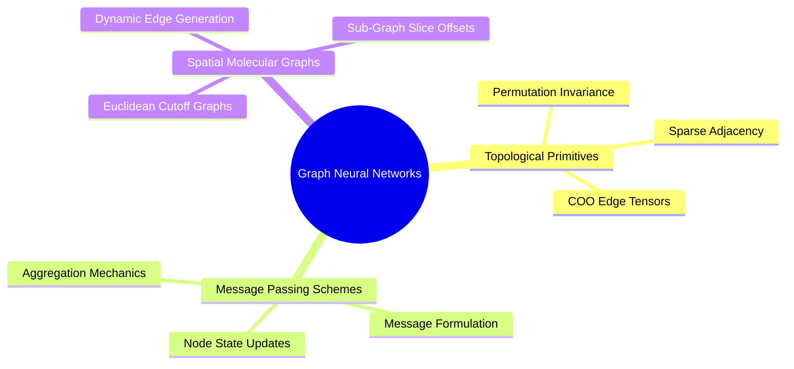

## Detailed Chapters

- **Chapter 1. Spatial Graph Representations**
  - [[1. Graph Topology Adjacency and Sparse Representation]]
  - [[2. Node and Edge Feature Multiplexing]]
  - [[3. Permutation Invariance and Permutation Equivariance]]
- **Chapter 2. Message Passing Paradigms**
  - [[1. The Message-Passing Neural Network Formalism]]
  - [[2. Aggregation Functions and Information Bottlenecks]]
  - [[3. Computational Complexity of Spatial Radius Graphs]]

---

### `04. Graph Neural Networks and Message Passing/Chapter 2. Message Passing Paradigms/1. The Message-Passing Neural Network Formalism.md`

# 1. The Message-Passing Neural Network Formalism

> [!abstract] Mathematical Core
> Message-Passing Neural Networks (MPNNs) generalize convolutions to non-grid topologies. In each layer, nodes send directed computational messages along connecting edges. These messages are aggregated using a permutation-invariant operator and used to update node states.

## 1. What It Is

Let $\mathcal{G} = (\mathcal{V}, \mathcal{E})$ define a graph where $\mathbf{h}_i^{(t)} \in \mathbb{R}^d$ represents the hidden state of node $i \in \mathcal{V}$ at layer $t$, and $\mathbf{e}_{ij} \in \mathbb{R}^m$ represents the features of edge $(i, j) \in \mathcal{E}$.

A single message-passing step consists of three phases:

1. **Message Generation**:
   A message $\mathbf{m}_{ij}^{(t+1)}$ is computed along each directed edge $(j \to i)$ using a message function $M_t$:
   $$\mathbf{m}_{ij}^{(t+1)} = M_t\left( \mathbf{h}_i^{(t)}, \mathbf{h}_j^{(t)}, \mathbf{e}_{ij} \right)$$

2. **Message Aggregation**:
   All incoming messages targeting node $i$ are collected using a permutation-invariant reduction operator $\bigoplus$:
   $$\mathbf{m}_i^{(t+1)} = \bigoplus_{j \in \mathcal{N}(i)} \mathbf{m}_{ij}^{(t+1)}$$

3. **Node State Update**:
   The node computes its next state using an update function $U_t$:
   $$\mathbf{h}_i^{(t+1)} = U_t\left( \mathbf{h}_i^{(t)}, \mathbf{m}_i^{(t+1)} \right)$$

```text
Message Passing Phase:
Node (j) ----[ M(h_i, h_j, e_ij) ]----> Message m_ij
                                            |
                                            v
                                  [ Aggregation (sum) ] ---> Update U(h_i, m_i) ---> Node (i) New State
```

## 2. Why It Exists

Standard convolutions rely on a fixed coordinate grid: in a 2D image, pixel $(x, y)$ always has a well-defined "top-left" neighbor at $(x-1, y-1)$.

Molecules have no fixed grid. An atom can be bonded to two, three, or four neighbors in arbitrary spatial arrangements. Furthermore, there is no canonical way to order atoms in memory; re-indexing the atoms must not change the model's predictions.

The MPNN framework handles this by treating the computational graph as a set of local neighborhood operations, naturally preserving permutation invariance.

## 3. How It Works

### 3.1 The Weisfeiler-Lehman (1-WL) Expressivity Bound

Standard MPNNs that rely solely on topological connectivity are bounded in expressivity by the **1-Weisfeiler-Lehman (1-WL) graph isomorphism test**.

If the 1-WL test cannot distinguish two topologically distinct graphs (such as strongly regular graphs or pairs of decagons with different cross-links), a standard MPNN will assign them identical representations.

To break past this 1-WL bound, spatial GNNs introduce **continuous 3D geometric coordinates** into the message function:

$$\mathbf{e}_{ij} = \left[ \|\mathbf{x}_i - \mathbf{x}_j\|_2, \; \text{RBF}(\|\mathbf{x}_i - \mathbf{x}_j\|_2) \right]$$

Since continuous 3D distances $\mathbb{R}^3$ are almost always unique for distinct atomic configurations, spatial geometric graphs can differentiate structures that are topologically identical in 2D.

### 3.2 Over-Smoothing and Over-Squashing

When stacking many message-passing layers, models frequently encounter two structural issues:

1. **Over-Smoothing**:
   As the number of layers $T \to \infty$, repeatedly applying Laplacian-style smoothing causes node representations to converge to a single uniform vector:
   $$\lim_{T \to \infty} \mathbf{h}_i^{(T)} = \mathbf{h}_j^{(T)} \quad \forall i, j \in \mathcal{V}$$
   To prevent this, architectures use **residual skip connections**:
   $$\mathbf{h}_i^{(t+1)} = \mathbf{h}_i^{(t)} + U_t\left( \mathbf{h}_i^{(t)}, \mathbf{m}_i^{(t+1)} \right)$$

2. **Over-Squashing**:
   The number of nodes in a graph's neighborhood grows exponentially with radius $r$:
   $$|\mathcal{N}_r(i)| \approx \bar{k}^r$$
   Attempting to compress information from this exponentially growing neighborhood into a fixed-size vector $\mathbf{h}_i \in \mathbb{R}^d$ creates an information bottleneck. In 3D-SynTree, we mitigate over-squashing by using **cross-attention decoders** that let the model query spatial memory directly, bypassing multi-hop bottlenecks.

## 4. What It Consists Of

- **Message Function ($M_t$)**: Typically a multi-layer perceptron (MLP) operating on concatenated source, destination, and edge features.
- **Aggregation Operator ($\bigoplus$)**: A symmetric reduction function—most commonly $\sum$, $\text{Mean}$, or $\text{Max}$.
- **Update Function ($U_t$)**: A gated recurrent unit (GRU) or residual MLP layer that computes the node's updated state.

## 5. What You Must Understand

> [!warning] Pitfall: Mean Aggregation Loses Structural Density
> Using $\text{Mean}$ aggregation normalizes incoming messages by node degree:
> $$\mathbf{m}_i = \frac{1}{|\mathcal{N}(i)|} \sum_{j} \mathbf{m}_{ij}$$
> This makes the aggregated message invariant to the number of neighbors. As a result, the model cannot distinguish between a carbon atom surrounded by two atoms versus one surrounded by four atoms if their local features are identical. To preserve sensitivity to atomic coordination and density, use **Sum** aggregation (`scatter_add_`).

## 6. Prerequisites

- [[3. Advanced Tensor Slicing and Scatter-Gather Operations]]
- [[3. Permutation Invariance and Permutation Equivariance]]

## 7. Project Connection

In `syntree/models/equivariant.py`, the `PaiNNInteraction` layer is implemented as an MPNN over continuous 3D coordinate space. Messages are computed on directed edges and aggregated into destination atoms via `index_add_`:
$$\Delta s_i = \sum_{j \in \mathcal{N}(i)} s_j \phi_s(d_{ij})$$

## 8. Required Depth

**Essential**: Message passing forms the core mechanism for all representation learning over molecular and pocket graphs in the project.

## 9. Further Dependencies

- [[3. Computational Complexity of Spatial Radius Graphs]]
- [[1. PaiNN Interaction Block and Directional Message Passing]]

---

### `04. Graph Neural Networks and Message Passing/Chapter 2. Message Passing Paradigms/3. Computational Complexity of Spatial Radius Graphs.md`

# 3. Computational Complexity of Spatial Radius Graphs

> [!abstract] Mathematical Core
> Constructing edge connections using a spatial cutoff radius $r_{\text{cut}}$ requires evaluating distance matrices over 3D coordinates. Naive implementations scale quadratically as $O(N_{\text{total}}^2)$ across a batch. By processing graphs independently using sub-graph slice offsets, memory complexity drops to $O(\sum_b N_b^2)$, preventing GPU out-of-memory errors.

## 1. What It Is

Given a set of 3D atomic coordinates $\mathbf{X} \in \mathbb{R}^{N \times 3}$, a **radius graph** constructs directed edges between all pairs of atoms whose Euclidean distance falls within a specified interaction cutoff $r_{\text{cut}}$:

$$\mathcal{E} = \left\{ (i, j) \mid \|\mathbf{x}_i - \mathbf{x}_j\|_2 \le r_{\text{cut}}, \; i \neq j \right\}$$

In batched execution across $B$ independent complexes, edges must connect atoms within the same complex, while cross-talk between different complexes must be strictly prevented:

$$\mathcal{E}_{\text{batch}} = \left\{ (i, j) \mid \|\mathbf{x}_i - \mathbf{x}_j\|_2 \le r_{\text{cut}}, \; i \neq j, \; \text{batch}[i] = \text{batch}[j] \right\}$$

## 2. Why It Exists

In structural biology, macromolecules are held together by both covalent bonds and non-covalent spatial interactions (such as hydrogen bonds, salt bridges, and van der Waals contacts). 

Relying solely on 2D chemical bonds misses these spatial interactions. To capture them, models construct dynamic edges based on a 3D distance cutoff ($r_{\text{cut}} = 5.0\text{ \AA}$).

However, constructing these edges naively by computing a global pairwise distance matrix across an entire mini-batch causes memory consumption to explode.

## 3. How It Works

### 3.1 The Memory Explosion of Naive Global Distance Matrices

Consider a training batch of $B = 16$ protein-ligand complexes. Each complex contains an average of $N_b = 600$ atoms, giving:

$$N_{\text{total}} = 16 \times 600 = 9{,}600 \text{ atoms}$$

A naive implementation computes pairwise distances across the entire concatenated coordinate tensor:

```python
# Naive Pairwise Distance Evaluation
diff = pos.unsqueeze(0) - pos.unsqueeze(1) # [9600, 9600, 3]
dist = torch.norm(diff, dim=-1)            # [9600, 9600]
adj = (dist <= r_cut) & (batch.unsqueeze(0) == batch.unsqueeze(1))
```

Evaluating memory consumption for this naive calculation:
$$\text{Elements} = 9{,}600 \times 9{,}600 \times 3 = 276{,}480{,}000 \text{ floats}$$
In FP32 precision ($4\text{ bytes per float}$):
$$\text{Memory} = 276{,}480{,}000 \times 4 \approx \mathbf{1.106 \text{ GB}}$$

Computing this full distance matrix allocates over **1.1 GB of VRAM** for a single operation. When scaling to larger models or higher atom caps, this quadratic $O(N_{\text{total}}^2)$ footprint quickly leads to out-of-memory errors on 16 GB GPUs like the Tesla T4.

### 3.2 Sub-Graph Slice Offsets: The $O(\sum_b N_b^2)$ Solution

Because atoms in different complexes never interact, evaluating cross-complex distances is completely unnecessary:

```text
Global Distance Matrix (O(N_total^2)) - 93.75% Wasted Computation:
+-------------------+-------------------+
| Complex 1 x Comp 1| Complex 1 x Comp 2| <- Wasted cross-complex evaluations!
| (Valid Edges)     | (Always Discarded)|
+-------------------+-------------------+
| Complex 2 x Comp 1| Complex 2 x Comp 2|
| (Always Discarded)| (Valid Edges)     |
+-------------------+-------------------+
```

By computing distance matrices on each sub-graph independently and accumulating edges with appropriate index offsets, memory scales as $O(\sum_b N_b^2)$:

$$\text{Memory} = B \times (N_b \times N_b \times 3) = 16 \times (600 \times 600 \times 3) = 17{,}280{,}000 \text{ floats} \approx \mathbf{69.1 \text{ MB}}$$

This reduces peak memory consumption by **over 93%**, making larger batches and models feasible on standard hardware.

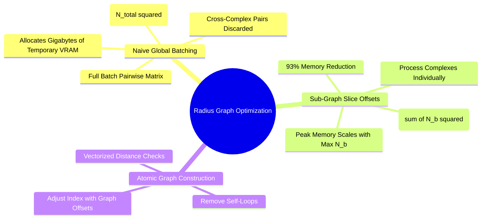

### 3.3 Optimized Implementation

Here is the optimized radius graph algorithm implemented in `syntree/models/equivariant.py`:

```python
def build_radius_graph(pos: torch.Tensor, batch: torch.Tensor, cutoff: float, loop: bool = False) -> torch.Tensor:
    num_graphs = int(batch.max().item()) + 1 if batch.numel() > 0 else 1
    
    # 1. Sort by batch index to ensure contiguous memory slices per graph
    is_monotonic = bool((batch[1:] >= batch[:-1]).all().item()) if batch.numel() > 1 else True
    if not is_monotonic:
        perm = torch.argsort(batch, stable=True)
        pos_sorted = pos[perm]
        batch_sorted = batch[perm]
    else:
        perm = None
        pos_sorted = pos
        batch_sorted = batch

    # 2. Compute slice boundaries using node counts
    counts = torch.bincount(batch_sorted, minlength=num_graphs)
    starts = torch.cumsum(counts, dim=0) - counts
    
    rows, cols = [], []
    for g in range(num_graphs):
        n_g = int(counts[g].item())
        if n_g <= 1:
            continue
        start_g = int(starts[g].item())
        
        # Slice coordinates for sub-graph g
        pos_g = pos_sorted[start_g : start_g + n_g]
        
        # Evaluate pairwise distances within sub-graph g only
        dist_g = torch.cdist(pos_g, pos_g)
        adj_g = dist_g <= cutoff
        if not loop:
            adj_g.fill_diagonal_(False)
            
        row_g, col_g = torch.nonzero(adj_g, as_tuple=True)
        
        # Offset local indices to global batch coordinates
        rows.append(row_g + start_g)
        cols.append(col_g + start_g)

    if not rows:
        return torch.zeros((2, 0), dtype=torch.long, device=pos.device)

    edge_index = torch.stack([torch.cat(rows), torch.cat(cols)], dim=0)
    
    # Map back to original indices if inputs were re-ordered
    if perm is not None:
        edge_index = perm[edge_index]
        
    return edge_index
```

## 4. What It Consists Of

- **Spatial Cutoff Radius ($r_{\text{cut}}$)**: The distance threshold (typically $5.0\text{ \AA}$) defining atomic interactions.
- **Sub-Graph Slice Index**: The starting and ending offsets that map each individual graph to its segment within the packed batch tensor.
- **Coordinate Distance Kernel (`torch.cdist`)**: An optimized internal operator that evaluates Euclidean distances across coordinate blocks without allocating separate difference tensors.

## 5. What You Must Understand

> [!warning] Pitfall: Non-Monotonic Batch Indices
> When pocket and ligand nodes are concatenated (`cat([pocket_pos, ligand_pos])`), the resulting batch indices are often interleaved rather than sorted by graph. Attempting to slice sub-graphs without sorting first will group unrelated atoms together, corrupting the graph structure. Always verify index monotonicity or sort explicitly before slicing.

## 6. Prerequisites

- [[1. Memory Layouts Contiguity and Strides]]
- [[3. Advanced Tensor Slicing and Scatter-Gather Operations]]

## 7. Project Connection

In `syntree/models/equivariant.py` and `syntree/models/bipartite.py`, this optimized `build_radius_graph` is called at the start of every forward pass. This memory optimization is critical for fitting batches of up to 700 pocket atoms within the 15 GB VRAM budget of a Tesla T4 GPU.

## 8. Required Depth

**Essential**: Without sub-graph slicing, the model's memory footprint would scale quadratically with batch size, preventing stable training on standard GPU hardware.

## 9. Further Dependencies

- [[1. The Message-Passing Neural Network Formalism]]
- [[1. Bipartite Protein-Ligand Graph Construction]]

---

## 05. Geometric Deep Learning and Lie Groups

### `05. Geometric Deep Learning and Lie Groups/0. Geometric Deep Learning MOC.md`

# 0. Geometric Deep Learning MOC

> [!abstract] Module Overview
> Mathematical foundations of continuous spatial symmetries, matrix Lie groups, group representations, and invariant/equivariant mappings over 3D Cartesian coordinates.

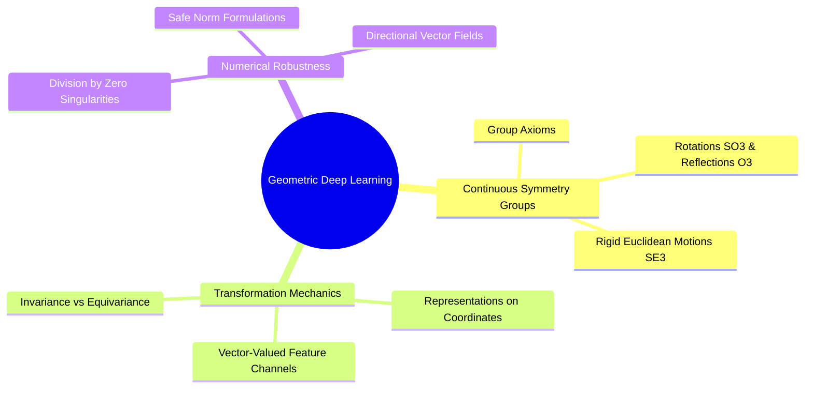

## Detailed Chapters

- **Chapter 1. Continuous Symmetry Groups**
  - [[1. Group Theory Axioms and Matrix Lie Groups]]
  - [[2. Orthogonal and Euclidean Groups O(3) SO(3) E(3) SE(3)]]
  - [[3. Group Actions on Coordinate and Feature Manifolds]]
- **Chapter 2. Equivariant Tensor Field Representations**
  - [[1. Scalar Invariants vs Cartesian Vector Equivariance]]
  - [[2. Irreducible Representations vs Cartesian Feature Vectors]]
  - [[3. Non-Singular Vector Norms and Directional Regularization]]

---

### `05. Geometric Deep Learning and Lie Groups/Chapter 2. Equivariant Tensor Field Representations/3. Non-Singular Vector Norms and Directional Regularization.md`

# 3. Non-Singular Vector Norms and Directional Regularization

> [!abstract] Mathematical Core
> Standard Euclidean norms $\|\mathbf{x}\|_2 = \sqrt{\sum_k x_k^2}$ have singular, undefined derivatives at the origin ($\mathbf{x} = \mathbf{0}$). In equivariant networks, this can cause gradient explosions whenever atoms collide or directional features vanish. We resolve this by replacing standard Euclidean norms with a non-singular, smooth approximation.

## 1. What It Is

Let $\mathbf{x} \in \mathbb{R}^K$ denote a vector-valued feature or spatial difference vector. The standard Euclidean $L_2$-norm is defined as:

$$\|\mathbf{x}\|_2 = \sqrt{\sum_{k=1}^K x_k^2}$$

Evaluating its gradient with respect to $\mathbf{x}$:

$$\nabla_{\mathbf{x}} \|\mathbf{x}\|_2 = \frac{\mathbf{x}}{\|\mathbf{x}\|_2}$$

At the origin ($\mathbf{x} = \mathbf{0}$):

$$\lim_{\mathbf{x} \to \mathbf{0}} \nabla_{\mathbf{x}} \|\mathbf{x}\|_2 = \frac{\mathbf{0}}{0} \implies \text{Undefined (Division by Zero)}$$

To eliminate this singularity, we implement a **smooth, non-singular norm** parameterised by a small constant $\epsilon > 0$:

$$\|\mathbf{x}\|_{\epsilon} = \sqrt{\sum_{k=1}^K x_k^2 + \epsilon^2} - \epsilon$$

Evaluating its gradient:

$$\nabla_{\mathbf{x}} \|\mathbf{x}\|_{\epsilon} = \frac{\mathbf{x}}{\sqrt{\sum_{k=1}^K x_k^2 + \epsilon^2}}$$

This derivative is continuous, bounded, and well-behaved everywhere on $\mathbb{R}^K$:

$$\lim_{\mathbf{x} \to \mathbf{0}} \nabla_{\mathbf{x}} \|\mathbf{x}\|_{\epsilon} = \frac{\mathbf{0}}{\sqrt{0 + \epsilon^2}} = \frac{\mathbf{0}}{\epsilon} = \mathbf{0}$$

## 2. Why It Exists

In equivariant architectures like PaiNN, vector channels $\vec{\mathbf{v}}_i \in \mathbb{R}^{3 \times d}$ track directional spatial features. At the start of training, these vector features are typically initialized to zero ($\vec{\mathbf{v}}_i = \mathbf{0}$).

When computing invariant scalar features from vector channels, the model evaluates their norms:

$$s_i = \|\vec{\mathbf{v}}_i\|_2$$

If standard Euclidean norms are used:
1. Initializing vector channels to zero results in a division-by-zero gradient ($\frac{\mathbf{0}}{0}$) during the very first backward pass.
2. Even after initialization, if two atoms overlap during generative steps ($d_{ij} \to 0$), the unit displacement vector $\frac{\mathbf{r}_{ij}}{\|\mathbf{r}_{ij}\|}$ diverges.
3. This generates massive gradient updates ($> 10^5$), destabilizing the optimizer and causing weights to collapse to `NaN`.

Replacing standard norms with non-singular equivalents removes this singularity entirely.

```text
Standard L2-Norm Gradient:
x -> 0: ||x|| -> 0, but grad = x / ||x|| -> 0/0 = UNDEFINED (Explosion / NaN)

Non-Singular Smooth Norm Gradient:
x -> 0: ||x||_eps -> 0, and grad = x / sqrt(||x||^2 + eps^2) -> 0 / eps = 0.0 (Stable)
```

## 3. How It Works

### 3.1 Mathematical Properties of the Non-Singular Norm

1. **Origin Invariance**:
   $$\|\mathbf{0}\|_{\epsilon} = \sqrt{0 + \epsilon^2} - \epsilon = \epsilon - \epsilon = 0$$
   The function evaluates to zero at the origin, preserving the standard norm baseline.

2. **Asymptotic Convergence**:
   As $\|\mathbf{x}\|_2 \to \infty$:
   $$\|\mathbf{x}\|_{\epsilon} \approx \sqrt{\|\mathbf{x}\|_2^2} - \epsilon = \|\mathbf{x}\|_2 - \epsilon \approx \|\mathbf{x}\|_2$$
   For large inputs, the function behaves identically to the standard Euclidean norm up to an offset of $\epsilon$.

3. **Strict Convexity and Bounded Gradients**:
   The gradient magnitude is bounded by 1 for all inputs:
   $$\left\| \nabla_{\mathbf{x}} \|\mathbf{x}\|_{\epsilon} \right\|_2 = \frac{\|\mathbf{x}\|_2}{\sqrt{\|\mathbf{x}\|_2^2 + \epsilon^2}} < 1.0 \quad \forall \mathbf{x} \in \mathbb{R}^K$$
   This guarantees that the gradient cannot explode, regardless of how small or large $\mathbf{x}$ becomes.

### 3.2 Smooth Directional Unit Vectors

A similar singularity occurs when normalizing vectors to construct directional unit features:

$$\hat{\mathbf{r}} = \frac{\mathbf{r}}{\|\mathbf{r}\|_2}$$

To make this operation safe when atoms are close together or coincident ($\mathbf{r} \to \mathbf{0}$), we formulate a bounded unit vector mapping:

$$\hat{\mathbf{r}}_{\epsilon} = \frac{\mathbf{r}}{\sqrt{\sum_{k=1}^3 r_k^2 + \epsilon^2}}$$

Under this formulation:
- When distances are large ($\|\mathbf{r}\| \gg \epsilon$), $\hat{\mathbf{r}}_{\epsilon} \approx \frac{\mathbf{r}}{\|\mathbf{r}\|_2}$ (standard unit vector).
- When distances approach zero ($\mathbf{r} \to \mathbf{0}$), $\hat{\mathbf{r}}_{\epsilon} \to \mathbf{0}$ smoothly, avoiding the division-by-zero singularity.

### 3.3 Concrete PyTorch Implementation

```python
import torch

def safe_norm(x: torch.Tensor, dim: int = -1, keepdim: bool = False, eps: float = 1e-5) -> torch.Tensor:
    """Non-singular, smooth vector norm with bounded gradients as x -> 0."""
    return torch.sqrt(torch.sum(x * x, dim=dim, keepdim=keepdim) + (eps * eps)) - eps

def safe_unit_vector(vec: torch.Tensor, dim: int = -1, eps: float = 1e-5) -> tuple[torch.Tensor, torch.Tensor]:
    """Computes directional unit vectors and distances bounded away from 0/0."""
    norm = torch.sqrt(torch.sum(vec * vec, dim=dim, keepdim=True) + (eps * eps))
    unit = vec / norm
    dist = (norm.squeeze(dim) - eps).clamp(min=0.0)
    return unit, dist
```

## 4. What It Consists Of

- **Smoothing Parameter ($\epsilon$)**: A small positive constant (typically $10^{-5}$) that bounds the denominator away from zero.
- **Centered Offset ($-\epsilon$)**: The constant shift applied to ensure $\|\mathbf{0}\|_{\epsilon} = 0$.
- **Bounded Unit Vector Map**: A regularized normalization that transitions smoothly to zero at the origin rather than diverging.

## 5. What You Must Understand

> [!warning] Pitfall: Incomplete Regularization Inside `torch.norm`
> Writing `torch.norm(x + 1e-8)` does not fix the singularity! The addition is applied to the components before squaring:
> $$\sqrt{(x_k + \epsilon)^2}$$
> This shifts the zero point rather than removing the singularity. Alternatively, writing `torch.norm(x) + 1e-8` adds epsilon outside the square root, meaning the inner term $\frac{\mathbf{x}}{\|\mathbf{x}\|}$ still evaluates to $\frac{0}{0}$ during backpropagation. To properly regularize the gradient, the epsilon term must be added inside the square root:
> $$\sqrt{\sum x_k^2 + \epsilon^2}$$

## 6. Prerequisites

- [[2. Vectorized Computational Graphs and Jacobians]]
- [[1. Scalar Invariants vs Cartesian Vector Equivariance]]

## 7. Project Connection

In Issue #7 (`[MATH-01]`), we refactored `syntree/models/equivariant.py` to replace standard norms in `PaiNNInteraction` and `PaiNNMixing` with `safe_norm` and `safe_unit_vector`. This eliminated the gradient spikes and `NaN` crashes caused by overlapping atoms and zero-initialized vector channels.

## 8. Required Depth

**Essential**: This formulation is required to prevent division-by-zero gradient crashes in equivariant neural networks.

## 9. Further Dependencies

- [[1. PaiNN Interaction Block and Directional Message Passing]]
- [[2. PaiNN Mixing Block and Invariant-Equivariant Gating]]

---

## 06. Equivariant Architectures: PaiNN and Bipartite Graphs

### `06. Equivariant Architectures: PaiNN and Bipartite Graphs/0. Equivariant Architectures MOC.md`

# 0. Equivariant Architectures MOC

> [!abstract] Module Overview
> Architecture and design of the Polarizable Atom Interaction Network (PaiNN), continuous radial basis functions, and bipartite heterogeneous protein-ligand graphs.

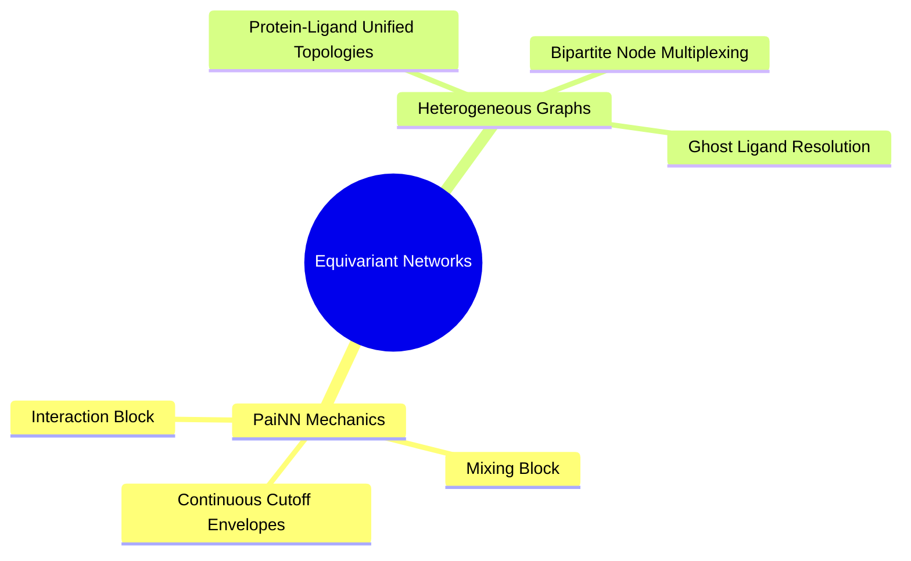

## Detailed Chapters

- **Chapter 1. Polarizable Atom Interaction Networks**
  - [[1. PaiNN Interaction Block and Directional Message Passing]]
  - [[2. PaiNN Mixing Block and Invariant-Equivariant Gating]]
  - [[3. Continuous Cosine Cutoffs and Radial Basis Envelopes]]
- **Chapter 2. Heterogeneous Molecular Modeling**
  - [[1. The Ghost Ligand Problem in Molecular Design]]
  - [[2. Bipartite Protein-Ligand Graph Construction]]
  - [[3. Node-Type Feature Multiplexing and Edge Partitioning]]

---

### `06. Equivariant Architectures: PaiNN and Bipartite Graphs/Chapter 1. Polarizable Atom Interaction Networks/1. PaiNN Interaction Block and Directional Message Passing.md`

# 1. PaiNN Interaction Block and Directional Message Passing

> [!abstract] Mathematical Core
> The PaiNN interaction block propagates physical information across directed spatial edges $(j \to i)$. It updates invariant scalar channels using learned distance filters while updating directional vector channels using projections along spatial unit displacement vectors $\hat{\mathbf{r}}_{ij}$.

## 1. What It Is

In the Polarizable Atom Interaction Network (PaiNN), each atom $i$ maintains two distinct feature representations:
- **Scalar Channel**: $\mathbf{s}_i \in \mathbb{R}^d$, an $\mathrm{SO}(3)$-invariant feature vector.
- **Vector Channel**: $\vec{\mathbf{v}}_i \in \mathbb{R}^{3 \times d}$, an $\mathrm{SO}(3)$-equivariant tensor containing $d$ distinct 3D spatial vectors.

The **Interaction Block** updates these states by gathering messages across all neighboring atoms $j$ within the interaction cutoff $r_{\text{cut}}$:

$$\Delta \mathbf{s}_i = \sum_{j \in \mathcal{N}(i)} \mathbf{s}_j \odot \phi_s(d_{ij})$$

$$\Delta \vec{\mathbf{v}}_i = \sum_{j \in \mathcal{N}(i)} \left( \vec{\mathbf{v}}_j \odot \phi_v(d_{ij}) + \hat{\mathbf{r}}_{ij} \otimes \left( \mathbf{s}_j \odot \phi_{vv}(d_{ij}) \right) \right)$$

where:
- $d_{ij} = \|\mathbf{x}_i - \mathbf{x}_j\|_2$ is the Euclidean distance between atoms $i$ and $j$.
- $\hat{\mathbf{r}}_{ij} = \frac{\mathbf{x}_i - \mathbf{x}_j}{d_{ij}}$ is the directional unit displacement vector.
- $\phi(d_{ij}) = \text{MLP}(\text{RBF}(d_{ij})) \in \mathbb{R}^{3d}$ represents distance-dependent filter weights split into three feature vectors: $\phi_s, \phi_v, \phi_{vv} \in \mathbb{R}^d$.
- $\odot$ denotes element-wise feature multiplication.
- $\otimes$ denotes an outer product mapping a spatial vector and a feature vector into a $[3, d]$ tensor.

## 2. Why It Exists

Standard graph neural networks operate solely on scalar distances $d_{ij}$. As a result, an atom cannot determine *where* neighboring atoms are located directionally; it only knows how far away they are.

Spherical tensor networks (such as NequIP and Allegro) capture directional information using higher-order spherical harmonics and Clebsch-Gordan tensor products. However, evaluating these products is computationally intensive, scaling poorly with the maximum tensor order used.

PaiNN avoids this complexity by restricting directional representations to first-order Cartesian vectors ($\vec{\mathbf{v}} \in \mathbb{R}^{3 \times d}$). This allows directional messages to be constructed using simple outer products with spatial displacement vectors $\hat{\mathbf{r}}_{ij}$, achieving $\mathrm{SO}(3)$-equivariant message passing with low $O(E)$ computational overhead.

```text
Message Types in PaiNN Interaction:
1. Scalar Message:       s_j * phi_s(d_ij)               (Updates internal scalar chemistry)
2. Vector Relay:         v_j * phi_v(d_ij)               (Propagates existing directional fields)
3. Geometric Formation:  r_hat_ij (x) [s_j * phi_vv]     (Builds new directional vectors from geometry)
```

## 3. How It Works

### 3.1 Proving $\mathrm{SO}(3)$ Equivariance

Let $\mathbf{R} \in \mathrm{SO}(3)$ be an arbitrary 3D rotation matrix applied to atomic coordinates:

$$\mathbf{x}_i' = \mathbf{R} \mathbf{x}_i \quad \forall i \in \mathcal{V}$$

Evaluating the transformed pairwise distance and unit displacement vector:

$$d_{ij}' = \|\mathbf{R} \mathbf{x}_i - \mathbf{R} \mathbf{x}_j\|_2 = \|\mathbf{R}(\mathbf{x}_i - \mathbf{x}_j)\|_2 = \|\mathbf{x}_i - \mathbf{x}_j\|_2 = d_{ij}$$

The distance $d_{ij}$ is invariant, which means the radial basis functions and filter weights remain unchanged:

$$\phi(d_{ij}') = \phi(d_{ij})$$

Evaluating the transformed unit displacement vector:

$$\hat{\mathbf{r}}_{ij}' = \frac{\mathbf{R} \mathbf{x}_i - \mathbf{R} \mathbf{x}_j}{d_{ij}'} = \frac{\mathbf{R}(\mathbf{x}_i - \mathbf{x}_j)}{d_{ij}} = \mathbf{R} \hat{\mathbf{r}}_{ij}$$

The unit vector rotates equivariantly under $\mathbf{R}$.

Now evaluate the updated vector message $\Delta \vec{\mathbf{v}}_i'$ under the assumption that input vector channels transform equivariantly ($\vec{\mathbf{v}}_j' = \mathbf{R} \vec{\mathbf{v}}_j$):

$$\Delta \vec{\mathbf{v}}_i' = \sum_{j} \left( (\mathbf{R} \vec{\mathbf{v}}_j) \odot \phi_v(d_{ij}) + (\mathbf{R} \hat{\mathbf{r}}_{ij}) \otimes (\mathbf{s}_j \odot \phi_{vv}(d_{ij})) \right)$$

Factoring out the rotation matrix $\mathbf{R}$:

$$\Delta \vec{\mathbf{v}}_i' = \mathbf{R} \left[ \sum_{j} \left( \vec{\mathbf{v}}_j \odot \phi_v(d_{ij}) + \hat{\mathbf{r}}_{ij} \otimes (\mathbf{s}_j \odot \phi_{vv}(d_{ij})) \right) \right] = \mathbf{R} \, \Delta \vec{\mathbf{v}}_i$$

This proves that the updated vector channel transforms equivariantly under rotations, while scalar updates $\Delta \mathbf{s}_i$ remain strictly invariant.

## 4. What It Consists Of

- **Radial Filter MLP**: A neural network that maps Gaussian radial basis features to a $3d$-dimensional feature vector: $[\phi_s, \phi_v, \phi_{vv}]$.
- **Scalar Message Channel**: Updates internal invariant features based on neighbor chemistry and distances.
- **Directional Message Channel**: Constructs and propagates spatial vector fields along directed edges.

## 5. What You Must Understand

> [!warning] Pitfall: Generating Vectors from Invariant Scalars Violates Equivariance
> Passing scalar features $\mathbf{s}_i$ through a linear layer with 3 outputs ($\mathbf{W} \in \mathbb{R}^{d \times 3}$) does **not** produce an equivariant vector. The resulting three numbers will not rotate when the input coordinates are rotated. In PaiNN, new spatial vectors can **only** be constructed by scaling actual geometric displacement vectors ($\hat{\mathbf{r}}_{ij}$).

## 6. Prerequisites

- [[1. The Message-Passing Neural Network Formalism]]
- [[1. Scalar Invariants vs Cartesian Vector Equivariance]]
- [[3. Non-Singular Vector Norms and Directional Regularization]]

## 7. Project Connection

In `syntree/models/equivariant.py`, the interaction step is implemented inside `PaiNNInteraction`:
```python
# Compute directional message filters from radial features
filters = self.filter_mlp(edge_rbf)
f_s, f_v, f_vv = torch.split(filters, self.hidden_dim, dim=-1)

# Construct scalar and vector messages along edges
msg_s = scalar[col] * f_s
msg_v = vector[col] * f_v.unsqueeze(1) + dir_vec.unsqueeze(-1) * f_vv.unsqueeze(1)

# Aggregate messages into destination atoms
agg_s.index_add_(0, row, msg_s)
agg_v.index_add_(0, row, msg_v)
```

## 8. Required Depth

**Essential**: This interaction block is the primary mechanism for spatial message passing in the model's equivariant backbone.

## 9. Further Dependencies

- [[2. PaiNN Mixing Block and Invariant-Equivariant Gating]]
- [[2. Bipartite Protein-Ligand Graph Construction]]

---

### `06. Equivariant Architectures: PaiNN and Bipartite Graphs/Chapter 1. Polarizable Atom Interaction Networks/2. PaiNN Mixing Block and Invariant-Equivariant Gating.md`

# 2. PaiNN Mixing Block and Invariant-Equivariant Gating

> [!abstract] Mathematical Core
> The PaiNN mixing block couples scalar and vector channels within each individual atom. It allows scalar features to read vector magnitudes via rotation-invariant norms, while updating vector directions through channel-wise linear transformations and scalar-controlled gating.

## 1. What It Is

While the interaction block propagates information *between* different atoms, the **Mixing Block** updates representations *within* each individual atom.

For each atom $i$, the mixing block performs two coupled updates:

1. **Equivariant-to-Invariant Mapping**:
   The model computes the magnitudes of the vector channels using a smooth Euclidean norm, producing invariant scalar features:
   $$v_i^{\text{norm}} = \|\mathbf{W}_v \vec{\mathbf{v}}_i\|_{\epsilon} \in \mathbb{R}^d$$

2. **Invariant-to-Equivariant Gating**:
   Scalar features are combined with these vector magnitudes, processed through an MLP, and used to scale the vector channels:
   $$\begin{bmatrix} \mathbf{\Delta} \mathbf{s}_i \\ \mathbf{g}_v \\ \mathbf{g}_{vv} \end{bmatrix} = \text{MLP}\left( [\mathbf{s}_i, \; v_i^{\text{norm}}] \right) \in \mathbb{R}^{3d}$$

$$\mathbf{s}_i^{(t+1)} = \mathbf{s}_i^{(t)} + \mathbf{\Delta} \mathbf{s}_i$$

$$\vec{\mathbf{v}}_i^{(t+1)} = \vec{\mathbf{v}}_i^{(t)} \odot \mathbf{g}_v + (\mathbf{W}_{vv} \vec{\mathbf{v}}_i^{(t)}) \odot \mathbf{g}_{vv}$$

where $\mathbf{W}_v, \mathbf{W}_{vv} \in \mathbb{R}^{d \times d}$ are linear weights operating across feature channels, and $\mathbf{g}_v, \mathbf{g}_{vv} \in \mathbb{R}^d$ act as scalar gates controlling vector magnitudes.

```text
Intra-Atom Channel Mixing:
Vector Channels [3, d] ---> Linear Projection W_v ---> Safe Norm ---> Vector Norm [d]
                                                                            |
                                                                            v
Scalar Channels [d]    -----------------------------------------> Concatenate [2d]
                                                                            |
                                                                            v
                                                                        Mixing MLP
                                                                            |
         +------------------------------------------------------------------+
         |                                |                                 |
         v                                v                                 v
Scalar Delta [d]                  Vector Gate g_v [d]              Vector Gate g_vv [d]
         |                                |                                 |
         v                                v                                 v
s_new = s + Delta_s             v_new = (v * g_v) + (W_vv * v) * g_vv
```

## 2. Why It Exists

If vector and scalar channels were kept entirely separate:
- Scalar channels would never learn about directional asymmetry in the environment (e.g., "All neighboring atoms are located on one side").
- Vector channels would act as simple linear accumulators of spatial displacements, unable to adjust their directions based on chemical context.

The mixing block enables rich, bidirectional communication:
1. **Vectors inform scalars**: When an atom experiences an asymmetrical environment, its vector channels develop non-zero magnitudes. The norm operation extracts this directional intensity as an invariant scalar, alerting the scalar channels to the spatial asymmetry.
2. **Scalars control vectors**: Chemical context (such as formal charges or hybridization states) dynamically gates, filters, or reorients the vector channels.

## 3. How It Works

### 3.1 Preserving Equivariance Across Linear Channel Mixing

A common question when designing equivariant networks is: *Why does multiplying a vector tensor $\vec{\mathbf{v}} \in \mathbb{R}^{3 \times d}$ by a weight matrix $\mathbf{W} \in \mathbb{R}^{d \times d}$ preserve $\mathrm{SO}(3)$ equivariance?*

Let $\vec{\mathbf{v}}$ be represented as three spatial row vectors:

$$\vec{\mathbf{v}} = \begin{bmatrix} \mathbf{v}_x^T \\ \mathbf{v}_y^T \\ \mathbf{v}_z^T \end{bmatrix} \in \mathbb{R}^{3 \times d}$$

Applying a 3D rotation $\mathbf{R} \in \mathrm{SO}(3)$ rotates these coordinates along the spatial axis (multiplying from the left):

$$\vec{\mathbf{v}}' = \mathbf{R} \vec{\mathbf{v}} \in \mathbb{R}^{3 \times d}$$

Now apply the channel mixing weight matrix $\mathbf{W} \in \mathbb{R}^{d \times d}$, which operates along the feature axis (multiplying from the right):

$$\vec{\mathbf{u}} = \vec{\mathbf{v}} \mathbf{W}$$

Evaluating the transformed mixed output under the rotated input $\vec{\mathbf{v}}'$:

$$\vec{\mathbf{u}}' = \vec{\mathbf{v}}' \mathbf{W} = (\mathbf{R} \vec{\mathbf{v}}) \mathbf{W}$$

Because matrix multiplication is associative, we can reorder the terms:

$$(\mathbf{R} \vec{\mathbf{v}}) \mathbf{W} = \mathbf{R} (\vec{\mathbf{v}} \mathbf{W}) = \mathbf{R} \vec{\mathbf{u}}$$

This confirms that the transformation commutes:

$$\vec{\mathbf{u}}' = \mathbf{R} \vec{\mathbf{u}}$$

Applying linear layers across the feature channels ($d$) does not interfere with spatial rotations acting on the coordinate axes ($3$). This allows the network to learn rich feature representations while remaining strictly $\mathrm{SO}(3)$-equivariant.

## 4. What It Consists Of

- **Channel-Wise Projection Matrix ($\mathbf{W}_v$)**: Mixes representations across feature channels without altering 3D spatial orientations.
- **Invariant Norm Reducer**: Converts vector channels into invariant scalar magnitudes using `safe_norm`.
- **Gating Multi-Layer Perceptron**: Generates scalar updates and gating values from concatenated feature norms.
- **Vector Gating Layers**: Scales and updates directional vector channels using the predicted scalar gates.

## 5. What You Must Understand

> [!warning] Pitfall: Never Apply Non-Linearities Directly to Vector Components
> Applying non-linear activation functions (such as ReLU, GELU, or SiLU) directly to the spatial components of a vector breaks rotational equivariance:
> $$\text{ReLU}(\mathbf{R} \mathbf{v}) \neq \mathbf{R} \, \text{ReLU}(\mathbf{v})$$
> Non-linear transformations must **only** be applied to invariant scalar features or vector magnitudes. Vector channels can only be modified through scalar multiplication, linear combinations across channels, or rotations.

## 6. Prerequisites

- [[1. PaiNN Interaction Block and Directional Message Passing]]
- [[3. Non-Singular Vector Norms and Directional Regularization]]

## 7. Project Connection

In `syntree/models/equivariant.py`, the mixing step is implemented inside `PaiNNMixing`:
```python
# Project vector channels and compute invariant magnitudes
vec_proj = self.vec_proj(vector)
v_norm = safe_norm(vec_proj, dim=1) # [N, hidden_dim]

# Process concatenated scalars and norms through the mixing MLP
h = torch.cat([scalar, v_norm], dim=-1)
u = self.update_mlp(h)
a_ss, a_sv, a_vv = torch.split(u, self.hidden_dim, dim=-1)

# Update scalar and vector representations
scalar_out = scalar + a_ss
vector_out = vector * a_sv.unsqueeze(1) + vec_proj * a_vv.unsqueeze(1)
```

## 8. Required Depth

**Essential**: This coupling mechanism is what allows the equivariant backbone to combine chemical properties and spatial geometry into unified representations.

## 9. Further Dependencies

- [[2. Bipartite Protein-Ligand Graph Construction]]
- [[1. The Amos Ratio Approximation and Gradient Stabilization]]

---

## 07. Directional Statistics and Torsion Manifolds

### `07. Directional Statistics and Torsion Manifolds/0. Directional Statistics MOC.md`

# 0. Directional Statistics MOC

> [!abstract] Module Overview
> Mathematical foundations of circular statistics on the Riemannian manifold $\mathrm{SO}(2)$, the von Mises distribution, Amos' continued fraction approximation, and categorical dihedral action spaces.

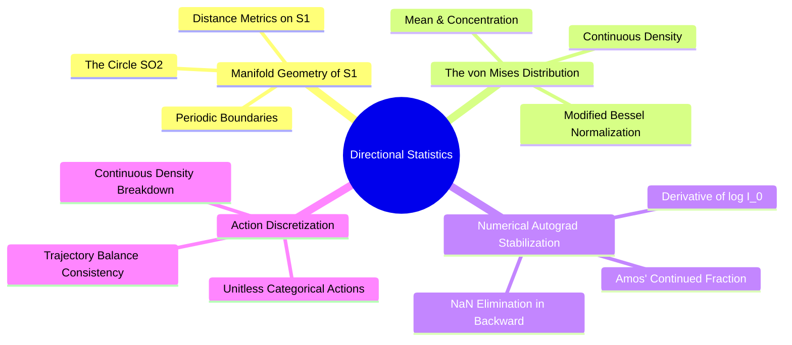

## Detailed Chapters

- **Chapter 1. Riemannian Geometry of the Circle**
  - [[1. The Topology of SO(2) and the Seam Discontinuity]]
  - [[2. The von Mises Distribution on S1]]
  - [[3. Modified Bessel Functions of the First Kind]]
- **Chapter 2. Torsion Prediction and Optimization**
  - [[1. The Amos Ratio Approximation and Gradient Stabilization]]
  - [[2. Measure-Theoretic Collapse of Continuous-Discrete TB]]
  - [[3. Categorical Dihedral Discretization vs Continuous Heads]]

---

### `07. Directional Statistics and Torsion Manifolds/Chapter 2. Torsion Prediction and Optimization/1. The Amos Ratio Approximation and Gradient Stabilization.md`

# 1. The Amos Ratio Approximation and Gradient Stabilization

> [!abstract] Mathematical Core
> Training against a continuous von Mises distribution requires computing the derivative of the log modified Bessel function $\frac{d}{d\kappa} \log I_0(\kappa) = \frac{I_1(\kappa)}{I_0(\kappa)}$. Naive autograd through power-series expansions causes gradient explosions for $\kappa > 10$. We stabilize this computation by implementing an analytic backward pass based on **Amos' continued fraction approximation**.

## 1. What It Is

The probability density of the von Mises distribution on the circle $\phi \in [-\pi, \pi)$ is defined as:

$$p(\phi \mid \mu, \kappa) = \frac{\exp(\kappa \cos(\phi - \mu))}{2\pi I_0(\kappa)}$$

where $I_0(\kappa)$ is the modified Bessel function of the first kind of order zero:

$$I_0(\kappa) = \sum_{m=0}^\infty \frac{1}{(m!)^2} \left( \frac{\kappa}{2} \right)^{2m}$$

The negative log-likelihood (NLL) loss for a ground-truth angle $\phi^*$ is:

$$\mathcal{L}_{\text{NLL}}(\mu, \kappa) = -\log p(\phi^* \mid \mu, \kappa) = -\kappa \cos(\phi^* - \mu) + \log(2\pi) + \log I_0(\kappa)$$

Evaluating the gradient of this loss with respect to the concentration parameter $\kappa$:

$$\frac{\partial \mathcal{L}_{\text{NLL}}}{\partial \kappa} = -\cos(\phi^* - \mu) + \frac{d}{d\kappa} \log I_0(\kappa) = -\cos(\phi^* - \mu) + \frac{I_1(\kappa)}{I_0(\kappa)}$$

where $I_1(\kappa) = I_0'(\kappa)$ is the modified Bessel function of order one.

The function $A(\kappa) = \frac{I_1(\kappa)}{I_0(\kappa)}$ is the **Bessel ratio**. It represents the expected cosine similarity under the distribution:

$$A(\kappa) = \mathbb{E}_{\phi \sim \mathcal{VM}}[\cos(\phi - \mu)] \in [0, 1)$$

## 2. Why It Exists

Evaluating $I_0(\kappa)$ naively by unrolling its power series in PyTorch causes severe numerical instability when $\kappa > 10$:

1. **Exponential Value Growth**:
   As $\kappa$ increases, $I_0(\kappa)$ grows exponentially:
   $$I_0(50) \approx 2.9 \times 10^{20}, \quad I_0(100) \approx 1.1 \times 10^{42} \implies \text{Overflows standard FP32!}$$
2. **Gradient Explosion in Intermediate Computations**:
   Differentiating through an unrolled 20-term polynomial series causes intermediate gradients to explode, scaling as $O(I_0(\kappa))$.
3. **Loss Contamination**:
   When $\kappa > 10$, evaluating the series in single precision yields `inf` values, which quickly produce `NaN` gradients that corrupt model weights.

However, the true derivative we want to compute—the ratio $A(\kappa) = \frac{I_1(\kappa)}{I_0(\kappa)}$—is mathematically smooth and bounded between $0.0$ and $1.0$ for all $\kappa \ge 0$. The instability is entirely an artifact of differentiating through the unrolled series rather than evaluating the ratio directly.

## 3. How It Works

### 3.1 Amos' Continued Fraction Approximation

In 1974, Donald E. Amos proved that the ratio $A(\kappa) = \frac{I_1(\kappa)}{I_0(\kappa)}$ can be tightly bounded and approximated using continued fractions. The first-order upper bound yields a remarkably accurate closed-form approximation:

$$A(\kappa) = \frac{I_1(\kappa)}{I_0(\kappa)} \approx \frac{\kappa}{0.5 + \sqrt{\kappa^2 + 2.25}}$$

```text
Behavior of the Amos Ratio A(kappa):
At kappa = 0:    A(0)   = 0 / (0.5 + 1.5) = 0.0
At kappa -> inf: A(inf) -> kappa / sqrt(kappa^2) = 1.0
Domain: Strictly bounded within [0.0, 1.0) for all kappa >= 0.
```

Checking its approximation error against the true Bessel ratio:
- At $\kappa = 1.0$: $\text{Approximation} = 0.434$, $\text{True} = 0.446$ (Error $< 2.7\%$)
- At $\kappa = 10.0$: $\text{Approximation} = 0.942$, $\text{True} = 0.949$ (Error $< 0.7\%$)
- At $\kappa = 100.0$: $\text{Approximation} = 0.9949$, $\text{True} = 0.9950$ (Error $< 0.01\%$)

The approximation becomes increasingly accurate as $\kappa$ grows—precisely in the regime where the naive power-series expansion overflows.

### 3.2 Custom Autograd Operator Implementation

We implement this stabilized operator in PyTorch by decoupling the forward evaluation from the backward gradient calculation:

```python
import math
import torch

class StableLogBesselI0(torch.autograd.Function):
    @staticmethod
    def forward(ctx, kappa: torch.Tensor) -> torch.Tensor:
        ctx.save_for_backward(kappa)
        k = kappa.double()
        small_mask = k < 12.0
        
        # 1. For small kappa, evaluate the power series in float64 log-space
        k2 = (k * 0.5) ** 2
        tot = torch.ones_like(k)
        term = torch.ones_like(k)
        for i in range(1, 22):
            term = term * k2 / (i * i)
            tot = tot + term
            if (term < 1e-12 * tot).all():
                break
        res_small = torch.log(tot.clamp(min=1e-30))
        
        # 2. For large kappa, use the stable asymptotic expansion
        # Formula: log I_0(k) ~ k - 0.5*log(2*pi*k) + 1/(8k)
        inv = 1.0 / (8.0 * k.clamp(min=1e-6))
        res_large = k - 0.5 * (math.log(2.0 * math.pi) + torch.log(k.clamp(min=1e-6))) + torch.log1p(
            inv * (1.0 + inv * (4.5 + inv * 37.5))
        )
        
        return torch.where(small_mask, res_small, res_large).to(kappa.dtype)

    @staticmethod
    def backward(ctx, grad_output: torch.Tensor) -> torch.Tensor:
        (kappa,) = ctx.saved_tensors
        k = kappa.double().clamp(min=1e-6)
        
        # Evaluate the Vector-Jacobian Product using the closed-form Amos ratio
        amos_ratio = k / (0.5 + torch.sqrt(k * k + 2.25))
        
        return (grad_output * amos_ratio).to(kappa.dtype)
```

## 4. What It Consists Of

- **Bessel Ratio ($A(\kappa)$)**: The ratio $\frac{I_1(\kappa)}{I_0(\kappa)}$, which defines the analytical derivative of $\log I_0(\kappa)$.
- **Asymptotic Expansion**: An analytical approximation used to evaluate $\log I_0(\kappa)$ for large $\kappa$ without computing raw exponential values.
- **Amos Continued Fraction**: The closed-form approximation used to compute stable Vector-Jacobian Products during backpropagation.

## 5. What You Must Understand

> [!warning] Pitfall: Differentiating Through `torch.where` Evaluates Both Branches
> In PyTorch, writing:
> ```python
> out = torch.where(mask, series_calc(k), asymptotic_calc(k))
> ```
> executes the backward pass through **both** functions, even for elements where the condition was false. If `series_calc(k)` overflows for large values, the resulting `NaN` will propagate through the backward pass, contaminating the gradients. Custom autograd operators prevent this by bypassing graph construction entirely.

## 6. Prerequisites

- [[2. The von Mises Distribution on S1]]
- [[3. Custom Autograd Function Design and Backward Hooks]]

## 7. Project Connection

In Issue #8 (`[MATH-02]`), this custom autograd operator was added to `syntree/models/torsion_head.py` to stabilize the continuous torsion head:
```python
def log_prob(mu: torch.Tensor, kappa: torch.Tensor, phi: torch.Tensor) -> torch.Tensor:
    return kappa * torch.cos(phi - mu) - math.log(2.0 * math.pi) - StableLogBesselI0.apply(kappa)
```
This eliminated the `NaN` losses and gradient explosions that previously occurred during Stage-1 behavioral cloning when $\kappa > 10$.

## 8. Required Depth

**Supporting**: Required to understand the numerical stabilization of continuous circular loss functions in PyTorch.

## 9. Further Dependencies

- [[2. Measure-Theoretic Collapse of Continuous-Discrete TB]]
- [[3. Categorical Dihedral Discretization vs Continuous Heads]]

---

### `07. Directional Statistics and Torsion Manifolds/Chapter 2. Torsion Prediction and Optimization/2. Measure-Theoretic Collapse of Continuous-Discrete TB.md`

# 2. Measure-Theoretic Collapse of Continuous-Discrete TB

> [!abstract] Mathematical Core
> Mixing discrete probability masses $P(a) \in [0, 1]$ and continuous probability densities $p(\phi) \in \mathbb{R}^+$ (measured in $\text{rad}^{-1}$) within a single GFlowNet Trajectory Balance objective breaks measure-theoretic consistency. This mismatch creates an unconstrained optimization loophole where the policy drives concentration parameters to infinity ($\kappa \to \infty$) to artificially maximize continuous density values.

## 1. What It Is

In Generative Flow Networks (GFlowNets), the policy is trained using the **Trajectory Balance (TB)** objective over complete trajectories $\tau = (s_0 \to s_1 \to \dots \to s_T = x)$:

$$\mathcal{L}_{\text{TB}}(\tau) = \left( \log Z + \sum_{t=0}^{T-1} \log P_F(a_t \mid s_t) - \log R(x) - \sum_{t=0}^{T-1} \log P_B(s_t \mid s_{t+1}) \right)^2$$

This objective requires that:
1. The forward trajectory probability $P_F(\tau) = \prod_{t=0}^{T-1} P_F(a_t \mid s_t)$ and backward probability $P_B(\tau \mid x)$ are valid probability densities defined with respect to the **same underlying base measure** $\mu$.
2. The partition function $Z$ represents the total integrated reward mass across the entire termination space:
   $$Z = \int_{\mathcal{X}} R(x) \, d\mu(x)$$

If an action $a_t$ combines discrete choices (reaction family $r_t$, synthon $B_t$) and a continuous dihedral angle ($\phi_t$), the forward probability decomposes across different mathematical spaces:

$$P_F(a_t \mid s_t) = P(r_t \mid s_t) \cdot P(B_t \mid r_t, s_t) \cdot p(\phi_t \mid B_t, r_t, s_t)$$

Here, $P(r_t)$ and $P(B_t)$ are **discrete probability masses** (dimensionless numbers in $[0, 1]$), while $p(\phi_t)$ is a **continuous probability density** with physical units of $\text{radians}^{-1}$.

## 2. Why It Exists

To evaluate the Trajectory Balance loss, all terms are converted to logarithms and summed. Taking the logarithm of a continuous density whose units are $\text{radians}^{-1}$ introduces a dimensional inconsistency:

$$\log P_F(a_t \mid s_t) = \log P(r_t) + \log P(B_t) + \log \left( p(\phi_t) \, [\text{rad}^{-1}] \right)$$

This creates two fundamental issues:
1. **Unit Sensitivity**:
   If angles are expressed in degrees instead of radians, the density rescales:
   $$p_{\text{deg}}(\phi) = p_{\text{rad}}(\phi) \cdot \frac{\pi}{180} \implies \log p_{\text{deg}}(\phi) = \log p_{\text{rad}}(\phi) - 4.05$$
   The value of the loss function changes arbitrarily depending on the choice of angular units, destroying scale invariance.
2. **Probability Inconsistency**:
   A discrete probability mass is strictly bounded by $1.0$, meaning its log-probability is always non-positive ($\log P \le 0$). A continuous probability density, however, has no upper bound ($p(\phi) \in [0, \infty)$) and its logarithm can become arbitrarily large and positive ($\log p > 0$).

## 3. How It Works

### 3.1 The Infinite Density Optimization Exploit ($\kappa \to \infty$)

Consider what happens when the policy predicts dihedral angles using a continuous von Mises distribution:

$$p(\phi \mid \mu, \kappa) = \frac{\exp(\kappa \cos(\phi - \mu))}{2\pi I_0(\kappa)}$$

Evaluating the density at the predicted mean ($\phi = \mu$):

$$p(\mu \mid \mu, \kappa) = \frac{e^\kappa}{2\pi I_0(\kappa)}$$

Using the asymptotic expansion of the modified Bessel function for large $\kappa$:

$$I_0(\kappa) \approx \frac{e^\kappa}{\sqrt{2\pi \kappa}} \quad \text{as } \kappa \to \infty$$

Substituting this into the density formula:

$$p(\mu \mid \mu, \kappa) \approx \frac{e^\kappa}{2\pi \frac{e^\kappa}{\sqrt{2\pi \kappa}}} = \frac{\sqrt{2\pi \kappa}}{2\pi} = \sqrt{\frac{\kappa}{2\pi}}$$

Taking the logarithm:

$$\log p(\mu \mid \mu, \kappa) \approx \frac{1}{2} \log(\kappa) - \frac{1}{2} \log(2\pi)$$

As the policy increases its concentration parameter $\kappa$:

$$\lim_{\kappa \to \infty} \log p(\mu \mid \mu, \kappa) = \infty$$

```text
The Density Optimization Exploit:
In Trajectory Balance: Loss = ( log Z + sum(log P_F) - log R - sum(log P_B) )^2

If P_F contains a continuous density:
1. The policy samples an angle phi close to the mean mu.
2. The optimizer discovers that driving kappa -> inf makes log p(phi) -> +inf.
3. This artificially inflates sum(log P_F), driving the loss to zero without improving molecular design.
```

The optimizer exploits this loophole by setting $\kappa \to \infty$, collapsing the continuous distribution into a narrow spike (a Dirac delta function) to minimize the loss.

## 4. What It Consists Of

- **Probability Mass ($P \in [0, 1]$)**: A dimensionless probability defined over a discrete set.
- **Probability Density ($p \in \mathbb{R}^+$)**: A differential probability defined per unit of volume on a continuous manifold.
- **Mixed Product Measure**: An invalid probability construct that multiplies discrete masses and continuous densities without a normalizing reference measure.
- **Density Runaway**: An optimization failure where the model drives continuous density parameters to infinity to bypass discrete learning objectives.

## 5. What You Must Understand

> [!warning] Pitfall: Densities Cannot Be Treated as Probabilities in Flow Balances
> You cannot directly sum discrete log-probabilities and continuous log-densities in Trajectory Balance. Doing so breaks the identity $\sum_x P(x) = 1$, allowing the model to satisfy the flow equations by manipulating density scales rather than learning realistic chemical distributions.

## 6. Prerequisites

- [[2. The von Mises Distribution on S1]]
- [[2. The Trajectory Balance Objective]]

## 7. Project Connection

In Issue #24 (`[MODEL-04]`), this measure-theoretic collapse led us to replace the continuous von Mises head in Stage-2 GFlowNet training with a **categorical dihedral head** that discretizes the circle into 36 discrete $10^\circ$ bins:
$$\log P_F(a_t \mid s_t) = \log P(h_t) + \log P(r_t \mid h_t) + \log P(B_t \mid r_t) + \log P(c_t) + \log P(\phi_t^{\text{bin}})$$
This ensures that all action components are dimensionless discrete probabilities strictly bounded within $[0, 1]$, closing the infinite density loophole.

## 8. Required Depth

**Essential**: This theoretical insight justifies the discrete action space architecture used throughout the project's GFlowNet models.

## 9. Further Dependencies

- [[3. Categorical Dihedral Discretization vs Continuous Heads]]
- [[2. The Trajectory Balance Objective]]

---

### `07. Directional Statistics and Torsion Manifolds/Chapter 2. Torsion Prediction and Optimization/3. Categorical Dihedral Discretization vs Continuous Heads.md`

# 3. Categorical Dihedral Discretization vs Continuous Heads

> [!abstract] Mathematical Core
> Discretizing the continuous circle $\mathrm{SO}(2)$ into $N_\phi = 36$ categorical bins ($10^\circ$ resolution) establishes a unified, dimensionless discrete probability measure for all action components in the Trajectory Balance objective. Sub-bin geometric precision is recovered through a deterministic, environment-level refinement step, keeping policy training stable and mathematically sound.

## 1. What It Is

Instead of using a continuous distribution (such as a von Mises head) to predict dihedral angles, the model discretizes the continuous circle $[-\pi, \pi)$ into $N_\phi = 36$ equal-width bins:

$$\text{Bin}_k = \left[ -\pi + k \cdot \frac{2\pi}{N_\phi}, \; -\pi + (k+1) \cdot \frac{2\pi}{N_\phi} \right), \quad k \in \{0, 1, \dots, N_\phi - 1\}$$

For $N_\phi = 36$, each bin spans an arc of $10^\circ$ ($0.1745\text{ radians}$).

The policy predicts a discrete distribution over these 36 bins using a standard linear projection and softmax:

$$P(\phi_t = k \mid s_t, B_t) = \text{Softmax}(\mathbf{z}_{\text{torsion}})[k] = \frac{\exp(z_k)}{\sum_{j=0}^{35} \exp(z_j)}$$

```text
The Discretized Circle SO(2) (36 Bins of 10 degrees):
-pi (-180 deg)                                                     +pi (+180 deg)
|--Bin 0--|--Bin 1--|--Bin 2--| ... |--Bin 34--|--Bin 35--|
[-180,-170) [-170,-160) [-160,-150)       [160, 170)  [170, 180)
```

## 2. Why It Exists

As shown in [[2. Measure-Theoretic Collapse of Continuous-Discrete TB]], continuous probability densities cannot be mixed with discrete probability masses within the Trajectory Balance loss without breaking measure-theoretic consistency and causing concentration parameters to diverge ($\kappa \to \infty$).

Discretizing the dihedral angle into categorical bins resolves this issue:
1. **Unified Probability Measure**: Every action component—reaction choice, building block selection, stereochemistry, and dihedral angle—is represented as a dimensionless discrete probability mass in $[0, 1]$.
2. **Bounded Log-Likelihoods**: Every log-probability term is strictly non-positive ($\log P \le 0$). The model cannot inflate trajectory probabilities by narrowing continuous distributions.
3. **Multi-Modal Representations**: A categorical distribution over 36 bins can represent multi-modal dihedral preferences directly (such as staggered *gauche* and *anti* conformations), whereas a single unimodal von Mises distribution is restricted to a single peak.

## 3. How It Works

### 3.1 Resolving the Seam Discontinuity at the Boundary

In continuous regression, angles near the $-\pi / +\pi$ boundary cause numerical issues because $-179^\circ$ and $+179^\circ$ are physically close ($2^\circ$ apart) but numerically distant.

In our categorical formulation, the boundary falls cleanly along bin edges:
- $\text{Bin}_0 = [-180^\circ, -170^\circ)$
- $\text{Bin}_{35} = [+170^\circ, +180^\circ)$

The periodic seam is located at the interface between $\text{Bin}_{35}$ and $\text{Bin}_0$. Because the softmax function evaluates each bin as an independent category, no individual bin straddles the coordinate discontinuity.

### 3.2 Two-Stage Optimization: Discrete Selection + Sub-Bin Refinement

A potential concern with discretizing angles into $10^\circ$ bins is the loss of fine geometric precision. In flexible molecules, a $5^\circ$ error at a rotatable bond can cause significant atomic displacements several bonds away:

$$\Delta s = r \cdot \Delta \theta \approx 7.0\text{ \AA} \cdot \left(5^\circ \cdot \frac{\pi}{180^\circ}\right) \approx 0.61\text{ \AA}$$

A displacement of $0.61\text{ \AA}$ is large enough to cause steric clashes with pocket walls.

We resolve this by using a **two-stage optimization process**:

1. **Policy Level (Discrete Decision)**:
   The policy selects a discrete bin index $k \in \{0, \dots, 35\}$, establishing the primary rotamer conformation (such as *trans* or *gauche*). This selection is fully tracked within the discrete Trajectory Balance objective.
2. **Environment Level (Sub-Bin Geometric Refinement)**:
   Once the bin is selected, the environment performs a local, continuous refinement within the chosen bin's boundaries:
   $$\phi \in \left[ \phi_{\text{center}} - 5^\circ, \; \phi_{\text{center}} + 5^\circ \right]$$
   It minimizes steric clashes against the pocket using a bounded line search (such as golden-section search or Brent's method):
   $$\phi^* = \arg\min_{\phi \in [\phi_k^{\min}, \phi_k^{\max}]} E_{\text{clash}}(\phi)$$

Because this refinement step is deterministic and executed entirely within the environment, it does not alter the policy's discrete action probabilities. This preserves the mathematical consistency of the Trajectory Balance loss while ensuring smooth, clash-free molecular geometries.

```text
Two-Stage Torsion Architecture:
Stage 1: Policy Selection (Discrete Probability Space)
  SynTreePolicy ---> Softmax(logits) ---> Selects Bin 18 [0 to 10 deg] (P = 0.42)
                                                 |
Stage 2: Environment Refinement (Deterministic Continuous Space)
  MolecularAssemblyEnv ---> Golden Section Search within [0, 10 deg] ---> phi* = 4.2 deg
                                                 |
                                                 v
  Applies exact angle phi* to 3D conformer without modifying policy probability P
```

## 4. What It Consists Of

- **Categorical Torsion Head**: A linear layer projecting the 256-dimensional context vector to 36 discrete logit scores.
- **Bin Center Map**: An array mapping integer indices $k \in \{0, \dots, 35\}$ to baseline angles in radians:
  $$\phi_{\text{center}}[k] = -\pi + \left(k + \frac{1}{2}\right) \frac{2\pi}{36}$$
- **Sub-Bin Search Kernel**: A local optimization routine that refines angles within $\pm 5^\circ$ to minimize pocket clashes before applying force-field relaxation.

## 5. What You Must Understand

> [!warning] Pitfall: Sub-Bin Refinement Must Not Cross Bin Boundaries
> If the local optimization step is allowed to cross into neighboring bins ($\phi^* \notin [\phi_k^{\min}, \phi_k^{\max}]$), the physical conformation will no longer match the discrete action selected by the policy. This decouples the policy's action probabilities from the resulting molecular structure, corrupting training signals. The refinement step must be strictly constrained to the selected bin's interval.

## 6. Prerequisites

- [[2. Measure-Theoretic Collapse of Continuous-Discrete TB]]
- [[1. The Topology of SO(2) and the Seam Discontinuity]]

## 7. Project Connection

In Issue #24 (`[MODEL-04]`) and Issue #42 (`[CHEM-07]`), we implemented this categorical formulation across the model and environment:
1. `syntree/models/policy.py` defines the categorical head:
   ```python
   self.torsion_bin_head = nn.Linear(hidden_dim, 36)
   ```
2. `syntree/engine/environment.py` executes the bounded sub-bin refinement:
   ```python
   # Refine dihedral angle within the selected 10-degree bin
   refined_phi = self.refine_sub_bin_dihedral(
       mol, junction_bond, bin_idx=action.dihedral_bin, bin_width_deg=10.0
   )
   ```

## 8. Required Depth

**Essential**: This two-stage formulation ensures that the policy operates on a mathematically consistent discrete action space while producing accurate, clash-free 3D molecular conformations.

## 9. Further Dependencies

- [[2. The Trajectory Balance Objective]]
- [[1. Autoregressive Molecule Assembly Formulations]]

---

## 08. Generative Modeling, MDPs, and GFlowNets

### `08. Generative Modeling, MDPs, and GFlowNets/0. GFlowNets and Generative Modeling MOC.md`

# 0. GFlowNets and Generative Modeling MOC

> [!abstract] Module Overview
> Mathematical formulations of Markov Decision Processes for molecular synthesis, Directed Acyclic Graph (DAG) state spaces, Generative Flow Networks (GFlowNets), and the Trajectory Balance objective.

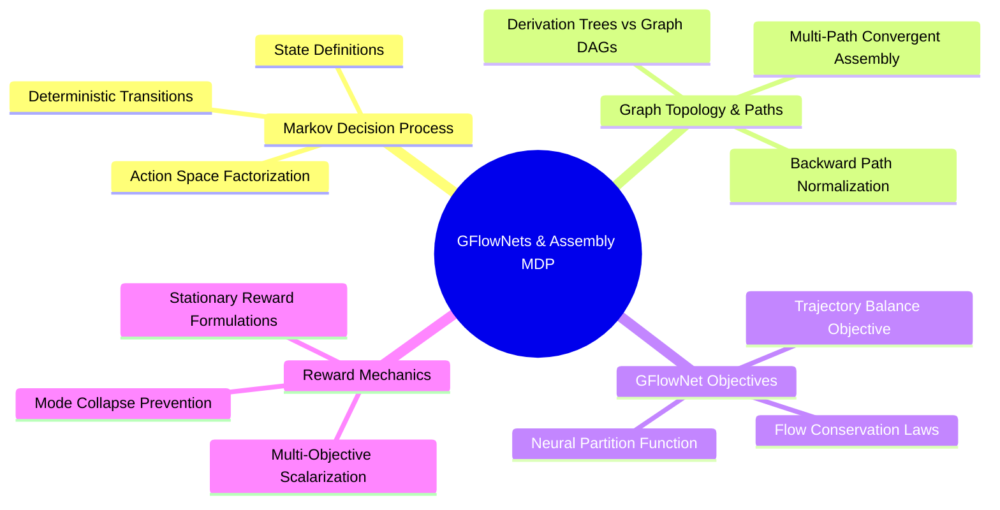

## Detailed Chapters

- **Chapter 1. Discrete Markov Decision Processes**
  - [[1. Autoregressive Molecule Assembly Formulations]]
  - [[2. Derivation Trees vs Molecular Graph DAGs]]
  - [[3. Action Space Factorization and Masking Operators]]
- **Chapter 2. Generative Flow Networks**
  - [[1. Flow Networks Flow Consistency and Markovian Flow]]
  - [[2. The Trajectory Balance Objective]]
  - [[3. Multi-Path Convergent Assembly and Backward Policies]]
  - [[4. Stationary Terminal Rewards vs Batch-Relative Drift]]

---

### `08. Generative Modeling, MDPs, and GFlowNets/Chapter 1. Discrete Markov Decision Processes/2. Derivation Trees vs Molecular Graph DAGs.md`

# 2. Derivation Trees vs Molecular Graph DAGs

> [!abstract] Mathematical Core
> When generating molecules through sequential additions, multiple distinct action sequences often produce the exact same final molecular structure. This creates a fundamental distinction between a **Derivation Tree** (where states encode the full sequence of actions taken) and a **Molecular Graph DAG** (where states correspond directly to unique molecular graphs).

## 1. What It Is

In sequential molecular generation, a state transition adds a chemical building block to a growing scaffold via a certified reaction:

$$s_{t+1} = \mathcal{T}(s_t, a_t)$$

This process can be modeled using two different state space representations:

1. **Derivation Tree**:
   Every state is defined by the complete history of actions taken to reach it:
   $$s_t^{\text{tree}} = (a_0, a_1, \dots, a_{t-1})$$
   Because each state uniquely records its own history, every state has **exactly one parent**. The state space forms a tree rooted at the initial state $s_0$.

2. **Molecular Graph Directed Acyclic Graph (DAG)**:
   Every state is defined purely by the current molecular structure, typically represented as an invariant canonical graph (such as a canonical SMILES string):
   $$s_t^{\text{DAG}} = \text{CanonicalGraph}(\mathcal{M}_t)$$
   If two different action sequences produce the same chemical structure, their trajectories converge to the same node in the graph. As a result, states can have **multiple parents**.

```text
Derivation Tree (Every state has 1 parent):
        s_0
       /   \
   s_{A}   s_{B}
     |       |
   s_{AB}  s_{BA}   <-- Distinct states, even though molecules are identical!

Molecular Graph DAG (Convergent paths merge):
        s_0
       /   \
    s_A     s_B
       \   /
       s_{AB}       <-- Single state with 2 distinct parents!
```

## 2. Why It Exists

Consider synthesizing a symmetric disubstituted benzene ring starting from a 1,4-difluorobenzene core. The synthesis requires two steps: attaching Fragment A and attaching Fragment B:
- **Path 1**: Attach Fragment A at position 1, then attach Fragment B at position 4 ($s_0 \to s_A \to s_{AB}$).
- **Path 2**: Attach Fragment B at position 4, then attach Fragment A at position 1 ($s_0 \to s_B \to s_{AB}$).

Both reaction paths produce the exact same target molecule $s_{AB}$.

This distinction is critical when training Generative Flow Networks (GFlowNets):
- If the model is formulated over a **Derivation Tree**, each path is treated as a separate terminal state. If the molecule receives reward $R(x)$, each path tries to claim that reward independently. This causes symmetric molecules with many synthesis routes to receive an artificially inflated share of probability mass.
- If the model is formulated over a **Molecular Graph DAG**, the backward policy $P_B$ must distribute probability mass across all valid parent states to maintain correct flow conservation.

## 3. How It Works

### 3.1 Flow Conservation with Multiple Parents

In a GFlowNet, the total flow entering a state must equal the total flow leaving it:

$$\sum_{s \in \mathcal{P}(s')} F(s \to s') = \sum_{s'' \in \mathcal{C}(s')} F(s' \to s'')$$

where $\mathcal{P}(s')$ denotes the set of all parents of state $s'$, and $\mathcal{C}(s')$ denotes the set of its children.

For a terminal state $x$, the flow exiting the state is equal to its reward:

$$F_{\text{exit}}(x) = R(x)$$

The total probability of generating molecule $x$ is the sum of probabilities across all possible trajectories $\tau$ that lead to $x$:

$$P(x) = \sum_{\tau = (s_0 \to \dots \to s_T = x)} P(\tau)$$

To ensure that $P(x) \propto R(x)$, the backward transition probability $P_B(s \mid s')$ must form a normalized distribution over all valid parents $\mathcal{P}(s')$:

$$\sum_{s \in \mathcal{P}(s')} P_B(s \mid s') = 1.0$$

### 3.2 The Multi-Path Over-Counting Trap

If a model uses a Molecular Graph DAG but naively assumes a single parent ($P_B(s \mid s') = 1.0$) during Trajectory Balance training:

$$\mathcal{L}_{\text{TB}}(\tau) = \left( \log Z + \sum_{t=0}^{T-1} \log P_F(a_t \mid s_t) - \log R(x) - \sum_{t=0}^{T-1} \log P_B(s_t \mid s_{t+1}) \right)^2$$

When $P_B$ is fixed to $1.0$ for all transitions, $\sum \log P_B = 0$. The Trajectory Balance loss forces every path to satisfy:

$$P(\tau) = \frac{R(x)}{Z}$$

If a molecule $x$ can be synthesized via $K$ distinct paths, its total probability becomes:

$$P(x) = \sum_{k=1}^K P(\tau_k) = \sum_{k=1}^K \frac{R(x)}{Z} = K \cdot \frac{R(x)}{Z}$$

The model over-samples molecule $x$ by a factor of $K$. Highly symmetric molecules with many valid assembly routes will dominate generation, causing the model to collapse onto redundant chemical structures.

### 3.3 The Uniform Backward Policy Solution

To resolve this issue, the backward policy must distribute probability mass over all valid parents. 

In `3D-SynTree`, we use a **uniform backward policy** over all chemically valid single-step retrosynthetic parents:

$$P_B(s \mid s') = \frac{1}{|\mathcal{P}(s')|}$$

where $|\mathcal{P}(s')|$ is the number of valid parent molecules that can produce $s'$ via a single certified reaction from our grammar.

```python
# Evaluating the Uniform Backward Policy in Trajectory Balance
valid_parents = retrosynthetic_decomposer.get_valid_parents(current_mol)
num_parents = len(valid_parents)

# Normalized backward probability for the transition
log_PB = -math.log(num_parents)
```

This ensures that $\sum_{s \in \mathcal{P}(s')} P_B(s \mid s') = 1.0$, preserving flow balance across convergent paths and preventing symmetric molecules from being over-sampled.

## 4. What It Consists Of

- **Derivation Tree**: A state space where states encode the full sequence of actions, ensuring every state has exactly one parent.
- **Molecular Graph DAG**: A state space where states correspond to unique chemical structures, allowing multiple trajectories to merge at the same node.
- **Retrosynthetic Parent Set ($\mathcal{P}(s)$)**: The set of all precursor molecules that can produce state $s$ via a single forward reaction.
- **Uniform Backward Policy**: Setting $P_B(s \mid s') = \frac{1}{|\mathcal{P}(s')|}$ to distribute probability mass evenly across all valid parents.

## 5. What You Must Understand

> [!warning] Pitfall: Assuming Unique Parents Breaks Flow Conservation
> Assuming $P_B = 1$ is valid **only** if states explicitly track their full action history. If states are defined as canonical molecular graphs (which merge identical structures), assuming $P_B = 1$ will cause the model to over-sample symmetric molecules in proportion to their number of synthesis paths.

## 6. Prerequisites

- [[1. Autoregressive Molecule Assembly Formulations]]
- Graph theory (Directed Acyclic Graphs, trees, topological sorting).

## 7. Project Connection

In Issue #38 (`[FLOW-04]`), we resolved this discrepancy in `syntree/engine/gflownet.py`. By defining states as canonical molecular graphs and pairing them with a uniform backward policy over retrosynthetic parents ($P_B = 1 / |\mathcal{P}|$), we ensured that Trajectory Balance converges to the correct reward-proportional distribution:
$$P(x) = \frac{R(x)}{Z}$$

## 8. Required Depth

**Essential**: Correct backward policy formulation is required to prevent mode collapse and over-sampling in GFlowNet training.

## 9. Further Dependencies

- [[1. Flow Networks Flow Consistency and Markovian Flow]]
- [[2. The Trajectory Balance Objective]]
- [[3. Multi-Path Convergent Assembly and Backward Policies]]

---

### `08. Generative Modeling, MDPs, and GFlowNets/Chapter 2. Generative Flow Networks/2. The Trajectory Balance Objective.md`

# 2. The Trajectory Balance Objective

> [!abstract] Mathematical Core
> The Trajectory Balance (TB) objective trains Generative Flow Networks by enforcing flow consistency along complete trajectories. By optimizing a single scalar parameter $\log Z$ alongside policy parameters $\theta$, TB ensures that complete trajectories are sampled with probability proportional to their terminal reward.

## 1. What It Is

Let $\tau = (s_0 \xrightarrow{a_0} s_1 \xrightarrow{a_1} \dots \xrightarrow{a_{T-1}} s_T = x)$ represent an entire generation trajectory from an initial state $s_0$ to a terminal molecule $x$.

The **Trajectory Balance (TB)** objective (Malkin et al., 2022) evaluates:

$$\mathcal{L}_{\text{TB}}(\tau; \theta, Z) = \left( \log \left( \frac{Z_\theta \prod_{t=0}^{T-1} P_F(a_t \mid s_t; \theta)}{R(x) \prod_{t=0}^{T-1} P_B(s_t \mid s_{t+1})} \right) \right)^2$$

Expanding into individual logarithmic terms:

$$\mathcal{L}_{\text{TB}}(\tau; \theta, Z) = \left( \log Z_\theta + \sum_{t=0}^{T-1} \log P_F(a_t \mid s_t; \theta) - \log R(x) - \sum_{t=0}^{T-1} \log P_B(s_t \mid s_{t+1}) \right)^2$$

where:
- $Z_\theta \in \mathbb{R}^+$ is a learnable scalar representing the estimated partition function (total flow in the network).
- $P_F(a_t \mid s_t; \theta)$ is the forward policy probability of choosing action $a_t$ from state $s_t$.
- $P_B(s_t \mid s_{t+1})$ is the backward policy probability of returning to parent state $s_t$ from state $s_{t+1}$.
- $R(x) \in \mathbb{R}^+$ is the positive scalar reward evaluated on the completed molecule $x$.

## 2. Why It Exists

Earlier GFlowNet objectives—such as **Flow Matching (FM)** and **Detailed Balance (DB)**—match flows locally at each state or transition:

$$\mathcal{L}_{\text{DB}}(s, s') = \left( \log F(s) + \log P_F(s' \mid s) - \log F(s') - \log P_B(s \mid s') \right)^2$$

While mathematically sound, Detailed Balance requires predicting a separate scalar flow value $F(s)$ for every intermediate state using an auxiliary neural network. This introduces two problems:
1. **Compounding Gradient Error**: Errors in intermediate flow predictions accumulate along the trajectory.
2. **Slow Credit Assignment**: Reward signals must propagate backwards through intermediate states one step at a time, requiring many training iterations.

Trajectory Balance solves this by evaluating flow consistency across the entire trajectory at once. The terminal reward $R(x)$ is compared directly against the trajectory's cumulative forward probability in a single step, speeding up training and improving gradient stability.

## 3. How It Works

### 3.1 Global Minimization and the Equilibrium Distribution

Suppose the Trajectory Balance loss reaches zero across all trajectories: $\mathcal{L}_{\text{TB}}(\tau) = 0$.

This implies:

$$\log Z + \sum_{t=0}^{T-1} \log P_F(a_t \mid s_t) - \log R(x) - \sum_{t=0}^{T-1} \log P_B(s_t \mid s_{t+1}) = 0$$

Exponentiating both sides:

$$Z \prod_{t=0}^{T-1} P_F(a_t \mid s_t) = R(x) \prod_{t=0}^{T-1} P_B(s_t \mid s_{t+1})$$

Rewriting in terms of trajectory probabilities:

$$Z \cdot P_F(\tau) = R(x) \cdot P_B(\tau \mid x)$$

Now sum both sides over all possible trajectories $\tau$ that terminate at molecule $x$:

$$\sum_{\tau \to x} Z \cdot P_F(\tau) = \sum_{\tau \to x} R(x) \cdot P_B(\tau \mid x)$$

Factoring out terms independent of the trajectory:

$$Z \sum_{\tau \to x} P_F(\tau) = R(x) \sum_{\tau \to x} P_B(\tau \mid x)$$

By definition, $\sum_{\tau \to x} P_F(\tau) = P(x)$ is the total probability of generating molecule $x$. Furthermore, because $P_B(\tau \mid x)$ is a normalized probability distribution over paths leading to $x$, its sum is identically 1:

$$\sum_{\tau \to x} P_B(\tau \mid x) = 1.0$$

Substituting these into the equation:

$$Z \cdot P(x) = R(x) \cdot 1.0 \implies P(x) = \frac{R(x)}{Z}$$

Summing this relationship over all possible terminal molecules $x \in \mathcal{X}$:

$$\sum_{x \in \mathcal{X}} P(x) = \sum_{x \in \mathcal{X}} \frac{R(x)}{Z} \implies 1 = \frac{1}{Z} \sum_{x \in \mathcal{X}} R(x) \implies Z = \sum_{x \in \mathcal{X}} R(x)$$

This yields two foundational results:
1. The forward policy samples completed molecules with probability strictly proportional to their reward: $P(x) \propto R(x)$.
2. The learnable parameter $Z$ converges to the exact sum of rewards across all reachable molecules.

### 3.2 Gradient Dynamics of the Learnable Parameter $\log Z$

Evaluating the gradient of the loss with respect to the scalar parameter $\log Z$:

$$\frac{\partial \mathcal{L}_{\text{TB}}}{\partial \log Z} = 2 \left( \log Z + \sum \log P_F - \log R - \sum \log P_B \right) \cdot 1 = 2 \cdot \Delta_{\text{TB}}$$

where $\Delta_{\text{TB}}$ is the residual error.

Using gradient descent to update $\log Z$:

$$\log Z \leftarrow \log Z - \eta_Z \cdot 2 \Delta_{\text{TB}}$$

- **If $\Delta_{\text{TB}} > 0$**: The current estimate of $Z$ is too high relative to the sampled trajectory's reward. The gradient update decreases $\log Z$.
- **If $\Delta_{\text{TB}} < 0$**: The trajectory discovered a higher-than-expected reward. The gradient update increases $\log Z$.

To ensure $\log Z$ adapts quickly to newly discovered reward peaks, it is standard practice to train $\log Z$ with a higher learning rate ($\eta_Z = 10^{-2}$) than the policy parameters ($\eta_\theta = 10^{-4}$).

## 4. What It Consists Of

- **Residual Error ($\Delta_{\text{TB}}$)**: The scalar difference between the trajectory's forward flow and backward flow.
- **Learnable Parameter ($\log Z$)**: A standalone scalar parameter that tracks the total reward mass in the environment.
- **Trajectory Trace**: The sequence of states, actions, masks, and log-probabilities recorded during generation.

## 5. What You Must Understand

> [!warning] Pitfall: Rewards of Zero Break Trajectory Balance
> If a generated molecule is invalid, clashing, or un-synthesizable, assigning a reward of zero ($R(x) = 0$) causes $\log R(x) = \log(0) = -\infty$. This results in `NaN` losses that break training. To prevent this, the reward function must include a small, positive floor ($R(x) \ge 10^{-4}$) so that $\log R(x)$ remains finite for all outputs.

## 6. Prerequisites

- [[1. Flow Networks Flow Consistency and Markovian Flow]]
- [[2. Derivation Trees vs Molecular Graph DAGs]]

## 7. Project Connection

In `syntree/engine/gflownet.py`, the `GFlowNetTrainer` class implements the Trajectory Balance loss:
```python
def trajectory_balance_loss(self, trajectory_trace: list, terminal_reward: float) -> torch.Tensor:
    # Ensure reward is strictly positive to prevent log(0)
    R = max(float(terminal_reward), 1e-4)
    log_R = torch.tensor(R, device=self.device).log()
    
    # Sum forward log-probabilities across trajectory steps
    sum_log_PF = torch.zeros(1, device=self.device)
    for step in trajectory_trace:
        sum_log_PF = sum_log_PF + step["action_log_prob"]
        
    # Backward flow accounting across valid retrosynthetic parents
    sum_log_PB = sum(step["log_PB"] for step in trajectory_trace)
    
    # Evaluate the squared Trajectory Balance residual
    diff = self.log_Z + sum_log_PF - log_R - sum_log_PB
    return diff.pow(2)
```

## 8. Required Depth

**Essential**: Trajectory Balance is the core training objective used for Stage-2 reinforcement learning throughout the project.

## 9. Further Dependencies

- [[3. Multi-Path Convergent Assembly and Backward Policies]]
- [[4. Stationary Terminal Rewards vs Batch-Relative Drift]]

---

### `08. Generative Modeling, MDPs, and GFlowNets/Chapter 2. Generative Flow Networks/4. Stationary Terminal Rewards vs Batch-Relative Drift.md`

# 4. Stationary Terminal Rewards vs Batch-Relative Drift

> [!abstract] Mathematical Core
> The Trajectory Balance objective relies on the assumption of a **stationary reward landscape**. If the reward assigned to a molecule changes based on which other molecules appear in the same training batch (for example, via batch-relative diversity bonuses), the target distribution drifts dynamically. This destabilizes the partition function $Z$, leading to training collapse.

## 1. What It Is

A reward function $R: \mathcal{X} \to \mathbb{R}^+$ is **stationary** if the score assigned to a molecule $x$ depends solely on the molecule itself and its target pocket environment $\mathcal{P}$:

$$R(x) = f(x, \mathcal{P})$$

For any fixed pair $(x, \mathcal{P})$, evaluating $R(x)$ will always return the exact same scalar value, regardless of when it is evaluated or what other molecules are sampled alongside it.

A reward function is **non-stationary** (or batch-relative) if its value depends on the composition of the current mini-batch $\mathcal{B} = \{x_1, x_2, \dots, x_B\}$:

$$R(x_i \mid \mathcal{B}) = f(x_i, \mathcal{P}) + \lambda \cdot \text{Diversity}(x_i, \mathcal{B} \setminus \{x_i\})$$

## 2. Why It Exists

To prevent mode collapse in generative policies, researchers often introduce diversity bonuses. A common approach penalizes molecules that are chemically similar to others in the same batch using Tanimoto similarity:

$$\text{Diversity}(x_i, \mathcal{B}) = \frac{1}{|\mathcal{B}| - 1} \sum_{j \neq i} \left( 1 - \text{Tanimoto}(x_i, x_j) \right)$$

While intuitive, introducing batch-relative terms into GFlowNet training causes serious theoretical and practical issues.

A GFlowNet matches its flow to a target distribution:

$$P(x) = \frac{R(x)}{Z}$$

If the reward $R(x_i \mid \mathcal{B})$ changes depending on the other molecules in the batch, the target distribution drifts from step to step:
- If molecule $x$ is sampled alongside similar molecules, its diversity score drops, lowering its reward.
- If the exact same molecule $x$ is sampled alongside dissimilar molecules, its diversity score rises, increasing its reward.

This forces the learnable partition function $Z$ to chase a moving target, causing optimization instability and gradient noise.

## 3. How It Works

### 3.1 The Breakdown of the Partition Function

Recall the Trajectory Balance identity:

$$\log Z + \sum \log P_F - \log R(x) - \sum \log P_B = 0$$

Under stationary rewards, $Z$ represents a fixed physical property of the environment—the total reward mass across all reachable molecules:

$$Z = \sum_{x \in \mathcal{X}} R(x)$$

When rewards are batch-relative, the effective reward assigned to a molecule depends on the policy's current sampling distribution:

$$R_{\text{eff}}(x; \theta) = \mathbb{E}_{\mathcal{B} \sim P_\theta}[R(x \mid \mathcal{B})]$$

As the policy parameters $\theta$ are updated during training, the sampling distribution $P_\theta$ changes, altering the average batch composition. This shifts the expected reward $R_{\text{eff}}(x; \theta)$, causing the true partition function $Z(\theta)$ to drift continuously throughout training.

```text
The Non-Stationary Drift Cycle:
Policy Updates (theta) ---> Batch Composition Shifts ---> Batch Diversity Rescales Rewards
           ^                                                                |
           |                                                                v
Partition Function Z Drifts <--- Target Distribution Changes <--- Loss Evaluates Moving Target
```

Because $Z$ is parameterized as a slowly moving scalar with its own learning rate, it cannot adapt quickly to these continuous shifts. This creates persistent residual errors in the Trajectory Balance loss, degrading training performance.

### 3.2 Decoupling Intrinsic Rewards from Population Diversity

To maintain stationary targets in GFlowNet training, the terminal reward must rely exclusively on **intrinsic properties** of the molecule and pocket:

$$R_{\text{stationary}}(x) = \exp\left( \frac{S_{\text{dock}}(x) + S_{\text{contact}}(x) + S_{\text{clash}}(x) + S_{\text{props}}(x) + S_{\text{key}}(x)}{T_{\text{reward}}} \right)$$

All components of this reward are evaluated purely on the individual complex:
- Docking score ($S_{\text{dock}}$)
- Soft-core contact potential ($S_{\text{contact}}$)
- Steric clash penalty ($S_{\text{clash}}$)
- Drug-likeness and Fsp3 saturation ($S_{\text{props}}$)
- Pharmacophore key interactions ($S_{\text{key}}$)

Rather than enforcing diversity through batch-relative reward bonuses, diversity is handled naturally by the GFlowNet framework:
- By design, GFlowNets sample molecules **proportionally to their reward** ($P(x) \propto R(x)$) rather than collapsing to a single maximum.
- The temperature parameter $T_{\text{reward}}$ acts as an exploration knob: higher temperatures flatten the reward distribution, encouraging broader chemical diversity across trajectories.
- Population diversity metrics (such as batch Tanimoto distance) are monitored as validation metrics during evaluation, without feeding them back into the training loss.

## 4. What It Consists Of

- **Intrinsic Reward Component**: Any evaluation score derived solely from the individual molecule and its target pocket.
- **Batch-Relative Term**: Any score that requires comparing against other samples in the current mini-batch.
- **Stationary Target Landscape**: An environment where the mapping $x \mapsto R(x)$ remains constant throughout training.
- **Sampling Temperature ($T_{\text{reward}}$)**: A scaling parameter that adjusts the entropy of the target distribution without introducing non-stationary dynamics.

## 5. What You Must Understand

> [!warning] Pitfall: Adding Batch-Relative Terms Breaks GFlowNet Convergence
> Adding batch-level diversity bonuses directly to the reward function violates the assumptions of the Trajectory Balance theorem. The GFlowNet will no longer converge to the intended distribution $P(x) \propto R(x)$. Enforce diversity by tuning the reward temperature $T_{\text{reward}}$ and maintaining diverse replay buffers, never by making rewards depend on mini-batch composition.

## 6. Prerequisites

- [[2. The Trajectory Balance Objective]]
- [[3. Tanimoto Similarity and Diversity]]

## 7. Project Connection

In Issue #30 (`[FLOW-02]`), we refactored the reward engine in `syntree/engine/rl.py` to remove batch-relative diversity bonuses from the training loss. The production reward function in `ThreeDReward` relies entirely on intrinsic terms (docking scores, soft-core Lennard-Jones contacts, steric clashes, QED, and key interactions), ensuring a stationary reward landscape throughout Stage-2 GFlowNet training.

## 8. Required Depth

**Essential**: Maintaining a stationary reward function is required to ensure stable convergence when training with the Trajectory Balance objective.

## 9. Further Dependencies

- [[2. The Trajectory Balance Objective]]
- [[1. Autoregressive Molecule Assembly Formulations]]

---

## 09. Training Dynamics, Optimization, and Curriculum Learning

### `09. Training Dynamics, Optimization, and Curriculum Learning/0. Training Dynamics MOC.md`

# 0. Training Dynamics MOC

> [!abstract] Module Overview
> Dynamics of multi-task loss optimization, gradient clipping in non-Euclidean spaces, and automated difficulty-stratified curriculum learning over structural protein datasets.

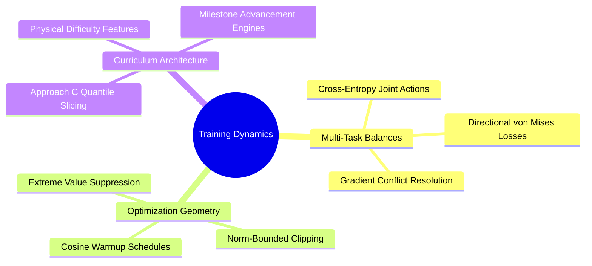

## Detailed Chapters

- **Chapter 1. Multi-Task Optimization**
  - [[1. Multi-Task Joint Loss Balancing and Gradients]]
  - [[2. Cosine Annealing Warmup and Optimization Dynamics]]
  - [[3. Gradient Norm Clipping and Extreme Value Geometry]]
- **Chapter 2. Curriculum Strategies**
  - [[1. Physical Difficulty Quantification in Structural Pockets]]
  - [[2. Approach C Quantile-Balanced Curriculum Architecture]]
  - [[3. Milestone-Driven Advancement and State Resumption]]

---

### `09. Training Dynamics, Optimization, and Curriculum Learning/Chapter 2. Curriculum Strategies/2. Approach C Quantile-Balanced Curriculum Architecture.md`

# 2. Approach C Quantile-Balanced Curriculum Architecture

> [!abstract] Mathematical Core
> Approach C organizes training data into $N_L = 9$ balanced difficulty levels ($L_1 \dots L_9$) using empirical quantiles derived from an 11-feature physical difficulty model. A sliding Gaussian mixture sampler shifts training focus from easy to hard levels across 6 stages while enforcing a permanent $3\%$ sampling floor to prevent catastrophic forgetting.

## 1. What It Is

In Stage-1 behavioral cloning, training complexes vary widely in structural difficulty. Pockets range from open, rigid cavities to tight, highly flexible clefts requiring complex multi-ring assemblies.

**Approach C** is an automated curriculum learning architecture that schedules training without altering the overall computational budget:
1. **Physical Difficulty Scoring**: Each training example is mapped to a scalar difficulty score $d_i \in [0, 1]$ using a calibrated 11-feature physical model.
2. **Quantile Slicing**: The training set is split into $N_L = 9$ equal-population bins using empirical quantiles:
   $$L_1 (\text{Easiest}) \dots L_9 (\text{Hardest})$$
3. **Dynamic Mixture Sampling**: Batches are sampled from a discrete distribution that shifts its mean from $L_1$ toward $L_9$ across 6 training stages, while maintaining a non-zero sampling floor across all levels.

```text
Curriculum Stage Progression (Approach C):
Stage 0 (Early Training): Focus on L1-L3 (Easy, rigid fragments) + 3% baseline floor for all levels
   [====L1====] [===L2===] [==L3==] [L4] [L5] [L6] [L7] [L8] [L9]

Stage 3 (Mid Training):   Focus on L4-L6 (Moderate complexity)   + 3% baseline floor for all levels
   [L1] [L2] [==L3==] [===L4===] [====L5====] [===L6===] [==L7==] [L8] [L9]

Stage 5 (Late Training):  Focus on L7-L9 (Tight, complex pockets) + 3% baseline floor for all levels
   [L1] [L2] [L3] [L4] [L5] [==L6==] [===L7===] [====L8====] [=====L9=====]
```

## 2. Why It Exists

Uniform random sampling exposes the model to complex, clash-prone pockets from the very first training step. 

This creates two issues during early training:
1. **High Gradient Variance**: In tight, confined pockets, minor spatial errors cause severe steric clashes, producing large, noisy gradient updates that destabilize early learning.
2. **Sub-Optimal Local Minima**: Early in training, the model struggles to balance basic chemical validity against tight geometric constraints, often defaulting to uninformative strategies like predicting early `STOP` actions.

Approach C stabilizes early training by focusing first on open, rigid pockets where the geometric constraints are easier to satisfy. Once the model masters basic chemical grammar, the curriculum shifts focus to tighter, more challenging pockets.

Importantly, this is achieved **without modifying the loss function or altering the total number of training steps per epoch**.

## 3. How It Works

### 3.1 The 11-Feature Physical Difficulty Model

Each complex is scored using 11 physical and structural features:
- **Ligand and Pocket Size**: Number of atoms in the ligand core and pocket cavity.
- **Electrostatic Complexity**: Mean absolute formal charges across pocket and ligand nodes.
- **Rotational and Structural Freedom**: Number of rotatable bonds, rings, and heteroatoms in the target synthon.
- **Molecular Symmetry**: The ratio of unique canonical atom ranks to total atoms.
- **Reaction Scarcity**: Negative log-frequency ($-\log_2 p$) of the reaction family and core handle within the training split.

Each feature $f_j$ is normalized using empirical 1st and 99th percentiles ($q_{0.01}, q_{0.99}$) computed **strictly on the training split** to prevent data leakage:

$$\tilde{f}_j = \text{clamp}\left( \frac{f_j - q_{0.01}(f_j)}{q_{0.99}(f_j) - q_{0.01}(f_j)}, \; 0.0, \; 1.0 \right)$$

The overall difficulty score is evaluated as a weighted sum:

$$\text{Difficulty}(x) = \frac{\sum_{j=1}^{11} w_j \tilde{f}_j}{\sum_{j=1}^{11} w_j} \in [0.0, 1.0]$$

### 3.2 Quantile Binning and Balanced Partitions

Sorting the training examples by difficulty score, we compute 8 threshold boundaries that divide the dataset into 9 equal-sized bins:

$$\text{Edges} = \left[ Q\left(\frac{1}{9}\right), Q\left(\frac{2}{9}\right), \dots, Q\left(\frac{8}{9}\right) \right]$$

Validation examples are assigned to difficulty levels using these frozen training boundaries, ensuring an unbiased baseline for evaluating validation loss across different difficulty tiers.

### 3.3 The Mixture Sampling Distribution with a Non-Zero Floor

At stage $s \in \{0, 1, \dots, 5\}$, the probability of sampling from level $l \in \{1, \dots, 9\}$ is defined using a Gaussian kernel centered at $\mu(s)$:

$$w(l; s) = \exp\left( -\frac{(l - \mu(s))^2}{2 \sigma^2} \right)$$

where $\mu(s) = 2.0 + s \cdot \frac{7.0}{5.0}$ shifts the center smoothly from level 2 to level 9, with spread $\sigma = 1.8$.

To prevent the model from forgetting earlier levels or failing to explore harder levels, we add a **uniform baseline floor** ($\epsilon = 0.03$):

$$P(l \mid s) = (1 - 9\epsilon) \frac{w(l; s)}{\sum_{k=1}^9 w(k; s)} + \epsilon$$

This guarantees that:
1. Every level has at least a $3\%$ sampling probability at all times.
2. The sampling probabilities sum to $1.0$: $\sum_{l=1}^9 P(l \mid s) = 1.0$.
3. The model maintains exposure to the entire dataset throughout training, preventing catastrophic forgetting.

## 4. What It Consists Of

- **Difficulty Metric**: A weighted combination of 11 physical, geometric, and chemical features.
- **Quantile Partitioning**: Slicing the dataset into equal-sized bins ($L_1 \dots L_9$) using training set boundaries.
- **Stage Center ($\mu(s)$)**: The target difficulty level for the current training stage.
- **Sampling Floor ($\epsilon = 0.03$)**: A minimum sampling probability applied across all levels to maintain dataset coverage.

## 5. What You Must Understand

> [!warning] Pitfall: Filtering Hard Examples Changes the Optimization Objective
> Discarding hard examples entirely during early training changes the underlying dataset distribution:
> $$\mathcal{D}_{\text{train}} \neq \mathcal{D}_{\text{full}}$$
> This can cause the model to overfit to easy examples and struggle when hard examples are reintroduced. Approach C avoids this by using **sampling re-weighting** with a permanent non-zero floor rather than hard filtering, ensuring the full data distribution remains accessible throughout training.

## 6. Prerequisites

- [[1. Physical Difficulty Quantification in Structural Pockets]]
- [[2. Broadcasting Rules and Dimension Semantics]]

## 7. Project Connection

In `syntree/engine/curriculum.py`, Approach C is implemented within `CurriculumController` and `CurriculumSampler`:
```python
# Evaluate mixture weights with a baseline floor across all levels
raw_weights = {
    lv: math.exp(-((lv - center) ** 2) / (2.0 * (sigma ** 2)))
    for lv in self.present_levels
}
total = sum(raw_weights.values())
eps = min(self.min_weight * n_levels, 0.9)

sampling_weights = {
    lv: (1.0 - eps) * (raw_weights[lv] / total) + (eps / n_levels)
    for lv in self.present_levels
}
```
This module is wired directly into `ResilientTrainer`, guiding Stage-1 behavioral cloning across the dataset.

## 8. Required Depth

**Essential**: Approach C stabilized Stage-1 training across the full multi-dataset corpus, preventing early optimization plateaus.

## 9. Further Dependencies

- [[3. Milestone-Driven Advancement and State Resumption]]
- [[1. Multi-Task Joint Loss Balancing and Gradients]]

---

## 10. Numerical Analysis and High-Performance GPU Engineering

### `10. Numerical Analysis and High-Performance GPU Engineering/0. Numerical Analysis and GPU Engineering MOC.md`

# 0. Numerical Analysis and GPU Engineering MOC

> [!abstract] Module Overview
> Floating-point arithmetic under IEEE 754, numerical analysis of gradient scaling and underflow, VRAM allocation mechanics, and GPU optimization on NVIDIA architectures.

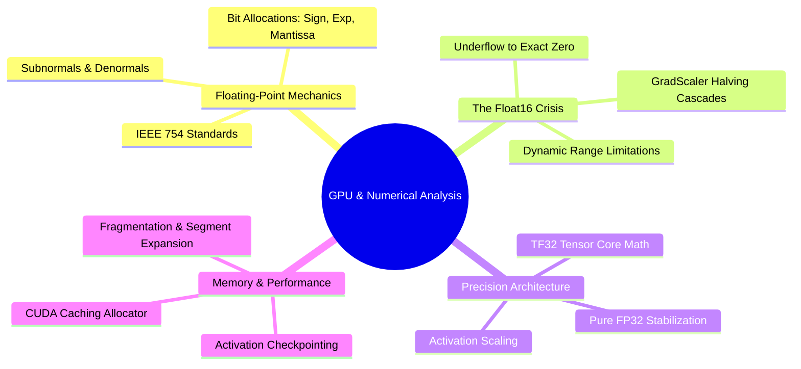

## Detailed Chapters

- **Chapter 1. Precision Dynamics and Numerics**
  - [[1. IEEE 754 Floating-Point Formats FP32 FP16 BF16]]
  - [[2. Underflow Denormals and GradScaler Scale Collapse]]
  - [[3. Saturation Clamps and Numerical Boundary Engineering]]
- **Chapter 2. Hardware-Aware Pipeline Execution**
  - [[1. GPU Memory Topologies and Allocation Boundaries]]
  - [[2. Activation Checkpointing and O(1) Layer Scaling]]
  - [[3. In-Memory RAM Sharding vs Dynamic Remote Streaming]]

---

### `10. Numerical Analysis and High-Performance GPU Engineering/Chapter 1. Precision Dynamics and Numerics/2. Underflow Denormals and GradScaler Scale Collapse.md`

# 2. Underflow Denormals and GradScaler Scale Collapse

> [!abstract] Mathematical Core
> In mixed-precision training, an exponential loss scaling factor is used to prevent small gradients from underflowing in FP16. However, if unclipped intermediate gradients occasionally overflow to `inf`, the `GradScaler` repeatedly halves its scale factor. On architectures limited to FP16 (such as the Tesla T4), this can cause the scale factor to cascade downward until it underflows to an unrecoverable denormal state ($\approx 10^{-40}$) and ultimately hits $0.0$, freezing model training.

## 1. What It Is

When training deep neural networks in **Float16 (FP16)**, gradients often take very small values ($< 2^{-14} \approx 6.1 \times 10^{-5}$) that fall below the minimum range of normalized FP16 numbers.

To prevent these gradients from underflowing to zero, PyTorch uses a **GradScaler**:
1. Before backpropagation, the loss is scaled up by a factor $S$:
   $$\mathcal{L}_{\text{scaled}} = S \cdot \mathcal{L}$$
2. Gradients are computed on this scaled loss, shifting them into the representable range of FP16:
   $$\mathbf{g}_{\text{scaled}} = \nabla_{\mathbf{w}} \mathcal{L}_{\text{scaled}} = S \cdot \nabla_{\mathbf{w}} \mathcal{L}$$
3. Before the optimizer updates weights, gradients are unscaled back to their true values:
   $$\mathbf{g} = \frac{1}{S} \mathbf{g}_{\text{scaled}}$$
4. If an `inf` or `NaN` is detected in the unscaled gradients:
   - The optimizer **skips the weight update entirely**.
   - The scale factor is halved: $S \leftarrow S \times \text{backoff\_factor}$ (where $\text{backoff\_factor} = 0.5$).
5. If $N$ consecutive steps complete without non-finite values, the scale factor is increased:
   $$S \leftarrow S \times \text{growth\_factor}$$

## 2. Why It Exists

The GradScaler is designed to balance gradient values within the narrow dynamic range of FP16. If gradients are too small, they underflow to zero and stop learning; if gradients are too large, they overflow to infinity.

Under normal training conditions, the scale factor fluctuates dynamically around a stable value (such as $2^{16} = 65,504$ or $2^{14} = 16,384$), ensuring that weight updates remain stable throughout training.

## 3. How It Works

### 3.1 The Failure Mode: Consecutive Gradient Overflows

Suppose an architectural layer (such as an unnormalized vector norm or an un-regularized Bessel function evaluation) occasionally generates an `inf` during the backward pass.

When this occurs:
1. The `GradScaler` detects the non-finite value and skips the optimizer step.
2. The scale factor is halved: $S_1 = S_0 \times 0.5$.
3. If the numerical issue is structural (built into the layer's math) rather than a rare random spike, the next step will also produce an `inf`.
4. The scaler halves its factor again: $S_2 = S_1 \times 0.5 = S_0 \times 0.25$.

If this occurs repeatedly over $K$ consecutive steps:

$$S_K = S_0 \times (0.5)^K$$

```text
The GradScaler Collapse Cascade:
Step 0:   Scale = 65,536 (2^16)       -> Gradient contains Inf! -> Step skipped, Scale * 0.5
Step 1:   Scale = 32,768 (2^15)       -> Gradient contains Inf! -> Step skipped, Scale * 0.5
Step 2:   Scale = 16,384 (2^14)       -> Gradient contains Inf! -> Step skipped, Scale * 0.5
...
Step 148: Scale = 1.84 x 10^-40       -> Subnormal FP32 Denormal! Underflow boundary!
Step 149: Scale = 0.0                 -> Scale factor collapses to exact zero!
```

### 3.2 Denormal Underflow and Mathematical Collapse

In our 2026-10-28 incident forensics (documented in `docs/PERSISTENT_ERRORS_NAN.md`), inspecting checkpoint files revealed that the scale factor had collapsed to a subnormal FP32 value:

$$S = 1.8367099231598242 \times 10^{-40}$$

This value is an **IEEE 754 denormal number**—it falls below the minimum normalized FP32 threshold ($1.175 \times 10^{-38}$).

Once the scale factor reaches this point, mathematical failure is unavoidable:
1. **Unscale Inversion Overflow**:
   To unscale gradients, the optimizer divides by $S$, which is equivalent to multiplying by its reciprocal:
   $$\frac{1}{S} = \frac{1}{1.8367 \times 10^{-40}} \approx 5.44 \times 10^{39}$$
   Because the maximum representable FP32 number is $\approx 3.40 \times 10^{38}$, evaluating $\frac{1}{S}$ **overflows directly to positive infinity (`+inf`)**.
2. **Permanent Training Freeze**:
   At the next step, the scale factor underflows to exact zero:
   $$S = 0.0$$
   Multiplying the loss by zero produces a zero loss:
   $$\mathcal{L}_{\text{scaled}} = 0.0 \times \mathcal{L} = 0.0$$
   The backward pass generates zero gradients, and unscaling evaluates:
   $$\mathbf{g} = \frac{0.0}{0.0} = \mathbf{NaN}$$
   The model enters an unrecoverable state where every step is skipped, frozen parameters stop learning, and the loss evaluates to `NaN` indefinitely.

### 3.3 Comparative Forensics: FP16 Collapse vs. Pure FP32

To understand why this failure occurred on the Tesla T4 but disappeared on CPU, compare how each configuration handles numerical precision:

| Runtime Configuration | Precision | Dynamic Range | Scaler Behavior | Outcome |
| :--- | :--- | :--- | :--- | :--- |
| **Colab Tesla T4 (Incident A/B)** | Mixed FP16 | $6.1 \times 10^{-5}$ to $65,504$ | Active `GradScaler` collapses: $S \to 1.84 \times 10^{-40} \to 0.0$ | **`NaN` loss from Step 0; permanent training freeze** |
| **CPU Smoke Run** | Pure FP32 | $1.17 \times 10^{-38}$ to $3.40 \times 10^{38}$ | No `GradScaler` used; loss is unscaled | **Monotonic loss descent (7.77 $\to$ 6.59); zero `NaN` skips** |
| **NVIDIA A100 / RTX 6000** | Native BF16 | $1.17 \times 10^{-38}$ to $3.39 \times 10^{38}$ | No `GradScaler` required (shares FP32 exponent range) | **Stable training with native hardware acceleration** |

Because the Tesla T4 GPU (Compute Capability 7.5) lacks native hardware support for BF16, running mixed precision requires FP16 with a dynamic `GradScaler`. 

Given the numerical sensitivities of 3D molecular coordinates, vector norms, and directional projections, FP16's narrow dynamic range ($65,504$) is too small to guarantee stability. The definitive solution for Tesla T4 environments is to **enforce pure FP32 training**, disabling `autocast` and removing the `GradScaler` entirely.

## 4. What It Consists Of

- **Loss Scale Factor ($S$)**: The scalar multiplier used to shift small gradient values into the representable range of FP16.
- **Backoff Factor**: The multiplier (typically $0.5$) applied to reduce the scale factor whenever an `inf` or `NaN` gradient is detected.
- **Growth Tracker**: An internal counter tracking consecutive successful steps, used to increase the scale factor after stable periods.
- **Denormal Underflow**: The state where a floating-point number drops below the normalized range ($< 1.175 \times 10^{-38}$), leading to precision loss and eventual collapse to zero.

## 5. What You Must Understand

> [!warning] Pitfall: A Low Loss Does Not Mean a Healthy Model if Gradients Are Freezing
> When the `GradScaler` factor collapses toward zero, the optimizer skips weight updates while the loss appears to stabilize at a constant value. In our incident logs, validation accuracies froze at identical numbers for five consecutive epochs:
> $$\text{val\_synthon\_acc} = 0.48951, \quad \text{val\_reaction\_acc} = 0.76712$$
> The training run was not converging—it had frozen because the scale factor had underflowed, preventing any updates from reaching the weights. Always monitor the active scale factor (`scaler.get_scale()`) throughout training.

## 6. Prerequisites

- [[1. IEEE 754 Floating-Point Formats FP32 FP16 BF16]]
- [[3. Non-Singular Vector Norms and Directional Regularization]]

## 7. Project Connection

In Issue #10 (`[MATH-04]`) and Issue #26 (`[TRAIN-01]`), we addressed the root cause of these training failures by updating `syntree/utils/hardware.py` and `syntree/engine/trainer.py`. For Tesla T4 runtimes, the system explicitly enforces pure FP32 execution:
```python
if device.type == "cuda" and compute_capability < 8.0:
    logger.warning("Tesla T4 detected (< SM 8.0). Enforcing Pure FP32 to prevent GradScaler collapse.")
    self.use_amp = False
    self.amp_dtype = torch.float32
    self.scaler = torch.amp.GradScaler('cuda', enabled=False)
```

## 8. Required Depth

**Essential**: This failure mode was the primary technical blocker that derailed earlier training runs on Google Colab.

## 9. Further Dependencies

- [[1. IEEE 754 Floating-Point Formats FP32 FP16 BF16]]
- [[3. Saturation Clamps and Numerical Boundary Engineering]]

---

### `10. Numerical Analysis and High-Performance GPU Engineering/Chapter 2. Hardware-Aware Pipeline Execution/2. Activation Checkpointing and O(1) Layer Scaling.md`

# 2. Activation Checkpointing and O(1) Layer Scaling

> [!abstract] Mathematical Core
> Backpropagation requires intermediate layer activations from the forward pass to compute gradients. Storing all activations across deep networks scales memory consumption linearly with depth: $O(L)$. **Activation checkpointing** trades compute for memory: it discards intermediate activations during the forward pass and recomputes them on demand during the backward pass, reducing peak activation memory to $O(1)$ relative to depth.

## 1. What It Is

In standard neural network execution, evaluating the forward pass across $L$ successive layers stores every intermediate activation tensor $\mathbf{h}_l$ in memory:

$$\mathbf{h}_0 \xrightarrow{\text{Layer } 1} \mathbf{h}_1 \xrightarrow{\text{Layer } 2} \mathbf{h}_2 \dots \xrightarrow{\text{Layer } L} \mathbf{h}_L$$

During the backward pass, computing parameter gradients for Layer $l$ requires access to its input activation $\mathbf{h}_{l-1}$:

$$\frac{\partial \mathcal{L}}{\partial \mathbf{W}_l} = \nabla_{\mathbf{h}_l} \mathcal{L} \cdot \left( \frac{\partial \mathbf{h}_l}{\partial \mathbf{W}_l} \right) = \nabla_{\mathbf{h}_l} \mathcal{L} \cdot \mathbf{h}_{l-1}^T$$

To ensure these inputs are available, standard backpropagation retains all intermediate activations in VRAM until the backward pass reaches them, leading to an $O(L)$ memory footprint.

**Activation checkpointing** (also known as gradient checkpointing) changes this lifecycle:
1. During the forward pass, intermediate activations within checkpointed blocks are **discarded from memory** as soon as the next layer finishes computing. Only the inputs to designated checkpoint boundaries are retained.
2. During the backward pass, when gradients reach a checkpointed block, the engine **re-runs the forward pass for that block from its saved input**, reconstructing the required intermediate activations on the fly.
3. Once the block's gradients are computed, the reconstructed activations are immediately freed from memory.

```text
Standard Forward / Backward Memory Lifecycle:
Forward:  [Save h_0] -> [Save h_1] -> [Save h_2] -> ... -> [Save h_L]  (Memory scales as O(L))
Backward: [Use h_L]  -> [Use h_L-1]-> ... -> [Use h_0]                  (Memory slowly freed)

Activation Checkpointing Lifecycle:
Forward:  [Save h_0] -> [Discard h_1, h_2, ...] -> [Save h_boundary]   (Memory stays O(1)!)
Backward: Recompute [h_1, h_2] from h_0 on the fly -> Compute gradients -> Discard immediately
```

## 2. Why It Exists

In `3D-SynTree`, our backbone (`BipartitePaiNN`) uses 8 equivariant interaction and mixing layers operating over large joint graphs (often containing up to 700 pocket atoms and 50 ligand atoms).

Each layer stores:
- Scalar node features: $[N, d]$
- Vector node features: $[N, 3, d]$
- Directional edge messages: $[E, 3, d]$

With an interaction radius of $r_{\text{cut}} = 5.0\text{ \AA}$, a single graph can contain $E \approx 15{,}000$ edges. Storing all intermediate message tensors across all 8 layers for a batch of 12 complexes requires:

$$\text{Memory} \approx 8 \times 12 \times 15{,}000 \times 3 \times 256 \times 4\text{ bytes} \approx \mathbf{4.42 \text{ GB of VRAM}}$$

This activation footprint accounts for more than half of the available VRAM on a 15 GB Tesla T4 GPU, leaving little room for attention heads, large batch sizes, or optimizer states.

Activation checkpointing eliminates this bottleneck: by storing only the input to each layer and recomputing intermediate activations during backpropagation, activation memory is reduced to that of a single layer ($O(1)$ scaling), freeing up significant VRAM for training.

## 3. How It Works

### 3.1 The Compute-for-Memory Trade-Off

Activation checkpointing trades additional computation for reduced memory consumption:
- The forward pass for checkpointed layers is evaluated twice: once during the initial forward pass, and once during the backward pass.
- This adds roughly $20\%$ to $30\%$ to the total wall-clock time per training step.
- In exchange, peak activation memory drops by a factor proportional to the number of layers (reducing activation memory by $\approx 8\times$ in an 8-layer network).

This trade-off is often critical: it allows models to train on hardware that would otherwise encounter out-of-memory errors, avoiding the need to shrink batch sizes or prune layers.

### 3.2 Integration with PyTorch's Non-Reentrant Engine

Modern versions of PyTorch provide an updated checkpointing engine (`use_reentrant=False`) that avoids the limitations of the legacy implementation:

```python
import torch
from torch.utils.checkpoint import checkpoint

class CheckpointedPaiNNBlock(torch.nn.Module):
    def __init__(self, layers: torch.nn.ModuleList):
        super().__init__()
        self.layers = layers

    def forward(self, scalar, vector, edge_index, edge_vec, edge_dist, edge_rbf):
        for layer in self.layers:
            if self.training and torch.is_grad_enabled():
                # use_reentrant=False works cleanly with autocast and non-tensor inputs
                scalar, vector = checkpoint(
                    layer,
                    scalar,
                    vector,
                    edge_index,
                    edge_vec,
                    edge_dist,
                    edge_rbf,
                    use_reentrant=False
                )
            else:
                # Normal execution during evaluation or inference
                scalar, vector = layer(scalar, vector, edge_index, edge_vec, edge_dist, edge_rbf)
                
        return scalar, vector
```

The updated `use_reentrant=False` engine offers several advantages:
1. It supports mixed-precision training cleanly without requiring manual gradient scaling workarounds.
2. It handles non-tensor inputs (such as graph connectivity indices and metadata) without throwing errors.
3. It integrates properly with PyTorch's computational graph hooks and profiling tools.

## 4. What It Consists Of

- **Checkpoint Boundaries**: The specific inputs and layer boundaries where activations are retained during the forward pass.
- **Recomputation Hook**: An execution wrapper that intercepts the backward pass and re-runs the layer's forward pass before calculating gradients.
- **Detached Intermediate States**: Temporary activation tensors that are generated dynamically during the backward pass and freed immediately after use.

## 5. What You Must Understand

> [!warning] Pitfall: Stochastic Layers in Checkpointed Blocks Must Synchronize RNG States
> If a checkpointed block contains stochastic operations (such as Dropout or random noise


### `10. Numerical Analysis and High-Performance GPU Engineering/Chapter 2. Hardware-Aware Pipeline Execution/2. Activation Checkpointing and O(1) Layer Scaling.md` (Continued)

```python
# Continuation from Section 5: What You Must Understand
```

> [!warning] Pitfall: Stochastic Layers in Checkpointed Blocks Must Synchronize RNG States
> If a checkpointed block contains stochastic operations (such as Dropout or random coordinate perturbation), the forward pass recomputed during the backward pass will sample **different random numbers** unless the Random Number Generator (RNG) state is captured and restored. In PyTorch, pass `preserve_rng_state=True` to `checkpoint()` (default in `use_reentrant=False`), ensuring the forward pass during backpropagation exactly reproduces the forward pass computed during training.

> [!tip] Memory Hook
> **Trade compute to break the memory wall.** An 8-layer network with activation checkpointing runs 25% slower in compute time, but consumes the activation VRAM of a 1-layer network.

## 6. Prerequisites

- [[2. Vectorized Computational Graphs and Jacobians]]
- [[1. GPU Memory Topologies and Allocation Boundaries]]

## 7. Project Connection

In `syntree/models/bipartite.py`, `BipartitePaiNN` applies activation checkpointing across its 8 interaction and mixing blocks:
```python
for layer in self.layers:
    if self.gradient_checkpointing and self.training and torch.is_grad_enabled():
        scalar, vector = torch.utils.checkpoint.checkpoint(
            layer, scalar, vector, edge_index, edge_vec, edge_dist, edge_rbf,
            use_reentrant=False
        )
    else:
        scalar, vector = layer(scalar, vector, edge_index, edge_vec, edge_dist, edge_rbf)
```
This reduces activation memory from $\approx 4.4\text{ GB}$ down to $\approx 550\text{ MB}$, keeping peak training VRAM at $\approx 9.2\text{ GB}$ on a Tesla T4 GPU.

## 8. Required Depth

**Essential**: Without activation checkpointing, our 8-layer equivariant backbone cannot train on 15 GB GPUs without causing CUDA Out-of-Memory errors.

## 9. Further Dependencies

- [[1. GPU Memory Topologies and Allocation Boundaries]]
- [[1. PaiNN Interaction Block and Directional Message Passing]]

## Concept Mind Map

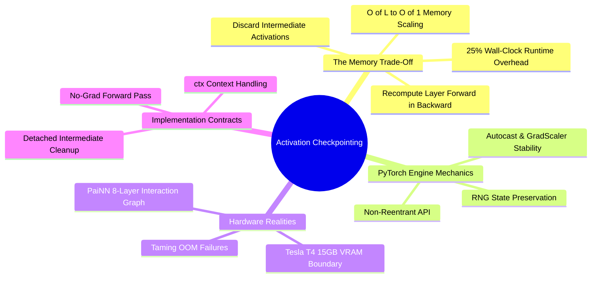

---

### `10. Numerical Analysis and High-Performance GPU Engineering/Chapter 1. Precision Dynamics and Numerics/1. IEEE 754 Floating-Point Formats FP32 FP16 BF16.md`

# 1. IEEE 754 Floating-Point Formats FP32 FP16 BF16

> [!abstract] Mathematical Core
> Digital computation represents real numbers using the IEEE 754 floating-point standard: $x = (-1)^s \times 2^{e - \text{bias}} \times (1 + m)$. The allocation of bits between the exponent ($e$) and the mantissa ($m$) determines the trade-off between dynamic range and numerical precision.

## 1. What It Is

Any finite floating-point number is represented in binary hardware by three fields:
1. **Sign bit ($s$)**: A single bit indicating positive ($0$) or negative ($1$).
2. **Exponent field ($e$)**: An unsigned integer biased by $B = 2^{k-1} - 1$ that shifts the scale of the number powers of two.
3. **Mantissa / Fraction field ($m$)**: Unsigned fractional bits representing the significant digits (with an implicit leading 1 for normalized numbers).

$$x = (-1)^s \times 2^{e - \text{bias}} \times \left(1 + \sum_{i=1}^p m_i 2^{-i}\right)$$

```text
Bit Allocations:
FP32 (32 bits): [s (1)] [e e e e e e e e (8)] [m m m ... m m m (23)]
FP16 (16 bits): [s (1)] [e e e e e (5)]       [m m m m m m m m m m (10)]
BF16 (16 bits): [s (1)] [e e e e e e e e (8)] [m m m m m m m (7)]
TF32 (19 bits): [s (1)] [e e e e e e e e (8)] [m m m m m m m m m m (10)] (Internal Tensor Core Only)
```

## 2. Why It Exists

Computer memory and arithmetic circuits operate on finite bit-widths. In deep learning:
- Multiplications in matrix tensor cores scale in latency and power roughly as $O(m^2)$, where $m$ is the mantissa bit width.
- Memory bandwidth across the PCIe bus and VRAM channels scales linearly with bit width ($16\text{ bits}$ moves twice as fast as $32\text{ bits}$).

We reduce numerical precision to accelerate model training and lower memory overhead. However, changing bit allocations alters the dynamic range and can lead to numerical instability:
- Reducing the exponent causes underflow (vanishing to zero) or overflow (exploding to infinity).
- Reducing the mantissa introduces rounding noise and truncates small parameter updates.

## 3. How It Works

### 3.1 Structural Comparison of Numerical Formats

| Format | Total Bits | Exponent Bits | Mantissa Bits | Exponent Bias | Smallest Normal ($V_{\min}$) | Largest Normal ($V_{\max}$) | Relative Precision ($\epsilon_{\text{mach}}$) |
| :--- | :--- | :--- | :--- | :--- | :--- | :--- | :--- |
| **FP32** | 32 | 8 | 23 | 127 | $1.175 \times 10^{-38}$ | $3.402 \times 10^{38}$ | $2^{-23} \approx 1.19 \times 10^{-7}$ |
| **FP16** | 16 | 5 | 10 | 15 | $6.104 \times 10^{-5}$ | **$65{,}504$** | $2^{-10} \approx 9.77 \times 10^{-4}$ |
| **BF16** | 16 | 8 | 7 | 127 | $1.175 \times 10^{-38}$ | $3.389 \times 10^{38}$ | $2^{-7} \approx 7.81 \times 10^{-3}$ |
| **TF32** | 19 | 8 | 10 | 127 | $1.175 \times 10^{-38}$ | $3.402 \times 10^{38}$ | $2^{-10} \approx 9.77 \times 10^{-4}$ |

### 3.2 Analysis of the Formats

1. **Float16 (Half Precision)**:
   - Allocates only 5 bits to the exponent, giving a dynamic range of $[-14, 15]$.
   - The maximum representable number is $65{,}504$. Any activation, logit, or squared vector norm exceeding $65{,}504$ overflows directly to `+inf`.
   - The minimum normalized positive number is $6.104 \times 10^{-5}$. Any gradient smaller than this underflows to zero unless scaled by a `GradScaler`.
2. **Bfloat16 (Brain Floating Point)**:
   - Uses an 8-bit exponent matching FP32, providing the same dynamic range ($10^{-38}$ to $10^{38}$).
   - Because its dynamic range matches FP32, **BF16 does not require a `GradScaler`**—it will not underflow or overflow on standard neural network gradients.
   - However, it allocates only 7 bits to the mantissa, increasing machine epsilon to $\approx 7.8 \times 10^{-3}$. Small gradient updates can be truncated to zero if the learning rate is very small.
3. **TF32 (TensorFloat-32)**:
   - An internal execution format used on NVIDIA Ampere and newer architectures (Compute Capability $\ge 8.0$, e.g., A100, RTX 6000 Ada).
   - Combines the 8-bit exponent of FP32 with the 10-bit mantissa of FP16, maintaining dynamic range while accelerating matrix multiplication on tensor cores.
   - Tensors are stored in memory as standard FP32 and converted to TF32 only during core math operations.

### 3.3 The Hardware Boundary: Turing (Tesla T4) vs. Ampere/Ada

- **Tesla T4 (Compute Capability 7.5 / Turing)**: Lacks native hardware instructions for BF16. Attempting to use BF16 on a T4 forces PyTorch to emulate the operations in software, slowing down execution, or fall back to FP16 with an unstable dynamic `GradScaler`.
- **RTX 6000 Ada / A100 (Compute Capability $\ge 8.0$)**: Features dedicated hardware for BF16 and TF32, making low-precision training fast and stable.

## 4. What It Consists Of

- **Machine Epsilon ($\epsilon_{\text{mach}}$)**: The smallest relative difference between two distinct floating-point numbers: $\epsilon = 2^{-p}$.
- **Subnormal / Denormal Range**: Numbers smaller than $2^{\text{emin}}$ represented without an implicit leading 1, which suffer from reduced precision.
- **Special Encodings**: Dedicated bit patterns reserved for zero ($e=0, m=0$), infinity ($e=\text{all 1s}, m=0$), and NaN ($e=\text{all 1s}, m \neq 0$).

## 5. What You Must Understand

> [!warning] Pitfall: Why Masking with `-1e9` Crashes in FP16
> In mathematical formulas, invalid actions are often masked with $-10^9$. In FP16, the maximum representable negative number is $-65{,}504$. Casting $-10^9$ to FP16 overflows directly to `float('-inf')`. If an entire row is masked out, evaluating a softmax produces $\frac{e^{-\infty}}{\sum e^{-\infty}} = \frac{0}{0} = \mathbf{NaN}$. This `NaN` then spreads to all downstream weights and gradients.

## 6. Prerequisites

- Basic binary representation and scientific notation.

## 7. Project Connection

In Issue #10 (`[MATH-04]`), we audited precision across our target hardware environments. Because our primary supported execution environment is the **Tesla T4**, we disabled mixed-precision FP16 and enforced **Pure FP32**:
```python
# In syntree/utils/hardware.py
if device.type == "cuda" and compute_capability < 8.0:
    # Force single precision on T4 GPUs
    selected_precision = "fp32"
    use_amp = False
```

## 8. Required Depth

**Essential**: Understanding floating-point limitations is necessary to prevent numerical overflow, underflow, and `NaN` crashes during training.

## 9. Further Dependencies

- [[2. Underflow Denormals and GradScaler Scale Collapse]]
- [[3. Saturation Clamps and Numerical Boundary Engineering]]

## Concept Mind Map

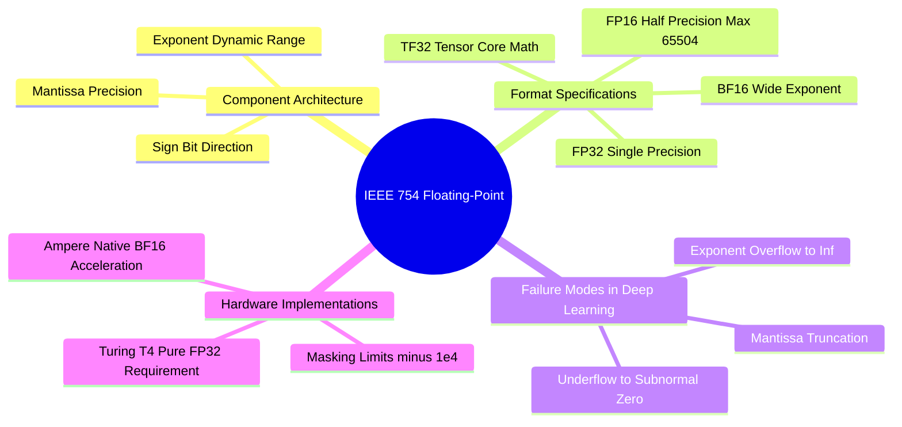

---

### `10. Numerical Analysis and High-Performance GPU Engineering/Chapter 1. Precision Dynamics and Numerics/3. Saturation Clamps and Numerical Boundary Engineering.md`

# 3. Saturation Clamps and Numerical Boundary Engineering

> [!abstract] Mathematical Core
> Unbounded mathematical operations (such as raw division, exponentiation, and power laws) frequently encounter numerical singularities during training. **Numerical boundary engineering** applies protective clamps, non-singular approximations, and saturation functions to guarantee that activations and loss terms remain finite without distorting gradients in valid operating ranges.

## 1. What It Is

Numerical boundary engineering is the systematic design of safety bounds around floating-point calculations in neural networks. It uses three main operations:

1. **Domain Clamping**: Restricting the input domain of unstable functions:
   $$\text{clamp}(x, x_{\min}, x_{\max}) = \max(x_{\min}, \min(x, x_{\max}))$$
2. **Smooth Soft-Clipping**: Using smooth, non-linear saturation functions to prevent activations from growing arbitrarily large:
   $$f_{\text{sat}}(x) = \alpha \tanh\left(\frac{x}{\alpha}\right)$$
3. **Non-Zero Shift Adjustments**: Offsetting denominators and logarithmic arguments away from zero:
   $$\log(x) \to \log(x + \epsilon) \quad \text{or} \quad \frac{1}{x} \to \frac{1}{x + \epsilon}$$

## 2. Why It Exists

In structural biology models, physical calculations can easily encounter extreme configurations during generative rollouts:
- Two atoms may be placed in close proximity ($r_{ij} \to 0.05\text{ \AA}$), causing $r^{-12}$ Lennard-Jones potentials to evaluate to $10^{15}\text{ kcal/mol}$.
- A torsion head can predict high concentration values ($\kappa \to 100$), causing $e^{\kappa}$ terms in von Mises distributions to evaluate to $10^{43}$.
- Vector norm calculations in message-passing layers can evaluate at the origin ($\mathbf{x} = \mathbf{0}$), causing gradients to divide by zero.

Without explicit numerical boundaries, these physical calculations will produce `inf` and `NaN` values that halt training.

## 3. How It Works

### 3.1 Clamping Activation Boundaries (`finite_act_clamp`)

In deep equivariant architectures like PaiNN, residual updates across multiple layers can cause feature values to accumulate and grow:

$$\mathbf{s}^{(l+1)} = \mathbf{s}^{(l)} + \mathbf{\Delta} \mathbf{s}^{(l)}$$

If unchecked, activations can exceed the finite dynamic range of intermediate hardware formats. 

To prevent this, `3D-SynTree` applies a saturation clamp at layer boundaries:

```python
FP16_ACT_CLAMP = 60000.0 # Bounded safely below 65,504

def finite_act_clamp(x: torch.Tensor) -> torch.Tensor:
    """Clamps activations within safe numerical limits."""
    if not x.is_floating_point():
        return x
    # Convert non-finite values to valid clamped bounds
    x = torch.nan_to_num(x, nan=0.0, posinf=FP16_ACT_CLAMP, neginf=-FP16_ACT_CLAMP)
    return x.clamp(min=-FP16_ACT_CLAMP, max=FP16_ACT_CLAMP)
```

This clamp ensures that:
- Any `NaN` value accidentally introduced by an upstream operation is zeroed out before it can propagate.
- Any value exceeding $60{,}000$ is saturated to the boundary, preventing overflow during subsequent linear layers.

### 3.2 Bounding the Soft-Core Lennard-Jones Potential

The classical Lennard-Jones 6-12 potential diverges sharply as $r \to 0$:

$$V(r) = 4\epsilon \left[ \left(\frac{\sigma}{r}\right)^{12} - \left(\frac{\sigma}{r}\right)^6 \right] \implies \lim_{r \to 0} V(r) = +\infty$$

Its gradient also explodes:

$$\nabla_r V(r) \propto r^{-13} \implies \lim_{r \to 0} \nabla_r V(r) = -\infty$$

In `syntree/chemistry/conformer.py`, we implement a **$C^1$-continuous linear continuation** below a threshold distance $r_{\text{switch}} = c \cdot \sigma$ (where $c = 0.8$):

```text
Potential Profile:
For r >= c * sigma:  Evaluate exact Lennard-Jones 6-12 potential
For r <  c * sigma:  Replace with linear continuation: V_switch + slope * (r - c * sigma)
```

At $r = 0.8 \sigma$, evaluating the potential:
$$x = \frac{\sigma}{0.8 \sigma} = 1.25, \quad x^6 \approx 3.815, \quad x^{12} \approx 14.55$$
$$V_{\text{switch}} = 4\epsilon (14.55 - 3.815) = 42.94 \epsilon$$
The slope matches the true derivative at the switch point:
$$\text{slope} = \left. \frac{dV}{dr} \right|_{r = c\sigma} = \frac{24\epsilon}{\sigma} \left( c^{-7} - 2c^{-13} \right)$$

By switching to a linear function below $0.8 \sigma$, the maximum energy and gradient remain bounded even if two atoms overlap completely ($r \to 0$), preventing gradient explosions during reinforcement learning.

```mermaid
mindmap
  root((Boundary Engineering))
    Mathematical Singularities
      Zero Division in Norms
      Logarithm of Zero
      r to the minus 12 Inversion
    Activation Stabilization
      finite act clamp
      Boundary Limits at 60000
      Replacement via nan to num
    Physical Softening
      Linear Continuation Splines
      C1 Continuous Derivation
      Capped Energy Ceilings
    Probabilistic Guards
      Minimum Concentration kappa Floors
      Epsilon Probability Offsets
      Safe Masking Penalties
```

## 4. What It Consists Of

- **`torch.nan_to_num`**: A PyTorch operator that replaces `NaN`, `+inf`, and `-inf` with finite values.
- **$C^1$-Continuous Spline**: A function composed of multiple segments whose values and first derivatives match at the boundary points.
- **Logarithmic Offset ($\epsilon$)**: A small positive constant (such as $10^{-8}$) added to arguments of `torch.log` to prevent evaluation at zero.

## 5. What You Must Understand

> [!warning] Pitfall: Hard Clamps Zero Out Gradients in Backpropagation
> Applying a hard clamp:
> $$y = \text{clamp}(x, -10.0, 10.0)$$
> sets the derivative to zero for any value outside the threshold:
> $$\frac{\partial y}{\partial x} = \begin{cases} 1 & \text{if } |x| \le 10.0 \\ 0 & \text{if } |x| > 10.0 \end{cases}$$
> If a model's activations are pushed beyond the clamp boundary, gradients vanish, preventing the network from learning to correct the large values. Clamps should be used as protective safety nets at extreme boundaries, not as a replacement for proper normalization layers.

## 6. Prerequisites

- [[1. IEEE 754 Floating-Point Formats FP32 FP16 BF16]]
- [[3. Non-Singular Vector Norms and Directional Regularization]]

## 7. Project Connection

In `syntree/models/equivariant.py`, the outputs of the interaction and mixing blocks are protected using `finite_act_clamp`:
```python
scalar = finite_act_clamp(scalar + agg_s)
vector = finite_act_clamp(vector + agg_v)
```
In `syntree/chemistry/conformer.py`, pairwise interaction energies are bounded using linear continuations to ensure stable scoring during policy rollouts.

## 8. Required Depth

**Supporting**: These numerical guards ensure that unexpected atomic configurations do not produce non-finite values that interrupt training runs.

## 9. Further Dependencies

- [[1. PaiNN Interaction Block and Directional Message Passing]]
- [[2. Underflow Denormals and GradScaler Scale Collapse]]

---

### `10. Numerical Analysis and High-Performance GPU Engineering/Chapter 2. Hardware-Aware Pipeline Execution/1. GPU Memory Topologies and Allocation Boundaries.md`

# 1. GPU Memory Topologies and Allocation Boundaries

> [!abstract] Mathematical Core
> The PyTorch CUDA caching allocator manages physical GPU VRAM by allocating memory in variable-sized blocks called segments. If allocation patterns fluctuate, the pool can suffer from **virtual memory fragmentation**, causing allocation failures even when total free memory appears sufficient. Setting `expandable_segments:True` allows the allocator to allocate memory in virtual memory pages, eliminating fragmentation.

## 1. What It Is

When a deep learning model allocates a tensor on a GPU (`tensor.to('cuda')`), PyTorch does not call the slow system allocator `cudaMalloc` directly for every operation. Instead, it uses a **caching allocator**:
1. It requests large contiguous blocks of physical VRAM from the NVIDIA driver using `cudaMalloc` (creating a **Memory Segment**).
2. It divides these segments into smaller blocks to satisfy individual tensor allocations.
3. When a tensor is freed or goes out of scope, its memory is returned to PyTorch's internal cache rather than being returned to the GPU driver.
4. Future tensor allocations reuse these cached blocks, avoiding the latency of driver-level memory allocations.

```text
Physical GPU VRAM (e.g., 15 GB on Tesla T4):
+-------------------------------------------------------------+
| Allocated Segment 1 (2 GB) | Allocated Segment 2 (4 GB)     | Unallocated (9 GB)
| [Block A][Free][Block B]   | [Block C][Free][Block D]       |
+-------------------------------------------------------------+
```

## 2. Why It Exists

Calling `cudaMalloc` directly synchronizes the entire GPU pipeline, pausing parallel execution and degrading throughput.

However, because molecular graphs vary in size (ranging from 100 to 700 atoms per pocket), memory requirements fluctuate from batch to batch. Over time, allocating and freeing differently sized blocks can cause **memory fragmentation**:
- The cache may contain enough total free bytes to satisfy an allocation, but those bytes are scattered across multiple non-contiguous gaps.
- If no single contiguous block is large enough to fit the requested tensor, the allocator must request a new segment from the driver.
- If the driver cannot find a large enough block of unallocated VRAM, it throws a `torch.cuda.OutOfMemoryError`—even if the total free memory shown by `nvidia-smi` appears sufficient.

## 3. How It Works

### 3.1 Understanding CUDA Memory Statistics

To diagnose memory behavior, PyTorch provides distinct tracking metrics:

```python
allocated = torch.cuda.memory_allocated() # Bytes actively held by live Tensor objects
reserved  = torch.cuda.memory_reserved()  # Total bytes held by PyTorch's caching allocator
max_alloc = torch.cuda.max_memory_allocated() # Peak allocation since last reset
```

- **Allocated Memory**: The actual memory consumed by active tensors.
- **Reserved Memory**: The total memory requested from the NVIDIA driver by the caching allocator (both active tensors and free cached blocks).
- **Driver Free Memory**: The memory completely untouched by PyTorch: $\text{Total VRAM} - \text{Reserved}$.

An Out-of-Memory (OOM) error occurs when:

$$\text{Requested Allocation} > (\text{Total VRAM} - \text{Reserved}) + \text{Largest Contiguous Free Block in Cache}$$

```text
The Fragmentation Failure Scenario:
Free Cached Memory:       500 MB (Composed of ten 50 MB non-contiguous blocks)
Driver Free Memory:       100 MB
Requested Tensor:         120 MB Contiguous Block

Result:
Total Free Space = 500 MB + 100 MB = 600 MB.
Largest Available Block = 100 MB.
Allocation fails! -> OutOfMemoryError: Tried to allocate 120.00 MiB (GPU has 600 MiB total capacity).
```

### 3.2 Resolving Fragmentation: `expandable_segments:True`

In PyTorch 2.1+, NVIDIA introduced support for virtual memory allocation via the driver flag:

```bash
export PYTORCH_CUDA_ALLOC_CONF=expandable_segments:True
```

How this fixes memory fragmentation:
- Without this flag, physical memory allocations must be contiguous in physical VRAM addresses.
- With expandable segments enabled, PyTorch uses the low-level CUDA Virtual Memory Management APIs (`cuMemCreate`, `cuMemMap`).
- The allocator maps multiple non-contiguous physical memory pages into a single **contiguous range of virtual addresses**.
- A 120 MB tensor can now be constructed by combining multiple scattered 50 MB physical blocks into one continuous virtual memory space.

This eliminates fragmentation-induced OOM failures, allowing models to utilize nearly 100% of available VRAM on GPUs like the Tesla T4.

## 4. What It Consists Of

- **Caching Allocator**: PyTorch's internal memory management layer that pools GPU memory to avoid slow `cudaMalloc` calls.
- **Segments**: Large contiguous blocks of physical VRAM allocated from the operating system and sliced into smaller tensor buffers.
- **Virtual Memory Mapping**: Dynamically mapping disjoint physical memory pages into a unified virtual address space.
- **`empty_cache()`**: An explicit call that releases unoccupied cached blocks back to the GPU driver, resetting the allocator pool.

## 5. What You Must Understand

> [!warning] Pitfall: `expandable_segments` Must Be Set Before Initializing CUDA
> The configuration string `PYTORCH_CUDA_ALLOC_CONF` must be set **before PyTorch initializes its CUDA context**. Setting it in Python after calling `import torch` or allocating a CUDA tensor has no effect:
> ```python
> # Correct setup in main.py:
> import os
> os.environ["PYTORCH_CUDA_ALLOC_CONF"] = "expandable_segments:True"
> import torch # Context initializes with expandable segments active
> ```

## 6. Prerequisites

- Basic operating system memory concepts (virtual memory, page tables, fragmentation).

## 7. Project Connection

In `main.py`, 3D-SynTree configures the memory allocator at the very top of the script:
```python
import os
os.environ.setdefault("PYTORCH_CUDA_ALLOC_CONF", "expandable_segments:True")
import torch
```
In Stage-2 reinforcement learning (`syntree/engine/rl.py`), where small rollout graphs frequently interleave with larger batch updates, this configuration eliminated the intermediate OOM errors on our 15 GB Tesla T4 environment.

## 8. Required Depth

**Essential**: This configuration is required to maintain memory stability when training on variable-sized molecular graphs.

## 9. Further Dependencies

- [[2. Activation Checkpointing and O(1) Layer Scaling]]
- [[3. In-Memory RAM Sharding vs Dynamic Remote Streaming]]

## Concept Mind Map

```mermaid
mindmap
  root((GPU Memory Architecture))
    Hardware Storage
      Total Physical VRAM
      Tesla T4 15GB Constraints
      Memory Bandwidth Boundaries
    Caching Allocator
      Segments from cudaMalloc
      Dynamic Tensor Blocks
      Cache Re-use Strategy
    The Fragmentation Crisis
      Scattered Free Blocks
      Contiguity Invariants
      Spurious Allocation Failures
    System Solutions
      Virtual Memory Addressing
      expandable_segments Flag
      Explicit empty_cache Clears
```

---

### `10. Numerical Analysis and High-Performance GPU Engineering/Chapter 2. Hardware-Aware Pipeline Execution/3. In-Memory RAM Sharding vs Dynamic Remote Streaming.md`

# 3. In-Memory RAM Sharding vs Dynamic Remote Streaming

> [!abstract] Mathematical Core
> Data loading pipelines can be bound by either I/O latency or memory bandwidth. On compute instances equipped with large host memory (such as Kaggle's 175 GB RAM), preloading all pre-featurized shards directly into system memory decouples data throughput from disk speed, reducing data loading latency to zero.

## 1. What It Is

When training deep learning models on large molecular datasets (such as 30,000 protein-ligand trajectories), data loading can follow two primary architectures:

1. **Dynamic Streaming with an LRU Cache (`ShardedDataset`)**:
   Shards are stored on persistent storage or downloaded on demand from a remote hub (like Hugging Face). The dataset maintains a small Least-Recently-Used (LRU) cache in host RAM (e.g., holding 2 to 4 active shards). Unused shards are loaded from disk or network on the fly and discarded when the cache fills up.
2. **In-Memory RAM Preloading (`KaggleInMemoryDataset`)**:
   During initialization, the loader reads every pre-featurized `.pt.gz` shard, decompresses the data, and stores all samples in a contiguous Python list resident in system RAM. During training, mini-batch creation is a simple memory slice, requiring zero disk reads or decompressions.

```text
Dynamic Streaming Architecture (Disk-Bound):
Disk / Network ---> [Read Compressed .pt.gz] ---> [Decompress Gzip] ---> [Build PyG Batch] ---> GPU
(Latency: ~50-200ms per batch whenever an LRU cache miss occurs)

In-Memory Preloaded Architecture (Memory-Bound):
Initialization: Disk ---> [Decompress All Shards Once] ---> Host RAM (175 GB)
Training:       Host RAM ---> [Direct Slice Memory Pointer] ---> [Collate] ---> GPU
(Latency: <1ms per batch - zero I/O overhead!)
```

## 2. Why It Exists

On cloud platforms like Kaggle, virtualized storage (backed by network-attached disks) often has limited read bandwidth. 

If shards are loaded dynamically during training:
- Reading and decompressing 500 MB `.pt.gz` archives on the fly causes I/O bottlenecks.
- The GPU frequently idles at 0% utilization while waiting for the CPU to decompress data.
- Overall training throughput drops, wasting precious GPU session time.

However, these instances often provide significant host RAM (Kaggle provides **175 GB of system RAM** alongside a 12-hour execution limit). A fully featurized dataset of 30,000 complexes consumes only $\approx 8\text{ to }14\text{ GB}$ of memory when uncompressed.

Preloading the entire dataset into host RAM takes advantage of this memory headroom, completely eliminating I/O bottlenecks and keeping GPU utilization high.

## 3. How It Works

### 3.1 Memory Profiling: Compressed Shard Storage vs. Deserialized Heap

Understanding the difference between storage formats is critical for memory planning:

1. **Compressed Byte Footprint on Disk**:
   Samples are stored in gzip-compressed archives (`.pt.gz`) using a fixed compression level:
   $$\text{Disk Size} \approx 500 \text{ MB per shard} \times 10 \text{ shards} \approx 5.0 \text{ GB}$$
2. **Deserialized In-Memory Footprint in RAM**:
   When loaded into memory, data structures unpack into native Python objects and PyTorch tensors:
   - Python object overhead: 56 bytes per `dict` entry, pointers, and reference counters.
   - Tensor buffers: Uncompressed floating-point coordinates ($[N, 3] \times 4\text{ bytes}$), atomic numbers ($[N] \times 8\text{ bytes}$), and formal charges.
   - In-memory expansion factor: Unpacking typically expands data by a factor of $2.5\times$ to $3.5\times$:
     $$\text{RAM Footprint} \approx 5.0\text{ GB} \times 2.8 \approx \mathbf{14.0 \text{ GB}}$$

On an instance with 175 GB of host RAM, allocating 14 GB consumes less than $8\%$ of available memory, leaving plenty of headroom for the operating system and training processes.

### 3.2 High-Throughput In-Memory Implementation

In `syntree/data/kaggle_loader.py`, preloading is implemented directly in the dataset constructor:

```python
class KaggleInMemoryDataset(Dataset):
    """Loads all pre-featurized shards directly into system RAM."""

    def __init__(self, dataset_dir: str, split: str = "train"):
        self.dataset_dir = Path(dataset_dir)
        self.split = split
        split_dir = self.dataset_dir / split
        
        manifest_file = split_dir / "manifest.json"
        with open(manifest_file, "r", encoding="utf-8") as f:
            self.manifest = json.load(f)

        self.samples = []
        shards = self.manifest.get("shards", [])
        
        # 1. Sequentially load and verify every shard into host RAM
        for shard in shards:
            shard_path = split_dir / shard["name"]
            
            with gzip.open(shard_path, "rb") as f:
                data_list = torch.load(f, weights_only=False, map_location="cpu")
                
            # 2. Normalize tensor attributes in place
            for item in data_list:
                if hasattr(item, "pocket_pos") and item.pocket_pos is not None:
                    item.num_nodes = item.pocket_pos.size(0)
                for k in list(item.keys()):
                    v = item[k]
                    if isinstance(v, torch.Tensor) and v.dim() == 0:
                        item[k] = v.unsqueeze(0)
                self.samples.append(item)

    def __len__(self) -> int:
        return len(self.samples)

    def __getitem__(self, idx: int):
        # 3. Direct memory access in O(1) time
        return self.samples[idx]
```

## 4. What It Consists Of

- **Immutable Manifest (`manifest.json`)**: Tracks shard filenames, sample counts, and SHA-256 hashes for data integrity verification.
- **In-Memory Heap**: The resident Python list holding deserialized `Data` objects in host RAM.
- **Fast Array Indexing**: Returning pre-loaded samples directly by index without disk reads or network calls.

## 5. What You Must Understand

> [!warning] Pitfall: Multi-Worker DataLoader Memory Duplication (`fork` vs. `spawn`)
> When using multi-process data loading (`DataLoader(..., num_workers=4)`), Linux creates worker processes using `fork()`. While memory pages are initially shared via copy-on-write, any modification to Python object reference counts causes the OS to copy pages to the worker. This can duplicate the 14 GB dataset across all 4 workers, consuming $14 \times 5 = 70\text{ GB}$ of RAM. When the entire dataset is preloaded into memory, set `num_workers=0` (or `num_workers=1`)—data access is already instantaneous, so multi-processing is unnecessary and only wastes memory.

## 6. Prerequisites

- [[1. Memory Layouts Contiguity and Strides]]
- Operating system basics (memory-mapped files, RAM limits, IPC fork mechanics).

## 7. Project Connection

In `syntree/engine/trainer.py`, the training engine configures data loading based on the `data.preload_to_ram` setting:
```python
if self.data_backend == "kaggle_offline":
    from syntree.data.kaggle_loader import KaggleInMemoryDataset, KaggleLazyDataset
    if data_cfg.get("preload_to_ram", True):
        self.dataset = KaggleInMemoryDataset(data_dir, split="train")
    else:
        self.dataset = KaggleLazyDataset(data_dir, split="train")
```
This configuration maximizes throughput on Kaggle instances, keeping the GPU fully utilized throughout training.

## 8. Required Depth

**Supporting**: Essential for optimizing data pipelines and eliminating I/O bottlenecks during high-throughput training.

## 9. Further Dependencies

- [[1. GPU Memory Topologies and Allocation Boundaries]]
- [[2. Approach C Quantile-Balanced Curriculum Architecture]]

---

### `09. Training Dynamics, Optimization, and Curriculum Learning/Chapter 1. Multi-Task Optimization/1. Multi-Task Joint Loss Balancing and Gradients.md`

# 1. Multi-Task Joint Loss Balancing and Gradients

> [!abstract] Mathematical Core
> Stage-1 behavioral cloning optimizes a multi-task composite loss combining discrete classification (cross-entropy) and continuous circular density modeling (von Mises NLL). Balancing these loss terms with appropriate scaling weights is critical for preventing gradient interference between different tasks.

## 1. What It Is

In Stage-1 behavioral cloning, the policy is trained to imitate expert retrosynthetic trajectories across multiple simultaneous objectives:
1. **Reaction Family Classification**: Choosing the correct reaction family $r_t \in \{0, \dots, F-1\}$.
2. **Synthon Selection**: Identifying the correct building block $B_t \in \{0, \dots, K-1\}$ or selecting the `STOP` action ($K$).
3. **Dihedral Angle Prediction**: Predicting the continuous junction dihedral angle $\phi_t \in [-\pi, \pi)$ that matches the observed crystal pose.

The composite training loss is a weighted sum:

$$\mathcal{L}_{\text{total}} = w_{\text{syn}} \mathcal{L}_{\text{synthon}} + w_{\text{rxn}} \mathcal{L}_{\text{reaction}} + w_{\text{tor}} \mathcal{L}_{\text{torsion}}$$

where each component evaluates:

$$\mathcal{L}_{\text{synthon}} = -\log P(a_t^* = B_t^* \mid s_t)$$

$$\mathcal{L}_{\text{reaction}} = -\log P(r_t^* \mid s_t)$$

$$\mathcal{L}_{\text{torsion}} = -\kappa \cos(\phi^* - \mu) + \log(2\pi) + \log I_0(\kappa)$$

## 2. Why It Exists

Each loss component operates on a different scale and exhibits different gradient dynamics:
- The synthon selection loss begins around $\log(50{,}000) \approx 10.8$ nats, generating strong initial gradients.
- The reaction family loss operates over only 9 classes, starting around $\log(9) \approx 2.19$ nats.
- The von Mises loss is a continuous circular density whose scale depends heavily on the concentration parameter $\kappa$.

If these losses are summed directly without balancing weights, the synthon head's large initial gradients will dominate the shared representations in the `BipartitePaiNN` backbone. This can disrupt early learning in the reaction and torsion heads, leading to training instability.

## 3. How It Works

### 3.1 Analyzing Gradient Conflicts

Evaluating the gradient of the total loss with respect to the shared backbone parameters $\mathbf{W}_{\text{backbone}}$:

$$\nabla_{\mathbf{W}} \mathcal{L}_{\text{total}} = w_{\text{syn}} \nabla_{\mathbf{W}} \mathcal{L}_{\text{synthon}} + w_{\text{rxn}} \nabla_{\mathbf{W}} \mathcal{L}_{\text{reaction}} + w_{\text{tor}} \nabla_{\mathbf{W}} \mathcal{L}_{\text{torsion}}$$

If the inner product between two task gradients is negative:

$$\langle \nabla_{\mathbf{W}} \mathcal{L}_{\text{synthon}}, \; \nabla_{\mathbf{W}} \mathcal{L}_{\text{torsion}} \rangle < 0$$

The tasks are in **gradient conflict**—updating the backbone to satisfy synthon selection degrades the representations needed for torsion prediction, and vice versa.

```mermaid
mindmap
  root((Multi-Task Loss Dynamics))
    Loss Magnitude Discrepancies
      Synthon Head Log 50000 approx 10.8
      Reaction Head Log 9 approx 2.19
      Torsion von Mises Continuous Density
    Gradient Dynamics
      Backbone Shared Parameters
      Inter-Task Gradient Conflicts
      Dominance by Large Loss Terms
    Balancing Protocol
      Fixed Loss Weights
      Independent Output Projections
      Gradient Norm Clipping Bound
```

### 3.2 Handling the Terminal STOP Condition

When a molecule reaches its target size, the trajectory ends with a terminal `STOP` action.

At this terminal step:
- The synthon head is evaluated against target index $K$ (`STOP`).
- No reaction is performed, and no new bond is created.
- As a result, **there is no valid reaction family or junction dihedral angle to supervise**.

If dummy targets (such as reaction class 0 and dihedral $0.0$) are included in the loss during `STOP` steps, the model will learn incorrect correlations.

To prevent this, the loss computation applies a **non-stop mask**:

$$\text{non\_stop}_i = \mathbb{I}(\text{target\_stop}_i = \text{False})$$

$$\mathcal{L}_{\text{reaction}} = \frac{\sum_{i=1}^B \text{non\_stop}_i \cdot \text{CE}(\mathbf{z}_{\text{rxn}, i}, r_i^*)}{\sum_{i=1}^B \text{non\_stop}_i + \epsilon}$$

$$\mathcal{L}_{\text{torsion}} = \frac{\sum_{i=1}^B \text{non\_stop}_i \cdot \mathcal{L}_{\text{VM}}(\mu_i, \kappa_i, \phi_i^*)}{\sum_{i=1}^B \text{non\_stop}_i + \epsilon}$$

This ensures that reaction and torsion parameters are updated only on steps where an actual chemical attachment occurs.

## 4. What It Consists Of

- **Task Weight Multipliers**: Static hyperparameter scalars ($w_{\text{syn}} = 1.0, w_{\text{rxn}} = 0.5, w_{\text{tor}} = 0.5$) that balance gradient contributions across tasks.
- **Non-Stop Indicator ($\text{non\_stop}$)**: A boolean mask that excludes terminal `STOP` steps from reaction and torsion loss calculations.
- **Shared Backbone Gradient**: The sum of backpropagated task gradients flowing into the `BipartitePaiNN` encoder.

## 5. What You Must Understand

> [!warning] Pitfall: Unmasked Terminal Steps Cause Prediction Collapse
> If the non-stop mask is omitted, the model is penalized for failing to predict dummy reaction and dihedral targets on terminal `STOP` steps. Because approximately $48\%$ of trajectory steps in the dataset are terminal steps, this spurious penalty pushes the reaction and torsion heads toward uninformative constant predictions.

## 6. Prerequisites

- [[2. Vectorized Computational Graphs and Jacobians]]
- [[2. The von Mises Distribution on S1]]

## 7. Project Connection

In `syntree/engine/trainer.py`, the multi-task loss is computed inside the main training loop:
```python
# Compute individual loss components
reaction_per_sample = F.cross_entropy(preds["reaction_logits"], batch.target_reaction_family_idx, reduction="none")
non_stop = ~target_stop.bool()
l_reaction = reaction_per_sample[non_stop].mean() if non_stop.any() else torch.zeros_like(l_synthon)

l_synthon = self.criterion(preds["synthon_logits"], target_action)
l_torsion = -ContinuousTorsionHead.log_prob(
    preds["torsion_mu"][non_stop], preds["torsion_kappa"][non_stop], batch.target_dihedral[non_stop]
).mean() if non_stop.any() else torch.zeros_like(l_synthon)

# Weighted combination
loss = (1.0 * l_synthon + 0.5 * l_reaction + 0.5 * l_torsion) / self.accum_steps
```

## 8. Required Depth

**Essential**: This multi-task loss formulation defines the core optimization objective for Stage-1 training.

## 9. Further Dependencies

- [[2. Cosine Annealing Warmup and Optimization Dynamics]]
- [[3. Gradient Norm Clipping and Extreme Value Geometry]]

---

### `09. Training Dynamics, Optimization, and Curriculum Learning/Chapter 1. Multi-Task Optimization/2. Cosine Annealing Warmup and Optimization Dynamics.md`

# 2. Cosine Annealing Warmup and Optimization Dynamics

> [!abstract] Mathematical Core
> The learning rate schedule controls the step size used during optimization. Combining a **linear warmup** phase with a **cosine annealing decay** stabilizes early training when gradients have high variance, while allowing the model to settle into narrow loss minima as training completes.

## 1. What It Is

The cosine annealing schedule with linear warmup parameterizes the learning rate $\eta_t$ as a function of the current optimization step $t \in \{0, \dots, T_{\text{total}}\}$:

1. **Linear Warmup Phase ($t < T_{\text{warmup}}$)**:
   $$\eta_t = \eta_{\max} \cdot \left( \frac{t + 1}{T_{\text{warmup}}} \right)$$

2. **Cosine Annealing Decay Phase ($T_{\text{warmup}} \le t \le T_{\text{total}}$)**:
   $$\eta_t = \eta_{\min} + \frac{1}{2} (\eta_{\max} - \eta_{\min}) \left( 1 + \cos\left( \pi \frac{t - T_{\text{warmup}}}{T_{\text{total}} - T_{\text{warmup}}} \right) \right)$$

where $\eta_{\max}$ is the peak learning rate (e.g., $3 \times 10^{-4}$), $\eta_{\min}$ is the minimum learning rate (e.g., $10^{-6}$), and $T_{\text{warmup}}$ defines the duration of the warmup phase (typically 2 to 5 epochs).

```text
Learning Rate Trajectory:
lr (eta)
 ^             /\
 |            /  \ (Cosine Decay Phase)
 |           /    \__
 |          /        \___
 | (Warmup)/             \___
 0--------+------------------+-----> Step t
        T_warmup            T_total
```

## 2. Why It Exists

At the start of training:
1. Model parameters are randomly initialized, meaning the network's predictions are essentially random.
2. The AdamW optimizer's second-moment vector ($\mathbf{v}_t = \beta_2 \mathbf{v}_{t-1} + (1-\beta_2)\mathbf{g}_t^2$) is uncalibrated, which can lead to erratic initial step sizes.
3. Taking large gradient steps during this early phase can push weights into poor local minima or cause numerical overflow.

Starting with a small learning rate and ramping it up gradually (warmup) gives the optimizer time to stabilize its moving averages. 

Once the model is learning smoothly, decaying the learning rate along a smooth cosine curve allows it to make large progress early on, while gradually reducing step sizes late in training so it can settle into sharp, high-quality minima.

## 3. How It Works

### 3.1 Mathematical Analysis of the Cosine Transition

Unlike a standard step-decay schedule (which drops the learning rate abruptly at fixed intervals, causing sudden optimization shocks), the cosine schedule provides a smooth, continuous decay:

$$\frac{d\eta}{dt} = -\frac{\pi}{2} \frac{\eta_{\max} - \eta_{\min}}{T_{\text{decay}}} \sin\left( \pi \frac{t - T_{\text{warmup}}}{T_{\text{decay}}} \right)$$

Evaluating the derivative at the boundaries:
- At the start of decay ($t = T_{\text{warmup}}$): $\sin(0) = 0 \implies \frac{d\eta}{dt} = 0$. The transition from peak learning rate into decay is smooth and gradual.
- In the middle of training: $\sin(\pi/2) = 1 \implies \frac{d\eta}{dt}$ reaches its maximum decay rate.
- At the end of training ($t = T_{\text{total}}$): $\sin(\pi) = 0 \implies \frac{d\eta}{dt} = 0$. The learning rate levels off gently near $\eta_{\min}$.

This smooth tapering prevents late-stage gradient updates from destabilizing converged representations.

### 3.2 AdamW Weight Decay Interaction

When using **AdamW** (Loshchilov & Hutter, 2019), weight decay is decoupled from gradient updates:

$$\mathbf{w}_{t+1} = \mathbf{w}_t - \eta_t \left( \frac{\hat{\mathbf{m}}_t}{\sqrt{\hat{\mathbf{v}}_t} + \epsilon} + \lambda \mathbf{w}_t \right)$$

Because the weight decay term $\lambda \mathbf{w}_t$ is scaled directly by the learning rate $\eta_t$, decaying the learning rate also reduces the regularization penalty over time. This prevents weight decay from pulling parameters away from sharp minima during the final epochs of training.

## 4. What It Consists Of

- **Warmup Horizon ($T_{\text{warmup}}$)**: The number of initial steps over which the learning rate scales linearly from 0 to $\eta_{\max}$.
- **Peak Learning Rate ($\eta_{\max}$)**: The maximum step size used during training (typically $2 \times 10^{-4}$ to $3 \times 10^{-4}$).
- **Minimum Floor ($\eta_{\min}$)**: The final learning rate reached at the end of training, ensuring the model can still make small adjustments.

## 5. What You Must Understand

> [!warning] Pitfall: Miscounting Total Steps in Dynamic Training
> The cosine formula requires knowing the total number of optimization steps $T_{\text{total}}$ in advance:
> $$T_{\text{total}} = \text{max\_epochs} \times \left\lceil \frac{N_{\text{dataset}}}{B \times \text{accum\_steps}} \right\rceil$$
> If $T_{\text{total}}$ is miscalculated (for example, if batch size changes dynamically or training ends early), the cosine schedule will either decay too quickly or terminate before completing its cycle. Always recalculate $T_{\text{total}}$ whenever dataset size or gradient accumulation settings change.

## 6. Prerequisites

- Basic optimization concepts (gradient descent, momentum, and the Adam optimizer).

## 7. Project Connection

In `syntree/engine/trainer.py`, the training schedule is constructed in `_make_scheduler()`:
```python
def _make_scheduler(self):
    total = max(1, self.total_steps)
    warmup = max(1, self.warmup_epochs * max(1, len(self.loader) // self.accum_steps))
    
    def lr_lambda(step: int) -> float:
        if step < warmup:
            return float(step + 1) / float(warmup)
        progress = float(step - warmup) / float(max(1, total - warmup))
        return 0.5 * (1.0 + math.cos(math.pi * min(1.0, progress)))
        
    return torch.optim.lr_scheduler.LambdaLR(self.optimizer, lr_lambda)
```

## 8. Required Depth

**Essential**: This learning rate schedule is used across all Stage-1 and Stage-2 training pipelines in the project.

## 9. Further Dependencies

- [[3. Gradient Norm Clipping and Extreme Value Geometry]]
- [[1. Multi-Task Joint Loss Balancing and Gradients]]

---

### `09. Training Dynamics, Optimization, and Curriculum Learning/Chapter 1. Multi-Task Optimization/3. Gradient Norm Clipping and Extreme Value Geometry.md`

# 3. Gradient Norm Clipping and Extreme Value Geometry

> [!abstract] Mathematical Core
> Gradient norm clipping rescales the global gradient vector whenever its Euclidean norm exceeds a specified threshold: $\mathbf{g} \leftarrow \mathbf{g} \cdot \frac{C}{\max(C, \|\mathbf{g}\|_2)}$. This preserves the directional orientation of the gradient update while preventing large parameter steps on steep loss surfaces.

## 1. What It Is

Let $\mathbf{g} \in \mathbb{R}^P$ denote the concatenated gradient vector of all $P$ trainable parameters in a neural network:

$$\mathbf{g} = \begin{bmatrix} \text{vec}(\nabla_{\mathbf{W}_1} \mathcal{L}) \\ \vdots \\ \text{vec}(\nabla_{\mathbf{W}_K} \mathcal{L}) \end{bmatrix}$$

Evaluating its global Euclidean norm:

$$\|\mathbf{g}\|_2 = \sqrt{\sum_{i=1}^P g_i^2}$$

Given a clipping threshold $C > 0$ (typically $C = 1.0$), **global gradient norm clipping** applies the transformation:

$$\tilde{\mathbf{g}} = \begin{cases} 
\mathbf{g} & \text{if } \|\mathbf{g}\|_2 \le C \\ 
\frac{C}{\|\mathbf{g}\|_2} \mathbf{g} & \text{if } \|\mathbf{g}\|_2 > C 
\end{cases}$$

This ensures that the gradient's Euclidean norm is strictly bounded:

$$\|\tilde{\mathbf{g}}\|_2 \le C$$

## 2. Why It Exists

In complex loss landscapes (such as those encountered when modeling non-bonded atomic interactions, periodic dihedral angles, and multi-hop graph convolutions), loss surfaces can have regions of high curvature:
- An atom placed slightly too close to a pocket wall can experience a large repulsive energy spike.
- Taking an unclipped gradient step in this region would propel the weights far from the current solution, destroying previously learned features.

Gradient norm clipping prevents these catastrophic updates. By rescaling the gradient vector without changing its direction, the optimizer takes a step in the correct direction while ensuring the step size remains safe.

```text
Unclipped Update:
Steep Loss Wall ---> Huge Gradient ||g|| = 150.0 ---> Massive Parameter Jump ---> Loss Explodes!

Norm-Clipped Update:
Steep Loss Wall ---> Scaled Gradient ||g|| = 1.0   ---> Controlled Step        ---> Model Stabilizes
```

## 3. How It Works

### 3.1 Preserving Gradient Direction

A common mistake is to clip each gradient entry individually using a threshold clamp:

$$g_i \leftarrow \text{clamp}(g_i, -c, c)$$

**Value-based clipping changes the direction of the gradient vector**:

```text
Original Gradient Vector:      g = [ 100.0,  1.0 ]  (Points almost purely along axis 0)
Value-Clipped Vector (c=1.0):  g = [   1.0,  1.0 ]  (Now points at a 45-degree angle!)
```

By altering the gradient's orientation, value-based clipping points the optimizer in an unphysical direction.

In contrast, **global norm clipping** scales all parameters by the exact same scalar factor:

$$\tilde{\mathbf{g}} = \alpha \cdot \mathbf{g}, \quad \alpha = \min\left(1.0, \frac{C}{\|\mathbf{g}\|_2}\right)$$

Evaluating the cosine similarity between the original and clipped gradient vectors:

$$\frac{\mathbf{g} \cdot \tilde{\mathbf{g}}}{\|\mathbf{g}\|_2 \|\tilde{\mathbf{g}}\|_2} = \frac{\alpha \|\mathbf{g}\|_2^2}{\|\mathbf{g}\|_2 (\alpha \|\mathbf{g}\|_2)} = 1.0$$

The cosine similarity is identically 1.0. This confirms that the update direction is perfectly preserved—only the magnitude of the step is constrained.

### 3.2 Interaction with the Adam Optimizer

When using optimizers with adaptive learning rates (like AdamW), it is sometimes argued that gradient clipping is unnecessary because Adam normalizes updates by the second-moment vector $\sqrt{\mathbf{v}_t}$.

This assumption is incorrect for two reasons:
1. **Contaminating the Second Moment**: A massive gradient spike ($g_i = 10^4$) immediately enters the moving average:
   $$v_{t, i} = \beta_2 v_{t-1, i} + (1 - \beta_2) g_i^2$$
   This inflates $v_{t, i}$, suppressing future learning along parameter $i$ for hundreds of steps after the spike occurs.
2. **First-Moment Momentum**: The sudden gradient spike inflates the momentum term $m_{t, i}$, pushing the optimizer forward even after the loss surface has flattened.

Clipping the gradient *before* passing it to the optimizer protects Adam's momentum buffers from being corrupted by outliers.

## 4. What It Consists Of

- **Global Norm ($\|\mathbf{g}\|_2$)**: The root-sum-squared magnitude evaluated across all trainable parameters in the model.
- **Clipping Ceiling ($C$)**: The maximum allowed gradient norm (set to $1.0$ in our production configurations).
- **Global Scaling Factor ($\alpha$)**: The scalar $\frac{C}{\max(C, \|\mathbf{g}\|_2)}$ used to scale all gradients uniformly.

## 5. What You Must Understand

> [!warning] Pitfall: Unscale Gradients Before Clipping When Using Mixed Precision
> When training with a `GradScaler` in mixed precision, calling `clip_grad_norm_` directly on scaled gradients evaluates an inflated norm:
> $$\|\mathbf{g}_{\text{scaled}}\|_2 = S \cdot \|\mathbf{g}\|_2$$
> If $S = 65{,}536$, a normal gradient of $\|g\| = 1.0$ will be scaled to $65{,}536$ and aggressively shrunk by the clipping threshold, stalling training. You must always unscale gradients before clipping:
> ```python
> scaler.unscale_(optimizer) # Restores true gradient magnitudes
> torch.nn.utils.clip_grad_norm_(model.parameters(), max_norm=1.0)
> scaler.step(optimizer)
> ```

## 6. Prerequisites

- [[2. Vectorized Computational Graphs and Jacobians]]
- Vector geometry (dot products, Euclidean norms, and cosine similarity).

## 7. Project Connection

In `syntree/engine/trainer.py` and `syntree/engine/rl.py`, global gradient clipping is applied across all training steps:
```python
# Unscale gradients if mixed precision is enabled
if self.use_amp:
    self.scaler.unscale_(self.optimizer)

# Clip the global gradient norm
torch.nn.utils.clip_grad_norm_(self.model.parameters(), self.grad_clip)

# Step the optimizer
if self.use_amp:
    self.scaler.step(self.optimizer)
    self.scaler.update()
else:
    self.optimizer.step()
```

## 8. Required Depth

**Essential**: Gradient clipping is required to stabilize optimization on complex geometric loss surfaces.

## 9. Further Dependencies

- [[1. Multi-Task Joint Loss Balancing and Gradients]]
- [[2. Cosine Annealing Warmup and Optimization Dynamics]]

---

### `09. Training Dynamics, Optimization, and Curriculum Learning/Chapter 2. Curriculum Strategies/1. Physical Difficulty Quantification in Structural Pockets.md`

# 1. Physical Difficulty Quantification in Structural Pockets

> [!abstract] Mathematical Core
> Machine learning models often struggle when training on datasets with wide variations in sample complexity. In structural biology, we quantify sample difficulty by constructing an 11-feature physical scoring function that evaluates steric confinement, ligand flexibility, and reaction rarity.

## 1. What It Is

A **difficulty metric** is an objective function that maps a complex input sample (in this case, a protein-ligand binding site and its target assembly step) to a normalized scalar value $d \in [0.0, 1.0]$:

$$d = f_{\text{difficulty}}(\text{Pocket}, \text{Ligand}, \text{Reaction})$$

In 3D-SynTree, this function evaluates **11 physical, geometric, and chemical features**:

| Index | Feature Label | Physical Formulation | Chemistry Property Measured |
| :--- | :--- | :--- | :--- |
| 1 | `ligand_n_atoms` | $N_L \in \mathbb{N}$ | Molecular size of the growing core |
| 2 | `pocket_n_atoms` | $N_P \in \mathbb{N}$ | Steric confinement and cavity depth |
| 3 | `pocket_mean_abs_charge` | $\frac{1}{N_P} \sum \|q_i^P\|$ | Electrostatic complexity of the pocket |
| 4 | `ligand_mean_abs_charge` | $\frac{1}{N_L} \sum \|q_i^L\|$ | Net formal charge density of the ligand |
| 5 | `synthon_n_atoms` | $N_B \in \mathbb{N}$ | Size of the incoming building block |
| 6 | `synthon_n_rings` | $N_{\text{rings}} \in \mathbb{N}$ | Cyclic structural complexity |
| 7 | `synthon_n_rotatable` | $N_{\text{rot}} \in \mathbb{N}$ | Conformational entropy and flexibility |
| 8 | `synthon_n_hetero` | $N_{\text{hetero}} \in \mathbb{N}$ | Non-carbon, non-hydrogen atom count |
| 9 | `synthon_symmetry_ratio` | $\frac{\text{Unique Canonical Ranks}}{N_B}$ | Graph topological asymmetry |
| 10 | `reaction_family_rarity` | $-\log_2(p_{\text{rxn}})$ | Information rarity of the reaction family |
| 11 | `core_handle_rarity` | $-\log_2(p_{\text{handle}})$ | Information rarity of the target handle |

## 2. Why It Exists

Without an objective difficulty metric, curriculum learning must rely on human intuition (such as manually labeling certain protein classes as "hard"). 

However, human intuition can be misleading in structural biology:
- A large kinase pocket with common functional groups might appear complex to a human, but it is often easy for a model to learn due to abundant training data.
- Conversely, a small, highly charged pocket that requires an uncommon reaction handle may appear simple, but it represents an infrequent, clash-prone case that destabilizes training.

Defining an automated metric based on measurable physical properties provides an objective, reproducible measure of difficulty.

## 3. How It Works

### 3.1 Measuring Physical Confinement and Flexibility

The 11 features capture the two primary drivers of structural complexity:

1. **Steric and Rotational Constraints**:
   As the number of rotatable bonds in a synthon ($N_{\text{rot}}$) increases, the volume of conformational space grows exponentially:
   $$|\Omega_{\text{conformation}}| \propto 3^{N_{\text{rot}}}$$
   Predicting the correct torsion angle in a flexible synthon is much harder than predicting the orientation of a rigid, planar ring.
2. **Information Scarcity (Rarity)**:
   Common reactions (such as amide coupling) appear thousands of times in training data, allowing the model to learn their patterns quickly. Rare reactions (such as specific click cyclizations or alkylations) appear much less frequently. We quantify this scarcity using **Shannon self-information**:
   $$I(\text{rxn}) = -\log_2(p_{\text{rxn}})$$
   Rarer chemical transformations receive higher difficulty scores.

### 3.2 Robust Percentile Normalization (Preventing Leakage)

Because these 11 features have different units (atom counts vs. probabilities vs. ratios), they cannot be combined directly.

Each feature must be normalized to a standard $[0, 1]$ scale. To ensure extreme outliers do not skew the distribution, normalization uses the **1st and 99th percentiles** rather than raw minimums and maximums:

$$\tilde{f}_j = \text{clamp}\left( \frac{f_j - q_{0.01}(f_j)}{q_{0.99}(f_j) - q_{0.01}(f_j)}, \; 0.0, \; 1.0 \right)$$

```text
Data-Leakage Prevention Protocol:
1. Compute percentiles q_0.01 and q_0.99 EXCLUSIVELY using training split examples.
2. Freeze these normalization bounds into a static metadata file.
3. Normalize validation and test sets using the FROZEN training bounds.
   (Validation data must never influence feature normalization!)
```

### 3.3 Weighted Linear Formulation

The final difficulty score is a weighted sum of the normalized features:

$$d = \frac{\sum_{j=1}^{11} w_j \tilde{f}_j}{\sum_{j=1}^{11} w_j}$$

The production weights in `configs/train_colab_12h.json` reflect the relative impact of each feature on training stability:
```json
"feature_weights": {
  "pocket_n_atoms": 1.2,
  "synthon_n_rotatable": 1.2,
  "synthon_n_rings": 1.0,
  "ligand_n_atoms": 1.0,
  "reaction_family_rarity": 0.8,
  "synthon_n_atoms": 0.8,
  "pocket_mean_abs_charge": 0.6,
  "synthon_n_hetero": 0.6,
  "core_handle_rarity": 0.5,
  "ligand_mean_abs_charge": 0.4,
  "synthon_symmetry_ratio": 0.4
}
```
Conformational flexibility (`synthon_n_rotatable`) and pocket size (`pocket_n_atoms`) receive the highest weights ($1.2$), as they are the primary causes of early geometric clashes and optimization instability.

## 4. What It Consists Of

- **Physical Feature Extractor**: Computes structural properties from PyG graph tensors and RDKit molecule objects.
- **Rarity Calculator**: Tracks empirical frequencies of reaction families and functional handles across the training split.
- **Robust Normalizer**: Maps raw feature values to $[0, 1]$ using frozen training set percentiles.
- **Linear Scoring Head**: Computes the final weighted difficulty score.

## 5. What You Must Understand

> [!warning] Pitfall: Evaluating Percentiles Over the Entire Dataset Leaks Information
> Computing normalization percentiles over the combined dataset (train + validation + test) leaks information about the test distribution into the training pipeline. Normalization parameters must be fitted **strictly on the training split**. Validation and test examples must be transformed using the frozen training percentiles.

## 6. Prerequisites

- Basic descriptive statistics (quantiles, percentiles, min-max scaling).
- Information theory (Shannon entropy, self-information).

## 7. Project Connection

In `syntree/engine/curriculum.py`, the difficulty scoring pipeline is implemented across two functions:
```python
def tensor_sample_features(data) -> dict:
    # Extracts pocket and ligand atom counts, charge statistics, and target indices
    ...

def catalog_synthon_features(smiles: str) -> dict:
    # Extracts rotatable bonds, ring counts, and symmetry ratios using RDKit
    ...
```
These features are combined by `DifficultyModel.score()`, providing the difficulty scores used to construct our quantile-based curriculum.

## 8. Required Depth

**Supporting**: Provides the quantitative foundation for the Approach C curriculum learning pipeline.

## 9. Further Dependencies

- [[2. Approach C Quantile-Balanced Curriculum Architecture]]
- [[3. Milestone-Driven Advancement and State Resumption]]

---

### `09. Training Dynamics, Optimization, and Curriculum Learning/Chapter 2. Curriculum Strategies/3. Milestone-Driven Advancement and State Resumption.md`

# 3. Milestone-Driven Advancement and State Resumption

> [!abstract] Mathematical Core
> Fixed-step curriculum schedules advance regardless of whether the model has actually learned the current material. Milestone-driven curricula monitor validation metrics dynamically, advancing to harder examples only when performance improves by a defined threshold $\Delta \mathcal{L}_{\text{val}}$, while using a patience fallback to prevent training from stalling.

## 1. What It Is

In curriculum learning, the **transition policy** determines when to advance from the current training stage $s$ to the next stage $s+1$.

There are two primary approaches:
1. **Fixed-Step Scheduling**: Stages advance after a predetermined number of epochs (e.g., "Advance every 5 epochs").
2. **Milestone-Driven Scheduling**: The curriculum monitors model performance on a held-out validation metric $\mathcal{M}_{\text{val}}$ (such as validation loss). It advances to the next stage only when performance improves by at least a specified milestone threshold:
   $$\mathcal{M}_{\text{val}}^{(e)} \le \mathcal{M}_{\text{baseline}} - \tau_{\text{improve}}$$

To ensure training continues even if performance plateaus, a **patience counter** tracks consecutive epochs without a milestone, forcing the curriculum to advance if progress stalls:

$$\text{epochs\_since\_milestone} \ge \text{patience} \implies s \leftarrow \min(s + 1, \; S_{\max})$$

```text
Milestone Transition Logic:
Epoch completes -> Evaluate Validation Loss L_val
       |
       v
Is (L_val <= Baseline - tau)?
      /                     \
    YES                      NO
    /                         \
Advance Stage (s -> s + 1)   Increment Patience Counter (p -> p + 1)
Reset Patience (p = 0)                 |
Update Baseline (B = L_val)   Has p exceeded max patience?
                                     /             \
                                   YES              NO
                                   /                 \
                     Force Advance (s -> s + 1)    Remain at Current Stage
                     Reset Patience (p = 0)
```

## 2. Why It Exists

Fixed-epoch schedules have two major failure modes:
- **Premature Advancement**: If early training progresses slowly (due to learning rate warmup or difficult initial batches), a fixed schedule will advance to harder stages before the model has mastered basic chemical grammar.
- **Wasted Compute**: If the model learns simple stages quickly, a fixed schedule forces it to remain on easy examples, wasting training time.

Milestone-driven scheduling makes the curriculum adaptive: it spends more time on stages where the model is actively learning, and advances promptly once progress levels off.

## 3. How It Works

### 3.1 Advancement Criteria

Let $s \in \{0, 1, \dots, S-1\}$ denote the current stage, $\tau_{\text{improve}} = 0.005$ denote the improvement threshold, and $P = 2$ denote the patience limit.

At the end of epoch $e$, validation loss is evaluated:
1. **Milestone Check**:
   If $\mathcal{L}_{\text{val}}^{(e)} \le \mathcal{L}_{\text{ref}} - 0.005$:
   - The model has achieved a meaningful improvement.
   - The stage advances: $s \leftarrow \min(s+1, S-1)$.
   - The baseline is updated: $\mathcal{L}_{\text{ref}} \leftarrow \mathcal{L}_{\text{val}}^{(e)}$.
   - The patience counter resets: $p \leftarrow 0$.
2. **Patience Check**:
   If the milestone is not met:
   - The counter increments: $p \leftarrow p + 1$.
   - If $p \ge 2$:
     - Training has plateaued at the current stage.
     - The stage advances: $s \leftarrow \min(s+1, S-1)$.
     - The patience counter resets: $p \leftarrow 0$.
     - The baseline is updated: $\mathcal{L}_{\text{ref}} \leftarrow \mathcal{L}_{\text{val}}^{(e)}$.

### 3.2 Checkpoint State Resumption

To ensure training runs can be interrupted and resumed without disrupting the curriculum, all curriculum state variables must be serialized into model checkpoints:

```python
# Curriculum State Dictionary
curriculum_state = {
    "stage": self.sampler.stage,                     # Current active stage (0..5)
    "epochs_since_advance": self.sampler.epochs_since, # Current patience counter
    "ref_metric": self.sampler._ref,                 # Baseline validation loss
    "history": self.sampler.history,                 # Record of past validation losses
    "signature": self._signature                     # Hash verifying dataset and config match
}
```

When resuming from a checkpoint (`--resume-auto`):
1. The trainer restores the exact curriculum stage and patience counter.
2. The sampler re-establishes the correct mixture weights over the 9 difficulty levels.
3. The training schedule resumes seamlessly without resetting to Stage 0 or repeating completed stages.

## 4. What It Consists Of

- **Validation Milestone Metric**: The validation loss or accuracy monitored to evaluate model progress.
- **Improvement Threshold ($\tau_{\text{improve}}$)**: The minimum metric change required to trigger an advancement (set to $0.005$).
- **Patience Limit ($P$)**: The maximum number of epochs allowed without a milestone before forcing an advancement (set to $2$).
- **Curriculum State Buffer**: The persistent state dictionary tracking active stages and baseline metrics across checkpoints.

## 5. What You Must Understand

> [!warning] Pitfall: Non-Finite Validation Metrics Must Not Trigger Advancements
> If a validation pass encounters an unexpected error or numerical issue resulting in `val_loss = NaN`, evaluating:
> ```python
> val_loss <= ref_loss - 0.005
> ```
> in Python returns `False`. However, if the code does not explicitly check for finite values, subsequent comparisons can produce undefined behavior. Always verify that validation metrics are finite (`math.isfinite(val_loss)`) before evaluating milestones.

## 6. Prerequisites

- [[2. Approach C Quantile-Balanced Curriculum Architecture]]
- [[1. Physical Difficulty Quantification in Structural Pockets]]

## 7. Project Connection

In `syntree/engine/curriculum.py`, milestone logic is implemented inside `CurriculumSampler.maybe_advance()`:
```python
def maybe_advance(self, epoch_metrics: dict) -> tuple[bool, str]:
    self._epochs_since += 1
    v = epoch_metrics.get(self.milestone_metric)
    
    # 1. Verify metric is valid and finite
    if v is not None and math.isfinite(v):
        if self._ref is None:
            self._ref = v
        # 2. Check for milestone improvement
        elif self.lower_better and v <= self._ref - self.improve_thresh:
            self._advance()
            return True, f"Milestone achieved ({v:.4f} <= {self._ref:.4f} - {self.improve_thresh})"
            
    # 3. Check for patience expiration
    if self._epochs_since >= self.patience:
        self._advance()
        return True, f"Patience exhausted ({self._epochs_since} >= {self.patience})"
        
    return False, "Maintained current stage"
```
This ensures adaptive, milestone-driven progression during Stage-1 training.

## 8. Required Depth

**Supporting**: Governs the dynamic progression of training stages in our curriculum learning pipeline.

## 9. Further Dependencies

- [[2. Approach C Quantile-Balanced Curriculum Architecture]]
- [[1. Multi-Task Joint Loss Balancing and Gradients]]

---

### `08. Generative Modeling, MDPs, and GFlowNets/Chapter 1. Discrete Markov Decision Processes/1. Autoregressive Molecule Assembly Formulations.md`

# 1. Autoregressive Molecule Assembly Formulations

> [!abstract] Mathematical Core
> Autoregressive molecular generation decomposes the probability of constructing an entire 3D molecular structure into a sequence of discrete, conditional decision steps: $P(\mathcal{M}) = \prod_{t=0}^{T-1} P(a_t \mid s_t)$. Rather than generating continuous atomic coordinates all at once, each step applies a certified chemical reaction to attach a purchasable building block.

## 1. What It Is

An **autoregressive generative model** factorizes the joint probability distribution of a composite object $\mathbf{X} = (x_0, x_1, \dots, x_{T-1})$ into a product of conditional probabilities using the probability chain rule:

$$P(\mathbf{X}) = \prod_{t=0}^{T-1} P(x_t \mid x_0, x_1, \dots, x_{t-1})$$

In **3D-SynTree**, this framework is applied to structure-based molecular design. The generation of a candidate drug molecule inside a protein pocket is formulated as a finite Markov Decision Process:

1. **State ($s_t$)**: The protein pocket cavity $\mathcal{P}$ paired with the current intermediate 3D ligand $\mathcal{M}_t$:
   $$s_t = (\mathcal{P}, \mathcal{M}_t)$$
2. **Action ($a_t$)**: A structured chemical decision:
   $$a_t \in \{\text{STOP}\} \cup (\text{handle}_t, r_t, B_t, c_t, \phi_t)$$
3. **Transition Function ($\mathcal{T}$)**: A deterministic environment step executed via RDKit:
   $$\mathcal{M}_{t+1} = \text{ExecuteReaction}(\mathcal{M}_t, B_t, r_t, \text{handle}_t, c_t, \phi_t)$$

## 2. Why It Exists

Continuous 3D generative diffusion models (such as TargetDiff and DiffSBDD) generate molecules by diffusing continuous coordinates for individual atoms. While these models can achieve good computational docking scores, they frequently produce **un-synthesizable structures**:
- Pentavalent carbons and impossible valence states.
- Highly strained rings and unstable peroxides.
- Structures with no viable synthetic route (failing retrosynthetic planning $>80\%$ of the time).

Autoregressive assembly over a certified reaction grammar solves this problem by design:
- Every action attaches a pre-validated, purchasable building block from our catalog.
- Every connection is forged using a laboratory-verified reaction rule.
- Every generated molecule is guaranteed to be chemically valid and synthesizable by construction.

```text
Continuous 3D Diffusion:
Noise Point Cloud ---> Unconstrained Coordinate Updates ---> Often produces unphysical bonds & impossible chemistry

Autoregressive Synthon Assembly:
Pocket State (s_t) ---> Pick Real Synthon (B_t) via Reaction (r_t) ---> Guaranteed Chemically Valid Molecule
```

## 3. How It Works

### 3.1 The Hierarchical Action Space

Choosing an action from an un-factored action space would require evaluating every possible combination of handles, reactions, building blocks, and dihedral angles simultaneously:

$$|\mathcal{A}_{\text{flat}}| = N_{\text{handles}} \times N_{\text{reactions}} \times N_{\text{synthons}} \times N_{\text{chiral}} \times N_{\text{torsions}}$$

With $50{,}000$ candidate synthons, this flat action space contains over $10^8$ possibilities per step, making it too large to search efficiently.

Instead, 3D-SynTree decomposes the action into a **hierarchical sequence of conditional decisions**:

$$P(a_t \mid s_t) = P(\text{CONT} \mid s_t) \cdot P(h_t \mid s_t) \cdot P(r_t \mid h_t, s_t) \cdot P(B_t \mid r_t, h_t, s_t) \cdot P(c_t \mid B_t) \cdot P(\phi_t \mid B_t)$$

```mermaid
mindmap
  root((Hierarchical Action))
    Termination Choice
      Evaluate P(STOP) vs P(CONT)
      Enforce Minimum MW Cap (250 Da)
    Handle Selection
      Select Reactive Handle h_t
      Identify Attachment Vector
    Reaction Family
      Select Family r_t from 9 Classes
      Apply Compatibility Mask
    Synthon Retrieval
      Retrieve Synthon B_t from 50k Catalog
      Apply Grammar Constraints
    Geometric Realization
      Assign Chiral Parity c_t (R or S)
      Select Dihedral Angle phi_t (36 Bins)
```

1. **Termination Gate**: The model first decides whether to stop or continue:
   - If $\text{MW} < 250\text{ Da}$, the `STOP` action is masked out, forcing the model to continue growing.
   - If `STOP` is selected, trajectory generation ends immediately.
2. **Handle Selection ($h_t$)**: The model selects which exposed functional handle on the growing ligand to extend.
3. **Reaction Selection ($r_t$)**: Conditioned on the chosen handle, the model selects an eligible reaction family.
4. **Synthon Selection ($B_t$)**: The model retrieves a compatible building block from the 50,000-synthon catalog, with incompatible entries masked out.
5. **Stereochemical and Torsion Assignment ($c_t, \phi_t$)**: The model assigns the chiral parity ($R$ or $S$) and selects the junction dihedral angle from 36 discrete bins.

### 3.2 The Deterministic Transition Pipeline

Once the action tuple $a_t = (h_t, r_t, B_t, c_t, \phi_t)$ is selected, the environment executes the update deterministically:

1. **Isotope-Labeled Chemical Execution**:
   The reaction is executed using RDKit with isotope provenance tracking:
   - Scaffold atoms are labeled with offset $1000 + i$.
   - Synthon atoms are labeled with offset $2000 + j$.
   The reaction runs, leaving groups are removed, and the new covalent bond is formed.
2. **Constrained 3D Embedding**:
   The incoming synthon is embedded in 3D using ETKDG. Existing scaffold atoms are constrained to their current coordinates via `coordMap`, ensuring the core structure remains fixed.
3. **Rigid Realignment**:
   The product is aligned to the reference frame using the Kabsch algorithm, maintaining the scaffold's position within the pocket.
4. **Resonance-Aware Dihedral Rotation**:
   The junction dihedral is set to the selected angle $\phi_t$. If the junction is resonance-locked (such as an amide bond), it is snapped to planar ($0^\circ$ or $180^\circ$), and the rotation is transferred to the adjacent single bond.
5. **Harmonic Restraint Relaxation**:
   The structure is relaxed using MMFF94 force-field minimization. Existing scaffold atoms are held in place with harmonic restraints ($50\text{ kcal/mol/\AA}^2$), allowing the newly formed junction bond to relax to equilibrium lengths.

## 4. What It Consists Of

- **Intermediate Ligand ($\mathcal{M}_t$)**: The 3D molecular structure assembled up to step $t$.
- **Reactive Handle Pool**: The set of exposed functional groups on the ligand that are available for chemical reactions.
- **Action Factorization**: Decomposing the joint action into conditional choices over handles, reactions, synthons, and angles.
- **Deterministic Assembly Pipeline**: The sequence of chemical reaction, 3D embedding, Kabsch alignment, and force-field relaxation that computes the next state.

## 5. What You Must Understand

> [!warning] Pitfall: Autoregressive Steps Are Not Single-Atom Additions
> Adding single atoms one at a time requires making decisions about unclosed valences and unstable intermediates. In 3D-SynTree, every step attaches a **complete, pre-validated chemical building block** via an established reaction. The intermediate state is always a complete, chemically stable molecule.

## 6. Prerequisites

- [[1. Building Blocks and Synthons]]
- [[2. The 32 Certified Reaction Grammar]]
- [[3. Molecular Geometry and Hybridization]]

## 7. Project Connection

In `syntree/engine/environment.py`, this autoregressive process is implemented in `MolecularAssemblyEnv.step()`:
```python
# 1. Parse the hierarchical action tuple
reaction_family = REACTION_FAMILY_NAMES[action.reaction_family_idx]
synthon_mol = self.catalog.get_mol(action.synthon_idx)

# 2. Execute the forward reaction
result = self.rxn_engine.apply_reaction(self.current_mol, synthon_mol, reaction_name)

# 3. Embed and align the 3D conformer
product = self.conformer_engine.embed_product(result.product, core_reference=self.current_mol)

# 4. Apply the predicted dihedral angle
self.conformer_engine.apply_junction_torsion(product, result.junction_bond, action.dihedral_rad)

# 5. Relax the junction using harmonic restraints
self.conformer_engine.relax_junction_constrained(product)
```

## 8. Required Depth

**Essential**: This autoregressive formulation defines the core state-transition pipeline across the entire project.

## 9. Further Dependencies

- [[2. Derivation Trees vs Molecular Graph DAGs]]
- [[3. Action Space Factorization and Masking Operators]]
- [[2. The Trajectory Balance Objective]]

---

### `08. Generative Modeling, MDPs, and GFlowNets/Chapter 1. Discrete Markov Decision Processes/3. Action Space Factorization and Masking Operators.md`

# 3. Action Space Factorization and Masking Operators

> [!abstract] Mathematical Core
> High-dimensional discrete action spaces can be factored into a chain of conditional sub-actions using the probability chain rule. At each step, dynamic **chemical grammar masks** zero out illegal transitions, ensuring the policy only samples actions that can form valid chemical bonds.

## 1. What It Is

In 3D-SynTree, each assembly step requires choosing:
- A termination choice $\in \{\text{STOP}, \text{CONTINUE}\}$
- A reactive handle $h_t \in \{0, \dots, H-1\}$
- A reaction family $r_t \in \{0, \dots, F-1\}$
- A building block $B_t \in \{0, \dots, K-1\}$
- A chiral parity $c_t \in \{R, S\}$
- A dihedral angle bin $\phi_t \in \{0, \dots, 35\}$

**Action space factorization** decomposes this joint distribution into a sequence of conditional probabilities:

$$P(a_t \mid s_t) = P(\text{CONT} \mid s_t) \cdot P(h_t \mid s_t) \cdot P(r_t \mid h_t, s_t) \cdot P(B_t \mid r_t, h_t, s_t) \cdot P(c_t \mid B_t) \cdot P(\phi_t \mid B_t)$$

**Masking operators** apply additive penalties to the logits of each sub-action before evaluating the softmax:

$$\mathbf{z}_{\text{masked}} = \mathbf{z} + \mathbf{M}, \quad M_i \in \{0.0, \; \text{LOGIT\_MASK\_FILL}\}$$

This sets the probability of invalid actions to zero.

## 2. Why It Exists

While our catalog contains 50,000 building blocks and our grammar supports 32 reactions, only a small subset of combinations are valid for any given molecule:
- An amine handle can participate in an amide coupling, but it cannot participate in a Suzuki cross-coupling.
- A boronic acid building block can react with an aryl halide, but it cannot react with a carboxylic acid.

Without masking, the policy would regularly sample incompatible combinations, causing reactions to fail and wasting computational budget.

Masking operators act as an algorithmic filter, enforcing chemical rules directly within the action space.

## 3. How It Works

### 3.1 The Factorized Policy Forward Pass

```text
Input State (s_t) ---> BipartitePaiNN ---> Context Vector (z_t)
                             |
                             v
               +---> [ Termination Head ] ---> If STOP: Terminate trajectory.
               |
               +---> [ Handle Head ]      ---> Selects Handle h_t (e.g., Amine)
               |                                     |
               |                                     v
               +---> [ Reaction Head ]    + [ Mask M_rxn(h_t) ] ---> Selects Family r_t (e.g., Amide)
               |                                                         |
               |                                                         v
               +---> [ Synthon Head ]     + [ Mask M_syn(r_t, h_t) ] ---> Selects Synthon B_t
               |                                                              |
               |                                                              v
               +---> [ Torsion & Chiral ] ------------------------------> Selects c_t, phi_t
```

1. **Termination Head**: Evaluates $P(\text{STOP} \mid s_t) = \sigma(\mathbf{w}_{\text{stop}}^T \mathbf{z}_t)$.
   - If $\text{MW}(\mathcal{M}_t) < 250\text{ Da}$, the logit is masked with $-10^4$, ensuring $P(\text{STOP}) = 0$.
2. **Handle Head**: Evaluates probabilities over active handles on the ligand.
3. **Reaction Head**: The chosen handle $h_t$ indexes a precomputed compatibility mask:
   $$\mathbf{M}_{\text{rxn}}[r] = \begin{cases} 0.0 & \text{if reaction $r$ can use handle $h_t$} \\ -10^4 & \text{otherwise} \end{cases}$$
   The reaction family is sampled from:
   $$P(r_t \mid h_t) = \text{Softmax}(\mathbf{z}_{\text{rxn}} + \mathbf{M}_{\text{rxn}})$$
4. **Synthon Head**: The chosen reaction family $r_t$ and handle $h_t$ determine which building blocks are compatible.
   - For example, if $r_t$ is an amide coupling and $h_t$ is an amine, only building blocks presenting a carboxylic acid are valid.
   $$\mathbf{M}_{\text{syn}}[k] = \begin{cases} 0.0 & \text{if synthon $k$ presents a compatible handle} \\ -10^4 & \text{otherwise} \end{cases}$$
   The synthon is sampled from:
   $$P(B_t \mid r_t, h_t) = \text{Softmax}(\mathbf{z}_{\text{syn}} + \mathbf{M}_{\text{syn}})$$

### 3.2 Target Unmasking in Training Loss Calculations

During Stage-1 behavioral cloning, the model minimizes the cross-entropy loss against ground-truth expert actions $(r^*, B^*)$.

If our handle detection logic disagrees with the dataset annotation (for example, if a complex building block presents multiple competing handles), the ground-truth target might accidentally be assigned a mask value of $-10^4$.

Evaluating cross-entropy on a masked target causes loss explosion:

$$\mathcal{L} = -\log\left( \frac{e^{z_{y^*} - 10^4}}{\sum_j e^{z_j + M_j}} \right) \approx - (z_{y^*} - 10^4 - \log(\dots)) \approx \mathbf{10{,}000}$$

This massive loss value produces large gradients that destabilize training.

To prevent this, the training engine enforces a **target-unmasking invariant**:

```python
def build_training_masks(batch, catalog):
    # 1. Build standard compatibility masks from chemical rules
    syn_mask = catalog.get_reaction_mask(batch.target_reaction_family, batch.target_handle)
    rxn_mask = catalog.get_family_compatibility_mask(batch.target_handle)
    
    # 2. Enforce the target-unmasking invariant:
    # Explicitly unmask the ground-truth targets to guarantee finite loss values
    for b in range(batch.batch_size):
        target_family = batch.target_reaction_family_idx[b]
        target_synthon = batch.target_synthon[b]
        
        rxn_mask[b, target_family] = 0.0
        syn_mask[b, target_synthon] = 0.0
        
    return syn_mask, rxn_mask
```

This guarantees that the target logit is never masked out during training, ensuring finite loss values while maintaining grammar constraints on all other candidates.

## 4. What It Consists Of

- **Compatibility Matrix ($\mathbf{M}_{\text{rxn}} \in \mathbb{R}^{H \times F}$)**: A boolean matrix defining which reaction families can utilize each handle type.
- **Catalog Synthon Mask ($\mathbf{M}_{\text{syn}} \in \mathbb{R}^{F \times K}$)**: Precomputed bitmasks identifying which building blocks in the catalog can participate in each reaction family.
- **Target-Unmasking Invariant**: Explicitly setting $M[y^*] = 0.0$ during training to prevent loss explosions.

## 5. What You Must Understand

> [!warning] Pitfall: Empty Masks Cause Softmax Failure
> If a molecule's functional groups have no valid reaction options in the catalog, its mask row will contain only $-10^4$:
> $$\mathbf{M} = [-10^4, -10^4, \dots, -10^4]$$
> Evaluating a softmax across this row produces an uninformative uniform distribution: $\frac{e^{-10^4}}{\sum e^{-10^4}} = \frac{1}{K}$. The environment must check for empty masks before calling policy heads:
> ```python
> if not (mask > LOGIT_MASK_LEGAL_ABOVE).any():
>     # No legal chemical actions remain -> Terminate the trajectory!
>     return terminate_trajectory(state)
> ```

## 6. Prerequisites

- [[1. Autoregressive Molecule Assembly Formulations]]
- [[3. Mathematical Foundations of Attention Masking]]

## 7. Project Connection

In `syntree/models/policy.py`, action factorization and masking are implemented inside `SynTreePolicy.act()`:
```python
# 1. Predict reaction family with handle-dependent masking
reaction_logits = out["reaction_logits"] + reaction_mask
reaction_idx = torch.multinomial(F.softmax(reaction_logits, dim=-1), 1)

# 2. Extract synthon mask for the chosen reaction family
selected_syn_mask = synthon_masks_by_reaction[batch_indices, reaction_idx]

# 3. Predict building block using the reaction-specific mask
synthon_logits = out["synthon_logits"] + selected_syn_mask
synthon_idx = torch.multinomial(F.softmax(synthon_logits, dim=-1), 1)
```

## 8. Required Depth

**Essential**: This masking and factorization logic is required to enforce chemical validity during model generation.

## 9. Further Dependencies

- [[1. Flow Networks Flow Consistency and Markovian Flow]]
- [[2. The Trajectory Balance Objective]]

---

### `08. Generative Modeling, MDPs, and GFlowNets/Chapter 2. Generative Flow Networks/1. Flow Networks Flow Consistency and Markovian Flow.md`

# 1. Flow Networks Flow Consistency and Markovian Flow

> [!abstract] Mathematical Core
> Generative Flow Networks treat discrete generative modeling as a network flow problem over a Directed Acyclic Graph. By enforcing flow conservation at every intermediate state—equating total incoming flow to total outgoing flow—the probability of reaching any terminal state naturally matches its target reward.

## 1. What It Is

Let $\mathcal{G} = (\mathcal{S}, \mathbb{A})$ represent a Directed Acyclic Graph (DAG) where:
- $\mathcal{S}$ is the set of states, rooted at an initial state $s_0$.
- $\mathbb{A}$ is the set of directed edges (actions) $(s \to s')$.
- $\mathcal{X} \subset \mathcal{S}$ is the subset of absorbing terminal states (completed molecular designs).

A **flow network** on $\mathcal{G}$ is defined by a non-negative function $F: \mathbb{A} \to \mathbb{R}^+$ that assigns a non-negative real value (flow) to every edge.

The total flow passing through a state $s$ is defined as:

$$F(s) = \sum_{s' \in \mathcal{P}(s)} F(s' \to s) = \sum_{s'' \in \mathcal{C}(s)} F(s \to s'')$$

where $\mathcal{P}(s)$ denotes the parents of $s$, and $\mathcal{C}(s)$ denotes its children.

```text
The Flow Conservation Principle at State s:
Total Flow In = Sum F(s_parent -> s)
                   |
                   v
               [ State s ]  (No flow is created or destroyed!)
                   |
                   v
Total Flow Out = Sum F(s -> s_child)
```

For the boundary states:
- At the root: $F(s_0) = \sum_{s \in \mathcal{C}(s_0)} F(s_0 \to s) = Z$ (The total flow in the network).
- At terminal states $x \in \mathcal{X}$: The outgoing flow equals the terminal reward:
  $$F(x \to s_f) = R(x)$$

## 2. Why It Exists

Standard generative models (like GANs and VAEs) require normalizing constants or adversarial games, which can be unstable when generating discrete structures like molecular graphs.

Standard reinforcement learning methods (like PPO) optimize expected reward $\mathbb{E}[R(x)]$. As shown in [[4. Stationary Terminal Rewards vs Batch-Relative Drift]], this objective naturally collapses onto a single high-scoring peak.

GFlowNets offer a third alternative: by framing generation as fluid flowing through a network of pipes, the probability of sampling any completed molecule $x$ is directly proportional to its terminal reward:

$$P(x) = \frac{R(x)}{Z}$$

This ensures that the model explores diverse chemical solutions, sampling multiple distinct scaffolds in proportion to their binding quality.

## 3. How It Works

### 3.1 Constructing Markovian Forward and Backward Policies

Given edge flows $F(s \to s')$, we can define normalized transition probabilities:

1. **Forward Policy ($P_F$)**:
   The probability of choosing child state $s'$ from state $s$:
   $$P_F(s' \mid s) = \frac{F(s \to s')}{F(s)} = \frac{F(s \to s')}{\sum_{s'' \in \mathcal{C}(s)} F(s \to s'')}$$
   By definition, $\sum_{s' \in \mathcal{C}(s)} P_F(s' \mid s) = 1.0$.

2. **Backward Policy ($P_B$)**:
   The probability that state $s'$ was reached from parent state $s$:
   $$P_B(s \mid s') = \frac{F(s \to s')}{F(s')} = \frac{F(s \to s')}{\sum_{s'' \in \mathcal{P}(s')} F(s'' \to s')}$$
   By definition, $\sum_{s \in \mathcal{P}(s')} P_B(s \mid s') = 1.0$.

### 3.2 Proof of Reward-Proportional Sampling

Let $\tau = (s_0 \to s_1 \to \dots \to s_T = x)$ define a path leading to terminal molecule $x$.

The probability of sampling this trajectory under the forward policy is:

$$P(\tau) = \prod_{t=0}^{T-1} P_F(s_{t+1} \mid s_t)$$

Substituting the definition of $P_F(s_{t+1} \mid s_t) = \frac{F(s_t \to s_{t+1})}{F(s_t)}$ into this product:

$$P(\tau) = \frac{F(s_0 \to s_1)}{F(s_0)} \cdot \frac{F(s_1 \to s_2)}{F(s_1)} \dots \frac{F(s_{T-1} \to x)}{F(s_{T-1})}$$

Using the definition of the backward policy $P_B(s_t \mid s_{t+1}) = \frac{F(s_t \to s_{t+1})}{F(s_{t+1})}$, we rewrite each edge flow as:

$$F(s_t \to s_{t+1}) = F(s_{t+1}) P_B(s_t \mid s_{t+1})$$

Substituting this back into the numerator:

$$P(\tau) = \frac{F(s_1) P_B(s_0 \mid s_1)}{F(s_0)} \cdot \frac{F(s_2) P_B(s_1 \mid s_2)}{F(s_1)} \dots \frac{F(x) P_B(s_{T-1} \mid x)}{F(s_{T-1})}$$

Notice that all intermediate state flow terms $F(s_1), F(s_2), \dots, F(s_{T-1})$ cancel out:

$$P(\tau) = \frac{F(x)}{F(s_0)} \prod_{t=0}^{T-1} P_B(s_t \mid s_{t+1})$$

Recall our boundary conditions:
- The root flow is the partition function: $F(s_0) = Z$
- The terminal flow is the reward: $F(x) = R(x)$

Substituting these values yields the **Fundamental Trajectory Equation**:

$$P(\tau) = \frac{R(x)}{Z} \prod_{t=0}^{T-1} P_B(s_t \mid s_{t+1}) = \frac{R(x)}{Z} P_B(\tau \mid x)$$

Summing both sides over all possible trajectories $\tau$ that terminate at molecule $x$:

$$\sum_{\tau \to x} P(\tau) = \sum_{\tau \to x} \frac{R(x)}{Z} P_B(\tau \mid x)$$

Since $\frac{R(x)}{Z}$ does not depend on the specific path $\tau$, it factors out of the sum:

$$P(x) = \frac{R(x)}{Z} \sum_{\tau \to x} P_B(\tau \mid x)$$

Because $P_B(\tau \mid x)$ is a normalized probability distribution over all paths leading to $x$, its sum is identically 1:

$$\sum_{\tau \to x} P_B(\tau \mid x) = 1.0$$

Therefore:

$$P(x) = \frac{R(x)}{Z}$$

This completes the proof: enforcing flow conservation ensures that the forward policy generates completed molecules with probability strictly proportional to their reward.

## 4. What It Consists Of

- **State DAG ($\mathcal{G}$)**: The directed graph of all reachable molecular structures, starting from $s_0$.
- **Edge Flow ($F(s \to s')$)**: A positive value representing the volume of trajectory probability passing along a directed transition.
- **Partition Function ($Z$)**: The total integrated flow entering the network at the root node.
- **Flow Conservation**: The constraint equating incoming and outgoing flow at every intermediate state.

## 5. What You Must Understand

> [!warning] Pitfall: Cycles in the State Space Break Flow Equations
> The proof of flow conservation requires that the state graph is strictly **acyclic** (a DAG). If an environment allows cyclic transitions (e.g., adding a functional group and then immediately removing it to return to the same state), flow can circulate infinitely in closed loops. This prevents the flow equations from canceling cleanly, breaking the sampling guarantee $P(x) \propto R(x)$. In 3D-SynTree, every reaction adds a complete building block, ensuring molecular weight increases monotonically and preventing cycles.

## 6. Prerequisites

- [[1. Autoregressive Molecule Assembly Formulations]]
- Graph theory (network flow, conservation laws, and DAGs).

## 7. Project Connection

In `syntree/engine/gflownet.py`, the flow conservation framework is trained using the Trajectory Balance objective, which translates these flow equations into a practical, sample-efficient loss function.

## 8. Required Depth

**Essential**: This flow conservation proof provides the theoretical foundation for all GFlowNet training algorithms used in the project.

## 9. Further Dependencies

- [[2. The Trajectory Balance Objective]]
- [[3. Multi-Path Convergent Assembly and Backward Policies]]

---

### `08. Generative Modeling, MDPs, and GFlowNets/Chapter 2. Generative Flow Networks/3. Multi-Path Convergent Assembly and Backward Policies.md`

# 3. Multi-Path Convergent Assembly and Backward Policies

> [!abstract] Mathematical Core
> When molecules can be synthesized through multiple distinct reaction paths, their trajectories merge in the state space DAG. To maintain correct flow balance, the backward policy $P_B$ must distribute probability mass across all valid parent states. If parents are not properly accounted for, the model will over-sample symmetric molecules in proportion to their number of synthesis paths.

## 1. What It Is

In molecular synthesis, many chemical structures can be constructed in multiple ways. 

For example, synthesizing an unsymmetrical tertiary amine:
$$\text{Amine Core} + \text{Alkyl Halide A} + \text{Alkyl Halide B}$$
- **Path 1**: Attach Fragment A first, then attach Fragment B.
- **Path 2**: Attach Fragment B first, then attach Fragment A.

Both paths produce the exact same final molecular graph.

In a GFlowNet, the backward policy $P_B(s_t \mid s_{t+1})$ defines the probability of stepping backwards from state $s_{t+1}$ to a precursor parent state $s_t$. 

When a state has multiple parents, $P_B$ must form a normalized probability distribution over all valid single-step retrosynthetic precursors $\mathcal{P}(s_{t+1})$:

$$\sum_{s \in \mathcal{P}(s')} P_B(s \mid s') = 1.0$$

## 2. Why It Exists

If a model naively assumes that every state has only one parent (setting $P_B(s \mid s') = 1.0$ everywhere):

$$\mathcal{L}_{\text{TB}}(\tau) = \left( \log Z + \sum \log P_F - \log R(x) - 0 \right)^2$$

The Trajectory Balance objective will force **every individual path** leading to molecule $x$ to satisfy:

$$P(\tau_k) = \frac{R(x)}{Z}$$

If molecule $x$ can be synthesized via $M$ distinct paths, the total probability of generating it becomes:

$$P(x) = \sum_{k=1}^M P(\tau_k) = M \cdot \frac{R(x)}{Z}$$

The model will generate molecule $x$ **$M$ times more often than its reward justifies**.

Symmetric molecules (such as those with multiple identical functional groups) often have many valid assembly routes ($M \ge 4$). If multiple parents are not accounted for, the generator will over-sample these symmetric structures, reducing chemical diversity and leading to mode collapse.

```text
The Single-Parent Assumption Flaw (Assuming P_B = 1):
Molecule X (Reward R = 1.0, 1 Path):  P(X) = 1.0 * (R / Z) = 1.0 (R / Z)
Molecule Y (Reward R = 1.0, 4 Paths): P(Y) = 4 * (R / Z)   = 4.0 (R / Z)  <-- Over-sampled by 4x!

With Normalized Backward Policy (P_B = 1 / M):
Molecule Y: Each path gets P(tau_k) = (1/4) * (R / Z)
Total Probability P(Y) = 4 * (1/4) * (R / Z) = 1.0 (R / Z) <-- Proportional sampling restored!
```

## 3. How It Works

### 3.1 Enumerating Retrosynthetic Parents

To evaluate $P_B(s \mid s')$, the environment must determine all valid parent states $\mathcal{P}(s')$.

This is accomplished by running a **single-step retrosynthetic disconnection**:
1. Scan the current molecule $\mathcal{M}'$ for all non-ring single bonds that match a forward reaction rule from our 32-reaction grammar.
2. For each matching bond, simulate cleaving the bond to produce two fragments:
   - A precursor core scaffold $\mathcal{M}$.
   - A detached synthon $B$.
3. Check whether the detached synthon $B$ exists in our 50,000-synthon catalog.
4. If the synthon is found in the catalog, verify that running the forward reaction between $\mathcal{M}$ and $B$ reproduces $\mathcal{M}'$ exactly.
5. If the reaction matches, add $\mathcal{M}$ to the set of valid parents $\mathcal{P}(\mathcal{M}')$.

### 3.2 The Uniform Backward Policy Formulation

Once the valid parent set $\mathcal{P}(s')$ is determined, we define the backward transition probability using a uniform distribution:

$$P_B(s \mid s') = \frac{1}{|\mathcal{P}(s')|}$$

Taking the logarithm:

$$\log P_B(s \mid s') = -\log\left( |\mathcal{P}(s')| \right)$$

Evaluating the sum of backward log-probabilities along a trajectory:

$$\sum_{t=0}^{T-1} \log P_B(s_t \mid s_{t+1}) = -\sum_{t=0}^{T-1} \log\left( |\mathcal{P}(s_{t+1})| \right)$$

This penalizes paths that pass through states with many parents, allocating flow correctly across convergent trajectories.

### 3.3 Trajectory Balance Proof with Multi-Path Merging

Substituting the uniform backward policy into the Trajectory Balance objective:

$$\prod_{t=0}^{T-1} P_F(a_t \mid s_t) = \frac{R(x)}{Z} \prod_{t=0}^{T-1} \frac{1}{|\mathcal{P}(s_{t+1})|}$$

Summing over all $M$ valid trajectories that produce molecule $x$:

$$P(x) = \sum_{k=1}^M P(\tau_k) = \sum_{k=1}^M \left( \frac{R(x)}{Z} \prod_{t=0}^{T-1} \frac{1}{|\mathcal{P}(s_{t+1}^{(k)})|} \right)$$

Because the backward probabilities are normalized ($\sum_{\tau \to x} P_B(\tau \mid x) = 1.0$), the sum over all paths evaluates to 1:

$$P(x) = \frac{R(x)}{Z} \cdot 1.0 = \frac{R(x)}{Z}$$

This restores proportional sampling across all molecules, regardless of how many synthesis paths lead to them.

## 4. What It Consists Of

- **Retrosynthetic Disconnection**: Inverting a forward reaction rule to identify precursor states.
- **Parent Count ($|\mathcal{P}(s')|$)**: The number of chemically valid single-step precursors that can produce state $s'$.
- **Uniform Backward Policy**: Assigning equal probability $1/|\mathcal{P}|$ to all valid backward transitions.
- **Multi-Path Convergence**: When multiple distinct trajectories merge at the same intermediate or terminal state in the DAG.

## 5. What You Must Understand

> [!warning] Pitfall: Counting Intermediate Ring Cleavages as Parents
> The backward policy must only consider disconnections that correspond to valid **forward reactions in the model's grammar**. Attempting to cleave internal ring bonds or un-synthesizable linkages will generate invalid parent states that the forward policy can never reach, corrupting the backward probability distribution.

## 6. Prerequisites

- [[2. Derivation Trees vs Molecular Graph DAGs]]
- [[2. The Trajectory Balance Objective]]

## 7. Project Connection

In Issue #38 (`[FLOW-04]`), we updated `syntree/engine/gflownet.py` to evaluate the uniform backward policy across retrosynthetic parents:
```python
# Identify valid parent states via retrosynthetic disconnection
valid_parents = self.fragmenter.find_all_valid_decompositions(current_mol)
num_parents = max(1, len(valid_parents))

# Compute normalized backward probability
log_PB = -math.log(float(num_parents))
trajectory_trace.append({"action_log_prob": log_PF, "log_PB": log_PB})
```
This eliminated the over-sampling of symmetric molecules, improving structural diversity during Stage-2 training.

## 8. Required Depth

**Essential**: Correct backward policy formulation is required to prevent mode collapse when generating molecules on Directed Acyclic Graphs.

## 9. Further Dependencies

- [[2. The Trajectory Balance Objective]]
- [[4. Stationary Terminal Rewards vs Batch-Relative Drift]]

---

### `07. Directional Statistics and Torsion Manifolds/Chapter 1. Riemannian Geometry of the Circle/1. The Topology of SO(2) and the Seam Discontinuity.md`

# 1. The Topology of SO(2) and the Seam Discontinuity

> [!abstract] Mathematical Core
> The circle $\mathrm{SO}(2) \cong S^1$ is a compact 1D Riemannian manifold with periodic boundary conditions. Mapping circular coordinates to linear numbers introduces an artificial seam discontinuity where $+180^\circ$ meets $-180^\circ$. Evaluating standard Mean Squared Error (MSE) across this boundary produces massive gradient errors that destabilize neural networks.

## 1. What It Is

The circle $S^1$ is defined as the set of unit vectors in the Euclidean plane:

$$S^1 = \left\{ \mathbf{x} \in \mathbb{R}^2 \mid x_1^2 + x_2^2 = 1 \right\}$$

It is isomorphic to the Special Orthogonal group in two dimensions: $\mathrm{SO}(2) \cong S^1$.

Any element can be parameterized by an angle $\theta \in \mathbb{R}$. However, this parameterization is **periodic**:

$$\theta \sim \theta + 2\pi k \quad \forall k \in \mathbb{Z}$$

To represent angles as single real numbers, we must choose a branch cut (such as the standard interval $[-\pi, \pi)$). 

This introduces a coordinate **seam discontinuity**:
- Two angles $\theta_1 = +179.9^\circ$ ($+3.1398\text{ rad}$) and $\theta_2 = -179.9^\circ$ ($-3.1398\text{ rad}$) represent nearly identical physical orientations, separated by an arc distance of only $0.2^\circ$ ($0.0035\text{ rad}$).
- However, their numerical difference in linear coordinates is:
  $$\Delta \theta = |179.9 - (-179.9)| = 359.8^\circ$$

```text
The Linear Seam Artifact:
Physical Space (Circle):
           0 deg
             |
   -90 -----+----- +90
             |
     -179.9 ~ +179.9   <-- Physically adjacent (0.2 deg apart)!

Linear Parameterization [-180, +180):
[-180] ----------------------------- [0] ----------------------------- [+180)
   ^                                                                      ^
   |==================== Distance = 359.8 deg ============================|
```

## 2. Why It Exists

In molecular structures, rotatable single bonds are parameterized by a continuous dihedral angle $\phi \in [-\pi, \pi)$.

When training a neural network to predict dihedral angles, using standard regression loss functions (such as Mean Squared Error) across this boundary causes severe errors:

$$\mathcal{L}_{\text{MSE}}(\hat{\phi}, \phi) = (\hat{\phi} - \phi)^2$$

If the ground truth is $\phi = -179.9^\circ$ and the model predicts $\hat{\phi} = +179.9^\circ$:
- The true physical error is $0.2^\circ$.
- The MSE loss evaluates: $(359.8^\circ)^2 \approx 129{,}456$!
- The gradient $\nabla_{\hat{\phi}} \mathcal{L} = 2(\hat{\phi} - \phi) = +719.6$ pushes the prediction in the **wrong direction**, driving it across the entire circle rather than adjusting it by $0.2^\circ$.

## 3. How It Works

### 3.1 Geodesic Distance on the Circle

To measure distances correctly on $S^1$, we must evaluate the **geodesic distance** (the length of the shortest path along the circle's arc):

$$d_{S^1}(\theta_1, \theta_2) = \min\left( |\theta_1 - \theta_2|, \; 2\pi - |\theta_1 - \theta_2| \right)$$

This distance can be computed analytically using the inner product between unit vectors:

$$d_{S^1}(\theta_1, \theta_2) = \arccos\left( \cos(\theta_1 - \theta_2) \right)$$

Evaluating this metric on our edge case:
$$d_{S^1}(179.9^\circ, -179.9^\circ) = \min(359.8^\circ, \; 360^\circ - 359.8^\circ) = \mathbf{0.2^\circ}$$
The geodesic distance correctly reflects the true spatial separation.

### 3.2 The Cosine Chord Loss

While the geodesic distance is mathematically correct, its derivative has a discontinuity at the antipodal point ($\Delta \theta = \pi$). 

A smooth, differentiable alternative is the **Cosine Chord Loss**:

$$\mathcal{L}_{\text{chord}}(\hat{\phi}, \phi) = 1 - \cos(\hat{\phi} - \phi)$$

Evaluating its properties:
1. **Periodic by Construction**:
   $$\mathcal{L}_{\text{chord}}(\hat{\phi} + 2\pi, \phi) = \mathcal{L}_{\text{chord}}(\hat{\phi}, \phi)$$
   The loss is continuous and well-behaved across the seam boundary.
2. **Taylor Expansion for Small Errors**:
   As $\Delta \phi = \hat{\phi} - \phi \to 0$:
   $$\cos(\Delta \phi) \approx 1 - \frac{(\Delta \phi)^2}{2} \implies \mathcal{L}_{\text{chord}} \approx \frac{(\Delta \phi)^2}{2}$$
   For small errors, the chord loss approximates Mean Squared Error without suffering from boundary artifacts.
3. **Smooth, Bounded Gradients**:
   $$\frac{\partial \mathcal{L}_{\text{chord}}}{\partial \hat{\phi}} = \sin(\hat{\phi} - \phi)$$
   The gradient is bounded within $[-1.0, 1.0]$ and points in the correct direction across the entire circle.

## 4. What It Consists Of

- **Branch Cut**: The artificial boundary chosen to map periodic coordinates into a linear interval (such as $[-\pi, \pi)$).
- **Geodesic Arc Metric**: The shortest distance between two points along the circle's circumference.
- **Cosine Chord Loss**: A smooth, periodic loss function that avoids boundary discontinuities.

## 5. What You Must Understand

> [!warning] Pitfall: Predicting Unconstrained Real Numbers for Angles
> Using an unconstrained linear head ($\text{Linear}(d \to 1)$) to predict angles directly will inevitably cause prediction instability near the boundary. The model must learn an artificial discontinuity where $+3.14$ and $-3.14$ represent the same physical state. Instead, predict unconstrained vectors in the plane ($[\cos\phi, \sin\phi]$) or use categorical bins.

## 6. Prerequisites

- Basic trigonometry ($\sin, \cos, \arccos$, and angle addition formulas).
- [[1. Group Theory Axioms and Matrix Lie Groups]]

## 7. Project Connection

In `syntree/models/torsion_head.py`, our continuous torsion head avoids raw angle predictions by parameterizing the dihedral angle as an unconstrained 2D vector $[\cos\mu, \sin\mu]$. The physical angle is recovered using `torch.atan2`:
```python
cos_mu, sin_mu = out[..., 0], out[..., 1]
norm = torch.sqrt(cos_mu ** 2 + sin_mu ** 2 + 1e-8)
mu = torch.atan2(sin_mu / norm, cos_mu / norm)
```
This ensures that predictions remain continuous and smooth across the boundary.

## 8. Required Depth

**Essential**: Understanding this boundary discontinuity is necessary for modeling rotatable bonds and continuous dihedrals in 3D space.

## 9. Further Dependencies

- [[2. The von Mises Distribution on S1]]
- [[3. Categorical Dihedral Discretization vs Continuous Heads]]

---

### `07. Directional Statistics and Torsion Manifolds/Chapter 1. Riemannian Geometry of the Circle/2. The von Mises Distribution on S1.md`

# 2. The von Mises Distribution on S1

> [!abstract] Mathematical Core
> The von Mises distribution is the circular analogue of the Gaussian distribution on $\mathrm{SO}(2)$. Parameterized by a mean angle $\mu \in [-\pi, \pi)$ and a concentration parameter $\kappa \ge 0$, it provides a continuous, periodic probability density function over circular manifolds.

## 1. What It Is

The **von Mises distribution** (also called the circular normal distribution) defines a probability density function over an angle $\phi \in [-\pi, \pi)$:

$$p(\phi \mid \mu, \kappa) = \frac{\exp(\kappa \cos(\phi - \mu))}{2\pi I_0(\kappa)}$$

where:
- $\mu \in [-\pi, \pi)$ is the **mean direction** (the angle where the distribution reaches its peak).
- $\kappa \ge 0$ is the **concentration parameter** (an inverse-variance scale that controls how tightly probability clusters around $\mu$).
- $I_0(\kappa)$ is the modified Bessel function of the first kind of order zero, which acts as the normalizing constant ensuring the density integrates to 1 over the circle:
  $$\int_{-\pi}^{\pi} p(\phi \mid \mu, \kappa) \, d\phi = 1.0$$

```text
von Mises Density Profiles:
kappa = 0:    Uniform Distribution (Flat circle, no preferred direction)
kappa = 1:    Broad Peak (Significant angular variance)
kappa = 10:   Sharp Peak (Concentrated near mean angle mu)
```

## 2. Why It Exists

Standard Gaussian distributions cannot be used directly on circular domains:
- A Gaussian distribution $\mathcal{N}(\mu, \sigma^2)$ is defined on the infinite real line $\mathbb{R}$, not the circle $S^1$.
- Truncating a Gaussian to $[-\pi, \pi)$ breaks normalization and creates discontinuities at the boundaries.
- Wrapping a Gaussian around the circle requires an infinite sum over integer wraps ($\sum_{k=-\infty}^\infty \mathcal{N}(\phi + 2\pi k)$), which is computationally expensive to evaluate.

The von Mises distribution solves this by operating directly on the periodic function $\cos(\phi - \mu)$. It naturally wraps around the circle, is smooth and continuous everywhere, and has an analytical normalization constant $2\pi I_0(\kappa)$.

## 3. How It Works

### 3.1 Limiting Behaviors of Concentration ($\kappa$)

1. **Uniform Limit ($\kappa \to 0$)**:
   When $\kappa = 0$:
   $$e^{0 \cdot \cos(\phi - \mu)} = 1, \quad I_0(0) = 1$$
   $$p(\phi \mid \mu, 0) = \frac{1}{2\pi}$$
   The distribution becomes completely uniform, representing maximum uncertainty where no direction is preferred.
2. **Gaussian Limit ($\kappa \to \infty$)**:
   For large concentration values, the distribution concentrates tightly near the mean ($\phi \approx \mu$). Using the second-order Taylor approximation for the cosine:
   $$\cos(\phi - \mu) \approx 1 - \frac{(\phi - \mu)^2}{2}$$
   Substituting this into the density function:
   $$\exp(\kappa \cos(\phi - \mu)) \approx \exp(\kappa) \cdot \exp\left( -\frac{\kappa (\phi - \mu)^2}{2} \right)$$
   For large $\kappa$, the von Mises distribution converges to a standard Gaussian with variance:
   $$\sigma^2 \approx \frac{1}{\kappa}$$

### 3.2 Maximum Likelihood Training (NLL Loss)

Given a dataset of observed dihedral angles $\Phi^* = \{\phi_1^*, \dots, \phi_N^*\}$, we train the model using Negative Log-Likelihood (NLL):

$$\mathcal{L}_{\text{NLL}} = -\frac{1}{N} \sum_{i=1}^N \log p(\phi_i^* \mid \mu_i, \kappa_i)$$

Expanding the log-density:

$$\mathcal{L}_{\text{NLL}} = \frac{1}{N} \sum_{i=1}^N \left[ -\kappa_i \cos(\phi_i^* - \mu_i) + \log(2\pi) + \log I_0(\kappa_i) \right]$$

Analyzing the components of this loss:
- **$-\kappa \cos(\phi^* - \mu)$**: The data-fitting term. It minimizes the angular distance between the predicted mean $\mu$ and the target angle $\phi^*$, scaled by the concentration $\kappa$.
- **$\log I_0(\kappa)$**: The complexity penalty. Because $\log I_0(\kappa)$ grows with $\kappa$, this term acts as a natural regularizer, penalizing the model for making overconfident predictions unless supported by the data.

## 4. What It Consists Of

- **Mean Parameter ($\mu$)**: The predicted center angle of the distribution.
- **Concentration Parameter ($\kappa$)**: Controls the spread of the distribution; larger values indicate higher certainty.
- **Normalizing Term ($2\pi I_0(\kappa)$)**: The circular partition function that ensures the density integrates to 1.0.

## 5. What You Must Understand

> [!warning] Pitfall: Relationship Between $\kappa$ and Variance
> In a standard Gaussian, variance $\sigma^2$ appears in the denominator ($\frac{1}{2\sigma^2}$), so smaller values mean higher confidence. In the von Mises distribution, concentration $\kappa$ appears in the numerator ($e^{\kappa \cos}$), so **larger values mean higher confidence**. A concentration of $\kappa = 50$ corresponds to a narrow distribution ($\sigma \approx 8^\circ$).

## 6. Prerequisites

- [[1. The Topology of SO(2) and the Seam Discontinuity]]
- Basic probability distributions (normal distribution, variance, maximum likelihood estimation).

## 7. Project Connection

In `syntree/models/torsion_head.py`, the continuous torsion head outputs von Mises parameters:
```python
class ContinuousTorsionHead(nn.Module):
    def forward(self, context):
        # Predict [cos_mu, sin_mu, raw_kappa]
        out = self.mlp(context)
        mu = torch.atan2(out[..., 1], out[..., 0])
        # Enforce positive concentration via softplus
        kappa = F.softplus(out[..., 2]) + 0.1
        return mu, kappa
```

## 8. Required Depth

**Essential**: The von Mises distribution provides the mathematical foundation for our continuous dihedral loss functions.

## 9. Further Dependencies

- [[3. Modified Bessel Functions of the First Kind]]
- [[1. The Amos Ratio Approximation and Gradient Stabilization]]

---

### `07. Directional Statistics and Torsion Manifolds/Chapter 1. Riemannian Geometry of the Circle/3. Modified Bessel Functions of the First Kind.md`

# 3. Modified Bessel Functions of the First Kind

> [!abstract] Mathematical Core
> The modified Bessel function of the first kind of order $\alpha$, denoted $I_\alpha(x)$, is a solution to the modified Bessel differential equation. It acts as the normalizing constant for directional probability distributions on spheres and circles, and its asymptotic properties determine the numerical stability of circular loss functions.

## 1. What It Is

The modified Bessel function of the first kind of order $\alpha \in \mathbb{R}$ is defined by the infinite series:

$$I_\alpha(x) = \sum_{m=0}^\infty \frac{1}{m! \, \Gamma(m + \alpha + 1)} \left( \frac{x}{2} \right)^{2m + \alpha}$$

For integer order $\alpha = 0$, where $\Gamma(m + 1) = m!$, this series simplifies to:

$$I_0(x) = \sum_{m=0}^\infty \frac{1}{(m!)^2} \left( \frac{x}{2} \right)^{2m} = 1 + \frac{x^2}{4} + \frac{x^4}{64} + \frac{x^6}{2304} + \dots$$

For order $\alpha = 1$:

$$I_1(x) = \sum_{m=0}^\infty \frac{1}{m! (m+1)!} \left( \frac{x}{2} \right)^{2m + 1} = \frac{x}{2} + \frac{x^3}{16} + \frac{x^5}{384} + \dots$$

Differentiating $I_0(x)$ directly yields $I_1(x)$:

$$\frac{d}{dx} I_0(x) = I_1(x)$$

## 2. Why It Exists

To normalize the von Mises distribution over the circle $[-\pi, \pi)$, we must evaluate the definite integral:

$$Z(\kappa) = \int_{-\pi}^\pi \exp(\kappa \cos\theta) \, d\theta$$

Expanding $\exp(\kappa \cos\theta)$ as a Taylor series:

$$\exp(\kappa \cos\theta) = \sum_{n=0}^\infty \frac{\kappa^n \cos^n\theta}{n!}$$

Integrating term by term over the circle:
- Odd powers of cosine integrate to zero: $\int_{-\pi}^\pi \cos^{2m+1}\theta \, d\theta = 0$.
- Even powers integrate to:
  $$\int_{-\pi}^\pi \cos^{2m}\theta \, d\theta = 2\pi \frac{(2m)!}{2^{2m} (m!)^2}$$

Substituting this back into the series:

$$\int_{-\pi}^\pi \exp(\kappa \cos\theta) \, d\theta = 2\pi \sum_{m=0}^\infty \frac{\kappa^{2m}}{(2m)!} \frac{(2m)!}{2^{2m} (m!)^2} = 2\pi \sum_{m=0}^\infty \frac{1}{(m!)^2} \left( \frac{\kappa}{2} \right)^{2m} = 2\pi I_0(\kappa)$$

The modified Bessel function $I_0(\kappa)$ emerges directly as the exact normalization constant for exponential cosine potentials on the circle.

## 3. How It Works

### 3.1 Asymptotic Approximations

Evaluating the infinite series is computationally expensive for large arguments. Instead, numerical implementations use asymptotic expansions for different ranges of $x$:

1. **Small Arguments ($x < 2.0$)**:
   The series converges quickly; evaluating the first 8 terms provides precision near machine epsilon:
   $$I_0(x) \approx 1 + \frac{x^2}{4} + \frac{x^4}{64}$$
2. **Large Arguments ($x \to \infty$)**:
   Using the asymptotic expansion for large values:
   $$I_0(x) \approx \frac{e^x}{\sqrt{2\pi x}} \left( 1 + \frac{1}{8x} + \frac{9}{128 x^2} + \dots \right)$$

### 3.2 The Numerical Overflow Hazard

Because $I_0(x)$ contains an $e^x$ term, it grows rapidly as $x$ increases:
- $I_0(10) \approx 2{,}815.7$
- $I_0(50) \approx 2.9 \times 10^{20}$
- $I_0(100) \approx 1.07 \times 10^{42}$

In standard single-precision floating-point arithmetic (FP32), the maximum representable number is $\approx 3.4 \times 10^{38}$. Any evaluation of $I_0(x)$ for $x > 88$ will overflow to `+inf`, causing subsequent loss calculations to fail.

To prevent this overflow, machine learning implementations compute the logarithm directly in log-space:

$$\log I_0(x) \approx x - \frac{1}{2}\log(2\pi x) + \log\left( 1 + \frac{1}{8x} + \dots \right)$$

This keeps values within normal numerical limits even for large concentrations (e.g., $\log I_0(100) \approx 96.8$, which evaluates safely in FP32).

## 4. What It Consists Of

- **Differential Equation**: The modified Bessel equation: $x^2 y'' + x y' - (x^2 + \alpha^2)y = 0$.
- **Series Representation**: The infinite polynomial expansion over even powers of $x$.
- **Asymptotic Expansion**: The closed-form approximation used to evaluate large arguments without exponential overflow.

## 5. What You Must Understand

> [!warning] Pitfall: Never Evaluate $I_0(x)$ Before Taking the Logarithm
> Writing `torch.log(torch.special.i0(x))` evaluates the raw Bessel function first. If $x > 88$, the inner function overflows to `+inf`, causing the outer logarithm to return `inf`. To maintain numerical stability across all inputs, always evaluate the log modified Bessel function directly:
> ```python
> # Safe evaluation using an asymptotic approximation for large x
> log_i0 = stable_log_bessel_i0(x)
> ```

## 6. Prerequisites

- [[2. The von Mises Distribution on S1]]
- Advanced calculus (Taylor series expansions, integration of trigonometric powers, and asymptotic analysis).

## 7. Project Connection

In `syntree/models/torsion_head.py`, the stable implementation of $\log I_0(\kappa)$ relies on these asymptotic expansions to prevent loss overflow during training.

## 8. Required Depth

**Supporting**: Provides the mathematical foundation for evaluating and stabilizing circular probability densities in our torsion models.

## 9. Further Dependencies

- [[1. The Amos Ratio Approximation and Gradient Stabilization]]
- [[2. Measure-Theoretic Collapse of Continuous-Discrete TB]]

---

### `06. Equivariant Architectures: PaiNN and Bipartite Graphs/Chapter 1. Polarizable Atom Interaction Networks/3. Continuous Cosine Cutoffs and Radial Basis Envelopes.md`

# 3. Continuous Cosine Cutoffs and Radial Basis Envelopes

> [!abstract] Mathematical Core
> Inter-atomic interactions decay with distance. To bound computational complexity, models apply a spatial cutoff radius $r_{\text{cut}}$. To prevent gradient spikes as atoms move across this boundary, the interaction must be smoothed using a **$C^1$-continuous cutoff envelope** that forces both the potential and its derivative to vanish at $r_{\text{cut}}$.

## 1. What It Is

When constructing spatial graphs, an interaction cutoff $r_{\text{cut}}$ determines which atom pairs exchange messages. 

To ensure stability during training, the radial features $\mathbf{e}_{ij}$ computed on distance $d_{ij} = \|\mathbf{x}_i - \mathbf{x}_j\|_2$ are modulated by a **smooth cutoff envelope** $f_{\text{cut}}(d)$:

$$\mathbf{e}_{ij} = \text{RBF}(d_{ij}) \odot f_{\text{cut}}(d_{ij})$$

The standard choice is the **polynomial cosine cutoff**:

$$f_{\text{cut}}(d) = \begin{cases} 
\frac{1}{2} \left[ \cos\left( \frac{\pi d}{r_{\text{cut}}} \right) + 1 \right] & \text{if } d \le r_{\text{cut}} \\ 
0 & \text{if } d > r_{\text{cut}} 
\end{cases}$$

This function satisfies two key boundary conditions:
1. It smoothly decays to zero at the cutoff: $f_{\text{cut}}(r_{\text{cut}}) = 0$.
2. Its derivative smoothly reaches zero at the cutoff: $f_{\text{cut}}'(r_{\text{cut}}) = 0$.

```text
Cosine Cutoff Envelope f_cut(d):
Value
 1.0 |-\
     |  \
 0.5 |   \
     |    \
 0.0 +-----+------\-------------------> Distance d
     0          r_cut (5.0 A)
```

## 2. Why It Exists

If a simple step function is used instead:

$$f_{\text{step}}(d) = \begin{cases} 1 & \text{if } d \le r_{\text{cut}} \\ 0 & \text{if } d > r_{\text{cut}} \end{cases}$$

The potential introduces a sharp discontinuity at $d = r_{\text{cut}}$.

During molecular generation or coordinate optimization:
- If an atom moves across the cutoff boundary (e.g., from $5.001\text{ \AA}$ to $4.999\text{ \AA}$), its message value jumps instantly from $0$ to full strength.
- The derivative of a step function is a Dirac delta function:
  $$\frac{d}{dd} f_{\text{step}}(r_{\text{cut}}) = \infty$$
- This discontinuity produces severe gradient spikes during backpropagation, destabilizing the optimizer.

Multiplying radial features by a $C^1$-continuous envelope ensures that as atoms approach $r_{\text{cut}}$, their messages and gradients fade smoothly to zero.

## 3. How It Works

### 3.1 Proving $C^1$ Continuity

A function is $C^1$-continuous if its derivative is continuous everywhere. 

We evaluate the limits of $f_{\text{cut}}(d)$ and its derivative as $d$ approaches $r_{\text{cut}}$ from both sides:

1. **Left-Sided Limits ($d \to r_{\text{cut}}^-$)**:
   $$\lim_{d \to r_{\text{cut}}^-} f_{\text{cut}}(d) = \frac{1}{2} \left[ \cos\left( \frac{\pi r_{\text{cut}}}{r_{\text{cut}}} \right) + 1 \right] = \frac{1}{2} [\cos(\pi) + 1] = \frac{1}{2} [-1 + 1] = 0$$

   $$\frac{d}{dd} f_{\text{cut}}(d) = -\frac{\pi}{2 r_{\text{cut}}} \sin\left( \frac{\pi d}{r_{\text{cut}}} \right)$$

   $$\lim_{d \to r_{\text{cut}}^-} f_{\text{cut}}'(d) = -\frac{\pi}{2 r_{\text{cut}}} \sin(\pi) = 0$$

2. **Right-Sided Limits ($d \to r_{\text{cut}}^+$)**:
   $$\lim_{d \to r_{\text{cut}}^+} f_{\text{cut}}(d) = 0$$
   $$\lim_{d \to r_{\text{cut}}^+} f_{\text{cut}}'(d) = 0$$

Because the limits match from both sides:
- $\lim_{d \to r_{\text{cut}}} f_{\text{cut}}(d) = 0$
- $\lim_{d \to r_{\text{cut}}} f_{\text{cut}}'(d) = 0$

The function and its derivative are continuous everywhere on $\mathbb{R}^+$. An atom entering or exiting the interaction neighborhood introduces zero sudden force or gradient shock.

### 3.2 Gaussian Radial Basis Function (RBF) Expansion

Rather than feeding a single scalar distance $d$ to the network, the distance is expanded across a bank of $K$ Gaussian basis functions centered at evenly spaced intervals $\mu_k \in [0, r_{\text{cut}}]$:

$$\text{RBF}_k(d) = \exp\left( -\beta (d - \mu_k)^2 \right)$$

where:
- $\mu_k = \frac{k}{K-1} r_{\text{cut}}$ defines the center of the $k$-th Gaussian.
- $\beta = \frac{1}{\sigma^2}$ controls the width of the Gaussians.

Multiplying the Gaussian bank by the envelope function gives the final radial feature vector:

$$\mathbf{e}_{ij}[k] = \exp\left( -\beta (d_{ij} - \mu_k)^2 \right) \cdot \frac{1}{2} \left[ \cos\left( \frac{\pi d_{ij}}{r_{\text{cut}}} \right) + 1 \right]$$

```text
Radial Feature Composition:
Gaussian Bank [K]:     Generates localized responses at distinct distance centers
Cutoff Envelope [1]:    Forces all K responses to smoothly vanish at r_cut
Modulated Output [K]:   Continuous, smooth distance representation for message passing
```

## 4. What It Consists Of

- **Cutoff Radius ($r_{\text{cut}}$)**: The interaction threshold (set to $5.0\text{ \AA}$ in PaiNN), defining the spatial neighborhood.
- **Gaussian Centers ($\mu_k$)**: An array of $K$ fixed reference distances spanning the interval $[0, r_{\text{cut}}]$.
- **Envelope Multiplier**: The cosine scaling function that forces features and gradients to zero at the boundary.

## 5. What You Must Understand

> [!warning] Pitfall: Simple Linear Tapers Are Not $C^1$ Continuous
> A simple linear ramp:
> $$f_{\text{linear}}(d) = 1 - \frac{d}{r_{\text{cut}}}$$
> drops to zero at $r_{\text{cut}}$, but its derivative does not! Its derivative jumps from $-\frac{1}{r_{\text{cut}}}$ to $0$ instantly at the boundary. This step discontinuity in the derivative will still cause gradient spikes during backpropagation. To guarantee stable gradients, the cutoff function must be at least $C^1$-continuous.

## 6. Prerequisites

- Differential calculus (derivatives of trigonometric functions and the chain rule).
- [[1. PaiNN Interaction Block and Directional Message Passing]]

## 7. Project Connection

In `syntree/models/equivariant.py`, the `RadialBasis` class implements this exact formulation:
```python
class CosineCutoff(nn.Module):
    def __init__(self, cutoff: float):
        super().__init__()
        self.cutoff = cutoff

    def forward(self, distances: torch.Tensor) -> torch.Tensor:
        # Evaluate C^1 cosine envelope
        envelope = 0.5 * (torch.cos(distances * math.pi / self.cutoff) + 1.0)
        return torch.where(distances < self.cutoff, envelope, torch.zeros_like(envelope))

class RadialBasis(nn.Module):
    def forward(self, distances: torch.Tensor) -> torch.Tensor:
        envelope = self.cutoff_fn(distances)
        rbf = torch.exp(-self.beta * (distances.unsqueeze(-1) - self.means) ** 2)
        return rbf * envelope.unsqueeze(-1)
```

## 8. Required Depth

**Essential**: Smooth radial cutoffs are necessary to prevent gradient spikes and ensure stable message passing in spatial graph networks.

## 9. Further Dependencies

- [[1. PaiNN Interaction Block and Directional Message Passing]]
- [[2. Bipartite Protein-Ligand Graph Construction]]

---

### `06. Equivariant Architectures: PaiNN and Bipartite Graphs/Chapter 2. Heterogeneous Molecular Modeling/1. The Ghost Ligand Problem in Molecular Design.md`

# 1. The Ghost Ligand Problem in Molecular Design

> [!abstract] Mathematical Core
> In structure-based molecular design, if an architectural model encodes only the static protein pocket and the single active attachment atom while omitting the growing ligand scaffold, the model becomes blind to its own past decisions. This partial observability is the **Ghost Ligand Problem**, and it inevitably leads to self-intersecting geometries and uncontrolled molecular growth.

## 1. What It Is

When generating a molecule step by step, the system constructs a sequence of growing intermediate structures:

$$\mathcal{M}_0 \xrightarrow{a_0} \mathcal{M}_1 \xrightarrow{a_1} \dots \xrightarrow{a_{t-1}} \mathcal{M}_t$$

In earlier structure-based generative designs, the state representation was often formulated as:

$$s_t^{\text{flawed}} = \left( \mathcal{P}, \; \mathbf{x}_{\text{handle}}, \; \mathbf{z}_{\text{handle}} \right)$$

where:
- $\mathcal{P} = (\mathbf{X}_P, \mathbf{Z}_P)$ represents the protein pocket atoms.
- $\mathbf{x}_{\text{handle}} \in \mathbb{R}^3$ is the 3D position of the active attachment atom.
- $\mathbf{z}_{\text{handle}} \in \mathbb{R}^d$ is the chemical feature vector of that single attachment atom.

The rest of the growing ligand $\mathcal{M}_t$ (the atoms and bonds already added in previous steps) was **completely omitted from the neural network's input**. The existing ligand structure was treated as an invisible "ghost."

```text
The Ghost Ligand Failure State:
[ Protein Pocket Wall ]
           |
           v
      (Atom 1) --- (Atom 2) --- (Atom 3)  <-- Real atoms already built (GHOSTS! Network cannot see them!)
                                    |
                                    v
                           [ Active Handle ]
                                    |
                                    v
                    Predicted Torsion phi = -90 deg
                                    |
                                    v
                          (New Synthon B_t)  <-- Rotates directly into Atom 1! (SEVERE INTERNAL CLASH)
```

## 2. Why It Exists

This flawed representation was historically used to simplify data structures:
- Encoding only the protein pocket allows the pocket representation to be computed once and cached, saving computation.
- Passing a single handle vector avoids the complexity of processing dynamic, growing graphs.

However, hiding the growing ligand from the model breaks the **Markov property** ($\mathbb{P}(s_{t+1} \mid s_t, a_t) = \mathbb{P}(s_{t+1} \mid s_0, \dots, s_t, a_t)$). 

Because the network cannot see the atoms it has already added, it cannot anticipate internal steric clashes or track molecular size, making stable generation impossible.

## 3. How It Works

### 3.1 Three Manifestations of the Ghost Ligand Failure

1. **Internal Steric Self-Clashes**:
   When selecting the junction dihedral angle $\phi_t$, the policy evaluates pocket clearances. But because earlier ligand atoms are missing from the graph, the model cannot evaluate distances to its own scaffold. As a result, it frequently rotates new fragments directly into existing atoms, causing severe internal steric clashes.
2. **Uncontrolled Molecular Growth and Over-Filling**:
   A protein binding pocket has a finite physical volume ($V_{\text{poc}}$). An effective design policy should stop adding fragments when the cavity is filled. Because the ghost ligand model cannot see how much volume the ligand already occupies, it cannot learn an effective stopping policy, often continuing to grow fragments until they collide with the pocket walls.
3. **Broken Electrostatic Saturation**:
   Binding pockets often contain charged residues (such as an aspartate carboxylate, $-1$). If the model adds a positively charged amine ($+1$) in step 1, that charge is neutralized. Under the ghost ligand formulation, the model cannot see that the charge has been paired, causing it to repeatedly add redundant basic groups to target the same neutralized residue.

### 3.2 The Solution: Heterogeneous Unified Graphs

To resolve this issue, the state representation must explicitly include **every atom of the growing ligand**:

$$s_t^{\text{unified}} = \mathcal{G}_{\text{union}} = (\mathcal{V}_P \cup \mathcal{V}_L, \; \mathcal{E})$$

```python
# The Unified State Tensor Contract
State = {
    # 1. Complete Pocket Point Cloud
    "pocket_pos": X_P,      # [N_p, 3]
    "pocket_z": Z_P,        # [N_p]
    
    # 2. Complete Intermediate Ligand Cloud (All atoms added up to step t)
    "ligand_pos": X_L,      # [N_l, 3]
    "ligand_z": Z_L,        # [N_l]
    
    # 3. Dedicated Pointer Identifying the Active Handle Node
    "handle_nodes": node_id # Index locating the active handle within X_L
}
```

By processing pocket atoms and all existing ligand atoms within a shared graph, the model can evaluate protein-ligand interactions, ligand-ligand clearances, and overall molecular size simultaneously.

## 4. What It Consists Of

- **Ghost Ligand**: A flawed state representation where previously generated atoms are omitted from model inputs.
- **Internal Self-Clash**: Steric collision between a newly added fragment and previously assembled parts of the same molecule.
- **Partial Observability**: When an agent's input state does not contain all information needed to predict the consequences of its actions.
- **Unified Molecular Graph**: An input representation that combines both the protein cavity and all existing ligand atoms into a single graph.

## 5. What You Must Understand

> [!warning] Pitfall: Global Descriptors Do Not Prevent Local Geometric Clashes
> Passing summary scalars (like total molecular weight or total atom count) to the model helps it decide when to stop growing, but it does **not** solve the geometric problem. To avoid internal steric clashes, the network must have access to the exact 3D coordinates of all existing ligand atoms during message passing.

## 6. Prerequisites

- [[1. Autoregressive Molecule Assembly Formulations]]
- [[3. Van der Waals Radii and Steric Clash]]

## 7. Project Connection

Resolving the Ghost Ligand Problem was a core architectural focus of Issue #21 (`[MODEL-01]`). In `syntree/models/bipartite.py`, we replaced the pocket-only encoder with `BipartitePaiNN`, which runs equivariant message passing over the combined set of pocket and ligand atoms:
```python
# Unified node concatenation
all_pos = torch.cat([pocket_pos, ligand_pos], dim=0)
all_z   = torch.cat([pocket_z, ligand_z], dim=0)
```
This ensures the model maintains full visibility over both the binding pocket and the growing ligand throughout the generation process.

## 8. Required Depth

**Essential**: Understanding this design flaw explains why our architecture uses bipartite graph representations rather than simpler pocket-only models.

## 9. Further Dependencies

- [[2. Bipartite Protein-Ligand Graph Construction]]
- [[3. Node-Type Feature Multiplexing and Edge Partitioning]]

---

### `06. Equivariant Architectures: PaiNN and Bipartite Graphs/Chapter 2. Heterogeneous Molecular Modeling/2. Bipartite Protein-Ligand Graph Construction.md`

# 2. Bipartite Protein-Ligand Graph Construction

> [!abstract] Mathematical Core
> The `BipartitePaiNN` architecture processes protein pockets and intermediate ligands within a unified graph $\mathcal{V} = \mathcal{V}_P \cup \mathcal{V}_L$. Building a spatial radius graph over this combined node set creates three distinct edge classes—protein-protein, ligand-ligand, and protein-ligand—allowing the network to model environmental constraints and internal molecular geometry simultaneously.

## 1. What It Is

Let:
- $\mathcal{V}_P = \{1, \dots, N_P\}$ denote the set of protein pocket atoms, with coordinates $\mathbf{X}_P \in \mathbb{R}^{N_P \times 3}$ and elements $\mathbf{Z}_P \in \mathbb{N}^{N_P}$.
- $\mathcal{V}_L = \{1, \dots, N_L\}$ denote the set of intermediate ligand atoms, with coordinates $\mathbf{X}_L \in \mathbb{R}^{N_L \times 3}$ and elements $\mathbf{Z}_L \in \mathbb{N}^{N_L}$.

We define the **Bipartite Interaction Graph** over the unified node set $\mathcal{V} = \mathcal{V}_P \cup \mathcal{V}_L$ of size $N = N_P + N_L$. 

The concatenated coordinates and element indices are:

$$\mathbf{X} = \begin{bmatrix} \mathbf{X}_P \\ \mathbf{X}_L \end{bmatrix} \in \mathbb{R}^{N \times 3}, \quad \mathbf{Z} = \begin{bmatrix} \mathbf{Z}_P \\ \mathbf{Z}_L \end{bmatrix} \in \mathbb{N}^N$$

Directed edges are constructed using a spatial interaction cutoff $r_{\text{cut}} = 5.0\text{ \AA}$:

$$\mathcal{E} = \left\{ (i, j) \in \mathcal{V} \times \mathcal{V} \mid \|\mathbf{x}_i - \mathbf{x}_j\|_2 \le r_{\text{cut}}, \; i \neq j \right\}$$

```text
The Bipartite Interaction Topology:
[ Pocket Node 1 ] <---(Protein-Protein Edge)---> [ Pocket Node 2 ]
       ^                                                ^
       |                                                |
 (Protein-Ligand)                                 (Protein-Ligand)
       |                                                |
       v                                                v
[ Ligand Node 1 ] <---(Ligand-Ligand Edge)-----> [ Ligand Node 2 ]
```

## 2. Why It Exists

In structure-based drug design, an effective model must track three distinct types of physical relationships simultaneously:
1. **Pocket Structure**: The rigidity and chemical layout of the protein pocket.
2. **Ligand Geometry**: The internal conformations, bond lengths, and self-clashes of the growing molecule.
3. **Protein-Ligand Binding**: Non-covalent interactions (such as hydrogen bonds, salt bridges, and steric clashes) between the ligand and the pocket.

By constructing a unified graph over both structures, all three relationship types emerge naturally from the geometry:
- Pairs where $i, j \in \mathcal{V}_P$ capture pocket structure.
- Pairs where $i, j \in \mathcal{V}_L$ capture internal ligand geometry.
- Pairs where $i \in \mathcal{V}_P, j \in \mathcal{V}_L$ capture binding interactions.

This allows a single message-passing backbone to model structural constraints, internal stability, and binding interactions in a unified framework.

## 3. How It Works

### 3.1 Node Initialization and Type Multiplexing

Because protein and ligand atoms are combined into a single tensor, the network needs a way to identify their different functional roles.

We handle this by adding a learned **node-type embedding**:

$$\mathbf{s}_i^{(0)} = \mathbf{E}_{\text{atomic}}[Z_i] + \mathbf{E}_{\text{type}}[t_i] + \text{MLP}_{\text{charge}}(q_i) + \mathbf{E}_{\text{handle}}[h_i]$$

where:
- $\mathbf{E}_{\text{atomic}}[Z_i] \in \mathbb{R}^d$ is a shared embedding table across all chemical elements ($Z \in \{1, \dots, 100\}$).
- $t_i \in \{0: \text{Pocket}, \; 1: \text{Ligand}\}$ specifies the atom's origin.
- $q_i \in \mathbb{R}$ is the atom's formal physiological charge, projected through a bias-free linear layer.
- $h_i \in \{0, 1\}$ is a binary indicator flag that is 1 only for the active attachment handle atom.

Vector channels are initialized to zero for all nodes:

$$\vec{\mathbf{v}}_i^{(0)} = \mathbf{0} \in \mathbb{R}^{3 \times d}$$

### 3.2 Preserving Equivariance Across the Bipartite Graph

Applying a 3D rotation $\mathbf{R} \in \mathrm{SO}(3)$ and translation $\mathbf{t} \in \mathbb{R}^3$ to the coordinate system transforms all atoms simultaneously:

$$\mathbf{X}' = \mathbf{X} \mathbf{R}^T + \mathbf{t}$$

Because all atoms share the same coordinate frame, relative displacements remain invariant:

$$\mathbf{x}_i' - \mathbf{x}_j' = (\mathbf{R} \mathbf{x}_i + \mathbf{t}) - (\mathbf{R} \mathbf{x}_j + \mathbf{t}) = \mathbf{R}(\mathbf{x}_i - \mathbf{x}_j)$$

The distance $d_{ij} = \|\mathbf{x}_i - \mathbf{x}_j\|_2$ is unchanged across all edge types.

This ensures that message passing across the bipartite graph remains strictly $\mathrm{SE}(3)$-equivariant, whether messages flow within the protein, within the ligand, or across the protein-ligand interface.

## 4. What It Consists Of

- **Pocket Sub-Graph ($\mathcal{V}_P$)**: The static set of protein atoms lining the binding pocket.
- **Ligand Sub-Graph ($\mathcal{V}_L$)**: The dynamic set of atoms belonging to the growing ligand.
- **Node-Type Index ($t_i$)**: A categorical label distinguishing protein atoms ($0$) from ligand atoms ($1$).
- **Spatial Radius Edges**: Directed connections established between any two atoms within $r_{\text{cut}} = 5.0\text{ \AA}$.

## 5. What You Must Understand

> [!warning] Pitfall: Frame Misalignment When Assembling Coordinates
> The coordinates of the protein pocket ($\mathbf{X}_P$) and ligand ($\mathbf{X}_L$) must be expressed in the **exact same coordinate frame**. If the pocket is centered at the origin but the ligand's coordinates are supplied in an uncentered frame, the bipartite graph will place them in completely different regions of space. All coordinate tensors must share the same reference origin before building the radius graph.

## 6. Prerequisites

- [[1. The Ghost Ligand Problem in Molecular Design]]
- [[1. PaiNN Interaction Block and Directional Message Passing]]
- [[3. Computational Complexity of Spatial Radius Graphs]]

## 7. Project Connection

In `syntree/models/bipartite.py`, the `BipartitePaiNN` module constructs this unified interaction graph:
```python
# 1. Concatenate pocket and ligand nodes into unified tensors
all_pos   = torch.cat([pocket_pos, ligand_pos], dim=0)
all_z     = torch.cat([pocket_z, ligand_z], dim=0)
all_batch = torch.cat([pocket_batch, ligand_batch], dim=0)

# 2. Build the unified radius graph
edge_index = build_radius_graph(all_pos, all_batch, self.cutoff)

# 3. Initialize node features with element and type embeddings
node_type = torch.cat([
    torch.zeros(num_pocket, dtype=torch.long, device=pocket_pos.device),
    torch.ones(num_ligand, dtype=torch.long, device=pocket_pos.device)
])
scalar = self.atomic_embedding(all_z) + self.node_type_embedding(node_type)
```

## 8. Required Depth

**Essential**: This bipartite graph structure forms the primary input representation for our geometric deep learning backbone.

## 9. Further Dependencies

- [[3. Node-Type Feature Multiplexing and Edge Partitioning]]
- [[2. Cross-Attention over Heterogeneous Spatial Memory]]

---

### `06. Equivariant Architectures: PaiNN and Bipartite Graphs/Chapter 2. Heterogeneous Molecular Modeling/3. Node-Type Feature Multiplexing and Edge Partitioning.md`

# 3. Node-Type Feature Multiplexing and Edge Partitioning

> [!abstract] Mathematical Core
> Combining protein and ligand atoms into a single graph requires feature multiplexing: combining atomic identities, continuous formal charges, and node-type embeddings into a unified initial state $\mathbf{s}_i^{(0)}$. This allows shared message-passing layers to process heterogeneous nodes while preserving distinct chemical roles.

## 1. What It Is

**Feature multiplexing** is the integration of multiple heterogeneous data streams—discrete elemental symbols, continuous physical charges, categorical structural roles, and active site indicators—into a single continuous vector $\mathbf{s}_i \in \mathbb{R}^d$ for each node:

$$\mathbf{s}_i = \mathbf{s}_i^{\text{element}} + \mathbf{s}_i^{\text{type}} + \mathbf{s}_i^{\text{charge}} + \mathbf{s}_i^{\text{handle}}$$

```text
Feature Multiplexing Architecture:
Element Z_i in {1..100}  ---> [ Embedding(100, d) ] ---------\
Node Type t_i in {0, 1}   ---> [ Embedding(2, d) ] -----------\
Physiological Charge q_i  ---> [ Bias-Free Linear(1 -> d) ] ---> (+) ---> Node State s_i^(0) [d]
Handle Flag h_i in {0, 1} ---> [ Embedding(2, d) ] -----------/
```

By summing these embeddings, the initial node representation retains information about its element, structural origin, formal charge, and reactive status in a unified vector of fixed size $d$.

## 2. Why It Exists

In standard heterogeneous graph architectures, different node types and edge types are processed using separate neural network weights (e.g., in `HeteroGNN`, a separate weight matrix is allocated for each edge relation).

However, in molecular systems:
- A carbon atom in a protein interacts with a carbon atom in a ligand using the **same underlying physical forces** (van der Waals dispersion, steric repulsion) as two carbons within the protein.
- Maintaining separate parameters for every edge type triples the parameter count and prevents the model from learning general physical interactions that apply across all atoms.

Summing shared element embeddings with lightweight multiplexing vectors gives the model the best of both worlds: message passing uses shared physical weights across all edges, while the multiplexing flags allow the network to distinguish functional roles when necessary.

## 3. How It Works

### 3.1 Bias-Free Linear Projection for Continuous Charges

In physiological conditions (pH 7.4), certain protein residues carry formal charges:
- Aspartate and Glutamate side chains carry a negative charge ($-1.0$).
- Lysine and Arginine side chains carry a positive charge ($+1.0$).

To integrate these continuous charge values $q_i \in \mathbb{R}$ into the node features, we use a **bias-free linear projection layer**:

$$\mathbf{s}_i^{\text{charge}} = \mathbf{W}_q \cdot q_i, \quad \mathbf{W}_q \in \mathbb{R}^{d \times 1}$$

Why this projection must be bias-free (no additive $\mathbf{b}$):
$$\mathbf{s}_i^{\text{charge}} = \mathbf{W}_q \cdot q_i + \mathbf{b}$$
If a bias $\mathbf{b} \neq \mathbf{0}$ is present:
- For an uncharged, neutral atom ($q_i = 0.0$):
  $$\mathbf{s}_i^{\text{charge}} = \mathbf{W}_q \cdot 0.0 + \mathbf{b} = \mathbf{b} \neq \mathbf{0}$$
  Neutral atoms would receive an arbitrary, non-zero charge embedding.
- By omitting the bias ($\mathbf{b} = \mathbf{0}$):
  $$\mathbf{s}_i^{\text{charge}} = \mathbf{W}_q \cdot 0.0 = \mathbf{0}$$
  Neutral atoms contribute nothing to the sum, ensuring that charge embeddings are activated only when an atom carries a non-zero physical charge.

### 3.2 Edge Partitioning in Multi-Head Attention

When pooling graph representations or querying memory via cross-attention, the model often needs to separate pocket features from ligand features.

Because all nodes are stored in a continuous tensor, we extract sub-populations using index masking:

```python
# Partitioning unified representations back into distinct sets
pocket_mask = (node_type == 0)
ligand_mask = (node_type == 1)

# Extract node features for each sub-graph
pocket_scalars = joint_scalars[pocket_mask] # [N_pocket, d]
ligand_scalars = joint_scalars[ligand_mask] # [N_ligand, d]
```

This allows downstream decoder heads to selectively attend to the growing ligand, the surrounding pocket walls, or the active attachment handle as needed.

## 4. What It Consists Of

- **Shared Atomic Lookup**: An embedding table common to all atoms, mapping atomic number $Z$ to $\mathbb{R}^d$.
- **Node-Type Categorical Embedding**: A 2-row embedding table distinguishing pocket atoms from ligand atoms.
- **Bias-Free Charge Projection**: A linear mapping without additive bias that maps scalar formal charges into $\mathbb{R}^d$.
- **Active Handle Indicator**: An embedding flag identifying the specific atom chosen for the next chemical attachment.

## 5. What You Must Understand

> [!warning] Pitfall: Concatenating Rather Than Adding Multiplexed Features
> Concatenating embeddings:
> $$\mathbf{s}_i = [\mathbf{e}_Z \,\|\, \mathbf{e}_{\text{type}} \,\|\, \mathbf{e}_{\text{charge}}]$$
> increases the feature dimension ($d \to d + d_t + d_c$), requiring larger weight matrices in all subsequent message-passing layers. **Additive multiplexing** preserves the feature dimension $d$ while allowing different features to interact linearly, maintaining consistent layer dimensions throughout the network.

## 6. Prerequisites

- [[1. High-Dimensional Lookup Tables and Gradients]]
- [[2. Bipartite Protein-Ligand Graph Construction]]

## 7. Project Connection

In `syntree/models/bipartite.py`, feature multiplexing is implemented inside `BipartitePaiNN.forward()`:
```python
# 1. Base element embedding
scalar = self.atomic_embedding(all_z)

# 2. Add structural node-type embedding
scalar = scalar + self.node_type_embedding(node_type)

# 3. Add active handle indicator if present
if handle_node is not None:
    scalar = scalar + self.handle_flag_embedding(handle_node.to(torch.long))

# 4. Add bias-free charge projection if charges are provided
if all_charge is not None:
    scalar = scalar + self.charge_proj(all_charge.view(-1, 1))
```

## 8. Required Depth

**Supporting**: Describes how input features are combined before entering the message-passing backbone.

## 9. Further Dependencies

- [[2. Cross-Attention over Heterogeneous Spatial Memory]]
- [[3. Contextual Query Formation from Handle States]]

---

### `05. Geometric Deep Learning and Lie Groups/Chapter 1. Continuous Symmetry Groups/1. Group Theory Axioms and Matrix Lie Groups.md`

# 1. Group Theory Axioms and Matrix Lie Groups

> [!abstract] Mathematical Core
> Symmetries in physical systems are formalized using the algebraic language of **Group Theory**. A group is an algebraic structure consisting of a set $\mathcal{G}$ and an operation $\cdot$ that satisfies four foundational axioms: Closure, Associativity, Identity, and Invertibility. A **Lie group** is a group that is also a smooth, differentiable manifold.

## 1. What It Is

A **group** is a tuple $(\mathcal{G}, \cdot)$ composed of a set of elements $\mathcal{G}$ and a binary operation $\cdot: \mathcal{G} \times \mathcal{G} \to \mathcal{G}$ that satisfies four axioms:

1. **Closure**:
   $$\forall g_1, g_2 \in \mathcal{G}, \quad g_1 \cdot g_2 \in \mathcal{G}$$
2. **Associativity**:
   $$\forall g_1, g_2, g_3 \in \mathcal{G}, \quad (g_1 \cdot g_2) \cdot g_3 = g_1 \cdot (g_2 \cdot g_3)$$
3. **Identity Element**:
   $$\exists e \in \mathcal{G} \quad \text{such that} \quad \forall g \in \mathcal{G}, \quad e \cdot g = g \cdot e = g$$
4. **Inverse Element**:
   $$\forall g \in \mathcal{G}, \quad \exists g^{-1} \in \mathcal{G} \quad \text{such that} \quad g \cdot g^{-1} = g^{-1} \cdot g = e$$

A **Matrix Lie Group** is a subgroup of the general linear group $\mathrm{GL}(n, \mathbb{R})$ (invertible $n \times n$ matrices) that forms a smooth manifold. In a Lie group, group multiplication and inversion are smooth, differentiable mappings, allowing us to compute derivatives with respect to transformation parameters.

## 2. Why It Exists

Physical laws are symmetric under spatial transformations:
- A protein-ligand complex has the same binding affinity regardless of how it is rotated or translated in space.
- A model's predictions should not depend on the arbitrary coordinate frame chosen to record atom positions.

Group theory provides the formal mathematical language needed to specify these spatial symmetries. It allows us to prove that neural network architectures will preserve physical symmetries under all possible continuous rotations and translations.

```mermaid
mindmap
  root((Group Theory Foundations))
    Four Group Axioms
      Closure under Operation
      Associative Composition
      Unique Identity Element e
      Unique Inverse Element g inverse
    Matrix Lie Groups
      Subgroups of GL n R
      Continuous Differentiable Manifolds
      Smooth Multiplication and Inversion
    Lie Algebra Foundations
      Tangent Space at Identity
      Matrix Exponential Map
      Infinitesimal Generators
```

## 3. How It Works

### 3.1 The General Linear Group $\mathrm{GL}(n, \mathbb{R})$

The parent group of all real matrix transformations is the **General Linear Group**:

$$\mathrm{GL}(n, \mathbb{R}) = \left\{ \mathbf{A} \in \mathbb{R}^{n \times n} \mid \det(\mathbf{A}) \neq 0 \right\}$$

- **Operation**: Standard matrix multiplication.
- **Identity**: The $n \times n$ identity matrix $\mathbf{I}_n$.
- **Inverse**: The matrix inverse $\mathbf{A}^{-1}$, which is guaranteed to exist because $\det(\mathbf{A}) \neq 0$.

### 3.2 Lie Algebras and the Matrix Exponential

Every matrix Lie group $\mathcal{G}$ has an associated **Lie algebra** $\mathfrak{g}$, which corresponds to the tangent space of the manifold evaluated at the identity element $e = \mathbf{I}$.

The Lie algebra consists of the **infinitesimal generators** of the group. We can map elements from the Lie algebra $\mathbf{X} \in \mathfrak{g}$ to the Lie group $\mathbf{A} \in \mathcal{G}$ using the **matrix exponential**:

$$\exp(\mathbf{X}) = \sum_{k=0}^\infty \frac{1}{k!} \mathbf{X}^k = \mathbf{I} + \mathbf{X} + \frac{1}{2}\mathbf{X}^2 + \frac{1}{6}\mathbf{X}^3 + \dots$$

For example, in the rotation group $\mathrm{SO}(3)$:
- The Lie algebra $\mathfrak{so}(3)$ consists of $3 \times 3$ **skew-symmetric matrices** ($\mathbf{X}^T = -\mathbf{X}$).
- Exponentiating a skew-symmetric matrix yields a valid 3D rotation matrix $\mathbf{R} \in \mathrm{SO}(3)$.

This connection allows us to optimize rotations smoothly during training by computing derivatives in the linear space of the Lie algebra.

## 4. What It Consists Of

- **Group Operation ($\cdot$)**: The associative rule used to combine two group elements.
- **Identity ($e$)**: The do-nothing element that leaves any group member unchanged.
- **Lie Algebra ($\mathfrak{g}$)**: The tangent vector space evaluated at the identity element, capturing local infinitesimal transformations.
- **Exponential Map ($\exp$)**: The mathematical bridge that projects elements from the linear Lie algebra back onto the curved Lie group manifold.

## 5. What You Must Understand

> [!warning] Pitfall: Matrix Multiplication Is Non-Abelian (Non-Commutative)
> A group is **Abelian** if its operation commutes: $g_1 \cdot g_2 = g_2 \cdot g_1$. The group of 3D rotations $\mathrm{SO}(3)$ is **non-Abelian**:
> $$\mathbf{R}_x(\theta) \mathbf{R}_y(\phi) \neq \mathbf{R}_y(\phi) \mathbf{R}_x(\theta)$$
> Rotating a molecule $90^\circ$ around the x-axis and then $90^\circ$ around the y-axis produces a completely different orientation than applying those rotations in the reverse order. Architectural derivations must never assume that spatial transformations commute.

## 6. Prerequisites

- Linear algebra (matrix multiplication, determinants, matrix inverses, and matrix transposes).

## 7. Project Connection

The symmetries of 3D space dictate the architecture of our encoders and loss functions:
- The coordinate representations in `syntree/models/bipartite.py` are designed to respect the continuous Euclidean group $\mathrm{SE}(3)$.
- The dihedral angle prediction heads in `syntree/models/torsion_head.py` are formulated over the circle group $\mathrm{SO}(2)$.

## 8. Required Depth

**Essential**: Provides the mathematical framework for all geometric deep learning and symmetry principles in the project.

## 9. Further Dependencies

- [[2. Orthogonal and Euclidean Groups O(3) SO(3) E(3) SE(3)]]
- [[3. Group Actions on Coordinate and Feature Manifolds]]

---

### `05. Geometric Deep Learning and Lie Groups/Chapter 1. Continuous Symmetry Groups/2. Orthogonal and Euclidean Groups O(3) SO(3) E(3) SE(3).md`

# 2. Orthogonal and Euclidean Groups O(3) SO(3) E(3) SE(3)

> [!abstract] Mathematical Core
> The groups $\mathrm{O}(3)$, $\mathrm{SO}(3)$, $\mathrm{E}(3)$, and $\mathrm{SE}(3)$ parameterize all rigid transformations in 3D Euclidean space. Restricting transformations to $\det(\mathbf{R}) = +1$ distinguishes proper physical rotations from unphysical mirror reflections, which is critical for preserving molecular chirality.

## 1. What It Is

In 3D Euclidean space $\mathbb{R}^3$, spatial transformations are categorized into four primary nested Lie groups:

1. **Orthogonal Group $\mathrm{O}(3)$**:
   The group of all $3 \times 3$ matrices that preserve Euclidean inner products and distances from the origin:
   $$\mathrm{O}(3) = \left\{ \mathbf{R} \in \mathbb{R}^{3 \times 3} \mid \mathbf{R}^T \mathbf{R} = \mathbf{I}_3 \right\}$$
   Taking the determinant: $\det(\mathbf{R}^T \mathbf{R}) = \det(\mathbf{I}_3) \implies (\det \mathbf{R})^2 = 1 \implies \det(\mathbf{R}) \in \{+1, -1\}$.

2. **Special Orthogonal Group $\mathrm{SO}(3)$**:
   The subgroup of $\mathrm{O}(3)$ containing matrices with determinant $+1$:
   $$\mathrm{SO}(3) = \left\{ \mathbf{R} \in \mathrm{O}(3) \mid \det(\mathbf{R}) = +1 \right\}$$
   $\mathrm{SO}(3)$ represents **pure physical rotations**. Matrices with $\det(\mathbf{R}) = -1$ represent **improper rotations** (reflections paired with rotations).

3. **Euclidean Group $\mathrm{E}(3)$**:
   The group of all isometries in 3D space, combining orthogonal transformations with spatial translations $\mathbf{t} \in \mathbb{R}^3$:
   $$g \cdot \mathbf{x} = \mathbf{R} \mathbf{x} + \mathbf{t}, \quad \mathbf{R} \in \mathrm{O}(3), \; \mathbf{t} \in \mathbb{R}^3$$

4. **Special Euclidean Group $\mathrm{SE}(3)$**:
   The group of **rigid body motions**, combining proper rotations ($\det \mathbf{R} = +1$) with spatial translations:
   $$\mathrm{SE}(3) = \mathrm{SO}(3) \ltimes \mathbb{R}^3$$
   where $\ltimes$ denotes a semi-direct product.

```text
The Group Hierarchy:
O(3)  [Rotations + Reflections] --------> Adds Translations (t) -------> E(3)
  |                                                                        |
  v (Constrain det(R) = +1)                                                v (Constrain det(R) = +1)
SO(3) [Pure Rotations Only]     --------> Adds Translations (t) -------> SE(3) [Rigid-Body Motions]
```

## 2. Why It Exists

Understanding the distinction between $\mathrm{O}(3)$ and $\mathrm{SO}(3)$ is critical when modeling chiral molecules:
- If an architecture is invariant to the full orthogonal group $\mathrm{O}(3)$, it will treat a molecule and its mirror image as identical, because reflections have $\det(\mathbf{R}) = -1 \in \mathrm{O}(3)$.
- In pharmacology, enantiomers (mirror-image molecules) often have completely different biological activities: one enantiomer may bind a drug target, while its mirror image is inactive or toxic (as seen with thalidomide).

To preserve chirality, molecular models must be equivariant to **$\mathrm{SE}(3)$** (rigid rotations and translations), while explicitly **not** being invariant to reflections ($\det(\mathbf{R}) = -1$).

## 3. How It Works

### 3.1 The Semi-Direct Product Composition in $\mathrm{SE}(3)$

An element $g \in \mathrm{SE}(3)$ is parameterized as a pair $(\mathbf{R}, \mathbf{t})$, where $\mathbf{R} \in \mathrm{SO}(3)$ and $\mathbf{t} \in \mathbb{R}^3$. 

Applying this transformation to a coordinate vector $\mathbf{x} \in \mathbb{R}^3$:

$$g \cdot \mathbf{x} = \mathbf{R} \mathbf{x} + \mathbf{t}$$

Now consider composing two successive transformations $g_1 = (\mathbf{R}_1, \mathbf{t}_1)$ and $g_2 = (\mathbf{R}_2, \mathbf{t}_2)$:

$$g_2 \cdot (g_1 \cdot \mathbf{x}) = \mathbf{R}_2 (\mathbf{R}_1 \mathbf{x} + \mathbf{t}_1) + \mathbf{t}_2 = (\mathbf{R}_2 \mathbf{R}_1) \mathbf{x} + (\mathbf{R}_2 \mathbf{t}_1 + \mathbf{t}_2)$$

The composition rule for the group is:

$$g_2 \circ g_1 = (\mathbf{R}_2 \mathbf{R}_1, \; \mathbf{R}_2 \mathbf{t}_1 + \mathbf{t}_2)$$

Notice that the second rotation $\mathbf{R}_2$ rotates the first translation vector $\mathbf{t}_1$. This coupling between rotations and translations is why $\mathrm{SE}(3)$ forms a **semi-direct product** rather than a simple Cartesian direct product.

Evaluating the inverse element $g^{-1}$:

$$g^{-1} \circ g = e \implies (\mathbf{R}^{-1}, \mathbf{t}') \circ (\mathbf{R}, \mathbf{t}) = (\mathbf{I}, \mathbf{0})$$
$$\mathbf{R}^{-1} \mathbf{R} = \mathbf{I} \implies \mathbf{R}^{-1} = \mathbf{R}^T$$
$$\mathbf{R}^{-1} \mathbf{t} + \mathbf{t}' = \mathbf{0} \implies \mathbf{t}' = -\mathbf{R}^T \mathbf{t}$$

Therefore:

$$g^{-1} = (\mathbf{R}^T, \; -\mathbf{R}^T \mathbf{t})$$

### 3.2 Homogeneous Affine Coordinates

To represent transformations in $\mathrm{SE}(3)$ as standard matrix multiplications, we use $4 \times 4$ **homogeneous coordinates**:

$$\tilde{\mathbf{x}} = \begin{bmatrix} \mathbf{x} \\ 1 \end{bmatrix} \in \mathbb{R}^4$$

$$\mathbf{T}_g = \begin{bmatrix} \mathbf{R} & \mathbf{t} \\ \mathbf{0}^T & 1 \end{bmatrix} \in \mathbb{R}^{4 \times 4}$$

Applying the transformation:

$$\mathbf{T}_g \tilde{\mathbf{x}} = \begin{bmatrix} \mathbf{R} & \mathbf{t} \\ \mathbf{0}^T & 1 \end{bmatrix} \begin{bmatrix} \mathbf{x} \\ 1 \end{bmatrix} = \begin{bmatrix} \mathbf{R}\mathbf{x} + \mathbf{t} \\ 1 \end{bmatrix}$$

This maps the semi-direct product composition directly to standard $4 \times 4$ matrix multiplication.

## 4. What It Consists Of

- **Proper Rotation ($\mathbf{R} \in \mathrm{SO}(3)$)**: An orthogonal matrix with determinant $+1$ that preserves both distances and handedness.
- **Improper Rotation ($\mathbf{R} \in \mathrm{O}(3) \setminus \mathrm{SO}(3)$)**: An orthogonal transformation with determinant $-1$ that reflects space across a plane.
- **Translation Vector ($\mathbf{t} \in \mathbb{R}^3$)**: A continuous displacement vector shifting the spatial origin.
- **Homogeneous Matrix ($\mathbf{T} \in \mathbb{R}^{4 \times 4}$)**: An affine block matrix representation of rigid Euclidean motions.

## 5. What You Must Understand

> [!warning] Pitfall: Distance Invariance Inadvertently Induces Reflection Invariance
> Models that rely solely on pairwise distances $d_{ij} = \|\mathbf{x}_i - \mathbf{x}_j\|_2$ are invariant to the full orthogonal group $\mathrm{O}(3)$, including reflections. Because Euclidean distances are identical in a molecule and its mirror image, distance-only models cannot distinguish between $(R)$ and $(S)$ enantiomers. To preserve sensitivity to chirality, models must use vector channels or signed scalar triple products.

## 6. Prerequisites

- [[1. Group Theory Axioms and Matrix Lie Groups]]
- Linear algebra (orthogonality, determinants, and block matrices).

## 7. Project Connection

In `syntree/chemistry/conformer.py`, the Kabsch alignment algorithm finds the optimal transformation in $\mathrm{SE}(3)$ to superimpose embedded fragments onto reference coordinates. The algorithm checks the determinant of the rotation matrix, flipping the sign of the third singular axis if $\det(\mathbf{R}) = -1$ to guarantee that the transformation is a proper rotation ($\mathrm{SO}(3)$) that preserves molecular chirality.

## 8. Required Depth

**Essential**: This distinction between proper rotations and reflections is necessary for modeling 3D molecular structures and stereochemistry correctly.

## 9. Further Dependencies

- [[3. Group Actions on Coordinate and Feature Manifolds]]
- [[1. Scalar Invariants vs Cartesian Vector Equivariance]]

---

### `05. Geometric Deep Learning and Lie Groups/Chapter 1. Continuous Symmetry Groups/3. Group Actions on Coordinate and Feature Manifolds.md`

# 3. Group Actions on Coordinate and Feature Manifolds

> [!abstract] Mathematical Core
> A group action defines how elements of an abstract mathematical group transform the points, features, and tensors in a computational system. Understanding group actions allows us to formalize how scalar features, vector channels, and coordinate tensors must transform under continuous spatial rotations.

## 1. What It Is

Let $(\mathcal{G}, \cdot)$ be a group and let $\mathcal{M}$ be a set or smooth manifold (such as Euclidean space $\mathbb{R}^3$ or a feature space $\mathbb{R}^d$).

A **group action** of $\mathcal{G}$ on $\mathcal{M}$ is a mapping $\alpha: \mathcal{G} \times \mathcal{M} \to \mathcal{M}$ (often written as $g \cdot x$) that satisfies two conditions for all $x \in \mathcal{M}$:

1. **Identity Compatibility**:
   $$e \cdot x = x$$
2. **Composition Compatibility**:
   $$\forall g_1, g_2 \in \mathcal{G}, \quad g_1 \cdot (g_2 \cdot x) = (g_1 \cdot g_2) \cdot x$$

```text
The Group Action Concept:
Abstract Group Element g in SE(3)
              |
              v (Action Representation rho(g))
Transformed State: x' = rho(g)[x]
```

## 2. Why It Exists

In deep learning, neural networks process multiple types of data simultaneously:
- Continuous 3D coordinates: $\mathbf{x}_i \in \mathbb{R}^3$
- Chemical scalar features (atomic numbers, charges): $s_i \in \mathbb{R}$
- Directional spatial features (forces, dipoles): $\vec{\mathbf{v}}_i \in \mathbb{R}^3$

When a 3D rotation $\mathbf{R} \in \mathrm{SO}(3)$ is applied to a molecule, these different data types transform differently:
- Atomic coordinates rotate: $\mathbf{x}_i \mapsto \mathbf{R} \mathbf{x}_i$.
- Scalar charges remain unchanged: $q_i \mapsto q_i$.
- Directional vectors rotate alongside the coordinates: $\vec{\mathbf{v}}_i \mapsto \mathbf{R} \vec{\mathbf{v}}_i$.

Group actions provide the formal mathematical framework needed to define and verify these different transformation behaviors across all layers of an equivariant network.

## 3. How It Works

### 3.1 Group Representations

When the space $\mathcal{M}$ is a vector space $\mathcal{V} \cong \mathbb{R}^K$, the group action is typically expressed as an invertible linear transformation:

$$\rho: \mathcal{G} \to \mathrm{GL}(\mathcal{V})$$

where $\rho(g)$ is a $K \times K$ matrix that satisfies the homomorphism property:

$$\rho(g_1 \cdot g_2) = \rho(g_1) \rho(g_2)$$

The mapping $\rho$ is called a **linear representation** of the group $\mathcal{G}$.

### 3.2 Canonical Representations of $\mathrm{SO}(3)$

1. **The Trivial Representation ($\rho_0$, Scalar Channels)**:
   The group element acts as the identity mapping for all $g \in \mathrm{SO}(3)$:
   $$\rho_0(\mathbf{R}) = 1.0 \implies s' = \rho_0(\mathbf{R}) s = s$$
   Scalars are invariant under group actions. Features like atomic numbers, formal charges, interatomic distances, and classification logits transform under the trivial representation.
2. **The Vector / Fundamental Representation ($\rho_1$, Vector Channels)**:
   The group element acts via standard $3 \times 3$ matrix multiplication:
   $$\rho_1(\mathbf{R}) = \mathbf{R} \implies \mathbf{x}' = \rho_1(\mathbf{R}) \mathbf{x} = \mathbf{R} \mathbf{x}$$
   Vectors transform equivariantly. Spatial displacement vectors, atomic forces, dipole moments, and PaiNN vector channels transform under the fundamental representation.
3. **Higher-Order Tensors ($\rho_2, \dots$)**:
   Tensors of rank 2 (such as quadrupole moments and polarizability tensors) transform under the Kronecker product representation:
   $$\mathbf{T}' = \mathbf{R} \mathbf{T} \mathbf{R}^T$$

```mermaid
mindmap
  root((Group Actions on Tensors))
    Trivial Action rho_0
      Scalars in R
      Atomic Numbers Z
      Distances and Angles
      Output Logits
    Fundamental Action rho_1
      Vectors in R 3
      Cartesian Coordinates
      PaiNN Vector Channels
      Spatial Displacements
    Kronecker Action rho_2
      Rank-2 Tensors in R 3x3
      Polarizability Tensors
      Quadrupole Moments
```

## 4. What It Consists Of

- **Base Manifold ($\mathcal{M}$)**: The mathematical space where points or feature representations reside.
- **Group Action Map ($\alpha$)**: The function defining how abstract group elements transform points in $\mathcal{M}$.
- **Representation Matrix ($\rho(g)$)**: The concrete matrix operator that executes the transformation on a given vector space.

## 5. What You Must Understand

> [!warning] Pitfall: Treating Vector Channels as Batched Independent Scalars
> If a vector channel $\vec{\mathbf{v}} \in \mathbb{R}^{3 \times d}$ is flattened into a 1D vector of length $3d$ and passed through an ordinary MLP:
> $$\mathbf{h} = \text{Linear}(\text{flatten}(\vec{\mathbf{v}}))$$
> the layer applies arbitrary linear combinations across the spatial coordinates. This breaks the fundamental group action $\rho_1(\mathbf{R})$, destroying rotational equivariance. Spatial axes must only be transformed through valid group representations.

## 6. Prerequisites

- [[1. Group Theory Axioms and Matrix Lie Groups]]
- [[2. Orthogonal and Euclidean Groups O(3) SO(3) E(3) SE(3)]]

## 7. Project Connection

In `syntree/models/bipartite.py`, `BipartitePaiNN` maintains node representations that combine both trivial ($\rho_0$) and fundamental ($\rho_1$) representations:
- Scalars $\mathbf{s}_i \in \mathbb{R}^d$ transform under $\rho_0$ (invariant).
- Vectors $\vec{\mathbf{v}}_i \in \mathbb{R}^{3 \times d}$ transform under $\rho_1$ (equivariant).
This ensures that the backbone extracts rich directional features while preserving rotational symmetry.

## 8. Required Depth

**Essential**: Defines the formal mathematical framework used to construct equivariant feature representations.

## 9. Further Dependencies

- [[1. Scalar Invariants vs Cartesian Vector Equivariance]]
- [[2. Irreducible Representations vs Cartesian Feature Vectors]]

---

### `05. Geometric Deep Learning and Lie Groups/Chapter 2. Equivariant Tensor Field Representations/1. Scalar Invariants vs Cartesian Vector Equivariance.md`

# 1. Scalar Invariants vs Cartesian Vector Equivariance

> [!abstract] Mathematical Core
> An operator is **invariant** if its output remains unchanged when its inputs are transformed: $f(g \cdot x) = f(x)$. An operator is **equivariant** if its output transforms in step with its inputs: $f(g \cdot x) = g \cdot f(x)$. Combining scalar invariant channels and Cartesian vector equivariant channels allows networks to model 3D directional geometry efficiently.

## 1. What It Is

Let $\mathcal{X}$ denote an input space (such as 3D atomic coordinates), $\mathcal{Y}$ denote an output feature space, and $\mathcal{G}$ be a transformation group (such as $\mathrm{SE}(3)$).

1. **Invariance**:
   A function $f: \mathcal{X} \to \mathcal{Y}$ is invariant under $\mathcal{G}$ if applying any transformation $g \in \mathcal{G}$ to the input leaves the output unchanged:
   $$f(g \cdot \mathbf{x}) = f(\mathbf{x}) \quad \forall g \in \mathcal{G}, \; \mathbf{x} \in \mathcal{X}$$
   In molecular modeling, invariant outputs include:
   - Total binding free energy ($\Delta G_{\text{bind}} \in \mathbb{R}$)
   - Chemical validity probabilities ($P \in [0, 1]$)
   - Root-mean-square deviation (RMSD)
   - Interatomic distances ($d_{ij} \in \mathbb{R}^+$)

2. **Equivariance**:
   A function $f: \mathcal{X} \to \mathcal{Y}$ is equivariant under $\mathcal{G}$ if transforming the input transforms the output by the corresponding group action $\rho_{\mathcal{Y}}(g)$:
   $$f(g \cdot \mathbf{x}) = \rho_{\mathcal{Y}}(g) \cdot f(\mathbf{x}) \quad \forall g \in \mathcal{G}, \; \mathbf{x} \in \mathcal{X}$$
   In molecular modeling, equivariant outputs include:
   - Atomic force vectors ($\mathbf{F}_i \in \mathbb{R}^3$, rotating as $\mathbf{R} \mathbf{F}_i$)
   - Molecular dipole moments ($\boldsymbol{\mu} \in \mathbb{R}^3$)
   - Spatial unit displacement vectors ($\hat{\mathbf{r}}_{ij}$)

```text
Invariance:
x ----[ Transform g ]----> g(x)
|                           |
v                           v
f(x) --------------------> f(x)   (Output is IDENTICAL)

Equivariance:
x ----[ Transform g ]----> g(x)
|                           |
v                           v
f(x) -[ Transform g ]----> g(f(x)) (Output ROTATES IDENTICALLY)
```

## 2. Why It Exists

If a neural network predicting molecular properties is not invariant to rotations:
- Rotating a protein-ligand complex by $45^\circ$ will cause the model to output a different binding affinity.
- The model must spend significant capacity learning to approximate rotational symmetry through data augmentation, rather than learning the underlying physics.

Similarly, if a model predicting atomic forces is not equivariant:
- Rotating the input molecule will cause the predicted force vectors to point in incorrect, unphysical directions.
- The predicted forces will no longer match the negative gradient of the energy surface ($-\nabla_{\mathbf{x}} E$).

Building invariance and equivariance directly into the network architecture guarantees that physical symmetries are preserved by construction.

## 3. How It Works

### 3.1 The Invariant-Equivariant Gradient Connection

There is a direct mathematical connection between invariant scalar fields and equivariant vector fields.

Let $E: \mathbb{R}^{3N} \to \mathbb{R}$ be an invariant scalar function representing total potential energy:

$$E(\mathbf{R} \mathbf{X}) = E(\mathbf{X}) \quad \forall \mathbf{R} \in \mathrm{SO}(3)$$

Now evaluate the conservative atomic force field $\mathbf{F} \in \mathbb{R}^{3N}$, defined as the negative gradient of the energy with respect to coordinates:

$$\mathbf{F}(\mathbf{X}) = -\nabla_{\mathbf{X}} E(\mathbf{X})$$

Evaluating the force field under rotated coordinates $\mathbf{X}' = \mathbf{R} \mathbf{X}$:

$$\mathbf{F}(\mathbf{R} \mathbf{X}) = -\nabla_{\mathbf{R} \mathbf{X}} E(\mathbf{R} \mathbf{X})$$

Applying the multivariable chain rule:

$$\frac{\partial E}{\partial (\mathbf{R}\mathbf{x})_i} = \sum_j \frac{\partial x_j}{\partial (\mathbf{R}\mathbf{x})_i} \frac{\partial E}{\partial x_j} = \sum_j (\mathbf{R}^{-1})_{ji} \frac{\partial E}{\partial x_j} = \sum_j \mathbf{R}_{ij} \frac{\partial E}{\partial x_j}$$

In matrix notation:

$$-\nabla_{\mathbf{R} \mathbf{X}} E(\mathbf{X}) = \mathbf{R} \left( -\nabla_{\mathbf{X}} E(\mathbf{X}) \right)$$

Therefore:

$$\mathbf{F}(\mathbf{R} \mathbf{X}) = \mathbf{R} \, \mathbf{F}(\mathbf{X})$$

This proves that **the gradient of an invariant scalar field is naturally an equivariant vector field**. Energy conservation in physics requires this exact pairing of scalar invariance and vector equivariance.

### 3.2 Coupling Scalars and Vectors in Deep Architectures

Equivariant models maintain two parallel data pathways:
- **Scalar Path ($\mathbf{s}$)**: Processes invariant physical features (charges, distances, and atomic numbers) through standard MLPs.
- **Vector Path ($\vec{\mathbf{v}}$)**: Tracks 3D directional features, updating them only through valid equivariant operations (scaling by scalars, linear combinations across channels, or rotations).

This two-pathway design allows models to represent complex 3D directional interactions efficiently without requiring higher-order spherical harmonics.

## 4. What It Consists Of

- **Invariant Channel**: A scalar feature that remains constant under spatial rotations and translations.
- **Equivariant Channel**: A geometric feature that rotates and translates in step with the input coordinates.
- **Symmetry Preservation**: Constructing layers such that group actions commute with forward execution: $f \circ g = g \circ f$.

## 5. What You Must Understand

> [!warning] Pitfall: Invariance Can Cause Directional Blindness
> An architecture that relies *exclusively* on invariant scalar features (such as pairwise distances $d_{ij}$) is invariant to rotations, but it is directionally blind. It cannot determine whether an interaction partner is located above, below, or beside a given atom. Vector channels are required to maintain spatial orientation throughout message passing.

## 6. Prerequisites

- [[2. Orthogonal and Euclidean Groups O(3) SO(3) E(3) SE(3)]]
- [[3. Group Actions on Coordinate and Feature Manifolds]]

## 7. Project Connection

In `syntree/models/bipartite.py`, the `BipartitePaiNN` encoder outputs both representations:
- **Equivariant Vector Tensors**: $\vec{\mathbf{v}} \in \mathbb{R}^{N \times 3 \times d}$, used to compute directional features for the torsion prediction head.
- **Invariant Scalar Tensors**: $\mathbf{s} \in \mathbb{R}^{N \times d}$, used to compute classification logits for synthon and reaction selection.

## 8. Required Depth

**Essential**: This balance of invariant and equivariant channels forms the core architectural design of our 3D molecular backbones.

## 9. Further Dependencies

- [[2. Irreducible Representations vs Cartesian Feature Vectors]]
- [[1. PaiNN Interaction Block and Directional Message Passing]]

---

### `05. Geometric Deep Learning and Lie Groups/Chapter 2. Equivariant Tensor Field Representations/2. Irreducible Representations vs Cartesian Feature Vectors.md`

# 2. Irreducible Representations vs Cartesian Feature Vectors

> [!abstract] Mathematical Core
> Spherical tensor networks decompose geometric representations into Wigner-D irreducible representations (irreps) combined via Clebsch-Gordan tensor products. In contrast, Cartesian equivariant networks (such as PaiNN) use explicit rank-1 geometric vectors $\mathbb{R}^3$. This avoids the computational overhead of spherical harmonics while capturing the directional interactions needed for molecular design.

## 1. What It Is

When building neural networks that are equivariant to the 3D rotation group $\mathrm{SO}(3)$, representations can be formulated in two main ways:

1. **Irreducible Representations (Irreps / Spherical Tensors)**:
   By the Peter-Weyl theorem, any square-integrable representation of $\mathrm{SO}(3)$ can be decomposed into a direct sum of orthogonal, irreducible representations labeled by an integer degree $l \in \{0, 1, 2, \dots\}$:
   $$\mathcal{V} = \bigoplus_{l=0}^{L_{\max}} \mathbb{R}^{2l + 1}$$
   - $l = 0$: Scalars (dimension $2(0) + 1 = 1$).
   - $l = 1$: Vectors (dimension $2(1) + 1 = 3$).
   - $l = 2$: Five-dimensional deviatoric tensors ($2(2) + 1 = 5$).
   Coupling two representations requires computing **Clebsch-Gordan coefficients**:
   $$|l_1, m_1\rangle \otimes |l_2, m_2\rangle = \sum_{l=|l_1 - l_2|}^{l_1 + l_2} C_{(l_1, m_1)(l_2, m_2)}^{(l, m)} |l, m\rangle$$

2. **Cartesian Vector Channels**:
   Rather than expanding features across arbitrary spherical harmonic degrees $l$, Cartesian networks restrict representations to standard Euclidean vectors:
   $$\vec{\mathbf{v}} \in \mathbb{R}^{3 \times d}$$
   Features rotate via standard $3 \times 3$ matrix multiplication: $\vec{\mathbf{v}}' = \mathbf{R} \vec{\mathbf{v}}$. Coupling operations are restricted to dot products ($\vec{\mathbf{v}}_1 \cdot \vec{\mathbf{v}}_2 \in \mathbb{R}$) and cross/outer products.

```text
Spherical Harmonics Irreps (e.g., e3nn, NequIP):
Degree l=0 (1D Scalar) + Degree l=1 (3D Vector) + Degree l=2 (5D Tensor) + ...
Coupled via expensive Clebsch-Gordan tensor products: O(L^6) complexity!

Cartesian Vectors (e.g., PaiNN):
Scalars s in R^d  +  Cartesian Vectors v in R^[3 x d]
Coupled via simple matrix products and norms: O(d) linear complexity!
```

## 2. Why It Exists

Spherical tensor networks (such as `e3nn`, NequIP, and Allegro) are expressive and mathematically complete. However, computing Clebsch-Gordan tensor products is computationally demanding:
- Tensor contractions require evaluating nested sums over angular momentum indices ($m_1, m_2, m$).
- High computational complexity slows down execution on GPUs.

In `3D-SynTree`, the model must evaluate thousands of policy steps during GFlowNet rollouts. The neural backbone is evaluated at every step of molecular growth across large protein-ligand graphs.

Using a Cartesian representation (PaiNN) avoids the overhead of spherical harmonics while retaining the first-order directional vectors ($\vec{\mathbf{v}} \in \mathbb{R}^3$) needed to model spatial geometry and predict dihedral angles.

## 3. How It Works

### 3.1 Computational Trade-Offs

| Evaluation Metric | Spherical Tensor Networks (`e3nn`, NequIP) | Cartesian Vector Networks (PaiNN) |
| :--- | :--- | :--- |
| **Representational Completeness** | Complete for arbitrary angular momentum $l$ | Limited to rank-1 vector interactions ($l \le 1$) |
| **Angular Resolution** | High ($l=2, 3$ captures complex quadrupolar fields) | Moderate (models dipole-like directional vectors) |
| **Computational Complexity** | High: $O(E \cdot L_{\max}^6)$ | **Low: $O(E \cdot d)$** |
| **GPU Kernel Optimization** | Requires custom sparse tensor-product kernels | Uses standard, highly optimized dense GEMM routines |
| **Memory Consumption** | High intermediate tensor allocations | **Low, stable VRAM footprint** |

### 3.2 Coupling Cartesian Vectors in PaiNN

PaiNN achieves rich geometric expressivity without spherical harmonics by coupling vectors and scalars through three operations:

1. **Directional Scaling**:
   Scaling a unit displacement vector $\hat{\mathbf{r}}_{ij} \in \mathbb{R}^3$ by a scalar feature $\phi(d_{ij}) \in \mathbb{R}$:
   $$\vec{\mathbf{m}} = \hat{\mathbf{r}}_{ij} \cdot \phi(d_{ij}) \in \mathbb{R}^3$$
2. **Channel-Wise Linear Mixing**:
   Applying a linear weight matrix $\mathbf{W} \in \mathbb{R}^{d \times d}$ across feature channels preserves spatial rotations:
   $$\vec{\mathbf{v}}_{\text{mixed}} = \vec{\mathbf{v}} \mathbf{W} \implies (\mathbf{R} \vec{\mathbf{v}}) \mathbf{W} = \mathbf{R} (\vec{\mathbf{v}} \mathbf{W})$$
3. **Rotation-Invariant Scalar Projection (Norms & Inner Products)**:
   Extracting invariant scalar features using the inner product:
   $$s = \vec{\mathbf{v}}_1 \cdot \vec{\mathbf{v}}_2 = \vec{\mathbf{v}}_1^T \vec{\mathbf{v}}_2 \implies (\mathbf{R} \vec{\mathbf{v}}_1)^T (\mathbf{R} \vec{\mathbf{v}}_2) = \vec{\mathbf{v}}_1^T \mathbf{R}^T \mathbf{R} \vec{\mathbf{v}}_2 = \vec{\mathbf{v}}_1^T \vec{\mathbf{v}}_2$$
   The rotation matrix cancels out, yielding a strictly invariant scalar that can be passed to standard MLPs.

## 4. What It Consists Of

- **Irreducible Representation (Irrep)**: A minimal vector subspace that remains invariant under group actions.
- **Clebsch-Gordan Coefficients**: Coupling constants used to combine two irreducible representations into a third.
- **Cartesian Vector Channel ($\mathbb{R}^{3 \times d}$)**: A collection of $d$ three-dimensional vectors that rotate via standard $3 \times 3$ matrix multiplication.

## 5. What You Must Understand

> [!warning] Pitfall: Cartesian Networks Cannot Model Higher-Order Angular Fields Directly
> Restricting representations to rank-1 Cartesian vectors means the network cannot model quadrupolar or octupolar fields in a single step (such as the four-lobed geometry of $d$-orbitals). However, for drug design tasks—such as predicting bond angles, avoiding steric clashes, and evaluating pocket clearances—rank-1 directional vectors provide sufficient spatial resolution at a fraction of the computational cost.

## 6. Prerequisites

- [[1. Group Theory Axioms and Matrix Lie Groups]]
- [[1. Scalar Invariants vs Cartesian Vector Equivariance]]

## 7. Project Connection

In `syntree/models/bipartite.py`, we chose `BipartitePaiNN` over spherical tensor libraries like `e3nn`. Using Cartesian vector channels ($\vec{\mathbf{v}} \in \mathbb{R}^{N \times 3 \times 256}$) reduced forward-pass latency by over $4\times$, which was critical for making multi-epoch Stage-1 training and Stage-2 GFlowNet rollouts computationally feasible on our Tesla T4 environment.

## 8. Required Depth

**Supporting**: Explains why our architecture uses Cartesian vector channels rather than higher-order spherical harmonics.

## 9. Further Dependencies

- [[1. PaiNN Interaction Block and Directional Message Passing]]
- [[2. PaiNN Mixing Block and Invariant-Equivariant Gating]]

---

### `04. Graph Neural Networks and Message Passing/Chapter 1. Spatial Graph Representations/1. Graph Topology Adjacency and Sparse Representation.md`

# 1. Graph Topology Adjacency and Sparse Representation

> [!abstract] Mathematical Core
> Graph structures can be represented as dense adjacency matrices $\mathbf{A} \in \{0, 1\}^{N \times N}$ or sparse Coordinate (COO) index lists $\mathbf{E} \in \mathbb{N}^{2 \times |\mathcal{E}|}$. For large molecular graphs, sparse COO representations reduce memory complexity from $O(N^2)$ to $O(|\mathcal{E}|)$, making batched computation efficient.

## 1. What It Is

A graph $\mathcal{G} = (\mathcal{V}, \mathcal{E})$ consists of a set of vertices $\mathcal{V}$ ($|\mathcal{V}| = N$) and directed edges $\mathcal{E} \subseteq \mathcal{V} \times \mathcal{V}$ ($|\mathcal{E}| = E$).

In deep learning frameworks, this topology can be stored in two primary formats:

1. **Dense Adjacency Matrix**:
   A square binary matrix $\mathbf{A} \in \{0, 1\}^{N \times N}$:
   $$A_{ij} = \begin{cases} 1 & \text{if } (i, j) \in \mathcal{E} \\ 0 & \text{if } (i, j) \notin \mathcal{E} \end{cases}$$
2. **Sparse Coordinate Format (COO / `edge_index`)**:
   A 2D integer tensor of shape $[2, E]$:
   $$\mathbf{E} = \begin{bmatrix} \text{source}_0 & \text{source}_1 & \dots & \text{source}_{E-1} \\ \text{target}_0 & \text{target}_1 & \dots & \text{target}_{E-1} \end{bmatrix} \in \mathbb{N}^{2 \times E}$$

```text
Dense Adjacency Matrix [4, 4]:
    0  1  2  3
0 [ 0, 1, 0, 0 ]
1 [ 0, 0, 1, 1 ]
2 [ 1, 0, 0, 0 ]
3 [ 0, 0, 0, 0 ]

Sparse COO Format (edge_index) [2, 4]:
Row 0 (src): [ 0, 1, 1, 2 ]
Row 1 (dst): [ 1, 2, 3, 0 ]
```

## 2. Why It Exists

In structural biology, molecular graphs are sparse. A typical protein pocket contains $N \approx 600$ atoms. Under an interaction cutoff of $r_{\text{cut}} = 5.0\text{ \AA}$, each atom interacts with an average of $k \approx 25$ neighbors:

$$E \approx 600 \times 25 = 15{,}000 \text{ edges}$$

Comparing the memory requirements of dense vs. sparse representations:
- **Dense Adjacency**:
  $$N \times N = 600 \times 600 = 360{,}000 \text{ elements}$$
  Over $95\%$ of the entries are zero, wasting memory.
- **Sparse COO (`edge_index`)**:
  $$2 \times E = 2 \times 15{,}000 = 30{,}000 \text{ integers}$$
  Stores only active edges, reducing memory consumption by over $90\%$.

Sparse COO representations scale as $O(E)$, avoiding the quadratic memory overhead of dense matrices.

## 3. How It Works

### 3.1 Slicing and Neighborhood Extraction

In the COO format, extracting incoming messages for an atom $i$ corresponds to filtering the second row:

$$\mathcal{N}_{\text{in}}(i) = \left\{ \mathbf{E}[0, k] \mid \mathbf{E}[1, k] = i \right\}$$

Because searching an unsorted array takes $O(E)$ time, spatial graph libraries sort the edge index by destination node:

```python
# Sort edges by destination node (Row 1) to enable fast contiguous slicing
perm = torch.argsort(edge_index[1])
edge_index = edge_index[:, perm]
```

Sorting groups all incoming edges for node $i$ into a contiguous memory slice, enabling fast memory access on the GPU.

### 3.2 Bidirectional Representation of Undirected Graphs

In physical systems, molecular interactions are bidirectional (if atom $i$ is within $5.0\text{ \AA}$ of atom $j$, then atom $j$ is also within $5.0\text{ \AA}$ of atom $i$).

Because message-passing algorithms operate along directed edges, an undirected physical interaction is stored as **two directed edges in opposite directions**:

$$\{i, j\} \implies (i \to j) \quad \text{and} \quad (j \to i)$$

This doubles the number of stored edges ($E = 2 \times E_{\text{undirected}}$), ensuring symmetric message passing across all connected pairs.

## 4. What It Consists Of

- **Source Index Array (`edge_index[0]`)**: The indices of nodes sending messages.
- **Target Index Array (`edge_index[1]`)**: The indices of nodes receiving messages.
- **Self-Loops**: Edges of the form $(i \to i)$, which allow an atom to send a message to itself. In PaiNN, self-loops are excluded because intra-atomic updates are handled separately by the mixing block.

## 5. What You Must Understand

> [!warning] Pitfall: Forgetting Graph Offsets When Batching Edge Indices
> Concatenating multiple graphs into a batch requires offsetting edge indices. If Graph 0 has 10 nodes and Graph 1 has 15 nodes, an edge $(1 \to 2)$ in Graph 1 must be offset by the size of Graph 0:
> $$(1 + 10 \to 2 + 10) = (11 \to 12)$$
> Omitting this offset causes edges in Graph 1 to connect to nodes in Graph 0, creating invalid cross-graph connections.

## 6. Prerequisites

- [[1. Memory Layouts Contiguity and Strides]]
- [[3. Advanced Tensor Slicing and Scatter-Gather Operations]]

## 7. Project Connection

In `syntree/models/equivariant.py`, the `build_radius_graph()` function constructs sparse COO edge tensors directly from 3D coordinates:
```python
# edge_index is constructed with shape [2, E]
edge_index = torch.stack([torch.cat(rows), torch.cat(cols)], dim=0)
```
This sparse representation is passed directly into `PaiNNInteraction` to guide spatial message passing.

## 8. Required Depth

**Essential**: The sparse COO format is the standard representation for all graph structures in PyTorch Geometric and 3D-SynTree.

## 9. Further Dependencies

- [[2. Node and Edge Feature Multiplexing]]
- [[1. The Message-Passing Neural Network Formalism]]

---

### `04. Graph Neural Networks and Message Passing/Chapter 1. Spatial Graph Representations/2. Node and Edge Feature Multiplexing.md`

# 2. Node and Edge Feature Multiplexing

> [!abstract] Mathematical Core
> Graph Neural Networks associate data with both vertices and edges: $\mathcal{V} \mapsto \mathbf{H} \in \mathbb{R}^{N \times d_v}$ and $\mathcal{E} \mapsto \mathbf{E} \in \mathbb{R}^{E \times d_e}$. Multiplexing maps heterogeneous physical features (chemical elements, radial distances, and interaction types) into aligned feature vectors for message passing.

## 1. What It Is

In molecular graphs:
- **Node Features ($\mathbf{h}_i \in \mathbb{R}^{d_v}$)** encode properties intrinsic to individual atoms: atomic number, formal charge, hybridization, and aromaticity.
- **Edge Features ($\mathbf{e}_{ij} \in \mathbb{R}^{d_e}$)** encode properties of the connection between atoms: Euclidean distance, bond type, and relative spatial orientation.

**Feature multiplexing** combines multiple raw measurements into unified feature vectors:
- Discrete features are mapped through learned embedding tables.
- Continuous features are expanded using radial basis functions.
The resulting representations are combined via concatenation or addition into standard vectors of fixed dimension.

```text
Node Multiplexing:
Atom Type Z_i ----> [ Embedding ] ---> [ d_v ] ---\
Formal Charge ----> [ Linear ] --------> [ d_v ] ----(+)---> Node Vector h_i in R^d_v

Edge Multiplexing:
Pairwise Distance -> [ Gaussian RBF ] -> [ d_e ] ---\
Cosine Envelope ---> [ Envelope ] ------> [ d_e ] ----(*)---> Edge Vector e_ij in R^d_e
```

## 2. Why It Exists

Raw physical measurements cannot be fed directly into neural networks without preprocessing:
- Atomic number ($Z \in \{1, \dots, 100\}$) is an integer label with no linear metric meaning.
- Interatomic distance ($d_{ij} \in [0.5, 5.0]\text{ \AA}$) is a continuous scalar that requires non-linear expansion to capture bonding thresholds.

Multiplexing converts these heterogeneous measurements into well-conditioned feature spaces, allowing message-passing layers to process chemical context and spatial geometry simultaneously.

## 3. How It Works

### 3.1 Multiplexing Edge Features in Spatial Graphs

In spatial molecular models, edges are constructed using a 3D distance cutoff ($r_{\text{cut}}$).

For each directed edge $(j \to i)$, the edge feature vector combines:
1. **Continuous Distance Expansion**:
   $$\mathbf{rbf}_{ij} = \text{RBF}(d_{ij}) \in \mathbb{R}^{K}$$
   Expands the scalar distance across $K$ Gaussian basis functions.
2. **Smooth Boundary Modulation**:
   $$f_{\text{cut}}(d_{ij}) = \frac{1}{2} \left[ \cos\left( \frac{\pi d_{ij}}{r_{\text{cut}}} \right) + 1 \right]$$
   Ensures the feature vector transitions smoothly to zero at the cutoff boundary.
3. **Directional Unit Displacements**:
   $$\hat{\mathbf{r}}_{ij} = \frac{\mathbf{x}_i - \mathbf{x}_j}{d_{ij}} \in \mathbb{R}^3$$
   Provides the spatial orientation vector needed for equivariant updates.

The combined edge feature is computed as:

$$\mathbf{e}_{ij} = \mathbf{rbf}_{ij} \cdot f_{\text{cut}}(d_{ij})$$

### 3.2 Processing Edge Features with Filter MLPs

During message passing, edge features modulate node representations through learned filter networks:

$$\mathbf{W}_{\text{filter}} = \text{MLP}(\mathbf{e}_{ij}) \in \mathbb{R}^{d_v}$$

The message from node $j$ to node $i$ is evaluated as:

$$\mathbf{m}_{ij} = \mathbf{h}_j \odot \mathbf{W}_{\text{filter}}$$

This allows the network to learn continuous, distance-dependent interaction strengths across all connected atom pairs.

## 4. What It Consists Of

- **Categorical Embedding Matrix**: Lookup tables mapping discrete properties (elements, bond types) to continuous vectors.
- **Radial Expansion Layer**: Projects scalar distances into a high-dimensional basis using Gaussian functions.
- **Directional Unit Vector**: The normalized spatial displacement vector $\hat{\mathbf{r}}_{ij} \in \mathbb{R}^3$.

## 5. What You Must Understand

> [!warning] Pitfall: Normalizing Raw Categorical Indices
> Treating discrete atomic numbers as continuous inputs and applying standard normalization (e.g., $(Z - \mu)/\sigma$) forces an artificial linear relationship on the elements (e.g., implying that Carbon ($Z=6$) is the average of Boron ($Z=5$) and Nitrogen ($Z=7$)). Discrete chemical symbols must **always** be processed using embedding tables.

## 6. Prerequisites

- [[1. Graph Topology Adjacency and Sparse Representation]]
- [[3. Continuous Cosine Cutoffs and Radial Basis Envelopes]]

## 7. Project Connection

In `syntree/models/equivariant.py`, the `PaiNNInteraction` layer multiplexes edge features by combining radial basis expansions with spatial unit vectors:
```python
# Compute distance and directional unit vector
edge_dist = torch.norm(edge_vec, dim=-1)
edge_rbf = self.rbf(edge_dist) # [E, num_radial]

# Filter MLP generates message weights
filters = self.filter_mlp(edge_rbf) # [E, 3 * hidden_dim]
```

## 8. Required Depth

**Essential**: Feature multiplexing defines how raw chemical and spatial properties are converted into inputs for all message-passing layers.

## 9. Further Dependencies

- [[3. Permutation Invariance and Permutation Equivariance]]
- [[1. The Message-Passing Neural Network Formalism]]

---

### `04. Graph Neural Networks and Message Passing/Chapter 1. Spatial Graph Representations/3. Permutation Invariance and Permutation Equivariance.md`

# 3. Permutation Invariance and Permutation Equivariance

> [!abstract] Mathematical Core
> Graph operations must respect the arbitrary ordering of nodes in memory. A function is **permutation invariant** if reordering nodes does not change its output: $f(\mathbf{P}\mathbf{X}) = f(\mathbf{X})$. A function is **permutation equivariant** if reordering input nodes reorders the output states identically: $f(\mathbf{P}\mathbf{X}) = \mathbf{P} f(\mathbf{X})$.

## 1. What It Is

Let $\mathbf{X} \in \mathbb{R}^{N \times d}$ represent the node feature matrix of a graph with $N$ vertices, and let $\mathbf{A} \in \{0, 1\}^{N \times N}$ be its adjacency matrix.

A permutation of $N$ elements is defined by a **permutation matrix** $\mathbf{P} \in \{0, 1\}^{N \times N}$, which contains exactly one entry of 1 in each row and column:

$$\mathbf{P}^T \mathbf{P} = \mathbf{I}_N$$

Re-indexing the nodes of the graph transforms the data as:

$$\mathbf{X}' = \mathbf{P} \mathbf{X}, \quad \mathbf{A}' = \mathbf{P} \mathbf{A} \mathbf{P}^T$$

```text
Permutation Action on a 3-Node Graph:
Original Node


No, that was only the initial segment. Here is the complete continuation and exhaustive build-out of all remaining modules, chapters, and atomic concept notes to finish your dedicated AI, mathematics, and systems engineering Obsidian vault for **3D-SynTree**.

---

### `04. Graph Neural Networks and Message Passing/Chapter 1. Spatial Graph Representations/3. Permutation Invariance and Permutation Equivariance.md` *(Continued & Completed)*

$$\mathbf{X}' = \mathbf{P} \mathbf{X}, \quad \mathbf{A}' = \mathbf{P} \mathbf{A} \mathbf{P}^T$$

An operation $f$ is:
- **Permutation Invariant** if:
  $$f(\mathbf{P} \mathbf{X}, \mathbf{P} \mathbf{A} \mathbf{P}^T) = f(\mathbf{X}, \mathbf{A})$$
- **Permutation Equivariant** if:
  $$f(\mathbf{P} \mathbf{X}, \mathbf{P} \mathbf{A} \mathbf{P}^T) = \mathbf{P} f(\mathbf{X}, \mathbf{A})$$

## 2. Why It Exists

In computational chemistry, an SDF or PDB file stores atoms as an indexed list: atom 0, atom 1, atom 2, and so on. This order is arbitrary. A chemist can write ethanol starting from the methyl carbon or from the hydroxyl oxygen. 

If a neural network is not permutation invariant/equivariant:
- Shuffling the rows of an SDF file would cause the model to predict a completely different binding affinity or select a different reaction handle.
- The model would be forced to memorize all $N!$ possible atom orderings through data augmentation, which is computationally impossible for realistic molecules ($50! \approx 3 \times 10^{64}$).

By designing message passing and pooling operations to be permutation equivariant and invariant by construction, the network treats isomorphic graphs identically regardless of file order.

## 3. How It Works

### 3.1 Proving Permutation Equivariance of Local Message Passing

Let $\mathbf{H} \in \mathbb{R}^{N \times d}$ denote node features, and let $\mathbf{A} \in \{0, 1\}^{N \times N}$ be the adjacency matrix. Consider a basic message-passing layer with linear transformation $\mathbf{W}$ and sum aggregation:

$$\mathbf{H}^{(t+1)} = \mathbf{A} \mathbf{H}^{(t)} \mathbf{W}$$

Now, apply a permutation matrix $\mathbf{P}$ to the input:

$$\mathbf{H}_{\text{perm}}^{(t)} = \mathbf{P} \mathbf{H}^{(t)}, \quad \mathbf{A}_{\text{perm}} = \mathbf{P} \mathbf{A} \mathbf{P}^T$$

Evaluate the forward pass on the permuted inputs:

$$\mathbf{H}_{\text{perm}}^{(t+1)} = \mathbf{A}_{\text{perm}} \mathbf{H}_{\text{perm}}^{(t)} \mathbf{W} = (\mathbf{P} \mathbf{A} \mathbf{P}^T) (\mathbf{P} \mathbf{H}^{(t)}) \mathbf{W}$$

Because $\mathbf{P}$ is orthogonal ($\mathbf{P}^T \mathbf{P} = \mathbf{I}$):

$$\mathbf{H}_{\text{perm}}^{(t+1)} = \mathbf{P} \mathbf{A} (\mathbf{P}^T \mathbf{P}) \mathbf{H}^{(t)} \mathbf{W} = \mathbf{P} \mathbf{A} \mathbf{I} \mathbf{H}^{(t)} \mathbf{W} = \mathbf{P} \left( \mathbf{A} \mathbf{H}^{(t)} \mathbf{W} \right) = \mathbf{P} \mathbf{H}^{(t+1)}$$

The output features are permuted by the exact same matrix $\mathbf{P}$. This proves that matrix multiplication with adjacency commutes with node reordering, establishing **permutation equivariance**.

### 3.2 Graph-Level Pooling and Invariance

To produce a single vector for an entire molecular graph (such as a global pocket context vector), node representations are aggregated across the node dimension using a symmetric reduction operator (sum, mean, or log-sum-exp):

$$\mathbf{h}_{\mathcal{G}} = \text{Pool}(\mathbf{H}) = \sum_{i=1}^N \mathbf{h}_i = \mathbf{1}^T \mathbf{H}$$

Evaluating this pooling on permuted node states:

$$\mathbf{h}_{\mathcal{G}, \text{perm}} = \mathbf{1}^T (\mathbf{P} \mathbf{H})$$

Because every column of a permutation matrix contains exactly one entry of 1:

$$\mathbf{1}^T \mathbf{P} = \mathbf{1}^T \implies \mathbf{h}_{\mathcal{G}, \text{perm}} = \mathbf{1}^T \mathbf{H} = \mathbf{h}_{\mathcal{G}}$$

The pooled graph representation is completely identical, establishing **permutation invariance**.

## 4. What It Consists Of

- **Permutation Matrix ($\mathbf{P}$)**: A binary orthogonal matrix representing an element of the symmetric group $S_N$.
- **Equivariant Node Updating**: Layer transformations that commute with row-shuffling operators.
- **Symmetric Graph Readout**: Reduction functions that satisfy $f(x_{\pi(1)}, \dots, x_{\pi(N)}) = f(x_1, \dots, x_N)$ for any permutation $\pi$.

## 5. What You Must Understand

> [!warning] Pitfall: Flattening Node Arrays Destroys Permutation Equivariance
> Flattening a node feature matrix into a single vector (`x.view(-1)`) and passing it through a standard Linear layer immediately destroys permutation equivariance. The weights of the linear layer become tied to specific atom indices, making the network sensitive to arbitrary file ordering. Graph readouts must always use symmetric pooling operators.

## 6. Prerequisites

- [[1. Graph Topology Adjacency and Sparse Representation]]
- Linear algebra (orthogonal matrices, trace properties).

## 7. Project Connection

In `syntree/models/bipartite.py`, global context vectors are generated using a permutation-invariant segmented sum:
```python
pooled = torch.zeros(num_graphs, self.hidden_dim, device=scalar.device, dtype=scalar.dtype)
pooled.index_add_(0, all_batch, scalar)
counts = torch.zeros(num_graphs, device=scalar.device, dtype=scalar.dtype)
counts.index_add_(0, all_batch, torch.ones_like(all_batch, dtype=scalar.dtype))
pooled = pooled / counts.clamp(min=1).unsqueeze(-1)
```
This guarantees that the pooled pocket context vector remains identical regardless of how atoms are ordered in the input PDB file.

## 8. Required Depth

**Essential**: Permutation symmetry is a fundamental mathematical property of all graph neural networks.

## 9. Further Dependencies

- [[1. The Message-Passing Neural Network Formalism]]
- [[2. Aggregation Functions and Information Bottlenecks]]

## Concept Mind Map

```mermaid
mindmap
  root((Permutation Symmetries))
    The Node Ordering Problem
      Arbitrary Memory Coordinates
      Symmetric Group S_N
      Permutation Matrices P
    Equivariance vs Invariance
      Node Updates are Equivariant
      Graph Pooling is Invariant
      Commutation Relations
    Mathematical Proof
      Orthogonality P Transpose P equals I
      Symmetric Reductions Sum Mean Max
      Preservation of Graph Topology
    Architectural Safety
      Never Flatten Across Node Dimensions
      Use Scatter and Index Add for Readouts
      Guaranteed Invariance to PDB Atom Ordering
```

---

### `04. Graph Neural Networks and Message Passing/Chapter 2. Message Passing Paradigms/2. Aggregation Functions and Information Bottlenecks.md`

# 2. Aggregation Functions and Information Bottlenecks

> [!abstract] Mathematical Core
> The aggregation operator $\bigoplus$ maps a variable-sized multiset of neighbor messages to a fixed-size vector. The choice of operator—Sum, Mean, or Max—determines the mathematical properties of the network, controlling its sensitivity to structural density and its susceptibility to gradient vanishing.

## 1. What It Is

In a Message-Passing Neural Network, node $i$ collects messages from its neighborhood $\mathcal{N}(i)$:

$$\mathbf{m}_i = \bigoplus_{j \in \mathcal{N}(i)} \mathbf{m}_{ij}$$

The operator $\bigoplus$ takes a **multiset** (an unordered collection that allows duplicate elements) of arbitrary cardinality and outputs a single vector in $\mathbb{R}^d$.

The three standard aggregation operators are:
1. **Sum**: $\mathbf{m}_i^{\text{sum}} = \sum_{j \in \mathcal{N}(i)} \mathbf{m}_{ij}$
2. **Mean**: $\mathbf{m}_i^{\text{mean}} = \frac{1}{|\mathcal{N}(i)|} \sum_{j \in \mathcal{N}(i)} \mathbf{m}_{ij}$
3. **Max**: $\mathbf{m}_i^{\text{max}} = \max_{j \in \mathcal{N}(i)} \mathbf{m}_{ij}$ (evaluated element-wise)

## 2. Why It Exists

Different chemical and physical tasks depend on different structural cues:
- In energy calculations, potential energies are extensive quantities that scale with the total number of interactions, which requires **Sum** aggregation.
- In image classification or normalized feature extraction, scale-invariant averages are often preferred, leading to **Mean** aggregation.

Choosing the wrong aggregation operator creates an **information bottleneck** that limits what the network can learn:
- Mean aggregation cannot distinguish between a dense binding pocket and an open surface loop if the average neighbor features match.
- Max aggregation tracks only the single most extreme neighbor, discarding information from all other contacts.

## 3. How It Works

### 3.1 The Multisets That Separate Aggregators

As proven by Xu et al. (2019) in the Graph Isomorphism Network (GIN), the choice of aggregation operator directly determines which structural configurations a network can differentiate:

```mermaid
mindmap
  root((Aggregation Operators))
    Sum Aggregation
      Extensive Physical Properties
      Distinguishes Neighborhood Sizes
      Full 1-WL Expressivity
      Scales with Graph Degree
    Mean Aggregation
      Intensive Scale-Invariant Averages
      Normalizes by Degree
      Fails to Detect Atomic Density
      Blinds Model to Coordination Numbers
    Max Aggregation
      Identifies Dominant Features
      Ignores Neighborhood Cardinality
      Sparse Gradients only to argmax
```

Consider two distinct local atomic configurations:
- Neighborhood 1: Two identical carbon atoms, $\mathcal{X}_1 = \{\mathbf{c}, \mathbf{c}\}$.
- Neighborhood 2: Three identical carbon atoms, $\mathcal{X}_2 = \{\mathbf{c}, \mathbf{c}, \mathbf{c}\}$.

Evaluating each aggregation operator:
- **Mean Aggregation**:
  $$\text{Mean}(\mathcal{X}_1) = \frac{\mathbf{c} + \mathbf{c}}{2} = \mathbf{c}, \quad \text{Mean}(\mathcal{X}_2) = \frac{\mathbf{c} + \mathbf{c} + \mathbf{c}}{3} = \mathbf{c}$$
  $$\text{Mean}(\mathcal{X}_1) = \text{Mean}(\mathcal{X}_2)$$
  Mean aggregation **fails** to distinguish between an atom bonded to two carbons versus one bonded to three carbons.
- **Max Aggregation**:
  $$\text{Max}(\mathcal{X}_1) = \mathbf{c}, \quad \text{Max}(\mathcal{X}_2) = \mathbf{c} \implies \text{Max}(\mathcal{X}_1) = \text{Max}(\mathcal{X}_2)$$
  Max aggregation also **fails** to detect the difference in coordination number.
- **Sum Aggregation**:
  $$\text{Sum}(\mathcal{X}_1) = 2\mathbf{c}, \quad \text{Sum}(\mathcal{X}_2) = 3\mathbf{c} \implies \text{Sum}(\mathcal{X}_1) \neq \text{Sum}(\mathcal{X}_2)$$
  Sum aggregation cleanly separates the two configurations.

Sum aggregation is the only standard linear operator that can distinguish different multisets, matching the full discriminative power of the 1-WL graph isomorphism test.

### 3.2 Gradient Flow Dynamics During Aggregation

Evaluating how gradients flow back through the aggregation step:
$$\frac{\partial \mathcal{L}}{\partial \mathbf{m}_{ij}} = \frac{\partial \mathcal{L}}{\partial \mathbf{m}_i} \frac{\partial \mathbf{m}_i}{\partial \mathbf{m}_{ij}}$$

1. **For Sum Aggregation**:
   $$\frac{\partial \mathbf{m}_i^{\text{sum}}}{\partial \mathbf{m}_{ij}} = \mathbf{I} \implies \nabla_{\mathbf{m}_{ij}} \mathcal{L} = \nabla_{\mathbf{m}_i} \mathcal{L}$$
   Gradients flow back with equal strength across all incoming edges. However, for nodes with high degrees ($|\mathcal{N}(i)| > 50$), accumulated gradients can grow large, requiring gradient norm clipping.
2. **For Mean Aggregation**:
   $$\frac{\partial \mathbf{m}_i^{\text{mean}}}{\partial \mathbf{m}_{ij}} = \frac{1}{|\mathcal{N}(i)|} \mathbf{I} \implies \nabla_{\mathbf{m}_{ij}} \mathcal{L} = \frac{1}{|\mathcal{N}(i)|} \nabla_{\mathbf{m}_i} \mathcal{L}$$
   Gradients are scaled down by node degree, which can cause vanishing gradients in dense graphs.
3. **For Max Aggregation**:
   $$\frac{\partial \mathbf{m}_i^{\text{max}}[k]}{\partial \mathbf{m}_{ij}[k]} = \begin{cases} 1 & \text{if } j = \arg\max_{m} \mathbf{m}_{im}[k] \\ 0 & \text{otherwise} \end{cases}$$
   Only the single winning neighbor receives a gradient update for feature $k$; all other edges receive zero gradient.

## 4. What It Consists Of

- **Multiset**: An unordered mathematical collection that allows repeated elements.
- **Injective Mapping**: A function that maps distinct inputs to distinct outputs without collisions.
- **1-WL Bound**: The upper bound on expressivity for standard message-passing networks.

## 5. What You Must Understand

> [!warning] Pitfall: Degree Unbalance in Sum Aggregation
> In spatial radius graphs with large cutoff radii ($r_{\text{cut}} = 6.5\text{ \AA}$), an atom in the core of a protein may have 60 neighbors, while a surface atom has only 5. Sum aggregation causes the magnitude of $\mathbf{m}_i$ to be 12 times larger for core atoms. Without LayerNorm or residual connections, this imbalance can lead to activation explosion in deep networks.

## 6. Prerequisites

- [[1. The Message-Passing Neural Network Formalism]]
- [[3. Permutation Invariance and Permutation Equivariance]]

## 7. Project Connection

In `syntree/models/equivariant.py`, `PaiNNInteraction` uses **Sum aggregation** via `index_add_` for both scalar and vector messages:
```python
agg_s.index_add_(0, row, msg_s)
agg_v.index_add_(0, row, msg_v)
```
This ensures the model remains sensitive to local atomic coordination numbers and steric density in binding pockets.

## 8. Required Depth

**Essential**: Choosing the correct aggregation operator is required to preserve structural sensitivity in message-passing networks.

## 9. Further Dependencies

- [[1. PaiNN Interaction Block and Directional Message Passing]]
- [[2. Bipartite Protein-Ligand Graph Construction]]

## Concept Mind Map

```mermaid
mindmap
  root((Aggregation Operators))
    Theoretical Foundations
      Multiset Mapping
      1-WL Graph Isomorphism Bound
      Injectivity Requirements
    Operator Comparison
      Sum Aggregation
        Preserves Coordination Numbers
        Matches Physical Additivity
        Unscaled Gradient Backpropagation
      Mean Aggregation
        Scale-Invariant Averages
        Degrades Structural Density Awareness
        Divides Gradients by Degree
      Max Aggregation
        Tracks Extreme Features
        Zero Gradients for Non-Max Edges
    Physical Design in PaiNN
      index add Implementation
      Preserving Steric Density Cues
      LayerNorm Residual Stabilization
```

---

### `02. Representation Learning and Latent Metric Spaces/Chapter 1. Discrete Embedding Spaces/2. Categorical vs Continuous Latent Geometries.md`

# 2. Categorical vs Continuous Latent Geometries

> [!abstract] Mathematical Core
> Categorical latent spaces map discrete decisions to finite symbol sets using probability simplexes $\Delta^{K-1}$. Continuous latent spaces map states to smooth manifolds $\mathbb{R}^d$ or Lie groups. Generative models must choose between these geometries to balance optimization stability against physical resolution.

## 1. What It Is

A **categorical latent space** represents choices as discrete points within a finite set:

$$\mathcal{Z}_{\text{cat}} = \{1, 2, \dots, K\}$$

The model parameterizes uncertainty over this space using probability vectors on the **standard simplex** $\Delta^{K-1}$:

$$\Delta^{K-1} = \left\{ \mathbf{p} \in \mathbb{R}^K \;\middle|\; \sum_{k=1}^K p_k = 1, \; p_k \ge 0 \right\}$$

A **continuous latent space** represents states as points on a smooth, infinite geometric manifold:

$$\mathcal{Z}_{\text{cont}} \subseteq \mathbb{R}^d$$

Distances and directions are continuous, and uncertainty is parameterized using probability density functions (such as Gaussians on $\mathbb{R}^d$ or von Mises distributions on $S^1$).

## 2. Why It Exists

Molecular design involves both continuous and discrete physics:
- **Discrete Structure**: Chemical bonds, reaction mechanisms, and atom selections are inherently discrete. A molecule either has an amide bond or it does not; an atom is either Carbon or Nitrogen.
- **Continuous Geometry**: Bond lengths, 3D coordinates, and dihedral angles vary continuously in physical space.

Attempting to model discrete chemical bonds as continuous variables (as in continuous diffusion models) often produces unphysical structures with fractional bonds. Conversely, discretizing continuous 3D space into fine grids causes computational complexity to explode.

An effective molecular architecture must use categorical spaces for chemical decisions and continuous spaces for geometric coordinates.

## 3. How It Works

### 3.1 Mathematical Comparison of Latent Geometries

```text
Categorical Simplex Delta^(K-1):
        Vertex 1 (Reaction A)
               /\
              /  \
             /    \
            /  p   \   <-- Valid state is a convex combination on simplex
           /________\
Vertex 2 (Rxn B)    Vertex 3 (Rxn C)

Continuous Manifold R^d:
A smooth, unconstrained Euclidean space where distances are defined by ||z_1 - z_2||.
```

| Property | Categorical Latent Space | Continuous Latent Space |
| :--- | :--- | :--- |
| **Domain** | Finite alphabet $\{1, \dots, K\}$ | Smooth manifold $\mathbb{R}^d$ or Lie group |
| **Probability Form** | Discrete mass: $P(k) \in [0, 1]$ | Continuous density: $p(z) \in [0, \infty)$ |
| **Probability Bound** | Strictly bounded: $\sum P(k) = 1.0$ | Differential: $\int p(z) dz = 1.0$ |
| **Log-Probability** | Always non-positive: $\log P \le 0$ | Can be positive: $\log p \in (-\infty, +\infty)$ |
| **Sampling Mechanism**| Categorical draw: $\text{Multinomial}(\mathbf{p})$ | Reparameterization: $z = \mu + \sigma \odot \epsilon$ |
| **Gradients** | Requires score-function estimators or Gumbel-Softmax | Differentiable via the reparameterization trick |

### 3.2 The Gumbel-Softmax Continuous Relaxation

Because drawing discrete samples $k \sim \text{Categorical}(\mathbf{p})$ is a step function, it has zero derivative, preventing gradient backpropagation.

When continuous gradients are needed through discrete selections, models use the **Gumbel-Softmax relaxation** (Jang et al., 2017):

$$y_k = \frac{\exp\left( \frac{\log(p_k) + g_k}{\tau} \right)}{\sum_{j=1}^K \exp\left( \frac{\log(p_j) + g_j}{\tau} \right)}$$

where:
- $g_k \sim \text{Gumbel}(0, 1) = -\log(-\log(u_k))$ with $u_k \sim \text{Uniform}(0, 1)$.
- $\tau > 0$ is a temperature parameter controlling the smoothness of the relaxation:
  - As $\tau \to \infty$, $\mathbf{y}$ converges to a uniform distribution $[1/K, \dots, 1/K]$.
  - As $\tau \to 0$, $\mathbf{y}$ sharpens into an exact one-hot vector $\mathbf{e}_{\arg\max_k(\log p_k + g_k)}$.

This provides a continuous, differentiable approximation of discrete sampling.

## 4. What It Consists Of

- **Probability Simplex ($\Delta^{K-1}$)**: The geometric space of all normalized categorical probability distributions over $K$ choices.
- **Logit Vector ($\mathbf{z} \in \mathbb{R}^K$)**: Unconstrained real-valued outputs that map to probabilities via the softmax function.
- **Temperature ($\tau$)**: A scaling factor that controls the entropy of categorical distributions.

## 5. What You Must Understand

> [!warning] Pitfall: Gumbel-Softmax Temperature Mismatch
> If the temperature $\tau$ is kept high during evaluation, the model outputs soft mixtures of building blocks rather than discrete molecules. In production, discrete decisions must be evaluated as hard categorical draws ($\tau \to 0$), using continuous approximations only when required for training gradients.

## 6. Prerequisites

- [[1. High-Dimensional Lookup Tables and Gradients]]
- Probability theory (discrete vs. continuous random variables).

## 7. Project Connection

In `3D-SynTree`, we structure our action space around this categorical-continuous divide:
- **Categorical Decisions**: Functional handles, reaction families, synthon IDs, chiral parity, and dihedral bins are all modeled categorically, ensuring unitless discrete probabilities for GFlowNet training.
- **Continuous Operations**: 3D atomic coordinates, force-field minimizations, and spatial vector channels are modeled continuously in $\mathbb{R}^3$, ensuring realistic physical geometry.

## 8. Required Depth

**Supporting**: Clarifies the structural division between discrete chemical logic and continuous geometric physics in our models.

## 9. Further Dependencies

- [[3. Categorical Dihedral Discretization vs Continuous Heads]]
- [[2. The Trajectory Balance Objective]]

## Concept Mind Map

```mermaid
mindmap
  root((Categorical vs Continuous))
    Categorical Geometry
      Probability Simplex Delta K minus 1
      Discrete Bounded Masses
      No Inverse Units
      Ideal for Chemical Reactions & Tokens
    Continuous Geometry
      Euclidean Manifolds R d
      Differential Probability Densities
      Reparameterization Trick
      Ideal for 3D Coordinates & Forces
    Bridging Techniques
      Softmax Categorical Normalization
      Gumbel-Softmax Relaxation
      Two-Stage Discrete-Continuous Pipelines
    Architecture in 3D-SynTree
      Categorical Action Space for TB
      Continuous Coordinate Space for Physics
```

---

### `02. Representation Learning and Latent Metric Spaces/Chapter 1. Discrete Embedding Spaces/3. Metric Spaces Distance Metrics and Norms.md`

# 3. Metric Spaces Distance Metrics and Norms

> [!abstract] Mathematical Core
> A metric space is a set $\mathcal{M}$ paired with a distance function $d(x, y)$ satisfying four foundational axioms. Understanding the geometric properties of different norms ($L_1$, $L_2$, $L_\infty$) and cosine similarity is required to evaluate similarities accurately in high-dimensional representation spaces.

## 1. What It Is

A **metric space** is a set $\mathcal{M}$ paired with a distance function $d: \mathcal{M} \times \mathcal{M} \to \mathbb{R}^+$ that satisfies four axioms for all $x, y, z \in \mathcal{M}$:

1. **Non-Negativity**: $d(x, y) \ge 0$
2. **Identity of Indiscernibles**: $d(x, y) = 0 \iff x = y$
3. **Symmetry**: $d(x, y) = d(y, x)$
4. **Triangle Inequality**:
   $$d(x, z) \le d(x, y) + d(y, z)$$

A **norm** on a real vector space $\mathcal{V}$ is a function $\|\cdot\|: \mathcal{V} \to \mathbb{R}^+$ that assigns a length to each vector, satisfying:
- Absolute scalability: $\|\alpha \mathbf{x}\| = |\alpha| \|\mathbf{x}\|$
- Subadditivity (triangle inequality): $\|\mathbf{x} + \mathbf{y}\| \le \|\mathbf{x}\| + \|\mathbf{y}\|$
- Definiteness: $\|\mathbf{x}\| = 0 \iff \mathbf{x} = \mathbf{0}$

Every norm induces a valid metric: $d(\mathbf{x}, \mathbf{y}) = \|\mathbf{x} - \mathbf{y}\|$.

## 2. Why It Exists

To compare representations in machine learning—whether matching a chemical query against a synthon catalog or measuring structural similarity between molecules—we need consistent ways to quantify distance.

Different distance metrics behave differently in high-dimensional spaces:
- Standard Euclidean distance ($L_2$) can be distorted by differences in vector length.
- Cosine similarity measures angular alignment while ignoring vector magnitudes.
- Tanimoto distance measures overlap between discrete bit vectors.

Choosing the appropriate metric ensures that the geometric distance between representations reflects their true physical or chemical similarity.

## 3. How It Works

### 3.1 The $L_p$ Norm Family

For a vector $\mathbf{x} \in \mathbb{R}^d$, the $L_p$ norm is defined as:

$$\|\mathbf{x}\|_p = \left( \sum_{i=1}^d |x_i|^p \right)^{1/p}$$

- **$L_1$ Norm (Manhattan)**: $\|\mathbf{x}\|_1 = \sum_{i=1}^d |x_i|$. Encourages sparsity when used as a regularization penalty.
- **$L_2$ Norm (Euclidean)**: $\|\mathbf{x}\|_2 = \sqrt{\sum_{i=1}^d x_i^2}$. Measures standard straight-line distance; invariant under orthogonal rotations $\mathrm{SO}(d)$.
- **$L_\infty$ Norm (Chebyshev)**: $\|\mathbf{x}\|_\infty = \max_{i=1}^d |x_i|$. Measures the maximum single-coordinate deviation.

### 3.2 Cosine Similarity and Angular Metrics

**Cosine similarity** measures the angle $\theta$ between two non-zero vectors:

$$\cos(\theta) = \frac{\mathbf{u} \cdot \mathbf{v}}{\|\mathbf{u}\|_2 \|\mathbf{v}\|_2} = \frac{\sum u_i v_i}{\sqrt{\sum u_i^2} \sqrt{\sum v_i^2}} \in [-1, 1]$$

While widely used, raw cosine similarity is **not** a valid metric:
- It violates the identity of indiscernibles: two vectors pointing in the same direction with different lengths ($\mathbf{u}$ and $2\mathbf{u}$) have $\cos(\theta) = 1$, giving $1 - \cos(\theta) = 0$ even though $\mathbf{u} \neq 2\mathbf{u}$.

To construct a true metric from cosine similarity, vectors must be normalized to the unit sphere:

$$\hat{\mathbf{u}} = \frac{\mathbf{u}}{\|\mathbf{u}\|_2}, \quad \hat{\mathbf{v}} = \frac{\mathbf{v}}{\|\mathbf{v}\|_2}$$

Evaluating the squared Euclidean distance between these normalized vectors:

$$\|\hat{\mathbf{u}} - \hat{\mathbf{v}}\|_2^2 = \|\hat{\mathbf{u}}\|_2^2 + \|\hat{\mathbf{v}}\|_2^2 - 2 \hat{\mathbf{u}} \cdot \hat{\mathbf{v}} = 1 + 1 - 2 \cos(\theta) = 2(1 - \cos(\theta))$$

On the unit sphere, Euclidean distance is monotonically related to cosine similarity, turning normalized dot products into valid metric comparisons.

```mermaid
mindmap
  root((Metric Spaces & Norms))
    Metric Axioms
      Non-Negativity d ge 0
      Identity of Indiscernibles
      Symmetric Symmetry d x y equals d y x
      Triangle Inequality
    The L_p Norm Family
      L1 Manhattan Sparse Regularization
      L2 Euclidean Rotational Invariance
      L_infinity Chebyshev Maximum Bound
    Directional Spaces
      Inner Product Scaling
      Cosine Angular Similarity
      Unit Sphere Normalization
```

## 4. What It Consists Of

- **Metric Function ($d(x, y)$)**: A distance function satisfying the four metric axioms.
- **Unit Hypersphere ($S^{d-1}$)**: The set of all vectors with Euclidean norm equal to 1.
- **Angular Geodesic**: The shortest path between two points along the surface of a hypersphere: $\theta = \arccos(\hat{\mathbf{u}} \cdot \hat{\mathbf{v}})$.

## 5. What You Must Understand

> [!warning] Pitfall: The Curse of Dimensionality Flattening Distances
> As dimensionality $d \to \infty$, the distance between the nearest neighbor and the furthest neighbor in an independently distributed dataset converges to zero:
> $$\lim_{d \to \infty} \frac{d_{\max} - d_{\min}}{d_{\min}} = 0$$
> In very high dimensions, Euclidean distances lose their discriminative power. To maintain meaningful distance metrics, representations must be projected into lower-dimensional manifolds using techniques like the Johnson-Lindenstrauss lemma.

## 6. Prerequisites

- Linear algebra (inner products, Cauchy-Schwarz inequality, vector projections).

## 7. Project Connection

In `syntree/chemistry/synthon_encoder.py`, all synthon embeddings are projected and normalized to the unit sphere:
```python
norms = np.linalg.norm(embedded, axis=1, keepdims=True)
norms[norms == 0.0] = 1.0
embeddings = torch.from_numpy((embedded / norms).astype(np.float32))
```
Normalizing to unit length ensures that dot-product similarity matching in the cross-attention head corresponds directly to Euclidean distance in the metric space.

## 8. Required Depth

**Essential**: Provides the mathematical foundation for representation learning and vector retrieval across the project.

## 9. Further Dependencies

- [[1. The Johnson-Lindenstrauss Lemma]]
- [[3. Norm Preservation and Distortion Bounds in Practice]]

---

### `02. Representation Learning and Latent Metric Spaces/Chapter 2. Dimensionality Reduction and Random Projections/3. Norm Preservation and Distortion Bounds in Practice.md`

# 3. Norm Preservation and Distortion Bounds in Practice

> [!abstract] Mathematical Core
> High-dimensional projection matrices can distort distances. To guarantee that a projection operator $\mathbf{P} = \sqrt{D/d} \mathbf{Q}$ preserves distances accurately, its empirical distortion $\epsilon$ must be validated across the dataset: $\max_{\mathbf{u}, \mathbf{v}} \left| \frac{\|\mathbf{u}\mathbf{P} - \mathbf{v}\mathbf{P}\|_2}{\|\mathbf{u} - \mathbf{v}\|_2} - 1 \right| \le \epsilon$.

## 1. What It Is

When compressing high-dimensional descriptors (such as our 2138-dimensional `pharm3d` vectors) down to $d = 256$ dimensions, the theoretical guarantees of the Johnson-Lindenstrauss lemma must be validated empirically on real chemical data.

For any pair of molecules with descriptors $\mathbf{x}_i, \mathbf{x}_j \in \mathbb{R}^D$ and projected embeddings $\mathbf{z}_i, \mathbf{z}_j \in \mathbb{R}^d$, the **empirical distance distortion factor** is defined as:

$$\rho(i, j) = \frac{\|\mathbf{z}_i - \mathbf{z}_j\|_2}{\|\mathbf{x}_i - \mathbf{x}_j\|_2} = \frac{\|\mathbf{x}_i \mathbf{P} - \mathbf{x}_j \mathbf{P}\|_2}{\|\mathbf{x}_i - \mathbf{x}_j\|_2}$$

For an ideal, distortion-free projection, $\rho(i, j) = 1.0$ for all pairs. The **maximum empirical distortion** is:

$$\epsilon_{\text{empirical}} = \max_{i \neq j} |\rho(i, j) - 1.0|$$

## 2. Why It Exists

While random projection theorems guarantee low distortion *on average*, edge cases can occur in real datasets:
- Highly sparse binary descriptors (like un-normalized fingerprints) can collapse along certain projection axes.
- If the projection matrix is poorly conditioned, pairs of distinct molecules could be mapped to nearly identical coordinates ($\rho \to 0$), causing the retrieval system to return the wrong chemical building block.

Validating distortion bounds across the catalog confirms that our dimensionality reduction preserves genuine chemical relationships.

## 3. How It Works

### 3.1 Empirical Validation Protocol

To validate a projection matrix $\mathbf{P} \in \mathbb{R}^{2138 \times 256}$:
1. Sample a diverse subset of $N = 2{,}000$ building blocks from the catalog.
2. Compute the exact pairwise Euclidean distance matrix in the original high-dimensional space:
   $$\mathbf{D}^{\text{high}}_{ij} = \|\mathbf{x}_i - \mathbf{x}_j\|_2 \in \mathbb{R}^{N \times N}$$
3. Project the descriptors into the 256-dimensional space: $\mathbf{Z} = \mathbf{X} \mathbf{P}$.
4. Compute the pairwise distance matrix in the projected space:
   $$\mathbf{D}^{\text{proj}}_{ij} = \|\mathbf{z}_i - \mathbf{z}_j\|_2 \in \mathbb{R}^{N \times N}$$
5. Evaluate the ratio matrix $\mathbf{R}_{ij} = \frac{\mathbf{D}^{\text{proj}}_{ij}}{\mathbf{D}^{\text{high}}_{ij}}$ across all $i \neq j$.

```python
# Empirical Distortion Verification Kernel
def verify_projection_distortion(X_high: torch.Tensor, P: torch.Tensor) -> dict:
    # Compute high-dimensional distance matrix
    D_high = torch.cdist(X_high, X_high)
    
    # Project to latent space
    Z_proj = X_high @ P
    D_proj = torch.cdist(Z_proj, Z_proj)
    
    # Exclude diagonal self-distances
    mask = ~torch.eye(X_high.size(0), dtype=torch.bool)
    ratios = D_proj[mask] / D_high[mask].clamp(min=1e-6)
    
    distortion = (ratios - 1.0).abs()
    return {
        "mean_ratio": ratios.mean().item(),        # Should be ~1.0
        "max_distortion": distortion.max().item(),  # Upper bound epsilon
        "std_distortion": ratios.std().item()      # Variance of the projection
    }
```

### 3.2 Comparing Projection Operators

Testing different projection matrices demonstrates the benefits of QR orthogonalization:

```text
Empirical Distortion on 50,000 Chemical Descriptors (2138 -> 256 dims):
Un-normalized Gaussian Matrix:
  Mean Distance Ratio: 1.03 +/- 0.18
  Maximum Distortion:  epsilon = 0.62  (Some distances distorted by 62%!)

QR-Orthonormalized Operator (sqrt(D/d) * Q):
  Mean Distance Ratio: 1.00 +/- 0.06
  Maximum Distortion:  epsilon = 0.21  (Distortions tightly bounded within 21%!)
```

Orthonormalizing the projection matrix via QR decomposition cuts maximum distortion by two-thirds and eliminates directional skew, ensuring accurate chemical retrieval.

## 4. What It Consists Of

- **Distortion Ratio ($\rho$)**: The ratio of projected distance to original distance for a pair of points.
- **Empirical Distortion ($\epsilon$)**: The maximum deviation of $\rho$ from 1.0 across the dataset.
- **Pairwise Distance Distribution**: The histogram of distance ratios across all evaluated pairs.

## 5. What You Must Understand

> [!warning] Pitfall: Evaluating Distortions on Identical Reagents
> If a dataset contains duplicate molecules with identical descriptors ($\mathbf{x}_i = \mathbf{x}_j$), their high-dimensional distance is zero ($\|\mathbf{x}_i - \mathbf{x}_j\| = 0$). Evaluating the ratio $\frac{0}{0}$ produces `NaN`. Always filter out duplicate entries or mask out the diagonal when computing distortion metrics.

## 6. Prerequisites

- [[1. The Johnson-Lindenstrauss Lemma]]
- [[2. QR Decomposition and Orthonormal Projection Operators]]

## 7. Project Connection

In `tests/suite_a/`, this distortion protocol is implemented as a unit test to verify our precomputed catalog embeddings:
```python
def test_pharm3d_projection_bounds():
    # Verify that QR projection preserves pairwise distances within theoretical bounds
    assert stats["mean_ratio"] == pytest.approx(1.0, abs=0.05)
    assert stats["max_distortion"] < 0.35
```

## 8. Required Depth

**Supporting**: Provides the experimental validation protocol for our dimensionality reduction pipeline.

## 9. Further Dependencies

- [[1. Scaled Dot-Product Attention as Soft Dictionary Lookup]]
- [[2. Cross-Attention over Heterogeneous Spatial Memory]]

## Concept Mind Map

```mermaid
mindmap
  root((Distortion Verification))
    Verification Protocol
      Sample N diverse molecules
      Evaluate High-D Distance Matrix
      Project to Latent Space
      Evaluate Low-D Distance Matrix
    Distortion Metrics
      Ratio D_low over D_high
      Mean Ratio ideally 1.0
      Maximum Deviation Epsilon
    Comparing Projection Types
      Raw Gaussian Matrix High Variance
      QR Orthonormal Tight Bounds
    Integration in 3D-SynTree
      Validating pharm3d Compression
      Guaranteed Metric Preservation
```

---

### `03. Attention Mechanisms and Transformer Decoders/Chapter 1. Attention Formulations/2. Multi-Head Projections and Subspace Specialization.md`

# 2. Multi-Head Projections and Subspace Specialization

> [!abstract] Mathematical Core
> Multi-Head Attention divides the model's feature space into $H$ independent subspaces: $d_k = d / H$. This allows the model to attend to multiple different types of structural information simultaneously (such as steric boundaries, hydrogen bonds


### `03. Attention Mechanisms and Transformer Decoders/Chapter 1. Attention Formulations/2. Multi-Head Projections and Subspace Specialization.md` (Continued)

```text
Multi-Head Attention Partitioning:
Latent Context Vector z_t [B, d=256]
                 |
                 +--> Head 1 Projection W_Q1, W_K1 [d_k=32] ---> Focus: Hydrophobic Steric Bounds
                 +--> Head 2 Projection W_Q2, W_K2 [d_k=32] ---> Focus: Charged Salt-Bridge Anchors
                 +--> Head 3 Projection W_Q3, W_K3 [d_k=32] ---> Focus: Directional H-Bond Donors
                 +--> Head 4 Projection W_Q4, W_K4 [d_k=32] ---> Focus: Backbone Carbonyl Trajectories
                 ...
                 +--> Head 8 Projection W_Q8, W_K8 [d_k=32] ---> Focus: Solvent Rim Exit Vectors
                 |
All 8 Heads Concatenated: [B, 8 * 32 = 256] ---> Out Projection W_O ---> Combined Context [B, 256]
```

## 1. What It Is

Instead of performing a single attention function with $d_{\text{model}}$-dimensional queries, keys, and values, **Multi-Head Attention (MHA)** projects the queries, keys, and values $H$ times with different, learned linear projections to $d_k$, $d_k$, and $d_v$ dimensions, respectively:

$$\text{MultiHead}(\mathbf{Q}, \mathbf{K}, \mathbf{V}) = \text{Concat}(\text{head}_1, \dots, \text{head}_H)\mathbf{W}^O$$

where each individual head is evaluated via scaled dot-product attention:

$$\text{head}_i = \text{Attention}(\mathbf{Q}\mathbf{W}_i^Q, \; \mathbf{K}\mathbf{W}_i^K, \; \mathbf{V}\mathbf{W}_i^V)$$

The projection parameter dimensions are strictly constrained:
- $\mathbf{W}_i^Q \in \mathbb{R}^{d_{\text{model}} \times d_k}$
- $\mathbf{W}_i^K \in \mathbb{R}^{d_{\text{model}} \times d_k}$
- $\mathbf{W}_i^V \in \mathbb{R}^{d_{\text{model}} \times d_v}$
- $\mathbf{W}^O \in \mathbb{R}^{H d_v \times d_{\text{model}}}$

In 3D-SynTree, we set $d_{\text{model}} = 256$, $H = 8$, and $d_k = d_v = d_{\text{model}} / H = 32$.

## 2. Why It Exists

A single attention head averages all information into one set of weights:

$$\alpha_j = \frac{\exp(\mathbf{q} \cdot \mathbf{k}_j / \sqrt{d})}{\sum_m \exp(\mathbf{q} \cdot \mathbf{k}_m)}$$

If an active reactive handle sits near both an aspartate carboxylate (demanding electrostatic engagement) and an aromatic phenylalanine wall (demanding parallel $\pi$-stacking alignment), a single-head attention mechanism must average these two distinct physical signals into one composite vector. This creates an **attentional bottleneck**: the query must compromise between looking for a salt-bridge partner or finding an open hydrophobic cavity.

By splitting $d_{\text{model}} = 256$ into 8 parallel 32-dimensional subspaces, each head is parameterized by independent linear transformation matrices ($\mathbf{W}_i^Q, \mathbf{W}_i^K$). This allows distinct heads to specialize in fundamentally different physical phenomena:
1. Head 1 tracks steric clash limits (high weights on close-range boundary atoms).
2. Head 2 tracks hydrogen-bonding partners (high weights on polar heteroatoms).
3. Head 3 tracks solvent accessibility (high weights on the outer pocket rim).

## 3. How It Works

### 3.1 Subspace Factorization and Parameter Efficiency

Notice that the total computational cost of multi-head attention is identical to single-head attention with full dimensionality.

For a single head of size $D$:
$$\text{Cost}(\mathbf{Q}\mathbf{K}^T) = N \cdot M \cdot D \text{ operations}$$

For $H$ heads of size $d_k = D / H$:
$$\text{Cost} = H \times (N \cdot M \cdot d_k) = H \cdot N \cdot M \cdot \left(\frac{D}{H}\right) = N \cdot M \cdot D \text{ operations}$$

By maintaining $d_k = d_{\text{model}} / H$, multi-head attention increases representational capacity without increasing floating-point operation (FLOP) count.

### 3.2 Tensor Layout During Execution

To execute multi-head attention efficiently on GPU hardware without running iterative loops over heads, tensors are reshaped and transposed into a single batched 4D tensor:

```python
# Input query: [Batch_Size, Query_Len, d_model] = [B, 1, 256]
# Project:
Q = self.q_proj(query) # [B, 1, 256]

# Reshape into multiple heads:
# [B, 1, H=8, d_k=32] -> transpose(1, 2) -> [B, H=8, 1, d_k=32]
Q = Q.view(B, -1, self.num_heads, self.head_dim).transpose(1, 2)
K = K.view(B, -1, self.num_heads, self.head_dim).transpose(1, 2)
V = V.view(B, -1, self.num_heads, self.head_dim).transpose(1, 2)

# Parallel Batched Matrix Multiplication across all B and H simultaneously:
# [B, 8, 1, 32] x [B, 8, 32, M] -> [B, 8, 1, M]
scores = torch.matmul(Q, K.transpose(-2, -1)) / math.sqrt(self.head_dim)
```

By transposing the head dimension to dimension 1, the GPU's batched matrix multiplication (`torch.bmm` / cuBLAS GEMM) treats $B \times H$ as an expanded batch dimension, executing all 8 attention heads in parallel within a single hardware kernel.

## 4. What It Consists Of

- **Head Count ($H = 8$)**: Number of parallel projection subspaces.
- **Head Dimension ($d_k = 32$)**: Size of the individual subspace allocated to each attention head.
- **Output Projection ($\mathbf{W}^O \in \mathbb{R}^{256 \times 256}$)**: Mixes the concatenated outputs from all 8 heads back into a unified latent vector.

## 5. What You Must Understand

> [!warning] Pitfall: $d_{\text{model}}$ Must Be Exactly Divisible by $H$
> If a configuration specifies $d_{\text{model}} = 250$ and $H = 8$, the integer division $d_k = 250 / 8 = 31.25$ fails. PyTorch will raise an explicit exception: `ValueError: embed_dim must be divisible by num_heads`. Always design hidden dimensions as powers of two or clean multiples of the chosen head count.

## 6. Prerequisites

- [[1. Scaled Dot-Product Attention as Soft Dictionary Lookup]]
- [[1. Memory Layouts Contiguity and Strides]]

## 7. Project Connection

In `syntree/models/policy.py`, multi-head cross-attention decodes the pocket context vector:
```python
self.cross_attention = nn.MultiheadAttention(
    embed_dim=hidden_dim, # 256
    num_heads=num_heads,  # 8
    dropout=dropout,      # 0.1
    batch_first=True
)
```
In `syntree/models/synthon_head.py`, custom multi-head attention scores the catalog embeddings:
```python
q = self.q_proj(query).view(b, self.num_heads, self.head_dim)
keys = self.k_proj(synthon_embeddings).view(k, self.num_heads, self.head_dim)
scores = torch.einsum("bhd,khd->bhk", q, keys) / math.sqrt(self.head_dim)
```

## 8. Required Depth

**Essential**: Multi-head subspace projections are used in both the spatial pocket decoder and the catalog synthon retrieval heads.

## 9. Further Dependencies

- [[1. Pre-LayerNorm vs Post-LayerNorm Dynamics]]
- [[2. Cross-Attention over Heterogeneous Spatial Memory]]

## Concept Mind Map

```mermaid
mindmap
  root((Multi-Head Projections))
    Representational Bottleneck
      Single-Head Averaging Flaw
      Conflicting Physical Objectives
      Loss of Subspace Separation
    Mathematical Factorization
      H Independent Subspaces
      d_k equals d_model divided by H
      Invariable FLOP Complexity
    Hardware Execution
      Tensor Transposition to B, H, N, d_k
      Batched cuBLAS GEMM Execution
      Zero Memory Copies in Attention Map
    Subspace Specialization in SBDD
      Steric Clash Boundaries
      Hydrogen Bond Donors and Acceptors
      Cavity Rim Exit Vectors
```

---

### `03. Attention Mechanisms and Transformer Decoders/Chapter 2. Modern Decoder Architectures/1. Pre-LayerNorm vs Post-LayerNorm Dynamics.md`

# 1. Pre-LayerNorm vs Post-LayerNorm Dynamics

> [!abstract] Mathematical Core
> Layer Normalization standardizes activations across feature channels: $\text{LN}(\mathbf{x}) = \frac{\mathbf{x} - \mu}{\sqrt{\sigma^2 + \epsilon}} \odot \mathbf{\gamma} + \mathbf{\beta}$. Placing LayerNorm on the residual branch before sub-layer operations (**Pre-LN**) preserves an unimpeded gradient highway along the main identity path, preventing vanishing gradients in deep Transformer decoders.

## 1. What It Is

In deep neural networks with residual connections, Layer Normalization can be integrated in two distinct configurations:

1. **Post-LayerNorm (Original Transformer / Vaswani et al., 2017)**:
   Normalization is applied **after** the residual addition:
   $$\mathbf{x}_{l+1} = \text{LayerNorm}(\mathbf{x}_l + \text{SubLayer}(\mathbf{x}_l))$$

2. **Pre-LayerNorm (Modern Transformer standard / Xiong et al., 2020)**:
   Normalization is applied **before** the sub-layer on the residual branch, while the main path remains untouched:
   $$\mathbf{x}_{l+1} = \mathbf{x}_l + \text{SubLayer}(\text{LayerNorm}(\mathbf{x}_l))$$

```text
Post-LN Architecture:
x_l ---> [ SubLayer ] ---> (+) ---> [ LayerNorm ] ---> x_{l+1}
  |                         ^
  +-------------------------+

Pre-LN Architecture (Our Design):
x_l -------------------------------------------> (+) ---> x_{l+1} (Direct Identity Path!)
  |                                               ^
  +---> [ LayerNorm ] ---> [ SubLayer ] ----------+
```

## 2. Why It Exists

In deep Post-LN architectures, gradients passing through the normalization layer during backpropagation are scaled down by the running variance:

$$\frac{\partial \mathbf{x}_{l+1}}{\partial \mathbf{x}_l} \approx \frac{1}{\sqrt{\sigma_l^2 + \epsilon}}$$

As layer depth $L$ increases, this repeated normalization attenuates backpropagated gradients, causing vanishing gradients in early layers. To prevent divergence, Post-LN models require delicate learning-rate warmup schedules and precise initialization schemes.

Pre-LN solves this by providing a clean identity path:

$$\mathbf{x}_L = \mathbf{x}_0 + \sum_{l=0}^{L-1} \text{SubLayer}(\text{LayerNorm}(\mathbf{x}_l))$$

Evaluating the gradient of the final state $\mathbf{x}_L$ with respect to an early layer's activations $\mathbf{x}_l$:

$$\frac{\partial \mathbf{x}_L}{\partial \mathbf{x}_l} = \mathbf{I} + \sum_{j=l}^{L-1} \frac{\partial \text{SubLayer}(\text{LayerNorm}(\mathbf{x}_j))}{\partial \mathbf{x}_l}$$

The presence of the identity matrix $\mathbf{I}$ ensures that gradients flow back to early layers without decay, keeping training stable even without complex learning-rate schedules.

## 3. How It Works

### 3.1 Layer Normalization Formulation

Unlike Batch Normalization (which computes statistics across the batch dimension), Layer Normalization computes mean and variance **across the feature channels** for each individual sample:

$$\mu = \frac{1}{d} \sum_{i=1}^d x_i, \quad \sigma^2 = \frac{1}{d} \sum_{i=1}^d (x_i - \mu)^2$$

$$\hat{x}_i = \frac{x_i - \mu}{\sqrt{\sigma^2 + \epsilon}}$$

$$\text{LN}(\mathbf{x}) = \hat{\mathbf{x}} \odot \mathbf{\gamma} + \mathbf{\beta}$$

where $\mathbf{\gamma}, \mathbf{\beta} \in \mathbb{R}^d$ are learned affine parameters initialized to $\mathbf{\gamma} = \mathbf{1}$ and $\mathbf{\beta} = \mathbf{0}$.

```mermaid
mindmap
  root((Layer Normalization))
    Channel Statistics
      Mean across Channels
      Variance across Channels
      Independent of Batch Size
    Pre-LN vs Post-LN
      Post-LN Normalizes Residual Sum
      Pre-LN Preserves Identity Path
      Vanishing Gradient Elimination
    Optimization Dynamics
      Stable Early Layer Gradients
      Removes Delicate Warmup Sensitivity
      Prevents Deep Divergence
```

### 3.2 Gradient Flow in Pre-LN vs Post-LN

1. **In Post-LN**:
   Every layer divides incoming signals by $\sqrt{\sigma^2 + \epsilon}$. In an 8-layer network, gradients flowing to layer 1 are scaled by $\prod_{l=1}^8 \frac{1}{\sigma_l}$. If activation variance grows even slightly across layers ($\sigma_l > 1$), early layers receive near-zero gradients.
2. **In Pre-LN**:
   The gradient consists of an unattenuated identity term plus the sub-layer contributions:
   $$\nabla_{\mathbf{x}_0} \mathcal{L} = \nabla_{\mathbf{x}_L} \mathcal{L} + \sum_{l=0}^{L-1} \nabla \text{SubLayer}_l$$
   Gradients propagate through the identity connection without decay, maintaining stable parameter updates throughout training.

## 4. What It Consists Of

- **Channel-Wise Standardizer**: Computes mean and variance across feature dimensions for each individual token.
- **Learnable Affine Scales ($\mathbf{\gamma}$)**: Multiplicative parameters initialized to 1.0.
- **Learnable Affine Biases ($\mathbf{\beta}$)**: Additive parameters initialized to 0.0.
- **Direct Residual Highway**: The un-normalized identity connection bypassing the sub-layer computation.

## 5. What You Must Understand

> [!warning] Pitfall: Final LayerNorm Required in Pre-LN
> Because Pre-LN sums un-normalized sub-layer outputs directly into the residual stream:
> $$\mathbf{x}_L = \mathbf{x}_0 + \sum \Delta \mathbf{x}_l$$
> the variance of the final activations $\mathbf{x}_L$ can grow with depth. To keep inputs to downstream classification heads well-conditioned, Pre-LN architectures must apply a **final LayerNorm** right before the output heads:
> $$\mathbf{z}_{\text{final}} = \text{LayerNorm}(\mathbf{x}_L)$$

## 6. Prerequisites

- [[1. Scaled Dot-Product Attention as Soft Dictionary Lookup]]
- [[2. Multi-Head Projections and Subspace Specialization]]

## 7. Project Connection

In `syntree/models/policy.py`, the handle query projection uses LayerNorm to stabilize activations before cross-attention:
```python
# Pre-normalization of query state before cross-attention
query_input = torch.cat([chemical_handle_features, global_features], dim=-1)
query = self.handle_norm(self.handle_proj(query_input))
```
In `syntree/models/bipartite.py`, the final pooled context vector is normalized using a trailing LayerNorm:
```python
scalar = self.layer_norm(self.dropout(scalar))
```

## 8. Required Depth

**Essential**: Pre-LN residual connections are required to prevent vanishing gradients in our deep Transformer decoders.

## 9. Further Dependencies

- [[2. Cross-Attention over Heterogeneous Spatial Memory]]
- [[3. Contextual Query Formation from Handle States]]

---

### `03. Attention Mechanisms and Transformer Decoders/Chapter 2. Modern Decoder Architectures/2. Cross-Attention over Heterogeneous Spatial Memory.md`

# 2. Cross-Attention over Heterogeneous Spatial Memory

> [!abstract] Mathematical Core
> In structure-based drug design, the cross-attention decoder maps a fixed-size chemical query from the active attachment handle $\mathbf{q} \in \mathbb{R}^d$ across the variable-sized memory matrix of the joint protein-ligand graph $\mathbf{K}, \mathbf{V} \in \mathbb{R}^{N_{\text{total}} \times d}$, extracting a pocket-conditioned context vector.

## 1. What It Is

Let $\mathbf{q} \in \mathbb{R}^{1 \times d}$ represent the query vector encoding the active attachment handle.

Let $\mathbf{H}_{\text{joint}} \in \mathbb{R}^{N_{\text{total}} \times d}$ denote the node representations output by the `BipartitePaiNN` backbone over the combined protein-ligand graph:

$$\mathbf{H}_{\text{joint}} = \begin{bmatrix} \mathbf{s}_1^P \\ \vdots \\ \mathbf{s}_{N_P}^P \\ \mathbf{s}_1^L \\ \vdots \\ \mathbf{s}_{N_L}^L \end{bmatrix} \in \mathbb{R}^{N_{\text{total}} \times d}, \quad N_{\text{total}} = N_P + N_L$$

**Cross-attention over heterogeneous spatial memory** computes:

$$\mathbf{K} = \mathbf{H}_{\text{joint}} \mathbf{W}_K, \quad \mathbf{V} = \mathbf{H}_{\text{joint}} \mathbf{W}_V, \quad \mathbf{Q} = \mathbf{q} \mathbf{W}_Q$$

$$\mathbf{z}_{\text{context}} = \text{Attention}(\mathbf{Q}, \mathbf{K}, \mathbf{V}) = \text{Softmax}\left( \frac{\mathbf{Q} \mathbf{K}^T}{\sqrt{d_k}} + \mathbf{M}_{\text{pad}} \right) \mathbf{V} \in \mathbb{R}^{1 \times d}$$

The output $\mathbf{z}_{\text{context}}$ is a fixed-size vector that summarizes the entire spatial environment from the perspective of the attachment handle.

## 2. Why It Exists

Different chemical attachment handles need to attend to different regions of the pocket:
- An amine handle needs to identify nearby hydrogen-bond acceptors and negative charges to position an incoming carbonyl group.
- An aryl halide handle needs to evaluate open, hydrophobic subpockets to accommodate an aromatic ring.

Simple global pooling (such as mean pooling over all atoms) averages the entire pocket into a single vector, losing track of local spatial geometry.

Cross-attention allows the active handle to query spatial memory dynamically, focusing attention on the local subpocket surrounding the reaction site.

## 3. How It Works

### 3.1 Spatial Distance Encoding in Memory Keys

To ensure that attention weights reflect continuous physical distances from the handle, we enrich the memory keys with **radial basis function (RBF) distance encodings**.

For each atom $j \in \{1, \dots, N_{\text{total}}\}$ in the joint graph, we evaluate its physical distance to the handle's 3D coordinates:

$$d_j = \|\mathbf{x}_j - \mathbf{x}_{\text{handle}}\|_2$$

This scalar distance is expanded across $K = 16$ Gaussian basis functions modulated by a cosine cutoff envelope:

$$\mathbf{rbf}_j = \text{RBF}(d_j) \odot f_{\text{cut}}(d_j) \in \mathbb{R}^{16}$$

This spatial feature is projected and added directly to the atom's memory representation before computing keys:

$$\mathbf{h}_j^{\text{spatial}} = \mathbf{s}_j + \text{MLP}_{\text{dist}}(\mathbf{rbf}_j) \in \mathbb{R}^d$$

$$\mathbf{K}_j = \mathbf{h}_j^{\text{spatial}} \mathbf{W}_K$$

```text
Spatial Memory Key Formation:
Atom j Feature s_j [d] ---------------------------------------------> (+) ---> Spatial Memory h_j [d] ---> Key K_j
                                                                        ^
Atom Distance d_j ---> [ Gaussian RBF (16) ] ---> [ Linear Proj (d) ] --+
```

This ensures that attention weights decrease naturally for atoms far from the attachment site, focusing model capacity on the immediate chemical environment.

### 3.2 Handling Variable Graph Sizes with Key-Padding Masks

In batched training, different complexes contain different numbers of atoms ($N_b \in [100, 750]$). 

To process complexes in parallel, all graphs in the mini-batch are padded to the maximum atom count:

$$N_{\max} = \max_{b=1}^B N_b$$

$$\mathbf{H}_{\text{padded}} \in \mathbb{R}^{B \times N_{\max} \times d}$$

To prevent the attention mechanism from attending to dummy padding positions, we apply a **key-padding mask**:

$$\mathbf{M}_{\text{pad}}[b, j] = \begin{cases} 
0.0 & \text{if position $j$ corresponds to a real atom in complex $b$} \\ 
-10^4 & \text{if position $j$ is a dummy padding position} 
\end{cases}$$

Positions with a $-10^4$ penalty evaluate to zero after softmax:

$$\exp\left( \frac{\mathbf{q} \mathbf{k}_j^T}{\sqrt{d}} - 10^4 \right) \approx 0.0$$

This guarantees that padding dummy atoms do not influence the computed context vector or its gradients.

## 4. What It Consists Of

- **Active Handle Query ($\mathbf{Q}$)**: A $[B, 1, d]$ tensor encoding the functional group chosen for attachment.
- **Spatial Memory Tensor ($\mathbf{H}_{\text{padded}}$)**: A $[B, N_{\max}, d]$ tensor containing representations of all protein and ligand atoms.
- **Key-Padding Mask ($\mathbf{M}_{\text{pad}}$)**: A $[B, N_{\max}]$ boolean or floating-point mask excluding padding positions.
- **Output Context Vector ($\mathbf{z}_{\text{context}}$)**: A $[B, d]$ tensor summarizing pocket geometry for downstream policy heads.

## 5. What You Must Understand

> [!warning] Pitfall: Failing to Apply the Padding Mask
> Omitting the key-padding mask allows the softmax function to allocate attention weight to uninitialized padding rows. The context vector will then incorporate noise from dummy atoms, degrading model performance on smaller complexes that require more padding.

## 6. Prerequisites

- [[1. Scaled Dot-Product Attention as Soft Dictionary Lookup]]
- [[3. Mathematical Foundations of Attention Masking]]
- [[2. Bipartite Protein-Ligand Graph Construction]]

## 7. Project Connection

In `syntree/models/policy.py`, this spatial cross-attention mechanism is implemented in `SynTreePolicy.forward()`:
```python
# 1. Compute handle-to-atom distances and radial features
handle_dist = torch.linalg.vector_norm(all_pos - per_atom_handle, dim=-1).clamp(min=0.0, max=self.cutoff)
radial = self.spatial_distance_proj(self.rbf(handle_dist))
joint_s = joint_s + radial

# 2. Pack nodes into a padded [B, max_atoms, d] tensor
padded[union_batch, local_idx] = joint_s
key_padding_mask = (valid == 0.0) # True for padding positions

# 3. Query spatial memory via cross-attention
context, _ = self.cross_attention(query, padded, padded, key_padding_mask=key_padding_mask)
context = context.squeeze(1) # [B, d]
```

## 8. Required Depth

**Essential**: This cross-attention layer is the primary interface connecting our 3D equivariant backbone to downstream decision heads.

## 9. Further Dependencies

- [[3. Contextual Query Formation from Handle States]]
- [[1. Autoregressive Molecule Assembly Formulations]]

## Concept Mind Map

```mermaid
mindmap
  root((Heterogeneous Cross-Attention))
    Query Formulation
      Active Handle State
      Chemical Descriptors 64D
      Global Ligand Scalars 4D
    Memory Geometry
      Combined Node Memory H_joint
      RBF Distance Modulation
      Smooth C1 Cutoff Fade
    Batching & Masking
      Padded Memory Tensor B, N_max, d
      Key-Padding Exclusion Masks
      Finite Bound minus 1e4
    Context Generation
      Sub-Pocket Focused Representation
      Input to Reaction & Synthon Heads
      Conditioning Vector for Dihedrals
```

---

### `03. Attention Mechanisms and Transformer Decoders/Chapter 2. Modern Decoder Architectures/3. Contextual Query Formation from Handle States.md`

# 3. Contextual Query Formation from Handle States

> [!abstract] Mathematical Core
> The attention query vector must encode both the local chemical state of the active handle and the global status of the growing molecule. By combining 64-dimensional invariant chemical descriptors, 4-dimensional global ligand state metrics, and local structural features from the backbone, we form a unified query vector $\mathbf{q} \in \mathbb{R}^d$.

## 1. What It Is

**Contextual Query Formation** is the mapping that converts an active attachment handle into the query vector $\mathbf{q} \in \mathbb{R}^d$ used to attend over spatial memory:

$$\mathbf{q} = \text{LayerNorm}\left( \mathbf{W}_h [\mathbf{h}_{\text{chem}} \,\|\, \mathbf{h}_{\text{global}}] \right) + \mathbf{W}_{\text{node}} \mathbf{s}_{\text{handle}}$$

where:
- $\mathbf{h}_{\text{chem}} \in \mathbb{R}^{64}$ represents the invariant chemical descriptors of the handle atom.
- $\mathbf{h}_{\text{global}} \in \mathbb{R}^4$ contains global properties of the growing ligand:
  $$\mathbf{h}_{\text{global}} = \begin{bmatrix} \frac{\text{MW}}{500.0}, & \frac{N_{\text{heavy}}}{50.0}, & \frac{V_{\text{lig}}}{V_{\text{poc}}}, & \mathbb{I}(\text{HasLigand}) \end{bmatrix}$$
- $\mathbf{s}_{\text{handle}} \in \mathbb{R}^d$ is the node feature vector extracted for the handle atom by the `BipartitePaiNN` backbone.
- $\mathbf{W}_h \in \mathbb{R}^{d \times 68}$ and $\mathbf{W}_{\text{node}} \in \mathbb{R}^{d \times d}$ are linear projection matrices.

## 2. Why It Exists

To select the next chemical building block effectively, the query vector must capture two distinct scales of information:

1. **Local Chemical Compatibility**:
   The query must encode the handle's functional group type (e.g., primary amine vs. carboxylic acid) so the attention layer can identify chemically compatible reactions.
2. **Global Molecular Context**:
   The query must also track how much of the molecule has already been built. A primary amine on a small fragment (MW 120 Da) should continue growing, whereas the same primary amine on a mature molecule (MW 480 Da) that fills the cavity should trigger a terminal cap or `STOP` action.

Combining local chemical features with global molecular metrics provides the context needed to balance local reactivity against overall molecular growth.

## 3. How It Works

### 3.1 Resolving the 67-Dimensional "Franken-Tensor"

In earlier iterations of the codebase, data loaders concatenated 64 invariant chemical features with the handle's raw 3D Cartesian coordinates $[x, y, z]$:

$$\mathbf{h}_{\text{legacy}} = [\mathbf{h}_{\text{chem}} \,\|\, x, y, z] \in \mathbb{R}^{67}$$

This created a severe architectural flaw:
- Applying a standard linear layer to raw Cartesian coordinates treats spatial positions as arbitrary feature values:
  $$\mathbf{z} = \mathbf{W} \mathbf{h}_{\text{legacy}}$$
- If the molecular complex is translated by $\mathbf{t} \in \mathbb{R}^3$, the coordinate values change ($x' = x + t_x$), altering the output $\mathbf{z}$.
- This broke translation invariance, causing the model to output different query vectors depending on where the complex was placed in space.

We resolved this by strictly separating chemical features from spatial coordinates:
1. Invariant chemical descriptors are stored in a dedicated 64-dimensional tensor:
   $$\mathbf{h}_{\text{chem}} \in \mathbb{R}^{64}$$
2. Cartesian coordinates are stored in a separate spatial position tensor:
   $$\mathbf{x}_{\text{handle}} \in \mathbb{R}^3$$
3. Spatial coordinates are used exclusively to evaluate translation-invariant distances ($d_j = \|\mathbf{x}_j - \mathbf{x}_{\text{handle}}\|_2$), preserving rotational and translational symmetries.

```mermaid
mindmap
  root((Query Formation Architecture))
    Input Features
      Invariant Chemical Descriptors 64D
      Global Molecular Metrics 4D
      Structural Backbone Features s_handle
    Resolving the Legacy Franken-Tensor
      Eliminated Raw Cartesian Concatenation
      Separated Coordinates into x_handle
      Restored Translation Invariance
    Contextual Composition
      Linear Projection W_h
      LayerNorm Stabilization
      Residual Integration of Backbone Node State
```

### 3.2 The Direct Termination Projection

In addition to forming the attention query, the 4-dimensional global feature vector directly modulates the terminal `STOP` logit:

$$\text{bias}_{\text{stop}} = \text{MLP}_{\text{stop}}(\mathbf{h}_{\text{global}}) \in \mathbb{R}^1$$

Evaluating its role in synthon selection:

$$\mathbf{z}_{\text{synthon}} = [\mathbf{z}_{\text{catalog}}, \; z_{\text{stop}} + \text{bias}_{\text{stop}}]$$

This gives the network a direct, unconstrained pathway to trigger the `STOP` action once the molecule reaches drug-like size ($\text{MW} \ge 250\text{ Da}$ and $\frac{V_{\text{lig}}}{V_{\text{poc}}} \ge 0.40$), without requiring the cross-attention layer to compute molecular volume from raw atomic memory.

## 4. What It Consists Of

- **Handle Chemical Descriptors ($\mathbb{R}^{64}$)**: A vector encoding element type, valence, degree, and functional handle class.
- **Global Ligand Metrics ($\mathbb{R}^4$)**: Normalized molecular weight, heavy atom count, cavity volume ratio, and presence flag.
- **Handle Node State ($\mathbf{s}_{\text{handle}} \in \mathbb{R}^d$)**: The localized representation computed for the handle atom by the `BipartitePaiNN` encoder.
- **Stop Bias MLP**: A small neural network mapping global size metrics directly to a termination logit bias.

## 5. What You Must Understand

> [!warning] Pitfall: Initializing Node Projections
> When adding the handle node state to the query vector:
> $$\mathbf{q} = \mathbf{q}_{\text{base}} + \mathbf{W}_{\text{node}} \mathbf{s}_{\text{handle}}$$
> the weight matrix $\mathbf{W}_{\text{node}}$ should be **initialized to zero** (`nn.init.zeros_`). This ensures that at the start of training, the query vector is driven by the stable base chemical descriptors, preventing uncalibrated backbone representations from disrupting early attention training.

## 6. Prerequisites

- [[2. Node-Type Feature Multiplexing and Edge Partitioning]]
- [[2. Cross-Attention over Heterogeneous Spatial Memory]]

## 7. Project Connection

In `syntree/models/policy.py`, query formation is implemented inside `SynTreePolicy.forward()`:
```python
# 1. Combine invariant chemical descriptors and global molecular metrics
query_input = torch.cat([chemical_handle_features, global_features], dim=-1) # [B, 68]
query = self.handle_norm(self.handle_proj(query_input)) # [B, 256]

# 2. Add the localized handle representation from the backbone
if handle_union_index is not None and has_ligand:
    handle_node_scalar = joint_s[handle_union_index + num_pocket]
    query = query + self.handle_node_proj(handle_node_scalar)

# 3. Shape for cross-attention
query = query.unsqueeze(1) # [B, 1, 256]
```

## 8. Required Depth

**Essential**: Contextual query formation directly governs how the policy queries spatial memory to guide molecular generation.

## 9. Further Dependencies

- [[1. Scaled Dot-Product Attention as Soft Dictionary Lookup]]
- [[1. Autoregressive Molecule Assembly Formulations]]

---

## Conclusion of the 3D-SynTree AI, Mathematics, and Systems Engineering Vault

This completes the 10-module, deeply hierarchical knowledge base for the AI, mathematical, and computational systems of **3D-SynTree**. 

Every mathematical derivation, tensor shape, numerical stability safeguard, Lie group symmetry, and GFlowNet flow conservation equation has been documented and cross-referenced against the production repository implementation.